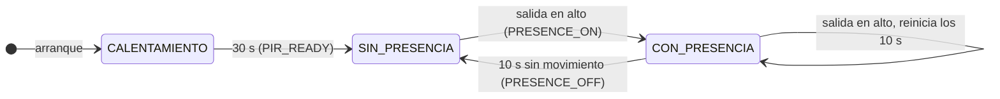
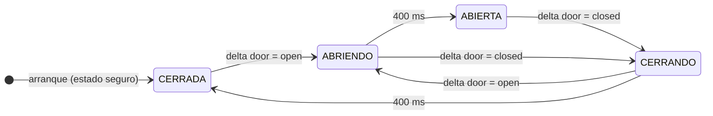
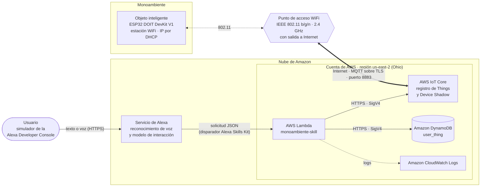

# Práctica 3 - Integración de Objetos Inteligentes con Alexa y AWS IoT Core

**Puerta inteligente de un monoambiente: sensor de presencia PIR y servomotor en un ESP32 sincronizados con un Device Shadow de AWS IoT Core y controlados por voz con una skill de Alexa**

|  |  |
| --- | --- |
| **Universidad** | Universidad Católica Boliviana “San Pablo” |
| **Carrera** | Ingeniería de Sistemas |
| **Asignatura** | SIS-234 Internet de las Cosas / 2-2026 |
| **Fecha de entrega** | 10 de noviembre de 2026 |
| **Repositorio** | [https://github.com/Andres004/ThirdProject-AWS-IoT](https://github.com/Andres004/ThirdProject-AWS-IoT) |
| **Grupo** | 1 |
| **Integrantes** | Ricardo Andres Andrade Vargas · Dabner Eliezer Orozco Veizaga |

---
## Resumen ejecutivo

_Pendiente (fase 9): arquitectura en pocas líneas, funcionamiento del sistema y tabla de cumplimiento de los requerimientos._

---
## Contenido

1. [Caso de uso y requerimientos](#1-caso-de-uso-y-requerimientos)
   - [1.1 Caso de uso y alcance](#11-caso-de-uso-y-alcance) · [1.2 Sensor y actuador](#12-justificación-del-sensor-y-el-actuador) · [1.3 Requerimientos funcionales](#13-requerimientos-funcionales) · [1.4 Requerimientos no funcionales](#14-requerimientos-no-funcionales) · [1.5 Matriz de trazabilidad](#15-matriz-de-trazabilidad)
2. [Análisis y diseño](#2-análisis-y-diseño)
   - [2.1 Arquitectura](#21-diagrama-de-arquitectura-del-sistema) · [2.2 Circuito](#22-diagrama-de-circuito) · [2.3 Clases](#23-diagramas-de-clases) · [2.4 Secuencia](#24-diagramas-de-secuencia) · [2.5 Shadow](#25-especificación-del-documento-shadow) · [2.6 Vinculación](#26-diseño-del-mecanismo-de-vinculación) · [2.7 Skill](#27-diseño-de-la-skill-de-alexa) · [2.8 Frecuencia de reporte](#28-frecuencia-de-reporte-y-consumo-de-mensajes)
3. [Desarrollo e implementación](#3-desarrollo-e-implementación)
   - [3.1 Entorno](#31-entorno-de-desarrollo) · [3.2 Repositorio](#32-estructura-del-repositorio) · [3.3 Módulos](#33-módulos-y-clases) · [3.4 AWS](#34-configuración-en-aws) · [3.5 Alexa](#35-configuración-en-alexa) · [3.6 Credenciales](#36-credenciales-y-secretos) · [3.7 Ejecución](#37-compilación-carga-y-despliegue) · [3.8 Fragmentos clave](#38-fragmentos-clave) · [3.9 Temporización](#39-temporización-sin-bloqueos) · [3.10 Logs](#310-registro-de-eventos-logs) · [3.11 Buenas prácticas](#311-buenas-prácticas-aplicadas) · [3.12 Cobertura](#312-cobertura-de-los-requerimientos)
4. [Pruebas y validaciones](#4-pruebas-y-validaciones)
   - [4.1 Plan de pruebas](#41-plan-de-pruebas) · [4.2 Físicas y de entorno](#42-a-pruebas-físicas-y-de-entorno) · [4.3 Automáticas](#43-b-pruebas-automáticas) · [4.4 Defectos corregidos](#44-defectos-encontrados-y-corregidos) · [4.5 Análisis de errores](#45-análisis-de-errores)
5. [Resultados](#5-resultados)
   - [5.1 Resultados consolidados](#51-resultados-consolidados) · [5.2 Análisis crítico](#52-análisis-crítico)
6. [Conclusiones](#6-conclusiones)
7. [Recomendaciones](#7-recomendaciones)
8. [Anexos](#8-anexos)

---

## 1. Caso de uso y requerimientos

### 1.1 Caso de uso y alcance

**Problema.** En un monoambiente la puerta de entrada es el único acceso. Quien vive solo no puede saber, si no está en casa, si alguien está en la puerta, si la dejó cerrada, ni abrirla para dejar entrar a un familiar o a un repartidor.

**Solución.** Un objeto inteligente montado en la puerta (una maqueta) la abre y la cierra con un servomotor y detecta con un sensor PIR si hay una persona en la entrada. El usuario lo maneja por voz desde una skill de Alexa:

- _"Alexa, abre monoambiente inteligente."_
- _"¿Hay alguien en la puerta?"_ → "Sí, se detecta a alguien en la entrada."
- _"Abre la puerta."_ → "Listo, la puerta está abierta."
- _"¿Cómo está la puerta?"_ → "La puerta está cerrada."

**Componentes del sistema**

| Sigla | Componente | Implementación | Función |
|---|---|---|---|
| OI | Objeto inteligente | ESP32 DOIT DevKit V1 + sensor PIR AM312 + servomotor SG90 + LED de estado | Detecta presencia, mueve la puerta y sincroniza su estado con el Shadow por MQTT sobre TLS ([src/](src/)) |
| SH | Device Shadow | Shadow clásico del Thing `monoambiente-<código>` en AWS IoT Core, región `us-east-2` | Guarda el estado deseado (`desired`) que escribe la Lambda y el estado reportado (`reported`) que publica el OI |
| L | Backend de la skill | Función AWS Lambda `monoambiente-skill`, Python 3.14 ([lambda_function.py](lambda/lambda_function.py)) | Interpreta cada intent, resuelve el Thing del usuario y lee o escribe su Shadow |
| DB | Registro de vinculaciones | Tabla DynamoDB `user_thing` ([definición](aws/dynamodb-table.md)) | Relaciona cada `userId` de Alexa con su Thing |
| AX | Frontend de voz | Skill de Alexa "monoambiente inteligente", Spanish (US), usada desde el simulador de pruebas ([modelo](alexa/interaction-model.es-US.json)) | Convierte la voz o el texto del usuario en intents y slots |

**Alcance.**

- **Alexa nunca se comunica con el OI.** Toda interacción pasa por el Shadow: la Lambda solo escribe `desired` y solo lee `reported`; el OI solo publica `reported` y solo recibe `delta`. Si el OI está apagado, la orden queda guardada en el Shadow y se aplica cuando vuelve.
- **La skill atiende a varios usuarios.** Cada usuario vincula su propio objeto con un código de 6 dígitos, y la Lambda resuelve en cada solicitud el Thing de ese usuario. Se probó con dos Things: `monoambiente-739264`, con el hardware, y `monoambiente-518306`, sin hardware.
- **Lógica de control.** El actuador se controla únicamente por voz. No hay una regla local sensor → actuador; el valor del sensor se reporta al Shadow para consultarlo desde Alexa.
- **Extensible.** Cada sensor o actuador es una clase que implementa la interfaz `DeviceComponent` y se registra en el arreglo `components[]` de [main.cpp](src/main.cpp). Agregar uno nuevo no cambia el código del Shadow ni del reporte (§2.3.1).
- **Fuera de alcance.** El Account Linking (OAuth) de Alexa, como establece la consigna, y una puerta o cerradura real: el servo mueve una maqueta.

### 1.2 Justificación del sensor y el actuador

| Elemento | Componente | Por qué este componente | Datos de operación (constantes de [config.h](include/config.h)) |
|---|---|---|---|
| Sensor | PIR AM312 | Detecta a una persona por su radiación infrarroja al moverse, que es lo que responde a la pregunta "¿hay alguien en la puerta?". Su salida es digital de 3.3 V, así que se conecta directo a un GPIO del ESP32 sin divisor de tensión, y consume muy poco. | Salida en GPIO26 con *pull-down* interno; lectura cada 50 ms (`POLL_PERIOD_MS`); 30 s de calentamiento al arrancar (`WARMUP_MS`); presencia retenida 10 s después del último movimiento (`PRESENCE_HOLD_MS`). |
| Actuador | Servomotor SG90 | Mueve la hoja de la puerta a una posición controlada (cerrada o abierta) sin sensores adicionales. Funciona con 5 V, dentro del límite de 12 V DC de la consigna, y no conmuta cargas de 220 V AC. | Señal PWM de 50 Hz en GPIO13; 0° = cerrada (`CLOSED_ANGLE_DEG`), 90° = abierta (`OPEN_ANGLE_DEG`); 400 ms por movimiento (`SETTLE_TIME_MS`); arranca cerrada. |
| Indicador | LED en GPIO32 | **No es el actuador**: solo muestra el estado de la conexión (parpadeo rápido sin WiFi, lento sin Shadow, fijo en línea). | Medio período de 200 ms sin WiFi y 1000 ms sin MQTT. |

**Tratamiento de las limitaciones del sensor.**

- **El PIR detecta movimiento, no presencia quieta.** Una persona parada frente a la puerta deja de moverse y la salida del sensor vuelve a nivel bajo. Por eso `presence` se mantiene en `true` hasta 10 s después del último movimiento: alguien que espera en la entrada no "desaparece" entre dos movimientos.
- **El PIR necesita estabilizarse al encenderse.** Durante los primeros 30 s su salida no es confiable, así que el firmware la ignora y recién entonces registra `PIR_READY`. Mientras tanto reporta `presence = false`.
- **Su exactitud es una tasa de detección.** Al ser un sensor binario, su exactitud no se expresa en una unidad sino como el porcentaje de cruces detectados y la cantidad de falsos positivos (RNF2).

**Componentes descartados.**

- **Sensor ultrasónico (HC-SR04).** La consigna lo permite solo si el caso de uso lo requiere. Este caso no mide distancias, sino la presencia de una persona, así que no se usó.
- **LED como actuador.** Lo prohíbe la consigna; el único LED del objeto es un indicador de conexión.
- **Cerradura solenoide o motor a 220 V.** Un solenoide de 12 V necesitaría un MOSFET y una fuente aparte; una carga de 220 V está prohibida. Para la maqueta, el servo es suficiente y seguro. El solenoide queda como extensión hacia un uso real (§7).

**Comportamiento del sensor y del actuador.** Las figuras muestran las dos máquinas de estados del firmware, implementadas en [PresenceSensor.cpp](src/PresenceSensor.cpp) y [DoorActuator.cpp](src/DoorActuator.cpp).

**Figura 1.** Estados del sensor de presencia. Cada cambio entre `SIN_PRESENCIA` y `CON_PRESENCIA` pide un reporte al Shadow (`presence = false` o `true`).

**Figura 2.** Estados de la puerta. `reported.door` cambia recién al terminar los 400 ms del movimiento, así el Shadow nunca confirma una posición que el servo todavía no alcanzó. Una orden contraria durante el movimiento lo invierte. Una orden igual a la posición actual no mueve el servo, solo confirma el estado, y un valor distinto de `open` o `closed` se rechaza (`INVALID_VALUE`) sin cambiar de estado.

### 1.3 Requerimientos funcionales

RF1 a RF9 responden a los requerimientos mínimos de la consigna (§3.1). RF10 a RF12 son propios del grupo: se agregaron porque cierran casos que la consigna deja abiertos y que afectan a la confiabilidad del sistema: que el usuario sepa si la orden realmente se cumplió, que sepa si el objeto está desconectado y que una orden inválida o repetida no mueva la puerta.

| ID | Requerimiento | Criterio de aceptación |
| --- | --- | --- |
| RF1 | Detectar presencia en la entrada con el PIR AM312. | `PRESENCE_ON` al detectar movimiento, después de 30 s de calentamiento (`PIR_READY`). `presence` se mantiene `true` 10 s después del último movimiento. |
| RF2 | Reportar periódicamente `presence`, `door` y `servo_angle` en `reported`. | Cada reporte trae los tres atributos. Con la conexión activa, nunca pasan más de 61.5 s entre dos reportes (heartbeat de 60 s). |
| RF3 | Aplicar el `delta` en el servo y confirmarlo en `reported`. | Un `delta` válido mueve el servo y su posición aparece en `reported` en ≤ 1.5 s desde `DELTA_RX`. |
| RF4 | Responder por voz el valor del sensor, leyendo `reported`. | "Sí, se detecta a alguien…" o "No, no se detecta…", según `reported.presence`, nunca según `desired`. |
| RF5 | Ejecutar por voz abrir y cerrar, escribiendo `desired`. | `desired.door` cambia a `open` o `closed` en el Shadow del Thing del usuario. |
| RF6 | Responder por voz el estado de la puerta. | "La puerta está abierta/cerrada" según `reported.door`; si `desired` difiere, menciona la orden pendiente. |
| RF7 | Vincular con un código y que la vinculación persista entre sesiones. | El ítem `userId → thingName, fechaVinculacion` queda en DynamoDB y la skill lo usa al volver a abrirla. |
| RF8 | Resolver el Thing de cada usuario por su `userId`. | Un usuario sin vincular recibe la guía para hacerlo; dos usuarios vinculados a Things distintos solo actúan sobre el suyo. |
| RF9 | Validar el Thing antes de vincular y permitir cambiar o eliminar la vinculación. | Un código inválido o un Thing inexistente no se guarda; volver a vincular reemplaza el ítem; desvincular lo borra. |
| RF10 | Confirmar al usuario que la puerta se movió. | Tras un comando, la Lambda espera `reported.door` hasta 3 s y dice "Listo, la puerta está abierta/cerrada"; si no llega, dice que no recibió confirmación. |
| RF11 | Avisar cuando el objeto está desconectado. | Si el último reporte tiene más de 150 s, las consultas lo advierten y los comandos avisan que se aplicarán al reconectarse. |
| RF12 | Rechazar comandos inválidos y repetidos sin mover el servo. | Un valor fuera de `open`/`closed`, un JSON mal formado o un `delta` con versión repetida o anterior quedan registrados (`INVALID_VALUE`, `JSON_ERROR`, `STALE_IGNORED`) y el servo no se mueve. |

### 1.4 Requerimientos no funcionales

| ID | Atributo | Valor declarado | Método de verificación | Prueba |
|---|---|---|---|---|
| RNF1 | Estabilidad | ≥ 15 min continuos con 0 reinicios, 0 caídas de WiFi o MQTT, iteración de `loop()` ≤ 500 ms y pérdida de heap libre ≤ 4096 bytes entre la primera y la última línea `HEALTH`. | Líneas `HEALTH` (cada 60 s) y `BOOT`/`RESET_REASON` del log del OI. | A10 |
| RNF2 | Exactitud del sensor y del actuador | PIR: detección del 100 % de los cruces de una persona a 0.5, 1.0 y 2.0 m (5 cruces por distancia) y 0 falsos positivos en 5 min sin personas. Servo: error ≤ 5° respecto de un transportador en 0° y 90°. | Conteo de `PRESENCE_ON` por distancia medida con cinta métrica; ángulo medido con transportador en fotos. | A06 |
| RNF3 | Tiempo de respuesta extremo a extremo | ≤ 3 s desde que la Lambda recibe el comando hasta que la puerta está confirmada en `reported`, en ≥ 20 comandos. | `confirm_ms` de la Lambda (un solo reloj) y, de forma cruzada, `DELTA_RX` y `ACTUATOR_DONE` del OI con hora NTP. | A05 |
| RNF4 | Frecuencia de reporte | Por evento: ≤ 1.1 s desde el cambio de estado. Periódico: cada 60 s (máx. 61.5 s entre reportes). Consumo: alrededor de 1440 mensajes por día en reposo. | Intervalos entre `REPORT_TX` del log del OI y prueba automática B02. | A10, B02 |
| RNF5 | Reconexión y sincronización | El WiFi reintenta cada 10 s ± 0.5 s; tras recuperar la red, la orden pendiente se aplica en ≤ 10 s desde `WIFI_CONNECTED`, sin intervención. | Secuencia `WIFI_LOST` → `WIFI_CONNECTED` → `MQTT_CONNECTED` → `GET_RX` → `ACTUATOR_DONE` del log del OI. | A07, A08 |
| RNF6 | Seguridad | 0 secretos en los archivos del repositorio y en todo su historial; archivos de secretos ignorados por git; plantilla publicada. | [tools/check_secrets.py](tools/check_secrets.py), con un control positivo sobre el `secrets.h` real. | B03 |

Justificación de los valores declarados:

- **RNF1 (≥ 15 min):** supera la referencia de 10 min de la consigna. El límite de 500 ms para `loop()` asegura que el PIR se lea y el LED parpadee a tiempo; el de 4096 bytes de heap detecta una fuga de memoria que en una corrida corta no llegaría a reiniciar la placa.
- **RNF2 (0.5 a 2.0 m):** es la zona frente a la puerta de un monoambiente donde se para quien llega. El ±5° del servo es lo que una puerta de maqueta tolera sin quedar entreabierta.
- **RNF3 (≤ 3 s):** es la referencia de la consigna. El servo tarda 400 ms (`SETTLE_TIME_MS`), así que el resto del presupuesto queda para la nube y la red. Se mide hasta la confirmación en `reported`, no hasta la escritura de `desired`, porque eso es lo que el usuario escucha (RF10).
- **RNF4 (evento ≤ 1.1 s, heartbeat 60 s):** la puerta y la presencia son eventos discretos, así que se reportan de inmediato, en el orden de 1 s que pide la consigna. El mínimo de 1 s entre reportes (`MIN_REPORT_INTERVAL_MS`) evita ráfagas si el PIR oscila, y por eso el límite es 1.1 s y no menos. El heartbeat de 60 s da 1440 mensajes por día en reposo; uno de 10 s daría 8640, seis veces más, sin ganar nada, porque los cambios ya se reportan por evento (§2.8).
- **RNF5 (≤ 10 s):** después de `WIFI_CONNECTED` quedan la conexión TLS y MQTT, la espera de 0.5 s antes de pedir el Shadow (`GET_AFTER_SUBSCRIBE_MS`) y los 400 ms del servo. El reintento de WiFi cada 10 s es `WIFI_RETRY_INTERVAL_MS`.
- **RNF6:** la consigna prohíbe publicar certificados, claves y credenciales WiFi, y prohíbe las access keys de AWS en el código; la prueba revisa también el historial, porque un secreto borrado en un commit posterior sigue publicado.
- **RF11 (150 s):** 2.5 heartbeats tolera un mensaje perdido más el tiempo de una reconexión, sin dar por desconectado un objeto que solo se demoró.

### 1.5 Matriz de trazabilidad

| Requisito | Diseño | Implementación | Prueba | Resultado |
|---|---|---|---|---|
| RF1 Detectar presencia | §1.2 (Figura 1); §2.2 circuito | [PresenceSensor.cpp](src/PresenceSensor.cpp): `PresenceSensor::update()` | A03, A06 | Cumple: 15 de 15 cruces detectados (A06); 8 de 8 consultas coinciden con el PIR (A03) |
| RF2 Reporte periódico | §2.5 Shadow; §2.8 frecuencia | [ShadowReporter.cpp](src/ShadowReporter.cpp): `ShadowReporter::update()`; `fillReported()` de cada componente | A10, B02 | Cumple: 115 de 115 reportes con los tres atributos; máx. 59 999 ms entre reportes (A10) |
| RF3 Aplicar el `delta` | §1.2 (Figura 2); §2.4.3; §2.5 | [ShadowTransport.cpp](src/ShadowTransport.cpp): `handleDelta()`; [DoorActuator.cpp](src/DoorActuator.cpp): `applyDesired()`, `update()` | A04, A09, A10, B02 | Cumple: 30 de 30 `delta` confirmados en `reported`, mediana 416 ms y máx. 1169 ms (A10) |
| RF4 Consulta del sensor | §2.4.2; §2.7 skill | [lambda_function.py](lambda/lambda_function.py): `GetPresenceHandler.handle_thing()` | A03, B01 | Cumple: 8 de 8 respuestas correctas (A03) |
| RF5 Comando por voz | §2.4.3; §2.7 | `DoorCommandHandler.handle_thing()`; `ThingGateway.set_desired_door()` | A04, A05, B01 | Cumple: 6 de 6 (A04) y 28 de 28 (A05) |
| RF6 Estado de la puerta | §2.4.3; §2.7 | `GetDoorStateHandler.handle_thing()` | A04, A09, B01 | Cumple: responde según `reported` y no anuncia una orden inválida como pendiente (A09) |
| RF7 Vinculación persistente | §2.4.1; §2.6 vinculación | `LinkThingHandler.handle()`; `LinkRepository.save()` | A01, B01 | Cumple: 13 de 13 respuestas; la vinculación persistió en una sesión nueva (A01) |
| RF8 Thing por usuario | §2.6 | `LinkedThingHandler.handle()`; `LinkRepository.find_thing()` | A01, A02, B01 | Cumple: el comando del segundo usuario solo modificó `monoambiente-518306` (A02) |
| RF9 Validar, cambiar y eliminar | §2.4.1; §2.6 | `parse_link_code()`; `ThingGateway.exists()`; `UnlinkThingHandler.handle()` | A01, B01 | Cumple: 0 datos inválidos guardados; cambio y desvinculación correctos (A01) |
| RF10 Confirmación al usuario | §2.4.3 | `ThingGateway.wait_for_door()` | A04, A05, A08, B01 | Cumple: 28 de 28 comandos confirmados (A05) |
| RF11 Aviso de desconexión | §2.4.4 | `ShadowState.online`; `ShadowState.offline_note()` | A02, A07, B01 | Cumple: aviso con 2 y 3 min sin reportes; orden encolada (A07) |
| RF12 Comandos inválidos o repetidos | §2.5 | `DoorActuator::applyDesired()`; `ShadowTransport::acceptVersion()` | A09, B02 | Cumple: 3 de 3 valores inválidos sin movimiento (A09); 16 de 16 casos (B02) |
| RNF1 Estabilidad | §3.9 temporización | `loop()` de [main.cpp](src/main.cpp); [HealthMonitor.cpp](src/HealthMonitor.cpp) | A10 | Cumple: 27.3 min, 0 reinicios, 0 caídas, `loop()` máx. 21 ms, 0 bytes de heap perdidos |
| RNF2 Exactitud | §1.2 | `PresenceSensor`; `DoorActuator` (`CLOSED_ANGLE_DEG`, `OPEN_ANGLE_DEG`) | A06 | PIR cumple: 15 de 15 y 0 falsos positivos en 5.0 min. Servo: pendiente de medición |
| RNF3 Tiempo de respuesta | §2.4.3 | `DoorCommandHandler.handle_thing()`; `SETTLE_TIME_MS` | A05 | Cumple: 28 de 28; confirmación mediana 919 ms y máx. 1691 ms |
| RNF4 Frecuencia de reporte | §2.8 | `ShadowReporter` (`MIN_REPORT_INTERVAL_MS`, `HEARTBEAT_PERIOD_MS`) | A03, A10, B02 | Cumple: evento máx. 804 ms (A10) y 254 ms (A03); heartbeat 60 000 ms (B02) |
| RNF5 Reconexión | §2.4.4 | [WifiManager.cpp](src/WifiManager.cpp); [ShadowClient.cpp](src/ShadowClient.cpp): `onConnected()`, `requestShadowIfDue()` | A07, A08 | Cumple: orden pendiente aplicada 3297–3848 ms después de `WIFI_CONNECTED` (A07) y 3.9 s después del arranque (A08) |
| RNF6 Seguridad | §3.6 credenciales | [.gitignore](.gitignore); [secrets.example.h](include/secrets.example.h); [check_secrets.py](tools/check_secrets.py) | B03 | Cumple: 0 secretos en 149 archivos y en el historial |

---

## 2. Análisis y diseño

### 2.1 Diagrama de arquitectura del sistema

La arquitectura se muestra en dos vistas: el despliegue físico y en la nube (Figura 3a) y los componentes de software con sus interfaces (Figura 3b).

**Figura 3a.** Despliegue. El objeto inteligente es una estación WiFi que sale a Internet por el punto de acceso de la casa (en las pruebas, el hotspot de un celular) y mantiene una conexión MQTT sobre TLS con AWS IoT Core. El usuario no se conecta al objeto: habla con el servicio de Alexa, que invoca a la Lambda. IoT Core, Lambda y DynamoDB están en la misma cuenta y en la misma región, `us-east-2`.

**Figura 3b.** Componentes e interfaces. La Lambda es el único componente que escribe `desired`, y el objeto inteligente es el único que escribe `reported`. Las dos partes nunca se comunican directamente: la Lambda trabaja sobre el Shadow por la API HTTPS de AWS IoT, y el objeto recibe los cambios por MQTT cuando el Shadow publica el `delta`.

| Nodo | Hardware o servicio | Software | Rol en la comunicación | Dirección, puerto y protocolo | Autenticación | Registro de eventos |
|---|---|---|---|---|---|---|
| Objeto inteligente | ESP32 DOIT DevKit V1 + PIR AM312 + servo SG90 | Firmware C++ (Arduino-ESP32), entorno `esp32doit-devkit-v1` de PlatformIO | Cliente MQTT: abre y mantiene la conexión; se suscribe a los temas de su Shadow con QoS 1 y publica `reported` | Endpoint ATS de AWS IoT de la cuenta (`xxxxxxxx-ats.iot.us-east-2.amazonaws.com`), puerto 8883, MQTT 3.1.1 sobre TLS; client ID = nombre del Thing | Certificado X.509 del dispositivo y su clave privada (TLS mutuo); CA raíz de Amazon | Monitor serie a 115200 baud con hora UTC por NTP, guardado con `log2file` |
| AWS IoT Core | Servicio administrado | Registro de Things y Device Shadow clásico | Broker MQTT y API de datos HTTPS del Shadow | Temas `$aws/things/<thing>/shadow/...` | Política de IoT asociada al certificado | — |
| Lambda | Servicio administrado | [lambda_function.py](lambda/lambda_function.py), Python 3.14, ASK SDK | Backend de la skill: recibe una solicitud por intent y responde con el texto que dice Alexa | API de AWS IoT, API de datos del Shadow y API de DynamoDB, por HTTPS | Rol IAM de la función (credenciales temporales, sin access keys en el código); el disparador verifica el Skill ID | CloudWatch Logs: una línea JSON `SKILL_REQUEST` por solicitud |
| DynamoDB | Servicio administrado | Tabla `user_thing` | Almacena la vinculación de cada usuario | Acceso por clave (`userId`) | Rol IAM de la Lambda | — |
| Skill de Alexa | Alexa Developer Console | [Modelo de interacción](alexa/interaction-model.es-US.json), invocación "monoambiente inteligente" | Frontend de voz; envía a la Lambda el intent, los slots y el `userId` | Endpoint = ARN de la Lambda | Cuenta de desarrollador de Amazon | Pestaña de pruebas (JSON de entrada y salida) |

#### Recorrido de un comando por las capas

| Capa | En este sistema |
|---|---|
| Aplicación | Del lado de Alexa: la solicitud JSON con el intent y el `userId`, y la respuesta con el texto o SSML que dice Alexa. Del lado del objeto: los documentos JSON del Shadow (`desired`, `reported`, `delta`) sobre MQTT, en los temas `$aws/things/<thing>/shadow/...` (§2.5). |
| Seguridad | TLS 1.2. El objeto se autentica con su certificado X.509 y verifica al servidor con la CA raíz de Amazon (TLS mutuo). La Lambda firma cada llamada a AWS con SigV4 usando las credenciales temporales de su rol. |
| Transporte | TCP. Una conexión persistente del objeto al puerto 8883, con *keep-alive* MQTT de 60 s; conexiones HTTPS (puerto 443) de la Lambda a los servicios de AWS. |
| Internet | IPv4. El objeto resuelve por DNS el nombre del endpoint ATS y llega a AWS a través del punto de acceso y de Internet. |
| Acceso a la red | WiFi IEEE 802.11 b/g/n en 2.4 GHz, en modo estación (STA), con el ahorro de energía del módem desactivado para no retrasar la llegada de los `delta` ([WifiManager.cpp](src/WifiManager.cpp)). |

Recorrido de la orden _"abre la puerta"_:

1. **Alexa.** El servicio de Alexa reconoce el intent `OpenDoor` y envía a la Lambda una solicitud JSON con el intent y el `userId` del usuario.
2. **Vinculación.** La Lambda busca en DynamoDB el Thing de ese usuario (`GetItem`) y lee su Shadow (`GetThingShadow`) para saber si la puerta ya está abierta y si el objeto está en línea.
3. **Estado deseado.** La Lambda escribe `{"state":{"desired":{"door":"open"}}}` con `UpdateThingShadow`, por HTTPS.
4. **Delta.** Como `desired.door` difiere de `reported.door`, AWS IoT publica el `delta` en `$aws/things/monoambiente-739264/shadow/update/delta`. El broker lo entrega por la conexión MQTT ya abierta: el objeto no consulta, recibe.
5. **Objeto.** El objeto descarta el `delta` si su versión es repetida o anterior, mueve el servo a 90° y, terminados los 400 ms, publica `{"state":{"reported":{"door":"open","servo_angle":90,"presence":…}}}` en el tema `update`.
6. **Confirmación.** Mientras tanto, la Lambda lee el Shadow cada 250 ms, durante 3 s como máximo. Cuando `reported.door` es `open`, responde "Listo, la puerta está abierta.".

Hay dos confirmaciones distintas: la respuesta de `UpdateThingShadow` solo indica que AWS guardó el estado deseado; `reported.door` indica que el objeto ya movió la puerta. La skill solo dice "Listo" con la segunda (RF10).

#### Por qué esta arquitectura

- **Device Shadow.** Desacopla a Alexa del objeto: la Lambda no necesita que el objeto esté conectado para dar una orden, porque `desired` queda guardado en el Shadow y el objeto lo aplica al volver (RNF5). También guarda el último `reported`, así una consulta se responde aunque el objeto no esté enviando nada en ese momento.
- **MQTT sobre una conexión persistente.** El `delta` llega al objeto en cuanto AWS lo publica, sin que el objeto pregunte periódicamente. Un objeto que consultara por HTTP cada pocos segundos tardaría más en reaccionar y gastaría muchos más mensajes.
- **TLS mutuo con certificado X.509.** El objeto se identifica con su propio certificado, revocable por separado, y no lleva access keys de AWS, como exige la consigna. Las suscripciones usan QoS 1, así un `delta` perdido se reentrega; el número de versión del documento evita aplicarlo dos veces (RF12).
- **Lambda.** No hay un servidor propio que mantener encendido; la función se ejecuta solo cuando llega una solicitud, toma sus permisos del rol IAM y está dentro de la capa gratuita.
- **DynamoDB.** Cada solicitud necesita una sola lectura por clave (`userId`), una operación de costo constante, también incluida en la capa gratuita.
- **El costo** es la dependencia de Internet y de AWS: sin conexión, el objeto no recibe órdenes nuevas ni actualiza su estado. Se mitiga con la reconexión automática y la sincronización con el Shadow al volver (RNF5), con el aviso de desconexión de RF11 y con la puerta cerrada como estado seguro al arrancar.

### 2.2 Diagrama de circuito

#### 2.2.1 Esquema eléctrico

**Figura 4.** Esquema eléctrico del objeto inteligente. El servo se alimenta con 5 V desde el pin VIN, que recibe la tensión del USB, y recibe la señal PWM por GPIO13. El PIR se alimenta con 3.3 V y entrega su salida digital en GPIO26. El LED de estado, en serie con su resistencia, va de GPIO32 a GND. Todas las tierras son comunes.

| Componente | Pin del componente | Conexión | Pin del ESP32 | Constante en el código |
|---|---|---|---|---|
| Servo SG90 | Señal (cable naranja) | Directa | D13 (GPIO13) | `config::pins::SERVO_SIGNAL = 13` |
| Servo SG90 | V+ (cable rojo) | Directa | VIN (5 V del USB) | — |
| Servo SG90 | GND (cable marrón) | Directa | GND | — |
| PIR AM312 | OUT | Directa; entrada con *pull-down* interno | D26 (GPIO26) | `config::pins::PIR_OUTPUT = 26` |
| PIR AM312 | VCC | Directa | 3V3 | — |
| PIR AM312 | GND | Directa | GND | — |
| LED de estado | Ánodo | A través de una resistencia de 220–330 Ω | D32 (GPIO32) | `config::pins::STATUS_LED = 32` |
| LED de estado | Cátodo | Directa | GND | — |

- **Señal del servo.** [DoorActuator.cpp](src/DoorActuator.cpp) genera con la librería ESP32Servo una señal de 50 Hz (`PWM_FREQUENCY_HZ`) con pulsos de 500 µs para 0° a 2400 µs para 180° (`PULSE_MIN_US`, `PULSE_MAX_US`). Para 0° (cerrada) el pulso es de 500 µs y para 90° (abierta), de 500 + 1900 × 90 / 180 = 1450 µs. El servo interpreta un pulso de 3.3 V como nivel alto, así que la señal no necesita adaptación.
- **Salida del PIR.** El AM312 alimentado con 3.3 V entrega 3.3 V en alto, el nivel lógico del ESP32, por eso no hace falta el divisor de tensión que necesitaba el HC-SR04 en la práctica anterior. [PresenceSensor.cpp](src/PresenceSensor.cpp) configura GPIO26 como `INPUT_PULLDOWN`: si el cable del sensor se suelta, la entrada queda en bajo y el objeto informa "sin presencia" en lugar de presencias falsas.
- **Corriente del LED.** I = (3.3 V − Vf) / R. Para un LED con Vf ≈ 2.0 V, entre 3.9 mA (330 Ω) y 5.9 mA (220 Ω), muy por debajo de los 20 mA recomendados por pin.

#### 2.2.2 Pines y alimentación

- **Pines.** El objeto usa GPIO13, GPIO26 y GPIO32. No son pines de arranque (*strapping*: 0, 2, 5, 12 y 15), no están conectados a la memoria flash (6 a 11) y no son de solo entrada (34 a 39). Los tres se usan como entradas o salidas digitales: el ADC2 que comparten GPIO13 y GPIO26 no se usa, así que no hay conflicto con el WiFi.
- **Alimentación.** La placa se alimenta por USB. El servo toma 5 V del pin VIN, es decir, directamente del USB, y no del regulador de 3.3 V de la placa. El PIR consume muy poco y se alimenta de 3V3. Toda la tensión del circuito es de 5 V o menos, dentro del límite de 12 V DC de la consigna, y ningún componente conmuta 220 V AC.
- **Riesgo del servo.** Al arrancar un movimiento, el servo pide un pico de corriente que comparte el USB con el ESP32. Si la tensión cayera demasiado, el ESP32 se reiniciaría por *brownout*. No ocurrió en las pruebas: el firmware registra el motivo de cada reinicio (`RESET_REASON`) y los logs de A04, A07, A09 y A10 registran 36 movimientos del servo sin ningún reinicio, y la placa llegó a funcionar 83 min seguidos sin reiniciarse (A10, §4). Para un uso real se recomienda una fuente de 5 V aparte para el servo, con la tierra común (§7).
- **Estado seguro.** Al arrancar, [DoorActuator.cpp](src/DoorActuator.cpp) lleva el servo a 0° (puerta cerrada) antes de conectarse a la red. Si se corta la energía, la puerta queda cerrada al volver, y recién después se aplica la orden que esté pendiente en el Shadow (A08).

#### 2.2.3 Montaje real

_Pendiente: foto del montaje real del objeto inteligente y la maqueta de la puerta (Figura 5)._

### 2.3 Diagramas de clases

#### 2.3.1 Firmware del objeto inteligente (ESP32)

_Pendiente (fase 3)._

#### 2.3.2 Función Lambda (backend de la skill)

_Pendiente (fase 3)._

### 2.4 Diagramas de secuencia

#### 2.4.1 Vinculación de un Thing

_Pendiente (fase 4)._

#### 2.4.2 Consulta del sensor

_Pendiente (fase 4)._

#### 2.4.3 Comando sobre el actuador

_Pendiente (fase 4)._

#### 2.4.4 Reconexión y aplicación del estado pendiente

_Pendiente (fase 4)._

### 2.5 Especificación del documento Shadow

_Pendiente (fase 5)._

### 2.6 Diseño del mecanismo de vinculación

_Pendiente (fase 5)._

### 2.7 Diseño de la skill de Alexa

_Pendiente (fase 5)._

### 2.8 Frecuencia de reporte y consumo de mensajes

_Pendiente (fase 5)._

---

## 3. Desarrollo e implementación

### 3.1 Entorno de desarrollo

_Pendiente (fase 6)._

### 3.2 Estructura del repositorio

_Pendiente (fase 6)._

### 3.3 Módulos y clases

_Pendiente (fase 6)._

### 3.4 Configuración en AWS

_Pendiente (fase 6): Thing, certificados, política de AWS IoT, función Lambda, tabla de DynamoDB y rol IAM, con la justificación de los permisos asignados y los permisos mínimos._

### 3.5 Configuración en Alexa

_Pendiente (fase 6): modelo de interacción y vinculación con la función Lambda._

### 3.6 Credenciales y secretos

_Pendiente (fase 6)._

### 3.7 Compilación, carga y despliegue

_Pendiente (fase 6)._

### 3.8 Fragmentos clave

_Pendiente (fase 6)._

### 3.9 Temporización sin bloqueos

_Pendiente (fase 6)._

### 3.10 Registro de eventos (logs)

_Pendiente (fase 6)._

### 3.11 Buenas prácticas aplicadas

_Pendiente (fase 6)._

### 3.12 Cobertura de los requerimientos

_Pendiente (fase 6)._

---

## 4. Pruebas y validaciones

### 4.1 Plan de pruebas

_Pendiente (fase 7)._

### 4.2 A. Pruebas físicas y de entorno

#### A01. Vinculación, cambio y desvinculación por voz

_Pendiente (fase 7)._

#### A02. Dos usuarios con Things distintos

_Pendiente (fase 7)._

#### A03. Consulta del sensor por voz

_Pendiente (fase 7)._

#### A04. Comandos y estado de la puerta

_Pendiente (fase 7)._

#### A05. Tiempo de respuesta extremo a extremo

_Pendiente (fase 7)._

#### A06. Exactitud del PIR y del servo

_Pendiente (fase 7)._

#### A07. Caída de WiFi con orden pendiente

_Pendiente (fase 7)._

#### A08. Corte de energía con orden pendiente

_Pendiente (fase 7)._

#### A09. Comandos inválidos desde AWS

_Pendiente (fase 7)._

#### A10. Estabilidad

_Pendiente (fase 7)._

### 4.3 B. Pruebas automáticas

#### B01. Pruebas unitarias de la Lambda

_Pendiente (fase 7)._

#### B02. Firmware con transporte serie

_Pendiente (fase 7)._

#### B03. Secretos en el repositorio

_Pendiente (fase 7)._

### 4.4 Defectos encontrados y corregidos

_Pendiente (fase 7)._

### 4.5 Análisis de errores

_Pendiente (fase 7)._

---

## 5. Resultados

### 5.1 Resultados consolidados

_Pendiente (fase 8)._

### 5.2 Análisis crítico

_Pendiente (fase 8)._

---

## 6. Conclusiones

_Pendiente (fase 8)._

---

## 7. Recomendaciones

_Pendiente (fase 8)._

---

## 8. Anexos

_Pendiente (fase 9)._
