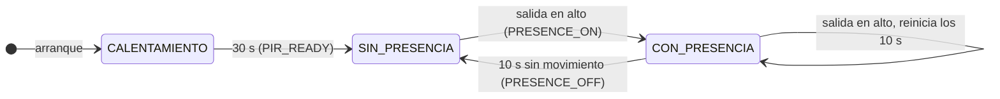
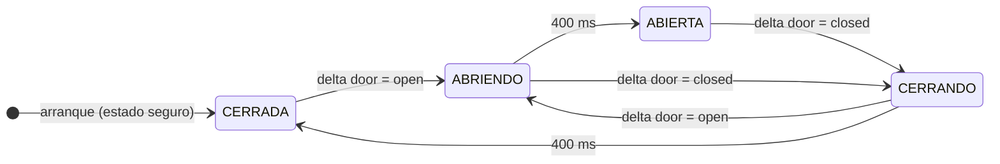
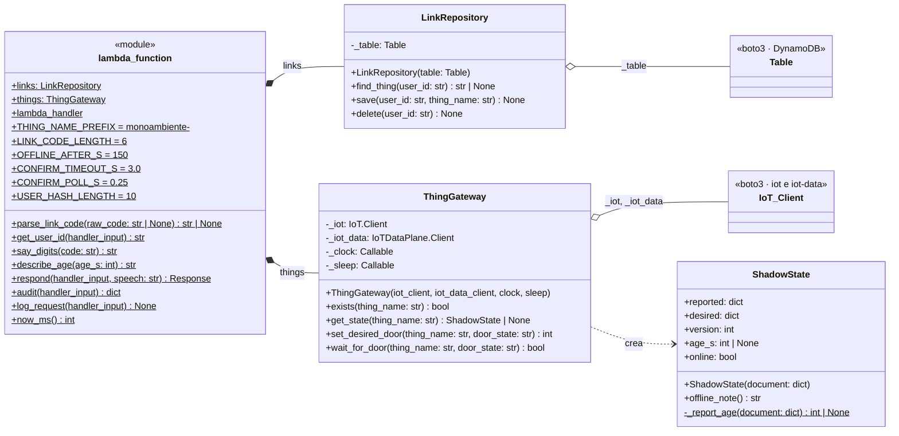
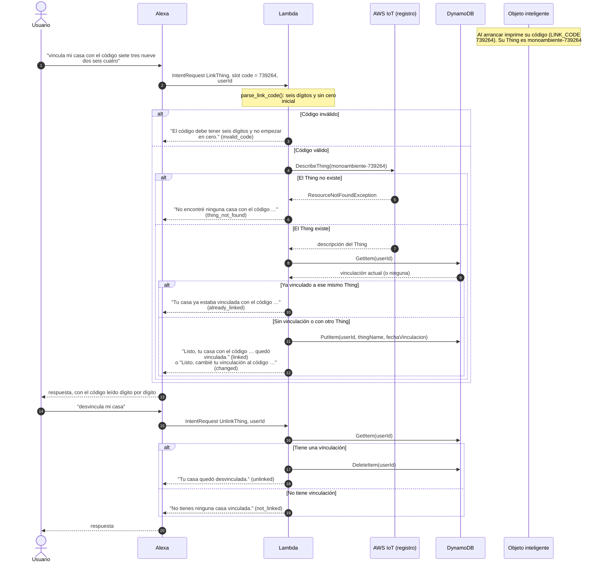
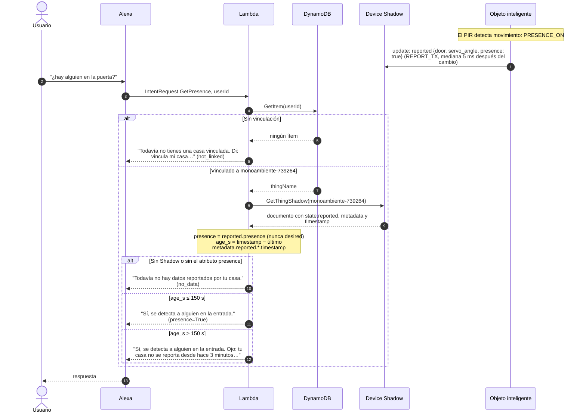
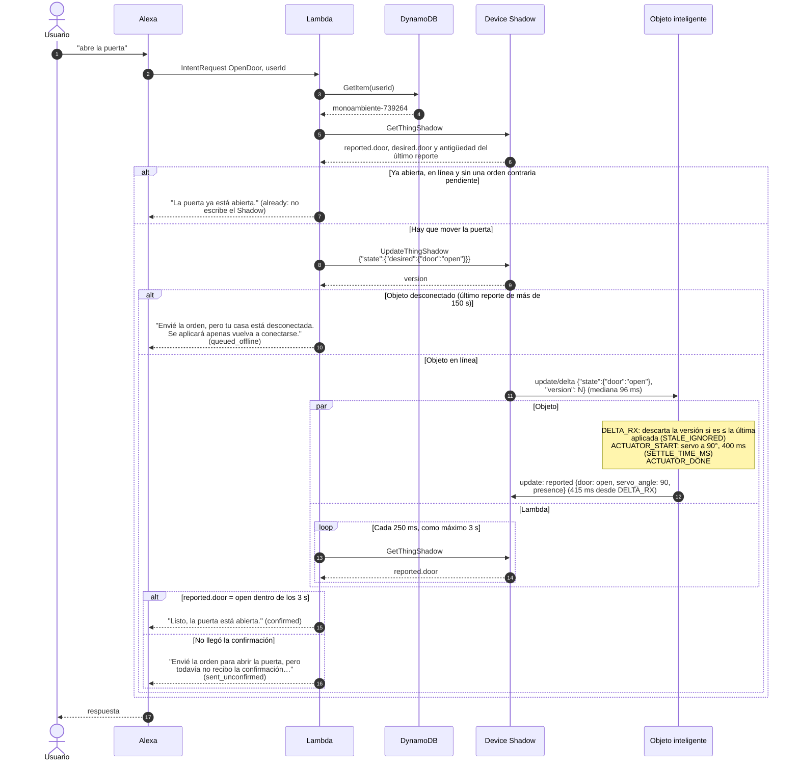
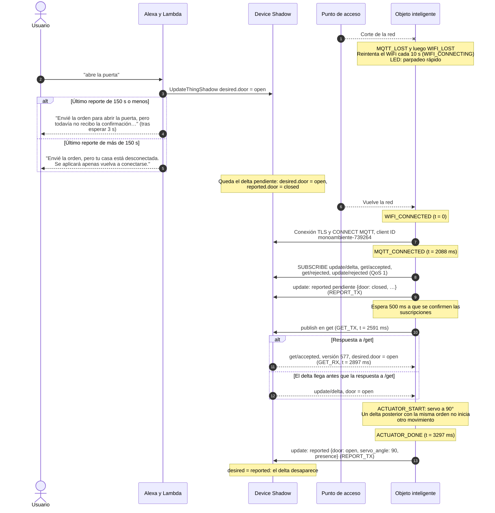

# Práctica 3 - Integración de Objetos Inteligentes con Alexa y AWS IoT Core

**Puerta inteligente de un monoambiente: sensor de presencia PIR y servomotor en un ESP32 sincronizados con un Device Shadow de AWS IoT Core y controlados por voz con una skill de Alexa**


|  |  |
| --- | --- |
| **Universidad** | Universidad Católica Boliviana “San Pablo” |
| **Carrera** | Ingeniería de Sistemas |
| **Asignatura** | SIS-234 Internet de las Cosas / 2-2026 |
| **Fecha de entrega** | 10 de noviembre de 2026 |
| **Repositorio** | [https://github.com/Andres004/ThirdProject-AWS-IoT](https://github.com/Andres004/ThirdProject-AWS-IoT) |
| **Grupo** | 1 |
| **Integrantes** | Ricardo Andres Andrade Vargas · Dabner Eliezer Orozco Veizaga |

---
## Resumen ejecutivo

_Pendiente (fase 9): arquitectura en pocas líneas, funcionamiento del sistema y tabla de cumplimiento de los requerimientos._

---
## Contenido

1. [Caso de uso y requerimientos](#1-caso-de-uso-y-requerimientos)
   - [1.1 Caso de uso y alcance](#11-caso-de-uso-y-alcance) · [1.2 Sensor y actuador](#12-justificación-del-sensor-y-el-actuador) · [1.3 Requerimientos funcionales](#13-requerimientos-funcionales) · [1.4 Requerimientos no funcionales](#14-requerimientos-no-funcionales) · [1.5 Matriz de trazabilidad](#15-matriz-de-trazabilidad)
2. [Análisis y diseño](#2-análisis-y-diseño)
   - [2.1 Arquitectura](#21-diagrama-de-arquitectura-del-sistema) · [2.2 Circuito](#22-diagrama-de-circuito) · [2.3 Clases](#23-diagramas-de-clases) · [2.4 Secuencia](#24-diagramas-de-secuencia) · [2.5 Shadow](#25-especificación-del-documento-shadow) · [2.6 Vinculación](#26-diseño-del-mecanismo-de-vinculación) · [2.7 Skill](#27-diseño-de-la-skill-de-alexa) · [2.8 Frecuencia de reporte](#28-frecuencia-de-reporte-y-consumo-de-mensajes)
3. [Desarrollo e implementación](#3-desarrollo-e-implementación)
   - [3.1 Entorno](#31-entorno-de-desarrollo) · [3.2 Repositorio](#32-estructura-del-repositorio) · [3.3 Módulos](#33-módulos-y-clases) · [3.4 AWS](#34-configuración-en-aws) · [3.5 Alexa](#35-configuración-en-alexa) · [3.6 Credenciales](#36-credenciales-y-secretos) · [3.7 Ejecución](#37-compilación-carga-y-despliegue) · [3.8 Fragmentos clave](#38-fragmentos-clave) · [3.9 Temporización](#39-temporización-sin-bloqueos) · [3.10 Logs](#310-registro-de-eventos-logs) · [3.11 Buenas prácticas](#311-buenas-prácticas-aplicadas) · [3.12 Cobertura](#312-cobertura-de-los-requerimientos)
4. [Pruebas y validaciones](#4-pruebas-y-validaciones)
   - [4.1 Plan de pruebas](#41-plan-de-pruebas) · [4.2 Físicas y de entorno](#42-a-pruebas-físicas-y-de-entorno) · [4.3 Automáticas](#43-b-pruebas-automáticas) · [4.4 Defectos corregidos](#44-defectos-encontrados-y-corregidos) · [4.5 Análisis de errores](#45-análisis-de-errores)
5. [Resultados](#5-resultados)
   - [5.1 Resultados consolidados](#51-resultados-consolidados) · [5.2 Análisis crítico](#52-análisis-crítico)
6. [Conclusiones](#6-conclusiones)
7. [Recomendaciones](#7-recomendaciones)
8. [Anexos](#8-anexos)

---

## 1. Caso de uso y requerimientos

### 1.1 Caso de uso y alcance

**Problema.** En un monoambiente la puerta de entrada es el único acceso. Quien vive solo no puede saber, si no está en casa, si alguien está en la puerta, si la dejó cerrada, ni abrirla para dejar entrar a un familiar o a un repartidor.

**Solución.** Un objeto inteligente montado en la puerta (una maqueta) la abre y la cierra con un servomotor y detecta con un sensor PIR si hay una persona en la entrada. El usuario lo maneja por voz desde una skill de Alexa:

- _"Alexa, abre monoambiente inteligente."_
- _"¿Hay alguien en la puerta?"_ → "Sí, se detecta a alguien en la entrada."
- _"Abre la puerta."_ → "Listo, la puerta está abierta."
- _"¿Cómo está la puerta?"_ → "La puerta está cerrada."

**Componentes del sistema**

| Sigla | Componente | Implementación | Función |
|---|---|---|---|
| OI | Objeto inteligente | ESP32 DOIT DevKit V1 + sensor PIR AM312 + servomotor SG90 + LED de estado | Detecta presencia, mueve la puerta y sincroniza su estado con el Shadow por MQTT sobre TLS ([src/](src/)) |
| SH | Device Shadow | Shadow clásico del Thing `monoambiente-<código>` en AWS IoT Core, región `us-east-2` | Guarda el estado deseado (`desired`) que escribe la Lambda y el estado reportado (`reported`) que publica el OI |
| L | Backend de la skill | Función AWS Lambda `monoambiente-skill`, Python 3.14 ([lambda_function.py](lambda/lambda_function.py)) | Interpreta cada intent, resuelve el Thing del usuario y lee o escribe su Shadow |
| DB | Registro de vinculaciones | Tabla DynamoDB `user_thing` ([definición](aws/dynamodb-table.md)) | Relaciona cada `userId` de Alexa con su Thing |
| AX | Frontend de voz | Skill de Alexa "monoambiente inteligente", Spanish (US), usada desde el simulador de pruebas ([modelo](alexa/interaction-model.es-US.json)) | Convierte la voz o el texto del usuario en intents y slots |

**Alcance.**

- **Alexa nunca se comunica con el OI.** Toda interacción pasa por el Shadow: la Lambda solo escribe `desired` y solo lee `reported`; el OI solo publica `reported` y solo recibe `delta`. Si el OI está apagado, la orden queda guardada en el Shadow y se aplica cuando vuelve.
- **La skill atiende a varios usuarios.** Cada usuario vincula su propio objeto con un código de 6 dígitos, y la Lambda resuelve en cada solicitud el Thing de ese usuario. Se probó con dos Things: `monoambiente-739264`, con el hardware, y `monoambiente-518306`, sin hardware.
- **Lógica de control.** El actuador se controla únicamente por voz. No hay una regla local sensor → actuador; el valor del sensor se reporta al Shadow para consultarlo desde Alexa.
- **Extensible.** Cada sensor o actuador es una clase que implementa la interfaz `DeviceComponent` y se registra en el arreglo `components[]` de [main.cpp](src/main.cpp). Agregar uno nuevo no cambia el código del Shadow ni del reporte (§2.3.1).
- **Fuera de alcance.** El Account Linking (OAuth) de Alexa, como establece la consigna, y una puerta o cerradura real: el servo mueve una maqueta.

### 1.2 Justificación del sensor y el actuador

| Elemento | Componente | Por qué este componente | Datos de operación (constantes de [config.h](include/config.h)) |
|---|---|---|---|
| Sensor | PIR AM312 | Detecta a una persona por su radiación infrarroja al moverse, que es lo que responde a la pregunta "¿hay alguien en la puerta?". Su salida es digital de 3.3 V, así que se conecta directo a un GPIO del ESP32 sin divisor de tensión, y consume muy poco. | Salida en GPIO26 con *pull-down* interno; lectura cada 50 ms (`POLL_PERIOD_MS`); 30 s de calentamiento al arrancar (`WARMUP_MS`); presencia retenida 10 s después del último movimiento (`PRESENCE_HOLD_MS`). |
| Actuador | Servomotor SG90 | Mueve la hoja de la puerta a una posición controlada (cerrada o abierta) sin sensores adicionales. Funciona con 5 V, dentro del límite de 12 V DC de la consigna, y no conmuta cargas de 220 V AC. | Señal PWM de 50 Hz en GPIO13; 0° = cerrada (`CLOSED_ANGLE_DEG`), 90° = abierta (`OPEN_ANGLE_DEG`); 400 ms por movimiento (`SETTLE_TIME_MS`); arranca cerrada. |
| Indicador | LED en GPIO32 | **No es el actuador**: solo muestra el estado de la conexión (parpadeo rápido sin WiFi, lento sin Shadow, fijo en línea). | Medio período de 200 ms sin WiFi y 1000 ms sin MQTT. |

**Tratamiento de las limitaciones del sensor.**

- **El PIR detecta movimiento, no presencia quieta.** Una persona parada frente a la puerta deja de moverse y la salida del sensor vuelve a nivel bajo. Por eso `presence` se mantiene en `true` hasta 10 s después del último movimiento: alguien que espera en la entrada no "desaparece" entre dos movimientos.
- **El PIR necesita estabilizarse al encenderse.** Durante los primeros 30 s su salida no es confiable, así que el firmware la ignora y recién entonces registra `PIR_READY`. Mientras tanto reporta `presence = false`.
- **Su exactitud es una tasa de detección.** Al ser un sensor binario, su exactitud no se expresa en una unidad sino como el porcentaje de cruces detectados y la cantidad de falsos positivos (RNF2).

**Componentes descartados.**

- **Sensor ultrasónico (HC-SR04).** La consigna lo permite solo si el caso de uso lo requiere. Este caso no mide distancias, sino la presencia de una persona, así que no se usó.
- **LED como actuador.** Lo prohíbe la consigna; el único LED del objeto es un indicador de conexión.
- **Cerradura solenoide o motor a 220 V.** Un solenoide de 12 V necesitaría un MOSFET y una fuente aparte; una carga de 220 V está prohibida. Para la maqueta, el servo es suficiente y seguro. El solenoide queda como extensión hacia un uso real (§7).

**Comportamiento del sensor y del actuador.** Las figuras muestran las dos máquinas de estados del firmware, implementadas en [PresenceSensor.cpp](src/PresenceSensor.cpp) y [DoorActuator.cpp](src/DoorActuator.cpp).



**Figura 1.** Estados del sensor de presencia. Cada cambio entre `SIN_PRESENCIA` y `CON_PRESENCIA` pide un reporte al Shadow (`presence = false` o `true`).



**Figura 2.** Estados de la puerta. `reported.door` cambia recién al terminar los 400 ms del movimiento, así el Shadow nunca confirma una posición que el servo todavía no alcanzó. Una orden contraria durante el movimiento lo invierte. Una orden igual a la posición actual no mueve el servo, solo confirma el estado, y un valor distinto de `open` o `closed` se rechaza (`INVALID_VALUE`) sin cambiar de estado.

### 1.3 Requerimientos funcionales

RF1 a RF9 responden a los requerimientos mínimos de la consigna (§3.1). RF10 a RF12 son propios del grupo: se agregaron porque cierran casos que la consigna deja abiertos y que afectan a la confiabilidad del sistema: que el usuario sepa si la orden realmente se cumplió, que sepa si el objeto está desconectado y que una orden inválida o repetida no mueva la puerta.

| ID | Requerimiento | Criterio de aceptación |
| --- | --- | --- |
| RF1 | Detectar presencia en la entrada con el PIR AM312. | `PRESENCE_ON` al detectar movimiento, después de 30 s de calentamiento (`PIR_READY`). `presence` se mantiene `true` 10 s después del último movimiento. |
| RF2 | Reportar periódicamente `presence`, `door` y `servo_angle` en `reported`. | Cada reporte trae los tres atributos. Con la conexión activa, nunca pasan más de 61.5 s entre dos reportes (heartbeat de 60 s). |
| RF3 | Aplicar el `delta` en el servo y confirmarlo en `reported`. | Un `delta` válido mueve el servo y su posición aparece en `reported` en ≤ 1.5 s desde `DELTA_RX`. |
| RF4 | Responder por voz el valor del sensor, leyendo `reported`. | "Sí, se detecta a alguien…" o "No, no se detecta…", según `reported.presence`, nunca según `desired`. |
| RF5 | Ejecutar por voz abrir y cerrar, escribiendo `desired`. | `desired.door` cambia a `open` o `closed` en el Shadow del Thing del usuario. |
| RF6 | Responder por voz el estado de la puerta. | "La puerta está abierta/cerrada" según `reported.door`; si `desired` difiere, menciona la orden pendiente. |
| RF7 | Vincular con un código y que la vinculación persista entre sesiones. | El ítem `userId → thingName, fechaVinculacion` queda en DynamoDB y la skill lo usa al volver a abrirla. |
| RF8 | Resolver el Thing de cada usuario por su `userId`. | Un usuario sin vincular recibe la guía para hacerlo; dos usuarios vinculados a Things distintos solo actúan sobre el suyo. |
| RF9 | Validar el Thing antes de vincular y permitir cambiar o eliminar la vinculación. | Un código inválido o un Thing inexistente no se guarda; volver a vincular reemplaza el ítem; desvincular lo borra. |
| RF10 | Confirmar al usuario que la puerta se movió. | Tras un comando, la Lambda espera `reported.door` hasta 3 s y dice "Listo, la puerta está abierta/cerrada"; si no llega, dice que no recibió confirmación. |
| RF11 | Avisar cuando el objeto está desconectado. | Si el último reporte tiene más de 150 s, las consultas lo advierten y los comandos avisan que se aplicarán al reconectarse. |
| RF12 | Rechazar comandos inválidos y repetidos sin mover el servo. | Un valor fuera de `open`/`closed`, un JSON mal formado o un `delta` con versión repetida o anterior quedan registrados (`INVALID_VALUE`, `JSON_ERROR`, `STALE_IGNORED`) y el servo no se mueve. |

### 1.4 Requerimientos no funcionales

| ID | Atributo | Valor declarado | Método de verificación | Prueba |
|---|---|---|---|---|
| RNF1 | Estabilidad | ≥ 15 min continuos con 0 reinicios, 0 caídas de WiFi o MQTT, iteración de `loop()` ≤ 500 ms y pérdida de heap libre ≤ 4096 bytes entre la primera y la última línea `HEALTH`. | Líneas `HEALTH` (cada 60 s) y `BOOT`/`RESET_REASON` del log del OI. | A10 |
| RNF2 | Exactitud del sensor y del actuador | PIR: detección del 100 % de los cruces de una persona a 0.5, 1.0 y 2.0 m (5 cruces por distancia) y 0 falsos positivos en 5 min sin personas. Servo: error ≤ 5° respecto de un transportador en 0° y 90°. | Conteo de `PRESENCE_ON` por distancia medida con cinta métrica; ángulo medido con transportador en fotos. | A06 |
| RNF3 | Tiempo de respuesta extremo a extremo | ≤ 3 s desde que la Lambda recibe el comando hasta que la puerta está confirmada en `reported`, en ≥ 20 comandos. | `confirm_ms` de la Lambda (un solo reloj) y, de forma cruzada, `DELTA_RX` y `ACTUATOR_DONE` del OI con hora NTP. | A05 |
| RNF4 | Frecuencia de reporte | Por evento: ≤ 1.1 s desde el cambio de estado. Periódico: cada 60 s (máx. 61.5 s entre reportes). Consumo: alrededor de 1440 mensajes por día en reposo. | Intervalos entre `REPORT_TX` del log del OI y prueba automática B02. | A10, B02 |
| RNF5 | Reconexión y sincronización | El WiFi reintenta cada 10 s ± 0.5 s; tras recuperar la red, la orden pendiente se aplica en ≤ 10 s desde `WIFI_CONNECTED`, sin intervención. | Secuencia `WIFI_LOST` → `WIFI_CONNECTED` → `MQTT_CONNECTED` → `GET_RX` → `ACTUATOR_DONE` del log del OI. | A07, A08 |
| RNF6 | Seguridad | 0 secretos en los archivos del repositorio y en todo su historial; archivos de secretos ignorados por git; plantilla publicada. | [tools/check_secrets.py](tools/check_secrets.py), con un control positivo sobre el `secrets.h` real. | B03 |

Justificación de los valores declarados:

- **RNF1 (≥ 15 min):** supera la referencia de 10 min de la consigna. El límite de 500 ms para `loop()` asegura que el PIR se lea y el LED parpadee a tiempo; el de 4096 bytes de heap detecta una fuga de memoria que en una corrida corta no llegaría a reiniciar la placa.
- **RNF2 (0.5 a 2.0 m):** es la zona frente a la puerta de un monoambiente donde se para quien llega. El ±5° del servo es lo que una puerta de maqueta tolera sin quedar entreabierta.
- **RNF3 (≤ 3 s):** es la referencia de la consigna. El servo tarda 400 ms (`SETTLE_TIME_MS`), así que el resto del presupuesto queda para la nube y la red. Se mide hasta la confirmación en `reported`, no hasta la escritura de `desired`, porque eso es lo que el usuario escucha (RF10).
- **RNF4 (evento ≤ 1.1 s, heartbeat 60 s):** la puerta y la presencia son eventos discretos, así que se reportan de inmediato, en el orden de 1 s que pide la consigna. El mínimo de 1 s entre reportes (`MIN_REPORT_INTERVAL_MS`) evita ráfagas si el PIR oscila, y por eso el límite es 1.1 s y no menos. El heartbeat de 60 s da 1440 mensajes por día en reposo; uno de 10 s daría 8640, seis veces más, sin ganar nada, porque los cambios ya se reportan por evento (§2.8).
- **RNF5 (≤ 10 s):** después de `WIFI_CONNECTED` quedan la conexión TLS y MQTT, la espera de 0.5 s antes de pedir el Shadow (`GET_AFTER_SUBSCRIBE_MS`) y los 400 ms del servo. El reintento de WiFi cada 10 s es `WIFI_RETRY_INTERVAL_MS`.
- **RNF6:** la consigna prohíbe publicar certificados, claves y credenciales WiFi, y prohíbe las access keys de AWS en el código; la prueba revisa también el historial, porque un secreto borrado en un commit posterior sigue publicado.
- **RF11 (150 s):** 2.5 heartbeats tolera un mensaje perdido más el tiempo de una reconexión, sin dar por desconectado un objeto que solo se demoró.

### 1.5 Matriz de trazabilidad

| Requisito | Diseño | Implementación | Prueba | Resultado |
|---|---|---|---|---|
| RF1 Detectar presencia | §1.2 (Figura 1); §2.2 circuito | [PresenceSensor.cpp](src/PresenceSensor.cpp): `PresenceSensor::update()` | A03, A06 | Cumple: 15 de 15 cruces detectados (A06); 8 de 8 consultas coinciden con el PIR (A03) |
| RF2 Reporte periódico | §2.5 Shadow; §2.8 frecuencia | [ShadowReporter.cpp](src/ShadowReporter.cpp): `ShadowReporter::update()`; `fillReported()` de cada componente | A10, B02 | Cumple: 115 de 115 reportes con los tres atributos; máx. 59 999 ms entre reportes (A10) |
| RF3 Aplicar el `delta` | §1.2 (Figura 2); §2.4.3; §2.5 | [ShadowTransport.cpp](src/ShadowTransport.cpp): `handleDelta()`; [DoorActuator.cpp](src/DoorActuator.cpp): `applyDesired()`, `update()` | A04, A09, A10, B02 | Cumple: 30 de 30 `delta` confirmados en `reported`, mediana 416 ms y máx. 1169 ms (A10) |
| RF4 Consulta del sensor | §2.4.2; §2.7 skill | [lambda_function.py](lambda/lambda_function.py): `GetPresenceHandler.handle_thing()` | A03, B01 | Cumple: 8 de 8 respuestas correctas (A03) |
| RF5 Comando por voz | §2.4.3; §2.7 | `DoorCommandHandler.handle_thing()`; `ThingGateway.set_desired_door()` | A04, A05, B01 | Cumple: 6 de 6 (A04) y 28 de 28 (A05) |
| RF6 Estado de la puerta | §2.4.3; §2.7 | `GetDoorStateHandler.handle_thing()` | A04, A09, B01 | Cumple: responde según `reported` y no anuncia una orden inválida como pendiente (A09) |
| RF7 Vinculación persistente | §2.4.1; §2.6 vinculación | `LinkThingHandler.handle()`; `LinkRepository.save()` | A01, B01 | Cumple: 13 de 13 respuestas; la vinculación persistió en una sesión nueva (A01) |
| RF8 Thing por usuario | §2.6 | `LinkedThingHandler.handle()`; `LinkRepository.find_thing()` | A01, A02, B01 | Cumple: el comando del segundo usuario solo modificó `monoambiente-518306` (A02) |
| RF9 Validar, cambiar y eliminar | §2.4.1; §2.6 | `parse_link_code()`; `ThingGateway.exists()`; `UnlinkThingHandler.handle()` | A01, B01 | Cumple: 0 datos inválidos guardados; cambio y desvinculación correctos (A01) |
| RF10 Confirmación al usuario | §2.4.3 | `ThingGateway.wait_for_door()` | A04, A05, A08, B01 | Cumple: 28 de 28 comandos confirmados (A05) |
| RF11 Aviso de desconexión | §2.4.4 | `ShadowState.online`; `ShadowState.offline_note()` | A02, A07, B01 | Cumple: aviso con 2 y 3 min sin reportes; orden encolada (A07) |
| RF12 Comandos inválidos o repetidos | §2.5 | `DoorActuator::applyDesired()`; `ShadowTransport::acceptVersion()` | A09, B02 | Cumple: 3 de 3 valores inválidos sin movimiento (A09); 16 de 16 casos (B02) |
| RNF1 Estabilidad | §3.9 temporización | `loop()` de [main.cpp](src/main.cpp); [HealthMonitor.cpp](src/HealthMonitor.cpp) | A10 | Cumple: 27.3 min, 0 reinicios, 0 caídas, `loop()` máx. 21 ms, 0 bytes de heap perdidos |
| RNF2 Exactitud | §1.2 | `PresenceSensor`; `DoorActuator` (`CLOSED_ANGLE_DEG`, `OPEN_ANGLE_DEG`) | A06 | PIR cumple: 15 de 15 y 0 falsos positivos en 5.0 min. Servo: pendiente de medición |
| RNF3 Tiempo de respuesta | §2.4.3 | `DoorCommandHandler.handle_thing()`; `SETTLE_TIME_MS` | A05 | Cumple: 28 de 28; confirmación mediana 919 ms y máx. 1691 ms |
| RNF4 Frecuencia de reporte | §2.8 | `ShadowReporter` (`MIN_REPORT_INTERVAL_MS`, `HEARTBEAT_PERIOD_MS`) | A03, A10, B02 | Cumple: evento máx. 804 ms (A10) y 254 ms (A03); heartbeat 60 000 ms (B02) |
| RNF5 Reconexión | §2.4.4 | [WifiManager.cpp](src/WifiManager.cpp); [ShadowClient.cpp](src/ShadowClient.cpp): `onConnected()`, `requestShadowIfDue()` | A07, A08 | Cumple: orden pendiente aplicada 3297–3848 ms después de `WIFI_CONNECTED` (A07) y 3.9 s después del arranque (A08) |
| RNF6 Seguridad | §3.6 credenciales | [.gitignore](.gitignore); [secrets.example.h](include/secrets.example.h); [check_secrets.py](tools/check_secrets.py) | B03 | Cumple: 0 secretos en 149 archivos y en el historial |

---

## 2. Análisis y diseño

### 2.1 Diagrama de arquitectura del sistema

La arquitectura se muestra en dos vistas: el despliegue físico y en la nube (Figura 3a) y los componentes de software con sus interfaces (Figura 3b).


**Figura 3a.** Despliegue. El objeto inteligente es una estación WiFi que sale a Internet por el punto de acceso de la casa (en las pruebas, el hotspot de un celular) y mantiene una conexión MQTT sobre TLS con AWS IoT Core. El usuario no se conecta al objeto: habla con el servicio de Alexa, que invoca a la Lambda. IoT Core, Lambda y DynamoDB están en la misma cuenta y en la misma región, `us-east-2`.


**Figura 3b.** Componentes e interfaces. La Lambda es el único componente que escribe `desired`, y el objeto inteligente es el único que escribe `reported`. Las dos partes nunca se comunican directamente: la Lambda trabaja sobre el Shadow por la API HTTPS de AWS IoT, y el objeto recibe los cambios por MQTT cuando el Shadow publica el `delta`.

| Nodo | Hardware o servicio | Software | Rol en la comunicación | Dirección, puerto y protocolo | Autenticación | Registro de eventos |
|---|---|---|---|---|---|---|
| Objeto inteligente | ESP32 DOIT DevKit V1 + PIR AM312 + servo SG90 | Firmware C++ (Arduino-ESP32), entorno `esp32doit-devkit-v1` de PlatformIO | Cliente MQTT: abre y mantiene la conexión; se suscribe a los temas de su Shadow con QoS 1 y publica `reported` | Endpoint ATS de AWS IoT de la cuenta (`xxxxxxxx-ats.iot.us-east-2.amazonaws.com`), puerto 8883, MQTT 3.1.1 sobre TLS; client ID = nombre del Thing | Certificado X.509 del dispositivo y su clave privada (TLS mutuo); CA raíz de Amazon | Monitor serie a 115200 baud con hora UTC por NTP, guardado con `log2file` |
| AWS IoT Core | Servicio administrado | Registro de Things y Device Shadow clásico | Broker MQTT y API de datos HTTPS del Shadow | Temas `$aws/things/<thing>/shadow/...` | Política de IoT asociada al certificado | — |
| Lambda | Servicio administrado | [lambda_function.py](lambda/lambda_function.py), Python 3.14, ASK SDK | Backend de la skill: recibe una solicitud por intent y responde con el texto que dice Alexa | API de AWS IoT, API de datos del Shadow y API de DynamoDB, por HTTPS | Rol IAM de la función (credenciales temporales, sin access keys en el código); el disparador verifica el Skill ID | CloudWatch Logs: una línea JSON `SKILL_REQUEST` por solicitud |
| DynamoDB | Servicio administrado | Tabla `user_thing` | Almacena la vinculación de cada usuario | Acceso por clave (`userId`) | Rol IAM de la Lambda | — |
| Skill de Alexa | Alexa Developer Console | [Modelo de interacción](alexa/interaction-model.es-US.json), invocación "monoambiente inteligente" | Frontend de voz; envía a la Lambda el intent, los slots y el `userId` | Endpoint = ARN de la Lambda | Cuenta de desarrollador de Amazon | Pestaña de pruebas (JSON de entrada y salida) |

#### Recorrido de un comando por las capas

| Capa | En este sistema |
|---|---|
| Aplicación | Del lado de Alexa: la solicitud JSON con el intent y el `userId`, y la respuesta con el texto o SSML que dice Alexa. Del lado del objeto: los documentos JSON del Shadow (`desired`, `reported`, `delta`) sobre MQTT, en los temas `$aws/things/<thing>/shadow/...` (§2.5). |
| Seguridad | TLS 1.2. El objeto se autentica con su certificado X.509 y verifica al servidor con la CA raíz de Amazon (TLS mutuo). La Lambda firma cada llamada a AWS con SigV4 usando las credenciales temporales de su rol. |
| Transporte | TCP. Una conexión persistente del objeto al puerto 8883, con *keep-alive* MQTT de 60 s; conexiones HTTPS (puerto 443) de la Lambda a los servicios de AWS. |
| Internet | IPv4. El objeto resuelve por DNS el nombre del endpoint ATS y llega a AWS a través del punto de acceso y de Internet. |
| Acceso a la red | WiFi IEEE 802.11 b/g/n en 2.4 GHz, en modo estación (STA), con el ahorro de energía del módem desactivado para no retrasar la llegada de los `delta` ([WifiManager.cpp](src/WifiManager.cpp)). |

Recorrido de la orden _"abre la puerta"_:

1. **Alexa.** El servicio de Alexa reconoce el intent `OpenDoor` y envía a la Lambda una solicitud JSON con el intent y el `userId` del usuario.
2. **Vinculación.** La Lambda busca en DynamoDB el Thing de ese usuario (`GetItem`) y lee su Shadow (`GetThingShadow`) para saber si la puerta ya está abierta y si el objeto está en línea.
3. **Estado deseado.** La Lambda escribe `{"state":{"desired":{"door":"open"}}}` con `UpdateThingShadow`, por HTTPS.
4. **Delta.** Como `desired.door` difiere de `reported.door`, AWS IoT publica el `delta` en `$aws/things/monoambiente-739264/shadow/update/delta`. El broker lo entrega por la conexión MQTT ya abierta: el objeto no consulta, recibe.
5. **Objeto.** El objeto descarta el `delta` si su versión es repetida o anterior, mueve el servo a 90° y, terminados los 400 ms, publica `{"state":{"reported":{"door":"open","servo_angle":90,"presence":…}}}` en el tema `update`.
6. **Confirmación.** Mientras tanto, la Lambda lee el Shadow cada 250 ms, durante 3 s como máximo. Cuando `reported.door` es `open`, responde "Listo, la puerta está abierta.".

Hay dos confirmaciones distintas: la respuesta de `UpdateThingShadow` solo indica que AWS guardó el estado deseado; `reported.door` indica que el objeto ya movió la puerta. La skill solo dice "Listo" con la segunda (RF10).

#### Por qué esta arquitectura

- **Device Shadow.** Desacopla a Alexa del objeto: la Lambda no necesita que el objeto esté conectado para dar una orden, porque `desired` queda guardado en el Shadow y el objeto lo aplica al volver (RNF5). También guarda el último `reported`, así una consulta se responde aunque el objeto no esté enviando nada en ese momento.
- **MQTT sobre una conexión persistente.** El `delta` llega al objeto en cuanto AWS lo publica, sin que el objeto pregunte periódicamente. Un objeto que consultara por HTTP cada pocos segundos tardaría más en reaccionar y gastaría muchos más mensajes.
- **TLS mutuo con certificado X.509.** El objeto se identifica con su propio certificado, revocable por separado, y no lleva access keys de AWS, como exige la consigna. Las suscripciones usan QoS 1, así un `delta` perdido se reentrega; el número de versión del documento evita aplicarlo dos veces (RF12).
- **Lambda.** No hay un servidor propio que mantener encendido; la función se ejecuta solo cuando llega una solicitud, toma sus permisos del rol IAM y está dentro de la capa gratuita.
- **DynamoDB.** Cada solicitud necesita una sola lectura por clave (`userId`), una operación de costo constante, también incluida en la capa gratuita.
- **El costo** es la dependencia de Internet y de AWS: sin conexión, el objeto no recibe órdenes nuevas ni actualiza su estado. Se mitiga con la reconexión automática y la sincronización con el Shadow al volver (RNF5), con el aviso de desconexión de RF11 y con la puerta cerrada como estado seguro al arrancar.

### 2.2 Diagrama de circuito

#### 2.2.1 Esquema eléctrico


**Figura 4.** Esquema eléctrico del objeto inteligente. El servo se alimenta con 5 V desde el pin VIN, que recibe la tensión del USB, y recibe la señal PWM por GPIO13. El PIR se alimenta con 3.3 V y entrega su salida digital en GPIO26. El LED de estado, en serie con su resistencia, va de GPIO32 a GND. Todas las tierras son comunes.

| Componente | Pin del componente | Conexión | Pin del ESP32 | Constante en el código |
|---|---|---|---|---|
| Servo SG90 | Señal (cable naranja) | Directa | D13 (GPIO13) | `config::pins::SERVO_SIGNAL = 13` |
| Servo SG90 | V+ (cable rojo) | Directa | VIN (5 V del USB) | — |
| Servo SG90 | GND (cable marrón) | Directa | GND | — |
| PIR AM312 | OUT | Directa; entrada con *pull-down* interno | D26 (GPIO26) | `config::pins::PIR_OUTPUT = 26` |
| PIR AM312 | VCC | Directa | 3V3 | — |
| PIR AM312 | GND | Directa | GND | — |
| LED de estado | Ánodo | A través de una resistencia de 220–330 Ω | D32 (GPIO32) | `config::pins::STATUS_LED = 32` |
| LED de estado | Cátodo | Directa | GND | — |

- **Señal del servo.** [DoorActuator.cpp](src/DoorActuator.cpp) genera con la librería ESP32Servo una señal de 50 Hz (`PWM_FREQUENCY_HZ`) con pulsos de 500 µs para 0° a 2400 µs para 180° (`PULSE_MIN_US`, `PULSE_MAX_US`). Para 0° (cerrada) el pulso es de 500 µs y para 90° (abierta), de 500 + 1900 × 90 / 180 = 1450 µs. El servo interpreta un pulso de 3.3 V como nivel alto, así que la señal no necesita adaptación.
- **Salida del PIR.** El AM312 alimentado con 3.3 V entrega 3.3 V en alto, el nivel lógico del ESP32, por eso no hace falta el divisor de tensión que necesitaba el HC-SR04 en la práctica anterior. [PresenceSensor.cpp](src/PresenceSensor.cpp) configura GPIO26 como `INPUT_PULLDOWN`: si el cable del sensor se suelta, la entrada queda en bajo y el objeto informa "sin presencia" en lugar de presencias falsas.
- **Corriente del LED.** I = (3.3 V − V<sub>f</sub>) / R. Para un LED con V<sub>f</sub> ≈ 2.0 V, entre 3.9 mA (330 Ω) y 5.9 mA (220 Ω), muy por debajo de los 20 mA recomendados por pin.

#### 2.2.2 Pines y alimentación

- **Pines.** El objeto usa GPIO13, GPIO26 y GPIO32. No son pines de arranque (*strapping*: 0, 2, 5, 12 y 15), no están conectados a la memoria flash (6 a 11) y no son de solo entrada (34 a 39). Los tres se usan como entradas o salidas digitales: el ADC2 que comparten GPIO13 y GPIO26 no se usa, así que no hay conflicto con el WiFi.
- **Alimentación.** La placa se alimenta por USB. El servo toma 5 V del pin VIN, es decir, directamente del USB, y no del regulador de 3.3 V de la placa. El PIR consume muy poco y se alimenta de 3V3. Toda la tensión del circuito es de 5 V o menos, dentro del límite de 12 V DC de la consigna, y ningún componente conmuta 220 V AC.
- **Riesgo del servo.** Al arrancar un movimiento, el servo pide un pico de corriente que comparte el USB con el ESP32. Si la tensión cayera demasiado, el ESP32 se reiniciaría por *brownout*. No ocurrió en las pruebas: el firmware registra el motivo de cada reinicio (`RESET_REASON`) y los logs de A04, A07, A09 y A10 registran 36 movimientos del servo sin ningún reinicio, y la placa llegó a funcionar 83 min seguidos sin reiniciarse (A10, §4). Para un uso real se recomienda una fuente de 5 V aparte para el servo, con la tierra común (§7).
- **Estado seguro.** Al arrancar, [DoorActuator.cpp](src/DoorActuator.cpp) lleva el servo a 0° (puerta cerrada) antes de conectarse a la red. Si se corta la energía, la puerta queda cerrada al volver, y recién después se aplica la orden que esté pendiente en el Shadow (A08).

#### 2.2.3 Montaje real

_Pendiente: foto del montaje real del objeto inteligente y la maqueta de la puerta (Figura 5)._

### 2.3 Diagramas de clases

Hay dos diagramas por programa: uno con las clases que resuelven el caso de uso y otro con las de soporte. Notación: `+` es público, `#` protegido y `-` privado; los miembros subrayados son estáticos y los métodos en cursiva son abstractos (virtuales puros en C++). «main.cpp» es el archivo principal del firmware, «namespace» un espacio de nombres de C++, «module» un módulo de Python y «ASK SDK» una clase de la librería de Alexa. El triángulo indica herencia; el rombo lleno, que un objeto crea y contiene al otro; el rombo vacío, que lo recibe ya creado; la flecha punteada, que lo usa. En los tipos, `∗` es un puntero de C++.

#### 2.3.1 Firmware del objeto inteligente (ESP32)


**Figura 6a.** Clases del caso de uso en el firmware ([src/](src/)). Hay dos jerarquías:

- **`DeviceComponent`** es la interfaz de todo sensor o actuador. `DoorActuator` y `PresenceSensor` la implementan. Cada componente escribe sus atributos en `reported` (`fillReported()`), toma de `desired` los que le corresponden (`applyDesired()`; un sensor deja la implementación vacía) y pide un reporte cuando su estado cambia (`requestReport()`). `ShadowReporter` recorre el arreglo `components[]` sin conocer las clases concretas, así que **un sensor o actuador nuevo solo requiere escribir su clase y agregarlo al arreglo** de [main.cpp](src/main.cpp).
- **`ShadowTransport`** es el enlace con el Shadow. Contiene la lógica común: interpreta el `delta` y la respuesta a `/get`, y descarta las versiones repetidas o anteriores (`acceptVersion()`). `ShadowClient` lo implementa con MQTT sobre TLS hacia AWS IoT Core; `SerialShadowClient`, con el monitor serie, en el entorno `local_test`. Como [main.cpp](src/main.cpp) y `ShadowReporter` solo usan la interfaz, el mismo firmware se prueba sin AWS en B02 (polimorfismo).

`ShadowTransport` no conoce a los componentes: [main.cpp](src/main.cpp) le entrega con `setHandlers()` la función `applyDesiredToComponents()`, que reparte el estado deseado entre los componentes, y la función que pide un reporte cuando termina la sincronización inicial. El enum `Position` es privado de `DoorActuator`.


**Figura 6b.** Clases de soporte del firmware. `WifiManager` conecta el WiFi y lo reintenta cada 10 s. `TimeSync` sincroniza la hora por NTP, y `EventLog` la usa para escribir cada línea de log con `t_ms` y hora UTC, comparable con CloudWatch. `HealthMonitor` registra el motivo del último reinicio, escribe una línea `HEALTH` cada 60 s y alimenta el watchdog de 30 s. `StatusLed` muestra el estado de la conexión en el LED. `EventLog` es una clase con solo métodos estáticos, que usan todas las demás. Todas las constantes están en el namespace `config` de [config.h](include/config.h) (Tabla 1), y todos los secretos, en el namespace `secrets` de `include/secrets.h`, que no se versiona ([plantilla](include/secrets.example.h)).

**Tabla 1.** Namespaces de [config.h](include/config.h). Cada constante tiene nombre y unidad; el código no tiene números sueltos.

| Namespace | Constantes | Usado por |
|---|---|---|
| `device` | `THING_NAME_PREFIX`, `LINK_CODE` | `ShadowClient`, `main.cpp` |
| `pins` | `SERVO_SIGNAL = 13`, `STATUS_LED = 32`, `PIR_OUTPUT = 26` | `DoorActuator`, `StatusLed`, `PresenceSensor` |
| `serial_log` | `BAUD_RATE = 115200`, `MAX_DETAILS_LENGTH = 256` | `EventLog` |
| `network` | `WIFI_RETRY_INTERVAL_MS = 10000`, `MQTT_RETRY_INTERVAL_MS = 5000`, `MQTT_PORT = 8883`, `MQTT_BUFFER_SIZE = 2048`, `MQTT_KEEPALIVE_S = 60`, `MQTT_SOCKET_TIMEOUT_S = 5`, `TLS_CONNECT_TIMEOUT_S = 8`, `TLS_HANDSHAKE_TIMEOUT_S = 8`, `MQTT_SUBSCRIBE_QOS = 1`, `GET_AFTER_SUBSCRIBE_MS = 500`, `GET_RESPONSE_TIMEOUT_MS = 5000` | `WifiManager`, `ShadowClient` |
| `clock_sync` | Servidores NTP, desfase UTC y `MIN_VALID_EPOCH_S` | `TimeSync` |
| `health` | `LOG_PERIOD_MS = 60000`, `WATCHDOG_TIMEOUT_S = 30` | `HealthMonitor` |
| `shadow_api` | Prefijo y sufijos de los temas del Shadow, `ERROR_CODE_NOT_FOUND = 404`, `KEY_VERSION` | `ShadowClient`, `ShadowTransport` |
| `shadow_doc` | `KEY_DOOR`, `KEY_SERVO_ANGLE`, `KEY_PRESENCE`, `DOOR_OPEN`, `DOOR_CLOSED` | Componentes |
| `door` | `PWM_FREQUENCY_HZ = 50`, `PULSE_MIN_US = 500`, `PULSE_MAX_US = 2400`, `CLOSED_ANGLE_DEG = 0`, `OPEN_ANGLE_DEG = 90`, `SETTLE_TIME_MS = 400` | `DoorActuator` |
| `pir` | `POLL_PERIOD_MS = 50`, `WARMUP_MS = 30000`, `PRESENCE_HOLD_MS = 10000` | `PresenceSensor` |
| `report` | `HEARTBEAT_PERIOD_MS = 60000`, `MIN_REPORT_INTERVAL_MS = 1000`, `PAYLOAD_BUFFER_SIZE = 512` | `ShadowReporter` |
| `status_led` | `BLINK_WIFI_DOWN_MS = 200`, `BLINK_SHADOW_DOWN_MS = 1000` | `StatusLed` |
| `local_test` | `MAX_LINE_LENGTH = 256` | `SerialShadowClient` |

#### 2.3.2 Función Lambda (backend de la skill)



**Figura 7a.** Acceso a los datos en la Lambda ([lambda_function.py](lambda/lambda_function.py)). Cada servicio de AWS queda detrás de una clase, y los handlers no llaman a boto3 directamente:

- **`LinkRepository`** guarda y busca la vinculación de cada usuario en la tabla `user_thing`, siempre por clave (`GetItem`, `PutItem`, `DeleteItem`).
- **`ThingGateway`** comprueba que un Thing exista (`DescribeThing`), lee su Shadow (`GetThingShadow`), escribe `desired.door` (`UpdateThingShadow`) y espera la confirmación en `reported`. El reloj y la espera se reciben en el constructor; las pruebas unitarias de B01 los reemplazan para comprobar el límite de 3 s sin esperar de verdad.
- **`ShadowState`** es una vista de solo lectura del documento del Shadow: separa `reported` de `desired`, calcula la antigüedad del último reporte a partir de los `timestamp` de `metadata` y decide si el objeto está en línea (`online`, una propiedad: último reporte con 150 s o menos).

`links` y `things` se crean una sola vez por contenedor de Lambda, al cargar el módulo, y las solicitudes siguientes los reutilizan. Las constantes del módulo reemplazan los números sueltos, y la configuración del despliegue (`IOT_ENDPOINT`, `IOT_REGION`, `TABLE_NAME`) se lee de las variables de entorno.

```mermaid
classDiagram
    direction TB
    class AbstractRequestHandler {
        <<ASK SDK>>
        +can_handle(handler_input)* bool
        +handle(handler_input)* Response
    }
    class AbstractExceptionHandler {
        <<ASK SDK>>
    }
    class AbstractRequestInterceptor {
        <<ASK SDK>>
    }
    class AbstractResponseInterceptor {
        <<ASK SDK>>
    }
    class LinkedThingHandler {
        <<abstract>>
        +handle(handler_input) Response
        +handle_thing(thing_name: str, record: dict)* str
    }
    class DoorCommandHandler {
        +intent_name: str$
        +target: str$
        +already_speech: str$
        +done_speech: str$
        +action_name: str$
        +can_handle(handler_input) bool
        +handle_thing(thing_name: str, record: dict) str
    }
    class OpenDoorHandler {
        +intent_name = OpenDoor$
        +target = open$
    }
    class CloseDoorHandler {
        +intent_name = CloseDoor$
        +target = closed$
    }
    class GetPresenceHandler {
        +can_handle(handler_input) bool
        +handle_thing(thing_name: str, record: dict) str
    }
    class GetDoorStateHandler {
        +can_handle(handler_input) bool
        +handle_thing(thing_name: str, record: dict) str
    }
    class LinkThingHandler {
        +can_handle(handler_input) bool
        +handle(handler_input) Response
    }
    class UnlinkThingHandler {
        +can_handle(handler_input) bool
        +handle(handler_input) Response
    }
    class LaunchRequestHandler {
        +can_handle(handler_input) bool
        +handle(handler_input) Response
    }
    class OtrosHandlers {
        HelpIntentHandler
        CancelOrStopIntentHandler
        SessionEndedRequestHandler
        UnhandledRequestHandler
    }
    class CatchAllExceptionHandler {
        +can_handle(handler_input, exception) bool
        +handle(handler_input, exception) Response
    }
    class RequestTimer {
        +process(handler_input) None
    }
    class RequestLogger {
        +process(handler_input, response) None
    }
    class LinkRepository {
        <<Figura 7a>>
    }
    class ThingGateway {
        <<Figura 7a>>
    }
    AbstractRequestHandler <|-- LinkedThingHandler
    LinkedThingHandler <|-- DoorCommandHandler
    DoorCommandHandler <|-- OpenDoorHandler
    DoorCommandHandler <|-- CloseDoorHandler
    LinkedThingHandler <|-- GetPresenceHandler
    LinkedThingHandler <|-- GetDoorStateHandler
    AbstractRequestHandler <|-- LinkThingHandler
    AbstractRequestHandler <|-- UnlinkThingHandler
    AbstractRequestHandler <|-- LaunchRequestHandler
    AbstractRequestHandler <|-- OtrosHandlers
    AbstractExceptionHandler <|-- CatchAllExceptionHandler
    AbstractRequestInterceptor <|-- RequestTimer
    AbstractResponseInterceptor <|-- RequestLogger
    LinkedThingHandler ..> LinkRepository : find_thing()
    LinkedThingHandler ..> ThingGateway
    LinkThingHandler ..> LinkRepository
    LinkThingHandler ..> ThingGateway : exists()
    UnlinkThingHandler ..> LinkRepository
    LaunchRequestHandler ..> LinkRepository
```



**Figura 7b.** Handlers e interceptores de la skill. `OtrosHandlers` agrupa cuatro clases que solo responden un texto fijo y no tocan AWS.

- **Resolución del Thing (RF8) en un solo lugar.** `LinkedThingHandler.handle()` busca el Thing del usuario y, si no hay vinculación, responde la guía para vincular; si la hay, llama a `handle_thing()`, que cada subclase implementa (patrón *método plantilla*). Así, los intents que necesitan un Thing (`GetPresence`, `GetDoorState`, `OpenDoor` y `CloseDoor`) no repiten esa lógica.
- **Un comando, dos intents.** `DoorCommandHandler` implementa la orden y la espera de la confirmación (RF5, RF10, RF11). `OpenDoorHandler` y `CloseDoorHandler` solo fijan sus atributos de clase: el intent que atienden, la posición objetivo y las frases.
- **Vinculación.** `LinkThingHandler` y `UnlinkThingHandler` heredan directamente de `AbstractRequestHandler`, porque trabajan sin un Thing vinculado o justamente para crearlo o borrarlo (RF7, RF9).
- **Registro.** `RequestTimer` guarda el instante en que llega la solicitud, y `RequestLogger` escribe al final una línea `SKILL_REQUEST` en CloudWatch con el resultado y los tiempos medidos (§3.10). Cuando ocurre una excepción, `CatchAllExceptionHandler` responde un mensaje de error y escribe esa misma línea, porque en ese caso el SDK no ejecuta el interceptor de respuesta.

El orden en que los handlers se registran en el `SkillBuilder` importa: el SDK usa el primero cuyo `can_handle()` devuelve `True`. `UnhandledRequestHandler`, que acepta cualquier solicitud y atiende `AMAZON.FallbackIntent` y `AMAZON.NavigateHomeIntent`, se registra al final.

### 2.4 Diagramas de secuencia

Los cuatro diagramas van del usuario al objeto inteligente. Los nombres de los eventos (`DELTA_RX`, `ACTUATOR_DONE`…) son los del log del objeto y los valores de `result` son los de la línea `SKILL_REQUEST` de la Lambda, así cada paso se puede seguir en la evidencia de §4. Los tiempos indicados son los medidos en las pruebas.

#### 2.4.1 Vinculación de un Thing



**Figura 8.** Vinculación, cambio y desvinculación (RF7, RF9). El código de 6 dígitos lo muestra el objeto al arrancar; el nombre del Thing es `monoambiente-` más el código. La Lambda valida primero el formato, sin consultar a AWS, y después que el Thing exista en AWS IoT; recién entonces escribe en DynamoDB, así un dato inválido nunca se guarda. Cambiar de objeto es vincular otro código: `PutItem` reemplaza el ítem del usuario, porque `userId` es la clave de partición. La vinculación no depende de que el objeto esté conectado. En A01 la Lambda tardó una mediana de 76 ms por solicitud.

#### 2.4.2 Consulta del sensor



**Figura 9.** Consulta del sensor (RF4, RF8, RF11). La consulta no llega al objeto: la Lambda lee el último `reported`, que el objeto publicó al detectar el cambio. Por eso responde aunque el objeto esté desconectado, y en ese caso agrega la advertencia de antigüedad. La consulta del estado de la puerta (`GetDoorState`, RF6) sigue la misma secuencia con `reported.door`, y además menciona la orden pendiente si `desired.door` es `open` o `closed` y difiere de `reported.door`.

#### 2.4.3 Comando sobre el actuador



**Figura 10.** Comando sobre el actuador (RF3, RF5, RF10, RF11, RF12). La Lambda solo escribe `desired`; AWS IoT calcula el `delta` y lo entrega al objeto por la conexión MQTT ya abierta. El objeto confirma en `reported` recién al terminar el movimiento, y la Lambda responde "Listo" solo cuando lee esa confirmación. Tiempos medidos en A05, en 28 comandos: de la llegada del intent a la Lambda al servo detenido, mediana 616 ms y máximo 984 ms; hasta la respuesta "Listo", mediana 919 ms y máximo 1691 ms, dentro del límite de 3 s de RNF3. La nube (de `UpdateThingShadow` a `DELTA_RX`) aportó una mediana de 96 ms; el resto son los 400 ms del servo, el reporte y la espera entre consultas de la Lambda. `CloseDoor` sigue la misma secuencia con `closed` y 0°.

#### 2.4.4 Reconexión y aplicación del estado pendiente



**Figura 11.** Reconexión y sincronización (RNF5, RF11). Mientras el objeto está desconectado, la orden queda guardada en `desired`. Al reconectarse, el objeto se suscribe y pide el documento completo con `/get`, así aplica la orden aunque el `delta` se hubiera publicado mientras estaba desconectado; si no hay respuesta en 5 s, repite el pedido (`GET_RESPONSE_TIMEOUT_MS`). Si AWS responde que el Shadow todavía no existe (`get/rejected` con código 404), el primer reporte lo crea. Los tiempos son los del intento 3 de A07 (log [A07_ESP32_tras_correccion.log](docs/evidencias/A07/A07_ESP32_tras_correccion.log), líneas 75 a 85): la orden pendiente se aplicó 3297 ms después de `WIFI_CONNECTED`. En el intento 2 el `delta` llegó antes que la respuesta a `/get`, y la puerta se movió 3848 ms después de `WIFI_CONNECTED`. Tras un corte de energía (A08), la puerta arranca cerrada, que es el estado seguro, y se abrió 3.9 s después de enchufar la placa. En los dos caminos la orden se aplica una sola vez: el número de versión descarta un `delta` repetido o atrasado, y `DoorActuator` no inicia otro movimiento si la orden coincide con el destino en curso o con la posición actual.

### 2.5 Especificación del documento Shadow

El Shadow es el contrato entre la Lambda y el objeto inteligente: ninguno de los dos conoce al otro, solo el documento. Las claves y los valores están definidos una sola vez en cada programa: en el namespace `config::shadow_doc` de [config.h](include/config.h) y en las constantes `DOOR_ATTRIBUTE`, `PRESENCE_ATTRIBUTE`, `DOOR_OPEN` y `DOOR_CLOSED` de [lambda_function.py](lambda/lambda_function.py).

#### 2.5.1 Thing y temas MQTT

| Aspecto | Definición |
|---|---|
| Thing | `monoambiente-<código>`, donde el código son los 6 dígitos de `config::device::LINK_CODE` (en el prototipo, `monoambiente-739264`). Hay un Thing por objeto |
| Tipo de Shadow | Shadow clásico (sin nombre) del Thing |
| Conexión | MQTT 3.1.1 sobre TLS al puerto 8883, client ID igual al nombre del Thing |
| Calidad de servicio | Suscripciones con QoS 1: AWS reenvía un mensaje no confirmado. Las publicaciones del objeto usan QoS 0, el único que publica la librería PubSubClient; un reporte perdido se corrige con el siguiente reporte o con el heartbeat |

Prefijo de todos los temas: `$aws/things/monoambiente-739264/shadow/`.

| Tema | Sentido | Contenido | Uso en el objeto | Evento del log |
|---|---|---|---|---|
| `update` | Objeto → AWS | `{"state":{"reported":{…}}}` | Publicar el estado del objeto ([ShadowReporter.cpp](src/ShadowReporter.cpp)) | `REPORT_TX` |
| `update/delta` | AWS → objeto | Atributos de `desired` que difieren de `reported`, con `version` | Aplicar la orden ([ShadowTransport.cpp](src/ShadowTransport.cpp), `handleDelta()`) | `DELTA_RX` |
| `update/rejected` | AWS → objeto | Código y mensaje de error | Solo se registra | `UPDATE_REJECTED` |
| `get` | Objeto → AWS | Mensaje vacío | Pedir el documento completo al conectarse | `GET_TX` |
| `get/accepted` | AWS → objeto | Documento completo, con `desired`, `reported` y `version` | Aplicar la orden pendiente (`handleGetAccepted()`) | `GET_RX` |
| `get/rejected` | AWS → objeto | Código de error; 404 si el Shadow no existe | Con 404, el primer reporte crea el documento | `GET_REJECTED` |

La Lambda no usa MQTT: lee y escribe el mismo documento con las operaciones `GetThingShadow` y `UpdateThingShadow` de la API de datos de AWS IoT, por HTTPS.

#### 2.5.2 Documento y atributos

```json
{
  "state": {
    "desired":  { "door": "open" },
    "reported": { "door": "closed", "servo_angle": 0, "presence": false },
    "delta":    { "door": "open" }
  },
  "metadata": { "reported": { "door": { "timestamp": 1794283473 } } },
  "version": 577,
  "timestamp": 1794283689
}
```

Estructura del documento que devuelve `GetThingShadow` con una orden pendiente, como en A07; los valores de `metadata` y `timestamp` son de ejemplo. AWS agrega `delta`, `metadata`, `version` y `timestamp`; los programas solo escriben dentro de `state`.

| Atributo | Sección | Tipo | Valores válidos | Quién lo escribe | Quién lo lee |
|---|---|---|---|---|---|
| `door` | `desired` | string | `"open"`, `"closed"` (en minúsculas) | Lambda, con cada comando (`ThingGateway.set_desired_door()`) | AWS, para calcular el `delta`; la Lambda, solo para avisar una orden pendiente |
| `door` | `reported` | string | `"open"`, `"closed"` | Objeto, cuando el servo termina de moverse | Lambda (RF6, RF10) |
| `servo_angle` | `reported` | entero | `0` (cerrada) o `90` (abierta), según `CLOSED_ANGLE_DEG` y `OPEN_ANGLE_DEG` | Objeto | Diagnóstico: muestra el ángulo que se ordenó al servo |
| `presence` | `reported` | booleano | `true`, `false` | Objeto, al cambiar el estado del PIR | Lambda (RF4) |

Cada reporte trae los tres atributos de `reported` a la vez, aunque solo uno haya cambiado: así el documento siempre describe el estado completo del objeto y la Lambda no combina datos de momentos distintos (RF2).

#### 2.5.3 Uso de `desired`, `reported` y `delta`

- **`desired` lo escribe solo la Lambda, y solo con `open` o `closed`.** Expresa lo que el usuario quiere. El objeto nunca lo escribe.
- **`reported` lo escribe solo el objeto.** Expresa lo que el objeto hizo y mide. La Lambda nunca lo escribe, y responde las consultas con `reported`, no con `desired`: si la orden no se cumplió, el usuario no recibe una respuesta falsa (RF4, RF6).
- **`reported.door` cambia recién al terminar el movimiento.** Durante los 400 ms del servo, `reported.door` conserva la posición anterior; así, la confirmación de la Lambda (RF10) significa que la puerta llegó.
- **`delta` lo calcula AWS** cuando `desired` difiere de `reported`, y lo publica en `update/delta`. Cuando el objeto reporta la posición pedida, el `delta` desaparece. Si la puerta ya está en la posición pedida, el objeto igual publica un reporte para que el `delta` desaparezca.
- **Orden pendiente.** Si `desired.door` es `open` o `closed` y difiere de `reported.door`, la Lambda la menciona al responder el estado de la puerta ("Hay una orden pendiente para abrirla."). Un valor inválido en `desired` no se anuncia como orden (A09).
- **Antigüedad.** La Lambda calcula cuánto hace que el objeto reportó a partir del `timestamp` del documento y de los `timestamp` de `metadata.reported`. Si pasan más de 150 s (`OFFLINE_AFTER_S`), lo considera desconectado (RF11).

#### 2.5.4 Versiones

AWS incrementa `version` con cada cambio del documento. El objeto guarda la última versión aplicada (`lastVersion_` de `ShadowTransport`):

- Un `delta` con versión menor o igual que la última se descarta (`STALE_IGNORED`). Con QoS 1, AWS puede reentregar un mensaje, y tras una reconexión puede llegar un `delta` atrasado; ninguno de los dos mueve el servo (RF12).
- La respuesta a `/get` siempre se aplica, porque después de una reconexión es el estado de referencia, y actualiza la última versión.
- Si la orden coincide con el destino del movimiento en curso o con la posición actual, `DoorActuator` no vuelve a mover el servo, aunque la versión sea nueva.

#### 2.5.5 Manejo de errores

| Situación | Quién la detecta | Respuesta | Efecto en el sistema |
|---|---|---|---|
| `door` con un valor distinto de `open`/`closed` (`"medio"`, `5`, `"OPEN"`) | Objeto (`DoorActuator::applyDesired()`) | `INVALID_VALUE` | El servo no se mueve; la Lambda no lo anuncia como orden pendiente (A09) |
| JSON mal formado | Objeto (`ShadowTransport`) | `JSON_ERROR reason=…` | Se descarta el mensaje (B02) |
| `delta` sin `state` | Objeto | `JSON_ERROR reason=missing_state` | Se descarta el mensaje (B02) |
| `delta` sin `door` | Objeto | Ninguna | El actuador lo ignora: no es para él (B02) |
| `delta` repetido o atrasado | Objeto (`acceptVersion()`) | `STALE_IGNORED` | El servo no se mueve (B02) |
| `update` rechazado por AWS | AWS | `update/rejected` → `UPDATE_REJECTED` | Se registra; el siguiente reporte lo reemplaza |
| `/get` sin respuesta en 5 s | Objeto | Repite `GET_TX` | Hasta recibir el documento |
| `/get` rechazado con 404 | AWS | `GET_REJECTED` | El Shadow todavía no existe: el primer reporte lo crea |
| Cambio de estado sin conexión | Objeto (`ShadowReporter`) | Ninguna | El reporte queda pendiente y se envía apenas vuelve la conexión (A07) |
| Error al publicar un reporte | Objeto (`ShadowReporter`) | `REPORT_TX_FAILED` | El reporte queda pendiente y se reintenta tras el mínimo de 1 s |
| Shadow inexistente o sin el atributo | Lambda | "Todavía no hay datos reportados por tu casa." | `result: no_data` |
| Error de AWS en la Lambda | Lambda (`CatchAllExceptionHandler`) | "Hubo un problema al procesar tu pedido." | `result: error`, con el tipo de excepción en el log |

#### 2.5.6 Ejemplo de sesión real

Orden _"abre la puerta"_ de la prueba A04. Línea de la Lambda en CloudWatch ([A05_cloudwatch.csv](docs/evidencias/A05/A05_cloudwatch.csv)), resumida:

```text
{"event": "SKILL_REQUEST", "intent": "OpenDoor", "thing": "monoambiente-739264",
 "start_utc_ms": 1794280282123, "desired_set_utc_ms": 1794280282224, "version": 360,
 "confirmed_utc_ms": 1794280283304, "confirm_ms": 1181, "result": "confirmed"}
```

Log del objeto ([A04_ESP32.log](docs/evidencias/A04/A04_ESP32.log), líneas 15 a 18):

```text
[2970124|2026-11-10T03:11:22.439Z] DELTA_RX version=360 {"version":360,"timestamp":1794280282,"state":{"door":"open"},"metadata":{"door":{"timestamp":1794280282}}}
[2970134|2026-11-10T03:11:22.450Z] ACTUATOR_START door=open
[2970534|2026-11-10T03:11:22.850Z] ACTUATOR_DONE door=open angle=90
[2970539|2026-11-10T03:11:22.855Z] REPORT_TX reason=event {"state":{"reported":{"door":"open","servo_angle":90,"presence":true}}}
```

La versión 360 une las dos líneas. La Lambda escribió `desired` a las 03:11:22.224; el `delta` llegó al objeto 215 ms después (03:11:22.439); el servo arrancó 11 ms más tarde y terminó a los 400 ms; el reporte salió 5 ms después. La Lambda leyó la confirmación en su siguiente consulta y respondió "Listo, la puerta está abierta." 1181 ms después de recibir el intent.

### 2.6 Diseño del mecanismo de vinculación

#### 2.6.1 Identificador

| Aspecto | Definición |
|---|---|
| Identificador | Código de vinculación de 6 dígitos que no empieza en 0 (`config::device::LINK_CODE`, en el prototipo `739264`) |
| Relación con el Thing | El nombre del Thing es `monoambiente-` más el código. La Lambda lo arma con `THING_NAME_PREFIX` y el objeto con `config::device::THING_NAME_PREFIX`, así los dos usan el mismo nombre sin una tabla intermedia |
| Dónde lo ve el usuario | El objeto lo imprime al arrancar (`LINK_CODE 739264`). En un producto, iría en una etiqueta del dispositivo |
| Cómo lo dice | Dígito por dígito o como número: _"vincula mi casa con el código siete tres nueve dos seis cuatro"_. El slot `code` es de tipo `AMAZON.NUMBER` |

**Por qué seis dígitos sin cero inicial.**

- **No es trivial de adivinar.** Hay 900 000 códigos posibles (100 000 a 999 999), y el código no se publica en el Shadow. Con un nombre como "maceta 1", cualquier usuario podría vincular el objeto de otro; la consigna recomienda evitarlo.
- **Se dice fácil por voz.** Seis dígitos son cortos de dictar, y Alexa los devuelve como un número en el slot.
- **Sin cero inicial.** `AMAZON.NUMBER` entrega un número, y un cero a la izquierda se perdería ("cero siete…" llegaría como "7…"): el código no coincidiría con el Thing. Por eso `parse_link_code()` rechaza un código que empiece en 0, y los Things se crean con códigos que no empiezan en 0.

#### 2.6.2 Modelo de datos

Tabla `user_thing` de DynamoDB, en `us-east-2` ([definición](aws/dynamodb-table.md)):

| Atributo | Tipo | Rol | Ejemplo |
|---|---|---|---|
| `userId` | String | Clave de partición: el `context.System.user.userId` que envía Alexa en cada solicitud | `amzn1.ask.account.AMASSKDEAA…` |
| `thingName` | String | Thing vinculado | `monoambiente-739264` |
| `fechaVinculacion` | String, ISO 8601 en UTC | Fecha de la última vinculación o cambio | `2026-11-10T02:39:04.497180+00:00` |

- **Sin clave de ordenamiento:** cada usuario tiene como máximo un objeto vinculado, así que `userId` identifica el ítem. Vincular otro código reemplaza el ítem (`PutItem`), y eso es "cambiar la vinculación".
- **Acceso solo por clave:** la Lambda usa `GetItem`, `PutItem` y `DeleteItem`, nunca `Scan` ni `Query`. Cada solicitud cuesta una lectura, sin importar cuántos usuarios haya.
- **Varios usuarios, un objeto cada uno:** dos usuarios pueden tener objetos distintos (A02) o el mismo objeto, porque la tabla no exige que `thingName` sea único.

#### 2.6.3 Operaciones y validaciones

| Operación | Intent | Validaciones, en orden | Resultado |
|---|---|---|---|
| Vincular | `LinkThing` | 1. Formato: solo dígitos, exactamente 6, sin 0 inicial (`parse_link_code()`).<br>2. El Thing existe en AWS IoT (`iot:DescribeThing`, `ThingGateway.exists()`).<br>3. El usuario no está ya vinculado a ese Thing (`GetItem`). | `PutItem` → "Listo, tu casa con el código … quedó vinculada." (`linked`). Un error en 1 o 2 no escribe nada (`invalid_code`, `thing_not_found`); el caso 3 responde `already_linked` |
| Cambiar | `LinkThing` con otro código | Las mismas | `PutItem` reemplaza el ítem → "Listo, cambié tu vinculación al código …" (`changed`) |
| Desvincular | `UnlinkThing` | El usuario tiene una vinculación (`GetItem`) | `DeleteItem` → "Tu casa quedó desvinculada." (`unlinked`) |
| Resolver | Todos los que usan el objeto (`GetPresence`, `GetDoorState`, `OpenDoor`, `CloseDoor`) | El usuario tiene una vinculación (`LinkedThingHandler.handle()`) | El Thing de ese usuario, o la guía "Todavía no tienes una casa vinculada. Di: vincula mi casa con el código…" (`not_linked`) |

La vinculación persiste entre sesiones porque está en DynamoDB y no en los atributos de sesión de Alexa: al abrir la skill otra vez, `LaunchRequest` ya saluda al usuario vinculado (A01, paso 13).

#### 2.6.4 Alcance y limitaciones

- **No se prueba la propiedad del objeto.** Quien conozca el código puede vincularlo. El código no trivial reduce el riesgo, pero no lo elimina; la consigna deja fuera de alcance el Account Linking (OAuth). Las mejoras posibles están en §7.
- **El `userId` depende de la skill habilitada.** Alexa genera un `userId` nuevo si el usuario deshabilita la skill y la vuelve a habilitar; en ese caso tendría que vincular su objeto otra vez.
- **Privacidad en los logs.** La Lambda registra en CloudWatch un hash de 10 caracteres del `userId` (`USER_HASH_LENGTH`), nunca el identificador completo.

### 2.7 Diseño de la skill de Alexa

| Aspecto | Definición |
|---|---|
| Nombre de invocación | **monoambiente inteligente** (_"Alexa, abre monoambiente inteligente"_) |
| Idioma | Spanish (US), `es-US` |
| Modelo de interacción | [alexa/interaction-model.es-US.json](alexa/interaction-model.es-US.json), exportado de la Alexa Developer Console |
| Endpoint | ARN de la función Lambda `monoambiente-skill`; el disparador de la Lambda verifica el Skill ID |
| Uso | Simulador de pruebas de la Alexa Developer Console, por texto o voz |

**Tabla 2.** Intents de la skill. Las frases son las del modelo de interacción.

| Intent | Requisitos | Slot | Frases de ejemplo | Handler | Respuesta típica |
|---|---|---|---|---|---|
| `LinkThing` | RF7, RF9 | `code` (`AMAZON.NUMBER`) | "vincula mi casa con el código {code}", "vincular mi casa con el código {code}", "cambia mi casa al código {code}", "mi código es {code}" | `LinkThingHandler` | "Listo, tu casa con el código 7 3 9 2 6 4 quedó vinculada." |
| `UnlinkThing` | RF9 | — | "desvincula mi casa", "desvincular mi casa", "elimina la vinculación" | `UnlinkThingHandler` | "Tu casa quedó desvinculada." |
| `GetPresence` | RF4, RF11 | — | "hay alguien en la puerta", "hay alguien en la entrada", "detectas a alguien en la entrada", "hay presencia en la puerta" | `GetPresenceHandler` | "Sí, se detecta a alguien en la entrada." / "No, no se detecta a nadie en la entrada." |
| `OpenDoor` | RF5, RF10, RF11 | — | "abre la puerta", "abrir la puerta", "abre la puerta principal" | `OpenDoorHandler` | "Listo, la puerta está abierta." / "La puerta ya está abierta." |
| `CloseDoor` | RF5, RF10, RF11 | — | "cierra la puerta", "cerrar la puerta", "cierra la puerta principal" | `CloseDoorHandler` | "Listo, la puerta está cerrada." / "La puerta ya está cerrada." |
| `GetDoorState` | RF6, RF11 | — | "cómo está la puerta", "cuál es el estado de la puerta", "la puerta está abierta", "la puerta está cerrada" | `GetDoorStateHandler` | "La puerta está cerrada. Hay una orden pendiente para abrirla." |
| `AMAZON.HelpIntent` | — | — | Integrado ("ayuda") | `HelpIntentHandler` | "Puedes vincular tu casa con un código, abrir o cerrar la puerta…" |
| `AMAZON.CancelIntent`, `AMAZON.StopIntent` | — | — | Integrados ("cancela", "detener") | `CancelOrStopIntentHandler` | "Hasta luego." y cierra la sesión |
| `AMAZON.FallbackIntent`, `AMAZON.NavigateHomeIntent` | — | — | Integrados | `UnhandledRequestHandler` | "No entendí eso. Puedes vincular tu casa…" |

Además, `LaunchRequest` (abrir la skill) saluda y, si el usuario no tiene un objeto vinculado, le explica cómo vincularlo.

**Decisiones de diseño.**

- **Un intent por acción y sin slot para la acción.** `OpenDoor` y `CloseDoor` son intents separados en lugar de un `SetDoor` con un slot `{estado}`: el reconocimiento no depende de que Alexa resuelva bien el valor del slot, y cada frase lleva directo a su handler.
- **Frases en forma de pregunta y de afirmación.** "la puerta está abierta" se interpreta como la pregunta "¿la puerta está abierta?" del simulador, que se escribe sin signos de interrogación; por eso pertenece a `GetDoorState` y no a un comando.
- **Sesión abierta.** Todas las respuestas, salvo detener y cancelar, terminan con la repregunta "¿Qué quieres hacer?" (`respond()`), así el usuario da varias órdenes sin volver a decir el nombre de invocación.
- **Código leído dígito por dígito.** Las respuestas usan SSML `<say-as interpret-as="digits">` (`say_digits()`): Alexa dice "siete tres nueve dos seis cuatro" y no "setecientos treinta y nueve mil…", que es como el usuario lo lee en el objeto.
- **Respuestas que dicen la verdad del objeto.** Las consultas se responden con `reported` y los comandos con la confirmación del objeto (RF10); si el objeto no responde o está desconectado, la skill lo dice en lugar de afirmar algo que no ocurrió (RF11).

### 2.8 Frecuencia de reporte y consumo de mensajes

#### 2.8.1 Política de reporte

[ShadowReporter.cpp](src/ShadowReporter.cpp) combina un reporte por evento con un reporte periódico de respaldo, como recomienda la consigna:

| Disparador | Cuándo | Constante | Evento del log |
|---|---|---|---|
| Evento | Al cambiar `presence` (`PRESENCE_ON`/`PRESENCE_OFF`) o `door` (`ACTUATOR_DONE`), y para confirmar una orden que no requiere movimiento | — | `REPORT_TX reason=event` |
| Intervalo mínimo | Entre dos reportes pasa al menos 1 s; los cambios que ocurren antes se agrupan en un solo reporte con el estado final | `MIN_REPORT_INTERVAL_MS = 1000` | — |
| Heartbeat | Si pasaron 60 s sin ningún reporte | `HEARTBEAT_PERIOD_MS = 60000` | `REPORT_TX reason=heartbeat` |
| Sincronización | Después de conectarse y recibir el documento con `/get` | — | `REPORT_TX reason=event` |
| Sin conexión | El cambio queda pendiente y se publica apenas vuelve la conexión | — | — |

El umbral del reporte por evento es el cambio de estado, porque las dos variables son discretas: `presence` es `true` o `false`, y `door`, `open` o `closed`. No hay un "cambio significativo" que medir, como en una variable continua.

#### 2.8.2 Justificación según la dinámica de las variables

- **Presencia.** La llegada de una persona es un evento discreto que el usuario quiere saber en el momento, así que se reporta de inmediato. El PIR solo cambia de estado al detectar movimiento y la presencia se retiene 10 s, así que un mismo episodio produce dos reportes (llegada y salida), no uno por cada movimiento.
- **Puerta.** Es un evento discreto que, además, confirma una orden del usuario: la Lambda espera ese reporte para decir "Listo" (RF10). Por eso sale apenas termina el movimiento, en el orden de 1 s que pide la consigna para un evento como la apertura de una puerta.
- **Intervalo mínimo de 1 s.** Si el PIR oscila o llegan órdenes seguidas, se evita una ráfaga de mensajes. Es la razón por la que el límite de RNF4 es 1.1 s: un cambio que ocurre justo después de otro reporte espera hasta 1 s.
- **Heartbeat de 60 s.** Sin cambios, no hay nada nuevo que informar; el heartbeat solo demuestra que el objeto sigue en línea. La Lambda considera desconectado al objeto después de 150 s sin reportes (2.5 heartbeats, RF11), lo que tolera un heartbeat perdido y una reconexión.

#### 2.8.3 Consumo de mensajes

Cada reporte es un mensaje MQTT publicado y una operación de actualización del Shadow. Con un documento de menos de 512 bytes (`PAYLOAD_BUFFER_SIZE`), AWS lo cuenta como una sola unidad de cada tipo, porque mide los mensajes en bloques de 5 KB y las operaciones del Shadow en bloques de 1 KB. Como referencia, la capa gratuita de 12 meses de [AWS IoT Core](https://aws.amazon.com/iot-core/pricing/) incluye 500 000 mensajes y 225 000 operaciones de registro o de Shadow por mes.

**Tabla 3.** Reportes del objeto según la política de reporte, para un objeto

| Escenario | Reportes por día | Reportes por mes (30 días) | Frente a 225 000 operaciones de Shadow por mes |
|---|---|---|---|
| Reposo: solo el heartbeat de 60 s | 1440 | 43 200 | 19 % |
| Uso intensivo medido en A10: 253 reportes por hora (113 por evento y 2 por heartbeat en 27.3 min) | 6066 | 181 974 | 81 % |
| Alternativa descartada: heartbeat de 10 s, sin eventos | 8640 | 259 200 | 115 %: supera la capa gratuita |

- **Reposo.** El caso normal de una puerta: la mayor parte del día nadie llega y nadie da órdenes. El consumo es el 19 % del límite.
- **Uso intensivo.** A10 es una prueba con una persona pasando frente al sensor y comandos cada pocos segundos durante 27 min; proyectarla a un día entero es un caso extremo. Aun así queda dentro de la capa gratuita.
- **Heartbeat de 10 s.** Daría 6 veces más mensajes que el de 60 s sin ninguna información nueva, porque los cambios ya se reportan por evento, y por sí solo superaría las operaciones gratuitas del Shadow.

Cada comando de voz agrega, además, la entrega del `delta` al objeto y las operaciones de la Lambda sobre el Shadow: una lectura inicial, una escritura de `desired` y una lectura cada 250 ms hasta la confirmación, unas 6 operaciones con la mediana de 919 ms de A05. Cien comandos por día sumarían unas 18 000 operaciones por mes.

---

## 3. Desarrollo e implementación

### 3.1 Entorno de desarrollo

_Pendiente (fase 6)._

### 3.2 Estructura del repositorio

_Pendiente (fase 6)._

### 3.3 Módulos y clases

_Pendiente (fase 6)._

### 3.4 Configuración en AWS

_Pendiente (fase 6): Thing, certificados, política de AWS IoT, función Lambda, tabla de DynamoDB y rol IAM, con la justificación de los permisos asignados y los permisos mínimos._

### 3.5 Configuración en Alexa

_Pendiente (fase 6): modelo de interacción y vinculación con la función Lambda._

### 3.6 Credenciales y secretos

_Pendiente (fase 6)._

### 3.7 Compilación, carga y despliegue

_Pendiente (fase 6)._

### 3.8 Fragmentos clave

_Pendiente (fase 6)._

### 3.9 Temporización sin bloqueos

_Pendiente (fase 6)._

### 3.10 Registro de eventos (logs)

_Pendiente (fase 6)._

### 3.11 Buenas prácticas aplicadas

_Pendiente (fase 6)._

### 3.12 Cobertura de los requerimientos

_Pendiente (fase 6)._

---

## 4. Pruebas y validaciones

### 4.1 Plan de pruebas

_Pendiente (fase 7)._

### 4.2 A. Pruebas físicas y de entorno

#### A01. Vinculación, cambio y desvinculación por voz

_Pendiente (fase 7)._

#### A02. Dos usuarios con Things distintos

_Pendiente (fase 7)._

#### A03. Consulta del sensor por voz

_Pendiente (fase 7)._

#### A04. Comandos y estado de la puerta

_Pendiente (fase 7)._

#### A05. Tiempo de respuesta extremo a extremo

_Pendiente (fase 7)._

#### A06. Exactitud del PIR y del servo

_Pendiente (fase 7)._

#### A07. Caída de WiFi con orden pendiente

_Pendiente (fase 7)._

#### A08. Corte de energía con orden pendiente

_Pendiente (fase 7)._

#### A09. Comandos inválidos desde AWS

_Pendiente (fase 7)._

#### A10. Estabilidad

_Pendiente (fase 7)._

### 4.3 B. Pruebas automáticas

#### B01. Pruebas unitarias de la Lambda

_Pendiente (fase 7)._

#### B02. Firmware con transporte serie

_Pendiente (fase 7)._

#### B03. Secretos en el repositorio

_Pendiente (fase 7)._

### 4.4 Defectos encontrados y corregidos

_Pendiente (fase 7)._

### 4.5 Análisis de errores

_Pendiente (fase 7)._

---

## 5. Resultados

### 5.1 Resultados consolidados

_Pendiente (fase 8)._

### 5.2 Análisis crítico

_Pendiente (fase 8)._

---

## 6. Conclusiones

_Pendiente (fase 8)._

---

## 7. Recomendaciones

_Pendiente (fase 8)._

---

## 8. Anexos

_Pendiente (fase 9)._
