# Práctica 3 - Integración de Objetos Inteligentes con Alexa y AWS IoT Core

**Puerta inteligente de un monoambiente: sensor de presencia PIR y servomotor en un ESP32 sincronizados con un Device Shadow de AWS IoT Core y controlados por voz con una skill de Alexa**


|  |  |
| --- | --- |
| **Universidad** | Universidad Católica Boliviana “San Pablo” |
| **Carrera** | Ingeniería de Sistemas |
| **Asignatura** | SIS-234 Internet de las Cosas / 2-2026 |
| **Fecha de entrega** | 10 de noviembre de 2026 |
| **Repositorio** | [https://github.com/Andres004/ThirdProject-AWS-IoT](https://github.com/Andres004/ThirdProject-AWS-IoT) |
| **Grupo** | 1 |
| **Integrantes** | Ricardo Andres Andrade Vargas · Dabner Eliezer Orozco Veizaga |

---
## Resumen ejecutivo

**Qué es.** Un objeto inteligente para la puerta de un monoambiente: un ESP32 abre y cierra la puerta (una maqueta) con un servo SG90 y detecta con un sensor PIR AM312 si hay alguien en la entrada. El usuario lo maneja en español desde la skill de Alexa "monoambiente inteligente": pregunta si hay alguien en la puerta, la abre o la cierra y consulta su estado, sin estar en casa.

**Arquitectura** (§2.1).

- **Objeto inteligente:** ESP32 con firmware orientado a objetos, conectado por MQTT sobre TLS (puerto 8883, certificado X.509) al Device Shadow de su Thing en AWS IoT Core (`us-east-2`).
- **Backend:** una función AWS Lambda en Python resuelve el Thing de cada usuario en DynamoDB y lee o escribe su Shadow.
- **Alexa nunca habla con el objeto:** la Lambda solo escribe `desired` y lee `reported`; el objeto solo publica `reported` y recibe el `delta`.

**Cómo funciona** (§2.4).

- **Vinculación:** el usuario dice el código de 6 dígitos que muestra el objeto; la Lambda valida el formato, comprueba que el Thing exista y guarda `userId → thingName`. Cada usuario actúa solo sobre su objeto.
- **Consulta:** la Lambda responde con el último `reported`; si el objeto no reporta hace más de 150 s, lo advierte.
- **Comando:** la Lambda escribe `desired.door`, el objeto recibe el `delta`, mueve el servo y confirma en `reported`; la skill dice "Listo" solo cuando lee esa confirmación.
- **Sin conexión:** la orden queda en el Shadow y el objeto la aplica sola al volver la red o la energía.

**Cumplimiento** (§5.1).

| Requisito | Declarado | Medido | Veredicto |
|---|---|---|---|
| RF1 a RF6: sensor, reporte, actuador y voz | Según §1.3 | 15 de 15 cruces detectados; 115 de 115 reportes completos; 8 de 8 consultas del sensor, 6 de 6 respuestas en A04 y 28 de 28 comandos en A05 correctos | Cumple |
| RF7 a RF9: vinculación | Persistente, por usuario, validada | 13 de 13 respuestas; dos usuarios con Things distintos; 0 datos inválidos guardados | Cumple |
| RF10 a RF12: confirmación, desconexión, inválidos | Propios del grupo | 28 de 28 confirmados; avisos de desconexión correctos; 0 movimientos por valores inválidos | Cumple |
| RNF1 Estabilidad | ≥ 15 min, 0 reinicios, `loop()` ≤ 500 ms | 27.3 min, 0 reinicios, 0 caídas, `loop()` máx. 21 ms | Cumple |
| RNF2 Exactitud | PIR 100 % y 0 falsos positivos; servo ±5° | PIR 15 de 15 y 0 en 5 min; servo pendiente de medición | Cumple el PIR |
| RNF3 Tiempo de respuesta | ≤ 3 s | Mediana 919 ms, máx. 1691 ms (28 comandos) | Cumple |
| RNF4 Frecuencia de reporte | Evento ≤ 1.1 s; heartbeat 60 s | Evento: mediana 5 ms, máx. 804 ms; heartbeat 60 000 ms | Cumple |
| RNF5 Reconexión | Orden pendiente ≤ 10 s | 3.3 a 3.9 s | Cumple |
| RNF6 Seguridad | 0 secretos | 0 en archivos e historial | Cumple |

**Hallazgos.** Las pruebas encontraron y corrigieron dos defectos que el uso normal no mostraba: el servo se confirmaba antes de terminar de moverse (B02) y el firmware se bloqueaba hasta 7 s con WiFi sin Internet (A07) (§4.4). El tiempo de un comando lo domina el servo (411 ms de 919 ms); la nube aporta 96 ms (§5.1).

**Pendiente.** La medición del ángulo del servo con transportador (A06-C) y la foto del montaje (§2.2.3).

---
## Contenido

1. [Caso de uso y requerimientos](#1-caso-de-uso-y-requerimientos)
   - [1.1 Caso de uso y alcance](#11-caso-de-uso-y-alcance) · [1.2 Sensor y actuador](#12-justificación-del-sensor-y-el-actuador) · [1.3 Requerimientos funcionales](#13-requerimientos-funcionales) · [1.4 Requerimientos no funcionales](#14-requerimientos-no-funcionales) · [1.5 Matriz de trazabilidad](#15-matriz-de-trazabilidad)
2. [Análisis y diseño](#2-análisis-y-diseño)
   - [2.1 Arquitectura](#21-diagrama-de-arquitectura-del-sistema) · [2.2 Circuito](#22-diagrama-de-circuito) · [2.3 Clases](#23-diagramas-de-clases) · [2.4 Secuencia](#24-diagramas-de-secuencia) · [2.5 Shadow](#25-especificación-del-documento-shadow) · [2.6 Vinculación](#26-diseño-del-mecanismo-de-vinculación) · [2.7 Skill](#27-diseño-de-la-skill-de-alexa) · [2.8 Frecuencia de reporte](#28-frecuencia-de-reporte-y-consumo-de-mensajes)
3. [Desarrollo e implementación](#3-desarrollo-e-implementación)
   - [3.1 Entorno](#31-entorno-de-desarrollo) · [3.2 Repositorio](#32-estructura-del-repositorio) · [3.3 Módulos](#33-módulos-y-clases) · [3.4 AWS](#34-configuración-en-aws) · [3.5 Alexa](#35-configuración-en-alexa) · [3.6 Credenciales](#36-credenciales-y-secretos) · [3.7 Ejecución](#37-compilación-carga-y-despliegue) · [3.8 Fragmentos clave](#38-fragmentos-clave) · [3.9 Temporización](#39-temporización-sin-bloqueos) · [3.10 Logs](#310-registro-de-eventos-logs) · [3.11 Buenas prácticas](#311-buenas-prácticas-aplicadas) · [3.12 Cobertura](#312-cobertura-de-los-requerimientos)
4. [Pruebas y validaciones](#4-pruebas-y-validaciones)
   - [4.1 Plan de pruebas](#41-plan-de-pruebas) · [4.2 Físicas y de entorno](#42-a-pruebas-físicas-y-de-entorno) · [4.3 Automáticas](#43-b-pruebas-automáticas) · [4.4 Defectos corregidos](#44-defectos-encontrados-y-corregidos) · [4.5 Análisis de errores](#45-análisis-de-errores)
5. [Resultados](#5-resultados)
   - [5.1 Resultados consolidados](#51-resultados-consolidados) · [5.2 Análisis crítico](#52-análisis-crítico)
6. [Conclusiones](#6-conclusiones)
7. [Recomendaciones](#7-recomendaciones)
8. [Anexos](#8-anexos)

---

## 1. Caso de uso y requerimientos

### 1.1 Caso de uso y alcance

**Problema.** En un monoambiente la puerta de entrada es el único acceso. Quien vive solo no puede saber, si no está en casa, si alguien está en la puerta, si la dejó cerrada, ni abrirla para dejar entrar a un familiar o a un repartidor.

**Solución.** Un objeto inteligente montado en la puerta (una maqueta) la abre y la cierra con un servomotor y detecta con un sensor PIR si hay una persona en la entrada. El usuario lo maneja por voz desde una skill de Alexa:

- _"Alexa, abre monoambiente inteligente."_
- _"¿Hay alguien en la puerta?"_ → "Sí, se detecta a alguien en la entrada."
- _"Abre la puerta."_ → "Listo, la puerta está abierta."
- _"¿Cómo está la puerta?"_ → "La puerta está cerrada."

**Componentes del sistema**

| Sigla | Componente | Implementación | Función |
|---|---|---|---|
| OI | Objeto inteligente | ESP32 DOIT DevKit V1 + sensor PIR AM312 + servomotor SG90 + LED de estado | Detecta presencia, mueve la puerta y sincroniza su estado con el Shadow por MQTT sobre TLS ([src/](src/)) |
| SH | Device Shadow | Shadow clásico del Thing `monoambiente-<código>` en AWS IoT Core, región `us-east-2` | Guarda el estado deseado (`desired`) que escribe la Lambda y el estado reportado (`reported`) que publica el OI |
| L | Backend de la skill | Función AWS Lambda `monoambiente-skill`, Python 3.14 ([lambda_function.py](lambda/lambda_function.py)) | Interpreta cada intent, resuelve el Thing del usuario y lee o escribe su Shadow |
| DB | Registro de vinculaciones | Tabla DynamoDB `user_thing` ([definición](aws/dynamodb-table.md)) | Relaciona cada `userId` de Alexa con su Thing |
| AX | Frontend de voz | Skill de Alexa "monoambiente inteligente", Spanish (US), usada desde el simulador de pruebas ([modelo](alexa/interaction-model.es-US.json)) | Convierte la voz o el texto del usuario en intents y slots |

**Alcance.**

- **Alexa nunca se comunica con el OI.** Toda interacción pasa por el Shadow: la Lambda solo escribe `desired` y solo lee `reported`; el OI solo publica `reported` y solo recibe `delta`. Si el OI está apagado, la orden queda guardada en el Shadow y se aplica cuando vuelve.
- **La skill atiende a varios usuarios.** Cada usuario vincula su propio objeto con un código de 6 dígitos, y la Lambda resuelve en cada solicitud el Thing de ese usuario. Se probó con dos Things: `monoambiente-739264`, con el hardware, y `monoambiente-518306`, sin hardware.
- **Lógica de control.** El actuador se controla únicamente por voz. No hay una regla local sensor → actuador; el valor del sensor se reporta al Shadow para consultarlo desde Alexa.
- **Extensible.** Cada sensor o actuador es una clase que implementa la interfaz `DeviceComponent` y se registra en el arreglo `components[]` de [main.cpp](src/main.cpp). Agregar uno nuevo no cambia el código del Shadow ni del reporte (§2.3.1).
- **Fuera de alcance.** El Account Linking (OAuth) de Alexa, como establece la consigna, y una puerta o cerradura real: el servo mueve una maqueta.

### 1.2 Justificación del sensor y el actuador

| Elemento | Componente | Por qué este componente | Datos de operación (constantes de [config.h](include/config.h)) |
|---|---|---|---|
| Sensor | PIR AM312 | Detecta a una persona por su radiación infrarroja al moverse, que es lo que responde a la pregunta "¿hay alguien en la puerta?". Su salida es digital de 3.3 V, así que se conecta directo a un GPIO del ESP32 sin divisor de tensión, y consume muy poco. | Salida en GPIO26 con *pull-down* interno; lectura cada 50 ms (`POLL_PERIOD_MS`); 30 s de calentamiento al arrancar (`WARMUP_MS`); presencia retenida 10 s después del último movimiento (`PRESENCE_HOLD_MS`). |
| Actuador | Servomotor SG90 | Mueve la hoja de la puerta a una posición controlada (cerrada o abierta) sin sensores adicionales. Funciona con 5 V, dentro del límite de 12 V DC de la consigna, y no conmuta cargas de 220 V AC. | Señal PWM de 50 Hz en GPIO13; 0° = cerrada (`CLOSED_ANGLE_DEG`), 90° = abierta (`OPEN_ANGLE_DEG`); 400 ms por movimiento (`SETTLE_TIME_MS`); arranca cerrada. |
| Indicador | LED en GPIO32 | **No es el actuador**: solo muestra el estado de la conexión (parpadeo rápido sin WiFi, lento sin Shadow, fijo en línea). | Medio período de 200 ms sin WiFi y 1000 ms sin MQTT. |

**Tratamiento de las limitaciones del sensor.**

- **El PIR detecta movimiento, no presencia quieta.** Una persona parada frente a la puerta deja de moverse y la salida del sensor vuelve a nivel bajo. Por eso `presence` se mantiene en `true` hasta 10 s después del último movimiento: alguien que espera en la entrada no "desaparece" entre dos movimientos.
- **El PIR necesita estabilizarse al encenderse.** Durante los primeros 30 s su salida no es confiable, así que el firmware la ignora y recién entonces registra `PIR_READY`. Mientras tanto reporta `presence = false`.
- **Su exactitud es una tasa de detección.** Al ser un sensor binario, su exactitud no se expresa en una unidad sino como el porcentaje de cruces detectados y la cantidad de falsos positivos (RNF2).

**Componentes descartados.**

- **Sensor ultrasónico (HC-SR04).** La consigna lo permite solo si el caso de uso lo requiere. Este caso no mide distancias, sino la presencia de una persona, así que no se usó.
- **LED como actuador.** Lo prohíbe la consigna; el único LED del objeto es un indicador de conexión.
- **Cerradura solenoide o motor a 220 V.** Un solenoide de 12 V necesitaría un MOSFET y una fuente aparte; una carga de 220 V está prohibida. Para la maqueta, el servo es suficiente y seguro. El solenoide queda como extensión hacia un uso real (§7).

**Comportamiento del sensor y del actuador.** Las figuras muestran las dos máquinas de estados del firmware, implementadas en [PresenceSensor.cpp](src/PresenceSensor.cpp) y [DoorActuator.cpp](src/DoorActuator.cpp).

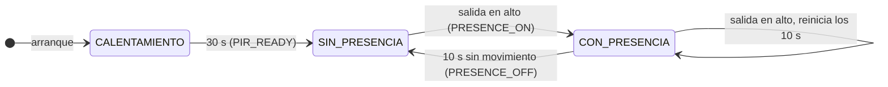

**Figura 1.** Estados del sensor de presencia. Cada cambio entre `SIN_PRESENCIA` y `CON_PRESENCIA` pide un reporte al Shadow (`presence = false` o `true`).

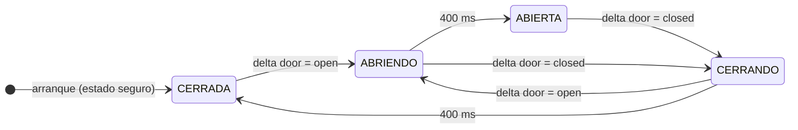

**Figura 2.** Estados de la puerta. `reported.door` cambia recién al terminar los 400 ms del movimiento, así el Shadow nunca confirma una posición que el servo todavía no alcanzó. Una orden contraria durante el movimiento lo invierte. Una orden igual a la posición actual no mueve el servo, solo confirma el estado, y un valor distinto de `open` o `closed` se rechaza (`INVALID_VALUE`) sin cambiar de estado.

### 1.3 Requerimientos funcionales

RF1 a RF9 responden a los requerimientos mínimos de la consigna (§3.1). RF10 a RF12 son propios del grupo: se agregaron porque cierran casos que la consigna deja abiertos y que afectan a la confiabilidad del sistema: que el usuario sepa si la orden realmente se cumplió, que sepa si el objeto está desconectado y que una orden inválida o repetida no mueva la puerta.

| ID | Requerimiento | Criterio de aceptación |
| --- | --- | --- |
| RF1 | Detectar presencia en la entrada con el PIR AM312. | `PRESENCE_ON` al detectar movimiento, después de 30 s de calentamiento (`PIR_READY`). `presence` se mantiene `true` 10 s después del último movimiento. |
| RF2 | Reportar periódicamente `presence`, `door` y `servo_angle` en `reported`. | Cada reporte trae los tres atributos. Con la conexión activa, nunca pasan más de 61.5 s entre dos reportes (heartbeat de 60 s). |
| RF3 | Aplicar el `delta` en el servo y confirmarlo en `reported`. | Un `delta` válido mueve el servo y su posición aparece en `reported` en ≤ 1.5 s desde `DELTA_RX`. |
| RF4 | Responder por voz el valor del sensor, leyendo `reported`. | "Sí, se detecta a alguien…" o "No, no se detecta…", según `reported.presence`, nunca según `desired`. |
| RF5 | Ejecutar por voz abrir y cerrar, escribiendo `desired`. | `desired.door` cambia a `open` o `closed` en el Shadow del Thing del usuario. |
| RF6 | Responder por voz el estado de la puerta. | "La puerta está abierta/cerrada" según `reported.door`; si `desired` difiere, menciona la orden pendiente. |
| RF7 | Vincular con un código y que la vinculación persista entre sesiones. | El ítem `userId → thingName, fechaVinculacion` queda en DynamoDB y la skill lo usa al volver a abrirla. |
| RF8 | Resolver el Thing de cada usuario por su `userId`. | Un usuario sin vincular recibe la guía para hacerlo; dos usuarios vinculados a Things distintos solo actúan sobre el suyo. |
| RF9 | Validar el Thing antes de vincular y permitir cambiar o eliminar la vinculación. | Un código inválido o un Thing inexistente no se guarda; volver a vincular reemplaza el ítem; desvincular lo borra. |
| RF10 | Confirmar al usuario que la puerta se movió. | Tras un comando, la Lambda espera `reported.door` hasta 3 s y dice "Listo, la puerta está abierta/cerrada"; si no llega, dice que no recibió confirmación. |
| RF11 | Avisar cuando el objeto está desconectado. | Si el último reporte tiene más de 150 s, las consultas lo advierten y los comandos avisan que se aplicarán al reconectarse. |
| RF12 | Rechazar comandos inválidos y repetidos sin mover el servo. | Un valor fuera de `open`/`closed`, un JSON mal formado o un `delta` con versión repetida o anterior quedan registrados (`INVALID_VALUE`, `JSON_ERROR`, `STALE_IGNORED`) y el servo no se mueve. |

### 1.4 Requerimientos no funcionales

| ID | Atributo | Valor declarado | Método de verificación | Prueba |
|---|---|---|---|---|
| RNF1 | Estabilidad | ≥ 15 min continuos con 0 reinicios, 0 caídas de WiFi o MQTT, iteración de `loop()` ≤ 500 ms y pérdida de heap libre ≤ 4096 bytes entre la primera y la última línea `HEALTH`. | Líneas `HEALTH` (cada 60 s) y `BOOT`/`RESET_REASON` del log del OI. | A10 |
| RNF2 | Exactitud del sensor y del actuador | PIR: detección del 100 % de los cruces de una persona a 0.5, 1.0 y 2.0 m (5 cruces por distancia) y 0 falsos positivos en 5 min sin personas. Servo: error ≤ 5° respecto de un transportador en 0° y 90°. | Conteo de `PRESENCE_ON` por distancia medida con cinta métrica; ángulo medido con transportador en fotos. | A06 |
| RNF3 | Tiempo de respuesta extremo a extremo | ≤ 3 s desde que la Lambda recibe el comando hasta que la puerta está confirmada en `reported`, en ≥ 20 comandos. | `confirm_ms` de la Lambda (un solo reloj) y, de forma cruzada, `DELTA_RX` y `ACTUATOR_DONE` del OI con hora NTP. | A05 |
| RNF4 | Frecuencia de reporte | Por evento: ≤ 1.1 s desde el cambio de estado. Periódico: cada 60 s (máx. 61.5 s entre reportes). Consumo: alrededor de 1440 mensajes por día en reposo. | Intervalos entre `REPORT_TX` del log del OI y prueba automática B02. | A10, B02 |
| RNF5 | Reconexión y sincronización | El WiFi reintenta cada 10 s ± 0.5 s; tras recuperar la red, la orden pendiente se aplica en ≤ 10 s desde `WIFI_CONNECTED`, sin intervención. | Secuencia `WIFI_LOST` → `WIFI_CONNECTED` → `MQTT_CONNECTED` → `GET_RX` → `ACTUATOR_DONE` del log del OI. | A07, A08 |
| RNF6 | Seguridad | 0 secretos en los archivos del repositorio y en todo su historial; archivos de secretos ignorados por git; plantilla publicada. | [tools/check_secrets.py](tools/check_secrets.py), con un control positivo sobre el `secrets.h` real. | B03 |

Justificación de los valores declarados:

- **RNF1 (≥ 15 min):** supera la referencia de 10 min de la consigna. El límite de 500 ms para `loop()` asegura que el PIR se lea y el LED parpadee a tiempo; el de 4096 bytes de heap detecta una fuga de memoria que en una corrida corta no llegaría a reiniciar la placa.
- **RNF2 (0.5 a 2.0 m):** es la zona frente a la puerta de un monoambiente donde se para quien llega. El ±5° del servo es lo que una puerta de maqueta tolera sin quedar entreabierta.
- **RNF3 (≤ 3 s):** es la referencia de la consigna. El servo tarda 400 ms (`SETTLE_TIME_MS`), así que el resto del presupuesto queda para la nube y la red. Se mide hasta la confirmación en `reported`, no hasta la escritura de `desired`, porque eso es lo que el usuario escucha (RF10).
- **RNF4 (evento ≤ 1.1 s, heartbeat 60 s):** la puerta y la presencia son eventos discretos, así que se reportan de inmediato, en el orden de 1 s que pide la consigna. El mínimo de 1 s entre reportes (`MIN_REPORT_INTERVAL_MS`) evita ráfagas si el PIR oscila, y por eso el límite es 1.1 s y no menos. El heartbeat de 60 s da 1440 mensajes por día en reposo; uno de 10 s daría 8640, seis veces más, sin ganar nada, porque los cambios ya se reportan por evento (§2.8).
- **RNF5 (≤ 10 s):** después de `WIFI_CONNECTED` quedan la conexión TLS y MQTT, la espera de 0.5 s antes de pedir el Shadow (`GET_AFTER_SUBSCRIBE_MS`) y los 400 ms del servo. El reintento de WiFi cada 10 s es `WIFI_RETRY_INTERVAL_MS`.
- **RNF6:** la consigna prohíbe publicar certificados, claves y credenciales WiFi, y prohíbe las access keys de AWS en el código; la prueba revisa también el historial, porque un secreto borrado en un commit posterior sigue publicado.
- **RF11 (150 s):** 2.5 heartbeats tolera un mensaje perdido más el tiempo de una reconexión, sin dar por desconectado un objeto que solo se demoró.

### 1.5 Matriz de trazabilidad

| Requisito | Diseño | Implementación | Prueba | Resultado |
|---|---|---|---|---|
| RF1 Detectar presencia | §1.2 (Figura 1); §2.2 circuito | [PresenceSensor.cpp](src/PresenceSensor.cpp): `PresenceSensor::update()` | A03, A06 | Cumple: 15 de 15 cruces detectados (A06); 8 de 8 consultas coinciden con el PIR (A03) |
| RF2 Reporte periódico | §2.5 Shadow; §2.8 frecuencia | [ShadowReporter.cpp](src/ShadowReporter.cpp): `ShadowReporter::update()`; `fillReported()` de cada componente | A10, B02 | Cumple: 115 de 115 reportes con los tres atributos; máx. 59 999 ms entre reportes (A10) |
| RF3 Aplicar el `delta` | §1.2 (Figura 2); §2.4.3; §2.5 | [ShadowTransport.cpp](src/ShadowTransport.cpp): `handleDelta()`; [DoorActuator.cpp](src/DoorActuator.cpp): `applyDesired()`, `update()` | A04, A09, A10, B02 | Cumple: 30 de 30 `delta` confirmados en `reported`, mediana 416 ms y máx. 1169 ms (A10) |
| RF4 Consulta del sensor | §2.4.2; §2.7 skill | [lambda_function.py](lambda/lambda_function.py): `GetPresenceHandler.handle_thing()` | A03, B01 | Cumple: 8 de 8 respuestas correctas (A03) |
| RF5 Comando por voz | §2.4.3; §2.7 | `DoorCommandHandler.handle_thing()`; `ThingGateway.set_desired_door()` | A04, A05, B01 | Cumple: 6 de 6 (A04) y 28 de 28 (A05) |
| RF6 Estado de la puerta | §2.4.3; §2.7 | `GetDoorStateHandler.handle_thing()` | A04, A09, B01 | Cumple: responde según `reported` y no anuncia una orden inválida como pendiente (A09) |
| RF7 Vinculación persistente | §2.4.1; §2.6 vinculación | `LinkThingHandler.handle()`; `LinkRepository.save()` | A01, B01 | Cumple: 13 de 13 respuestas; la vinculación persistió en una sesión nueva (A01) |
| RF8 Thing por usuario | §2.6 | `LinkedThingHandler.handle()`; `LinkRepository.find_thing()` | A01, A02, B01 | Cumple: el comando del segundo usuario solo modificó `monoambiente-518306` (A02) |
| RF9 Validar, cambiar y eliminar | §2.4.1; §2.6 | `parse_link_code()`; `ThingGateway.exists()`; `UnlinkThingHandler.handle()` | A01, B01 | Cumple: 0 datos inválidos guardados; cambio y desvinculación correctos (A01) |
| RF10 Confirmación al usuario | §2.4.3 | `ThingGateway.wait_for_door()` | A04, A05, A08, B01 | Cumple: 28 de 28 comandos confirmados (A05) |
| RF11 Aviso de desconexión | §2.4.4 | `ShadowState.online`; `ShadowState.offline_note()` | A02, A07, B01 | Cumple: aviso con 2 y 3 min sin reportes; orden encolada (A07) |
| RF12 Comandos inválidos o repetidos | §2.5 | `DoorActuator::applyDesired()`; `ShadowTransport::acceptVersion()` | A09, B02 | Cumple: 3 de 3 valores inválidos sin movimiento (A09); 16 de 16 casos (B02) |
| RNF1 Estabilidad | §3.9 temporización | `loop()` de [main.cpp](src/main.cpp); [HealthMonitor.cpp](src/HealthMonitor.cpp) | A10 | Cumple: 27.3 min, 0 reinicios, 0 caídas, `loop()` máx. 21 ms, 0 bytes de heap perdidos |
| RNF2 Exactitud | §1.2 | `PresenceSensor`; `DoorActuator` (`CLOSED_ANGLE_DEG`, `OPEN_ANGLE_DEG`) | A06 | PIR cumple: 15 de 15 y 0 falsos positivos en 5.0 min. Servo: pendiente de medición |
| RNF3 Tiempo de respuesta | §2.4.3 | `DoorCommandHandler.handle_thing()`; `SETTLE_TIME_MS` | A05 | Cumple: 28 de 28; confirmación mediana 919 ms y máx. 1691 ms |
| RNF4 Frecuencia de reporte | §2.8 | `ShadowReporter` (`MIN_REPORT_INTERVAL_MS`, `HEARTBEAT_PERIOD_MS`) | A03, A10, B02 | Cumple: evento máx. 804 ms (A10) y 254 ms (A03); heartbeat 60 000 ms (B02) |
| RNF5 Reconexión | §2.4.4 | [WifiManager.cpp](src/WifiManager.cpp); [ShadowClient.cpp](src/ShadowClient.cpp): `onConnected()`, `requestShadowIfDue()` | A07, A08 | Cumple: orden pendiente aplicada 3297–3848 ms después de `WIFI_CONNECTED` (A07) y 3.9 s después del arranque (A08) |
| RNF6 Seguridad | §3.6 credenciales | [.gitignore](.gitignore); [secrets.example.h](include/secrets.example.h); [check_secrets.py](tools/check_secrets.py) | B03 | Cumple: 0 secretos en 149 archivos y en el historial |

---

## 2. Análisis y diseño

### 2.1 Diagrama de arquitectura del sistema

La arquitectura se muestra en dos vistas: el despliegue físico y en la nube (Figura 3a) y los componentes de software con sus interfaces (Figura 3b).

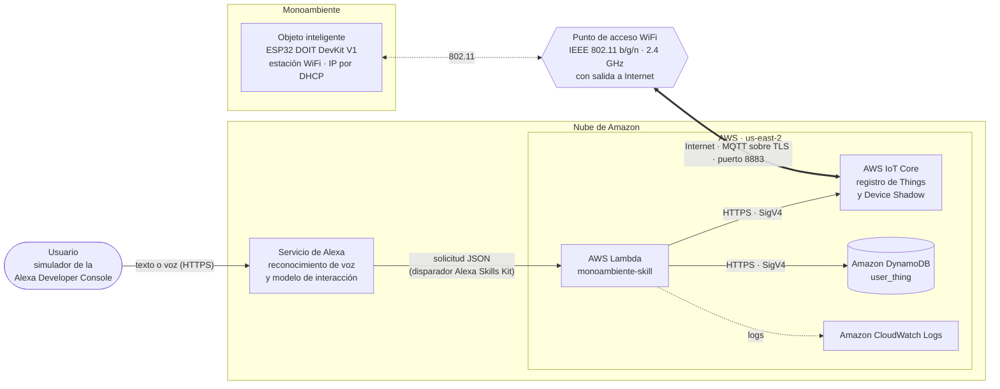

**Figura 3a.** Despliegue. El objeto inteligente es una estación WiFi que sale a Internet por el punto de acceso de la casa (en las pruebas, el hotspot de un celular) y mantiene una conexión MQTT sobre TLS con AWS IoT Core. El usuario no se conecta al objeto: habla con el servicio de Alexa, que invoca a la Lambda. IoT Core, Lambda y DynamoDB están en la misma cuenta y en la misma región, `us-east-2`.

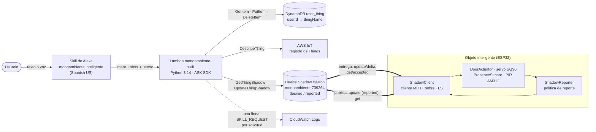

**Figura 3b.** Componentes e interfaces. La Lambda es el único componente que escribe `desired`, y el objeto inteligente es el único que escribe `reported`. Las dos partes nunca se comunican directamente: la Lambda trabaja sobre el Shadow por la API HTTPS de AWS IoT, y el objeto recibe los cambios por MQTT cuando el Shadow publica el `delta`.

| Nodo | Hardware o servicio | Software | Rol en la comunicación | Dirección, puerto y protocolo | Autenticación | Registro de eventos |
|---|---|---|---|---|---|---|
| Objeto inteligente | ESP32 DOIT DevKit V1 + PIR AM312 + servo SG90 | Firmware C++ (Arduino-ESP32), entorno `esp32doit-devkit-v1` de PlatformIO | Cliente MQTT: abre y mantiene la conexión; se suscribe a los temas de su Shadow con QoS 1 y publica `reported` | Endpoint ATS de AWS IoT de la cuenta (`xxxxxxxx-ats.iot.us-east-2.amazonaws.com`), puerto 8883, MQTT 3.1.1 sobre TLS; client ID = nombre del Thing | Certificado X.509 del dispositivo y su clave privada (TLS mutuo); CA raíz de Amazon | Monitor serie a 115200 baud con hora UTC por NTP, guardado con `log2file` |
| AWS IoT Core | Servicio administrado | Registro de Things y Device Shadow clásico | Broker MQTT y API de datos HTTPS del Shadow | Temas `$aws/things/<thing>/shadow/...` | Política de IoT asociada al certificado | — |
| Lambda | Servicio administrado | [lambda_function.py](lambda/lambda_function.py), Python 3.14, ASK SDK | Backend de la skill: recibe una solicitud por intent y responde con el texto que dice Alexa | API de AWS IoT, API de datos del Shadow y API de DynamoDB, por HTTPS | Rol IAM de la función (credenciales temporales, sin access keys en el código); el disparador verifica el Skill ID | CloudWatch Logs: una línea JSON `SKILL_REQUEST` por solicitud |
| DynamoDB | Servicio administrado | Tabla `user_thing` | Almacena la vinculación de cada usuario | Acceso por clave (`userId`) | Rol IAM de la Lambda | — |
| Skill de Alexa | Alexa Developer Console | [Modelo de interacción](alexa/interaction-model.es-US.json), invocación "monoambiente inteligente" | Frontend de voz; envía a la Lambda el intent, los slots y el `userId` | Endpoint = ARN de la Lambda | Cuenta de desarrollador de Amazon | Pestaña de pruebas (JSON de entrada y salida) |

#### Recorrido de un comando por las capas

| Capa | En este sistema |
|---|---|
| Aplicación | Del lado de Alexa: la solicitud JSON con el intent y el `userId`, y la respuesta con el texto o SSML que dice Alexa. Del lado del objeto: los documentos JSON del Shadow (`desired`, `reported`, `delta`) sobre MQTT, en los temas `$aws/things/<thing>/shadow/...` (§2.5). |
| Seguridad | TLS 1.2. El objeto se autentica con su certificado X.509 y verifica al servidor con la CA raíz de Amazon (TLS mutuo). La Lambda firma cada llamada a AWS con SigV4 usando las credenciales temporales de su rol. |
| Transporte | TCP. Una conexión persistente del objeto al puerto 8883, con *keep-alive* MQTT de 60 s; conexiones HTTPS (puerto 443) de la Lambda a los servicios de AWS. |
| Internet | IPv4. El objeto resuelve por DNS el nombre del endpoint ATS y llega a AWS a través del punto de acceso y de Internet. |
| Acceso a la red | WiFi IEEE 802.11 b/g/n en 2.4 GHz, en modo estación (STA), con el ahorro de energía del módem desactivado para no retrasar la llegada de los `delta` ([WifiManager.cpp](src/WifiManager.cpp)). |

Recorrido de la orden _"abre la puerta"_:

1. **Alexa.** El servicio de Alexa reconoce el intent `OpenDoor` y envía a la Lambda una solicitud JSON con el intent y el `userId` del usuario.
2. **Vinculación.** La Lambda busca en DynamoDB el Thing de ese usuario (`GetItem`) y lee su Shadow (`GetThingShadow`) para saber si la puerta ya está abierta y si el objeto está en línea.
3. **Estado deseado.** La Lambda escribe `{"state":{"desired":{"door":"open"}}}` con `UpdateThingShadow`, por HTTPS.
4. **Delta.** Como `desired.door` difiere de `reported.door`, AWS IoT publica el `delta` en `$aws/things/monoambiente-739264/shadow/update/delta`. El broker lo entrega por la conexión MQTT ya abierta: el objeto no consulta, recibe.
5. **Objeto.** El objeto descarta el `delta` si su versión es repetida o anterior, mueve el servo a 90° y, terminados los 400 ms, publica `{"state":{"reported":{"door":"open","servo_angle":90,"presence":…}}}` en el tema `update`.
6. **Confirmación.** Mientras tanto, la Lambda lee el Shadow cada 250 ms, durante 3 s como máximo. Cuando `reported.door` es `open`, responde "Listo, la puerta está abierta.".

Hay dos confirmaciones distintas: la respuesta de `UpdateThingShadow` solo indica que AWS guardó el estado deseado; `reported.door` indica que el objeto ya movió la puerta. La skill solo dice "Listo" con la segunda (RF10).

#### Por qué esta arquitectura

- **Device Shadow.** Desacopla a Alexa del objeto: la Lambda no necesita que el objeto esté conectado para dar una orden, porque `desired` queda guardado en el Shadow y el objeto lo aplica al volver (RNF5). También guarda el último `reported`, así una consulta se responde aunque el objeto no esté enviando nada en ese momento.
- **MQTT sobre una conexión persistente.** El `delta` llega al objeto en cuanto AWS lo publica, sin que el objeto pregunte periódicamente. Un objeto que consultara por HTTP cada pocos segundos tardaría más en reaccionar y gastaría muchos más mensajes.
- **TLS mutuo con certificado X.509.** El objeto se identifica con su propio certificado, revocable por separado, y no lleva access keys de AWS, como exige la consigna. Las suscripciones usan QoS 1, así un `delta` perdido se reentrega; el número de versión del documento evita aplicarlo dos veces (RF12).
- **Lambda.** No hay un servidor propio que mantener encendido; la función se ejecuta solo cuando llega una solicitud, toma sus permisos del rol IAM y está dentro de la capa gratuita.
- **DynamoDB.** Cada solicitud necesita una sola lectura por clave (`userId`), una operación de costo constante, también incluida en la capa gratuita.
- **El costo** es la dependencia de Internet y de AWS: sin conexión, el objeto no recibe órdenes nuevas ni actualiza su estado. Se mitiga con la reconexión automática y la sincronización con el Shadow al volver (RNF5), con el aviso de desconexión de RF11 y con la puerta cerrada como estado seguro al arrancar.

### 2.2 Diagrama de circuito

#### 2.2.1 Esquema eléctrico

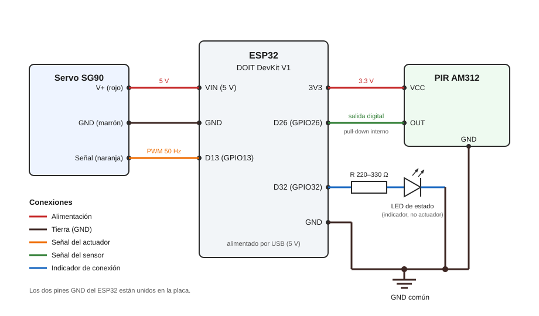

**Figura 4.** Esquema eléctrico del objeto inteligente. El servo se alimenta con 5 V desde el pin VIN, que recibe la tensión del USB, y recibe la señal PWM por GPIO13. El PIR se alimenta con 3.3 V y entrega su salida digital en GPIO26. El LED de estado, en serie con su resistencia, va de GPIO32 a GND. Todas las tierras son comunes.

| Componente | Pin del componente | Conexión | Pin del ESP32 | Constante en el código |
|---|---|---|---|---|
| Servo SG90 | Señal (cable naranja) | Directa | D13 (GPIO13) | `config::pins::SERVO_SIGNAL = 13` |
| Servo SG90 | V+ (cable rojo) | Directa | VIN (5 V del USB) | — |
| Servo SG90 | GND (cable marrón) | Directa | GND | — |
| PIR AM312 | OUT | Directa; entrada con *pull-down* interno | D26 (GPIO26) | `config::pins::PIR_OUTPUT = 26` |
| PIR AM312 | VCC | Directa | 3V3 | — |
| PIR AM312 | GND | Directa | GND | — |
| LED de estado | Ánodo | A través de una resistencia de 220–330 Ω | D32 (GPIO32) | `config::pins::STATUS_LED = 32` |
| LED de estado | Cátodo | Directa | GND | — |

- **Señal del servo.** [DoorActuator.cpp](src/DoorActuator.cpp) genera con la librería ESP32Servo una señal de 50 Hz (`PWM_FREQUENCY_HZ`) con pulsos de 500 µs para 0° a 2400 µs para 180° (`PULSE_MIN_US`, `PULSE_MAX_US`). Para 0° (cerrada) el pulso es de 500 µs y para 90° (abierta), de 500 + 1900 × 90 / 180 = 1450 µs. El servo interpreta un pulso de 3.3 V como nivel alto, así que la señal no necesita adaptación.
- **Salida del PIR.** El AM312 alimentado con 3.3 V entrega 3.3 V en alto, el nivel lógico del ESP32, por eso no hace falta el divisor de tensión que necesitaba el HC-SR04 en la práctica anterior. [PresenceSensor.cpp](src/PresenceSensor.cpp) configura GPIO26 como `INPUT_PULLDOWN`: si el cable del sensor se suelta, la entrada queda en bajo y el objeto informa "sin presencia" en lugar de presencias falsas.
- **Corriente del LED.** I = (3.3 V − V<sub>f</sub>) / R. Para un LED con V<sub>f</sub> ≈ 2.0 V, entre 3.9 mA (330 Ω) y 5.9 mA (220 Ω), muy por debajo de los 20 mA recomendados por pin.

#### 2.2.2 Pines y alimentación

- **Pines.** El objeto usa GPIO13, GPIO26 y GPIO32. No son pines de arranque (*strapping*: 0, 2, 5, 12 y 15), no están conectados a la memoria flash (6 a 11) y no son de solo entrada (34 a 39). Los tres se usan como entradas o salidas digitales: el ADC2 que comparten GPIO13 y GPIO26 no se usa, así que no hay conflicto con el WiFi.
- **Alimentación.** La placa se alimenta por USB. El servo toma 5 V del pin VIN, es decir, directamente del USB, y no del regulador de 3.3 V de la placa. El PIR consume muy poco y se alimenta de 3V3. Toda la tensión del circuito es de 5 V o menos, dentro del límite de 12 V DC de la consigna, y ningún componente conmuta 220 V AC.
- **Riesgo del servo.** Al arrancar un movimiento, el servo pide un pico de corriente que comparte el USB con el ESP32. Si la tensión cayera demasiado, el ESP32 se reiniciaría por *brownout*. No ocurrió en las pruebas: el firmware registra el motivo de cada reinicio (`RESET_REASON`) y los logs de A04, A07, A09 y A10 registran 36 movimientos del servo sin ningún reinicio, y la placa llegó a funcionar 83 min seguidos sin reiniciarse (A10, §4). Para un uso real se recomienda una fuente de 5 V aparte para el servo, con la tierra común (§7).
- **Estado seguro.** Al arrancar, [DoorActuator.cpp](src/DoorActuator.cpp) lleva el servo a 0° (puerta cerrada) antes de conectarse a la red. Si se corta la energía, la puerta queda cerrada al volver, y recién después se aplica la orden que esté pendiente en el Shadow (A08).

#### 2.2.3 Montaje real

_Pendiente: foto del montaje real del objeto inteligente y la maqueta de la puerta (Figura 5)._

### 2.3 Diagramas de clases

Hay dos diagramas por programa: uno con las clases que resuelven el caso de uso y otro con las de soporte. Notación: `+` es público, `#` protegido y `-` privado; los miembros subrayados son estáticos y los métodos en cursiva son abstractos (virtuales puros en C++). «main.cpp» es el archivo principal del firmware, «namespace» un espacio de nombres de C++, «module» un módulo de Python y «ASK SDK» una clase de la librería de Alexa. El triángulo indica herencia; el rombo lleno, que un objeto crea y contiene al otro; el rombo vacío, que lo recibe ya creado; la flecha punteada, que lo usa. En los tipos, `∗` es un puntero de C++.

#### 2.3.1 Firmware del objeto inteligente (ESP32)

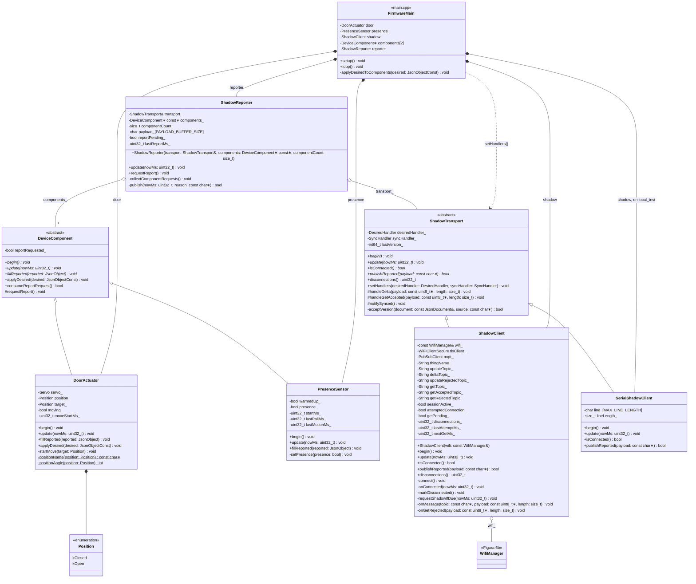

**Figura 6a.** Clases del caso de uso en el firmware ([src/](src/)). Hay dos jerarquías:

- **`DeviceComponent`** es la interfaz de todo sensor o actuador. `DoorActuator` y `PresenceSensor` la implementan. Cada componente escribe sus atributos en `reported` (`fillReported()`), toma de `desired` los que le corresponden (`applyDesired()`; un sensor deja la implementación vacía) y pide un reporte cuando su estado cambia (`requestReport()`). `ShadowReporter` recorre el arreglo `components[]` sin conocer las clases concretas, así que **un sensor o actuador nuevo solo requiere escribir su clase y agregarlo al arreglo** de [main.cpp](src/main.cpp).
- **`ShadowTransport`** es el enlace con el Shadow. Contiene la lógica común: interpreta el `delta` y la respuesta a `/get`, y descarta las versiones repetidas o anteriores (`acceptVersion()`). `ShadowClient` lo implementa con MQTT sobre TLS hacia AWS IoT Core; `SerialShadowClient`, con el monitor serie, en el entorno `local_test`. Como [main.cpp](src/main.cpp) y `ShadowReporter` solo usan la interfaz, el mismo firmware se prueba sin AWS en B02 (polimorfismo).

`ShadowTransport` no conoce a los componentes: [main.cpp](src/main.cpp) le entrega con `setHandlers()` la función `applyDesiredToComponents()`, que reparte el estado deseado entre los componentes, y la función que pide un reporte cuando termina la sincronización inicial. El enum `Position` es privado de `DoorActuator`.

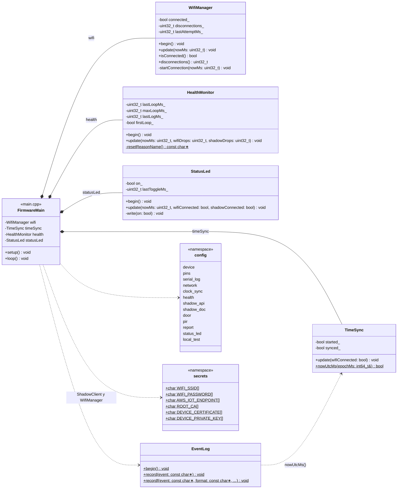

**Figura 6b.** Clases de soporte del firmware. `WifiManager` conecta el WiFi y lo reintenta cada 10 s. `TimeSync` sincroniza la hora por NTP, y `EventLog` la usa para escribir cada línea de log con `t_ms` y hora UTC, comparable con CloudWatch. `HealthMonitor` registra el motivo del último reinicio, escribe una línea `HEALTH` cada 60 s y alimenta el watchdog de 30 s. `StatusLed` muestra el estado de la conexión en el LED. `EventLog` es una clase con solo métodos estáticos, que usan todas las demás. Todas las constantes están en el namespace `config` de [config.h](include/config.h) (Tabla 1), y todos los secretos, en el namespace `secrets` de `include/secrets.h`, que no se versiona ([plantilla](include/secrets.example.h)).

**Tabla 1.** Namespaces de [config.h](include/config.h). Cada constante tiene nombre y unidad; el código no tiene números sueltos.

| Namespace | Constantes | Usado por |
|---|---|---|
| `device` | `THING_NAME_PREFIX`, `LINK_CODE` | `ShadowClient`, `main.cpp` |
| `pins` | `SERVO_SIGNAL = 13`, `STATUS_LED = 32`, `PIR_OUTPUT = 26` | `DoorActuator`, `StatusLed`, `PresenceSensor` |
| `serial_log` | `BAUD_RATE = 115200`, `MAX_DETAILS_LENGTH = 256` | `EventLog` |
| `network` | `WIFI_RETRY_INTERVAL_MS = 10000`, `MQTT_RETRY_INTERVAL_MS = 5000`, `MQTT_PORT = 8883`, `MQTT_BUFFER_SIZE = 2048`, `MQTT_KEEPALIVE_S = 60`, `MQTT_SOCKET_TIMEOUT_S = 5`, `TLS_CONNECT_TIMEOUT_S = 8`, `TLS_HANDSHAKE_TIMEOUT_S = 8`, `MQTT_SUBSCRIBE_QOS = 1`, `GET_AFTER_SUBSCRIBE_MS = 500`, `GET_RESPONSE_TIMEOUT_MS = 5000` | `WifiManager`, `ShadowClient` |
| `clock_sync` | Servidores NTP, desfase UTC y `MIN_VALID_EPOCH_S` | `TimeSync` |
| `health` | `LOG_PERIOD_MS = 60000`, `WATCHDOG_TIMEOUT_S = 30` | `HealthMonitor` |
| `shadow_api` | Prefijo y sufijos de los temas del Shadow, `ERROR_CODE_NOT_FOUND = 404`, `KEY_VERSION` | `ShadowClient`, `ShadowTransport` |
| `shadow_doc` | `KEY_DOOR`, `KEY_SERVO_ANGLE`, `KEY_PRESENCE`, `DOOR_OPEN`, `DOOR_CLOSED` | Componentes |
| `door` | `PWM_FREQUENCY_HZ = 50`, `PULSE_MIN_US = 500`, `PULSE_MAX_US = 2400`, `CLOSED_ANGLE_DEG = 0`, `OPEN_ANGLE_DEG = 90`, `SETTLE_TIME_MS = 400` | `DoorActuator` |
| `pir` | `POLL_PERIOD_MS = 50`, `WARMUP_MS = 30000`, `PRESENCE_HOLD_MS = 10000` | `PresenceSensor` |
| `report` | `HEARTBEAT_PERIOD_MS = 60000`, `MIN_REPORT_INTERVAL_MS = 1000`, `PAYLOAD_BUFFER_SIZE = 512` | `ShadowReporter` |
| `status_led` | `BLINK_WIFI_DOWN_MS = 200`, `BLINK_SHADOW_DOWN_MS = 1000` | `StatusLed` |
| `local_test` | `MAX_LINE_LENGTH = 256` | `SerialShadowClient` |

#### 2.3.2 Función Lambda (backend de la skill)

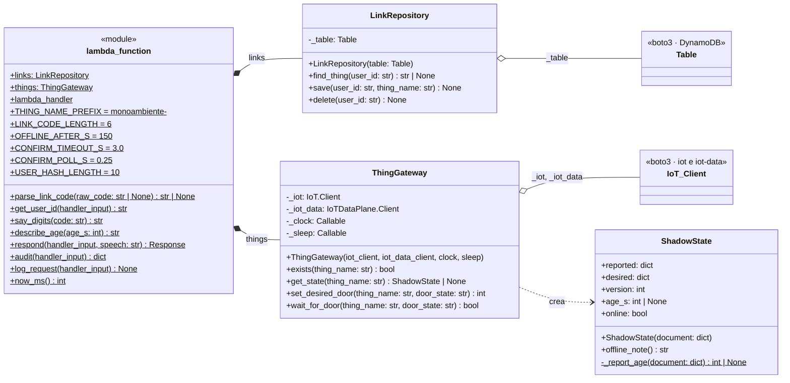

**Figura 7a.** Acceso a los datos en la Lambda ([lambda_function.py](lambda/lambda_function.py)). Cada servicio de AWS queda detrás de una clase, y los handlers no llaman a boto3 directamente:

- **`LinkRepository`** guarda y busca la vinculación de cada usuario en la tabla `user_thing`, siempre por clave (`GetItem`, `PutItem`, `DeleteItem`).
- **`ThingGateway`** comprueba que un Thing exista (`DescribeThing`), lee su Shadow (`GetThingShadow`), escribe `desired.door` (`UpdateThingShadow`) y espera la confirmación en `reported`. El reloj y la espera se reciben en el constructor; las pruebas unitarias de B01 los reemplazan para comprobar el límite de 3 s sin esperar de verdad.
- **`ShadowState`** es una vista de solo lectura del documento del Shadow: separa `reported` de `desired`, calcula la antigüedad del último reporte a partir de los `timestamp` de `metadata` y decide si el objeto está en línea (`online`, una propiedad: último reporte con 150 s o menos).

`links` y `things` se crean una sola vez por contenedor de Lambda, al cargar el módulo, y las solicitudes siguientes los reutilizan. Las constantes del módulo reemplazan los números sueltos, y la configuración del despliegue (`IOT_ENDPOINT`, `IOT_REGION`, `TABLE_NAME`) se lee de las variables de entorno.


**Figura 7b.** Handlers e interceptores de la skill. `OtrosHandlers` agrupa cuatro clases que solo responden un texto fijo y no tocan AWS.

- **Resolución del Thing (RF8) en un solo lugar.** `LinkedThingHandler.handle()` busca el Thing del usuario y, si no hay vinculación, responde la guía para vincular; si la hay, llama a `handle_thing()`, que cada subclase implementa (patrón *método plantilla*). Así, los intents que necesitan un Thing (`GetPresence`, `GetDoorState`, `OpenDoor` y `CloseDoor`) no repiten esa lógica.
- **Un comando, dos intents.** `DoorCommandHandler` implementa la orden y la espera de la confirmación (RF5, RF10, RF11). `OpenDoorHandler` y `CloseDoorHandler` solo fijan sus atributos de clase: el intent que atienden, la posición objetivo y las frases.
- **Vinculación.** `LinkThingHandler` y `UnlinkThingHandler` heredan directamente de `AbstractRequestHandler`, porque trabajan sin un Thing vinculado o justamente para crearlo o borrarlo (RF7, RF9).
- **Registro.** `RequestTimer` guarda el instante en que llega la solicitud, y `RequestLogger` escribe al final una línea `SKILL_REQUEST` en CloudWatch con el resultado y los tiempos medidos (§3.10). Cuando ocurre una excepción, `CatchAllExceptionHandler` responde un mensaje de error y escribe esa misma línea, porque en ese caso el SDK no ejecuta el interceptor de respuesta.

El orden en que los handlers se registran en el `SkillBuilder` importa: el SDK usa el primero cuyo `can_handle()` devuelve `True`. `UnhandledRequestHandler`, que acepta cualquier solicitud y atiende `AMAZON.FallbackIntent` y `AMAZON.NavigateHomeIntent`, se registra al final.

### 2.4 Diagramas de secuencia

Los cuatro diagramas van del usuario al objeto inteligente. Los nombres de los eventos (`DELTA_RX`, `ACTUATOR_DONE`…) son los del log del objeto y los valores de `result` son los de la línea `SKILL_REQUEST` de la Lambda, así cada paso se puede seguir en la evidencia de §4. Los tiempos indicados son los medidos en las pruebas.

#### 2.4.1 Vinculación de un Thing

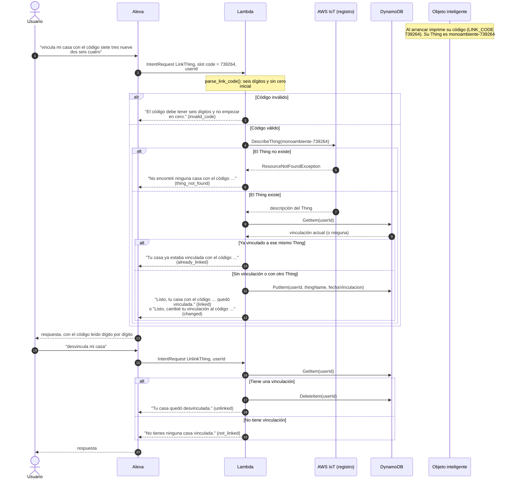

**Figura 8.** Vinculación, cambio y desvinculación (RF7, RF9). El código de 6 dígitos lo muestra el objeto al arrancar; el nombre del Thing es `monoambiente-` más el código. La Lambda valida primero el formato, sin consultar a AWS, y después que el Thing exista en AWS IoT; recién entonces escribe en DynamoDB, así un dato inválido nunca se guarda. Cambiar de objeto es vincular otro código: `PutItem` reemplaza el ítem del usuario, porque `userId` es la clave de partición. La vinculación no depende de que el objeto esté conectado. En A01 la Lambda tardó una mediana de 76 ms por solicitud.

#### 2.4.2 Consulta del sensor

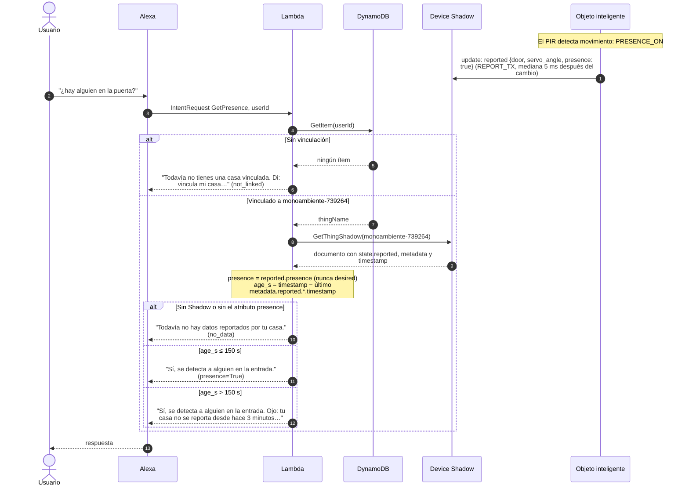

**Figura 9.** Consulta del sensor (RF4, RF8, RF11). La consulta no llega al objeto: la Lambda lee el último `reported`, que el objeto publicó al detectar el cambio. Por eso responde aunque el objeto esté desconectado, y en ese caso agrega la advertencia de antigüedad. La consulta del estado de la puerta (`GetDoorState`, RF6) sigue la misma secuencia con `reported.door`, y además menciona la orden pendiente si `desired.door` es `open` o `closed` y difiere de `reported.door`.

#### 2.4.3 Comando sobre el actuador

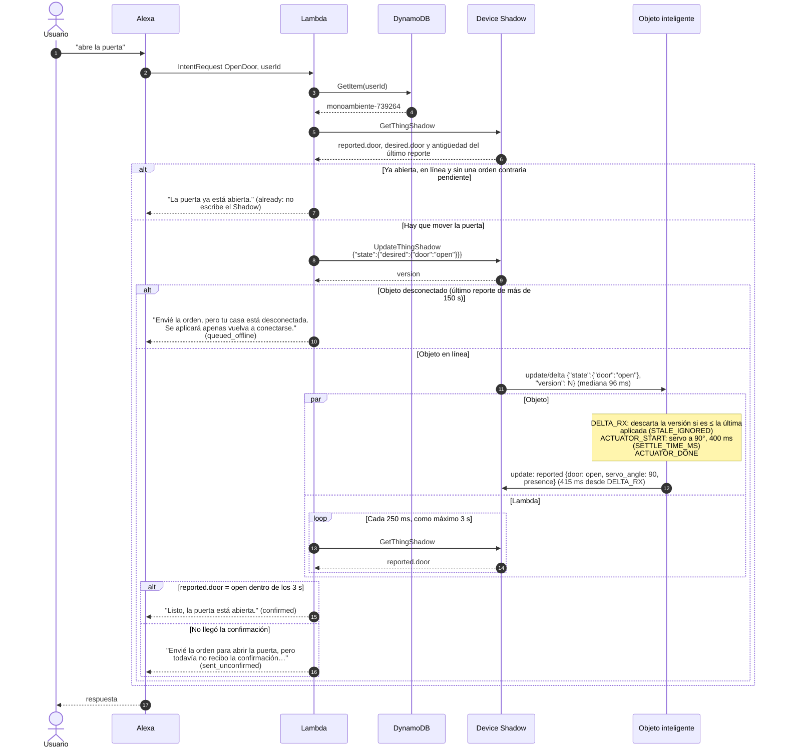

**Figura 10.** Comando sobre el actuador (RF3, RF5, RF10, RF11, RF12). La Lambda solo escribe `desired`; AWS IoT calcula el `delta` y lo entrega al objeto por la conexión MQTT ya abierta. El objeto confirma en `reported` recién al terminar el movimiento, y la Lambda responde "Listo" solo cuando lee esa confirmación. Tiempos medidos en A05, en 28 comandos: de la llegada del intent a la Lambda al servo detenido, mediana 616 ms y máximo 984 ms; hasta la respuesta "Listo", mediana 919 ms y máximo 1691 ms, dentro del límite de 3 s de RNF3. La nube (de `UpdateThingShadow` a `DELTA_RX`) aportó una mediana de 96 ms; el resto son los 400 ms del servo, el reporte y la espera entre consultas de la Lambda. `CloseDoor` sigue la misma secuencia con `closed` y 0°.

#### 2.4.4 Reconexión y aplicación del estado pendiente

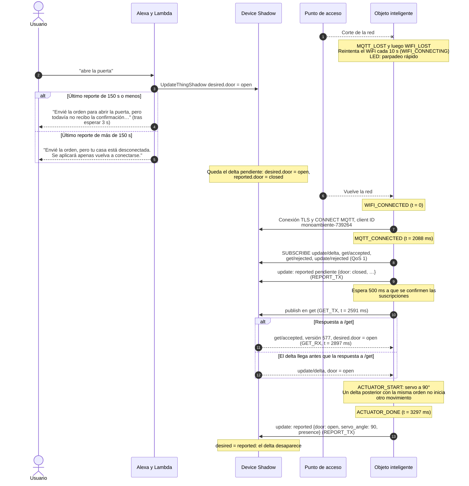

**Figura 11.** Reconexión y sincronización (RNF5, RF11). Mientras el objeto está desconectado, la orden queda guardada en `desired`. Al reconectarse, el objeto se suscribe y pide el documento completo con `/get`, así aplica la orden aunque el `delta` se hubiera publicado mientras estaba desconectado; si no hay respuesta en 5 s, repite el pedido (`GET_RESPONSE_TIMEOUT_MS`). Si AWS responde que el Shadow todavía no existe (`get/rejected` con código 404), el primer reporte lo crea. Los tiempos son los del intento 3 de A07 (log [A07_ESP32_tras_correccion.log](docs/evidencias/A07/A07_ESP32_tras_correccion.log), líneas 75 a 85): la orden pendiente se aplicó 3297 ms después de `WIFI_CONNECTED`. En el intento 2 el `delta` llegó antes que la respuesta a `/get`, y la puerta se movió 3848 ms después de `WIFI_CONNECTED`. Tras un corte de energía (A08), la puerta arranca cerrada, que es el estado seguro, y se abrió 3.9 s después de enchufar la placa. En los dos caminos la orden se aplica una sola vez: el número de versión descarta un `delta` repetido o atrasado, y `DoorActuator` no inicia otro movimiento si la orden coincide con el destino en curso o con la posición actual.

### 2.5 Especificación del documento Shadow

El Shadow es el contrato entre la Lambda y el objeto inteligente: ninguno de los dos conoce al otro, solo el documento. Las claves y los valores están definidos una sola vez en cada programa: en el namespace `config::shadow_doc` de [config.h](include/config.h) y en las constantes `DOOR_ATTRIBUTE`, `PRESENCE_ATTRIBUTE`, `DOOR_OPEN` y `DOOR_CLOSED` de [lambda_function.py](lambda/lambda_function.py).

#### 2.5.1 Thing y temas MQTT

| Aspecto | Definición |
|---|---|
| Thing | `monoambiente-<código>`, donde el código son los 6 dígitos de `config::device::LINK_CODE` (en el prototipo, `monoambiente-739264`). Hay un Thing por objeto |
| Tipo de Shadow | Shadow clásico (sin nombre) del Thing |
| Conexión | MQTT 3.1.1 sobre TLS al puerto 8883, client ID igual al nombre del Thing |
| Calidad de servicio | Suscripciones con QoS 1: AWS reenvía un mensaje no confirmado. Las publicaciones del objeto usan QoS 0, el único que publica la librería PubSubClient; un reporte perdido se corrige con el siguiente reporte o con el heartbeat |

Prefijo de todos los temas: `$aws/things/monoambiente-739264/shadow/`.

| Tema | Sentido | Contenido | Uso en el objeto | Evento del log |
|---|---|---|---|---|
| `update` | Objeto → AWS | `{"state":{"reported":{…}}}` | Publicar el estado del objeto ([ShadowReporter.cpp](src/ShadowReporter.cpp)) | `REPORT_TX` |
| `update/delta` | AWS → objeto | Atributos de `desired` que difieren de `reported`, con `version` | Aplicar la orden ([ShadowTransport.cpp](src/ShadowTransport.cpp), `handleDelta()`) | `DELTA_RX` |
| `update/rejected` | AWS → objeto | Código y mensaje de error | Solo se registra | `UPDATE_REJECTED` |
| `get` | Objeto → AWS | Mensaje vacío | Pedir el documento completo al conectarse | `GET_TX` |
| `get/accepted` | AWS → objeto | Documento completo, con `desired`, `reported` y `version` | Aplicar la orden pendiente (`handleGetAccepted()`) | `GET_RX` |
| `get/rejected` | AWS → objeto | Código de error; 404 si el Shadow no existe | Con 404, el primer reporte crea el documento | `GET_REJECTED` |

La Lambda no usa MQTT: lee y escribe el mismo documento con las operaciones `GetThingShadow` y `UpdateThingShadow` de la API de datos de AWS IoT, por HTTPS.

#### 2.5.2 Documento y atributos

```json
{
  "state": {
    "desired":  { "door": "open" },
    "reported": { "door": "closed", "servo_angle": 0, "presence": false },
    "delta":    { "door": "open" }
  },
  "metadata": { "reported": { "door": { "timestamp": 1794283473 } } },
  "version": 577,
  "timestamp": 1794283689
}
```

Estructura del documento que devuelve `GetThingShadow` con una orden pendiente, como en A07; los valores de `metadata` y `timestamp` son de ejemplo. AWS agrega `delta`, `metadata`, `version` y `timestamp`; los programas solo escriben dentro de `state`.

| Atributo | Sección | Tipo | Valores válidos | Quién lo escribe | Quién lo lee |
|---|---|---|---|---|---|
| `door` | `desired` | string | `"open"`, `"closed"` (en minúsculas) | Lambda, con cada comando (`ThingGateway.set_desired_door()`) | AWS, para calcular el `delta`; la Lambda, solo para avisar una orden pendiente |
| `door` | `reported` | string | `"open"`, `"closed"` | Objeto, cuando el servo termina de moverse | Lambda (RF6, RF10) |
| `servo_angle` | `reported` | entero | `0` (cerrada) o `90` (abierta), según `CLOSED_ANGLE_DEG` y `OPEN_ANGLE_DEG` | Objeto | Diagnóstico: muestra el ángulo que se ordenó al servo |
| `presence` | `reported` | booleano | `true`, `false` | Objeto, al cambiar el estado del PIR | Lambda (RF4) |

Cada reporte trae los tres atributos de `reported` a la vez, aunque solo uno haya cambiado: así el documento siempre describe el estado completo del objeto y la Lambda no combina datos de momentos distintos (RF2).

#### 2.5.3 Uso de `desired`, `reported` y `delta`

- **`desired` lo escribe solo la Lambda, y solo con `open` o `closed`.** Expresa lo que el usuario quiere. El objeto nunca lo escribe.
- **`reported` lo escribe solo el objeto.** Expresa lo que el objeto hizo y mide. La Lambda nunca lo escribe, y responde las consultas con `reported`, no con `desired`: si la orden no se cumplió, el usuario no recibe una respuesta falsa (RF4, RF6).
- **`reported.door` cambia recién al terminar el movimiento.** Durante los 400 ms del servo, `reported.door` conserva la posición anterior; así, la confirmación de la Lambda (RF10) significa que la puerta llegó.
- **`delta` lo calcula AWS** cuando `desired` difiere de `reported`, y lo publica en `update/delta`. Cuando el objeto reporta la posición pedida, el `delta` desaparece. Si la puerta ya está en la posición pedida, el objeto igual publica un reporte para que el `delta` desaparezca.
- **Orden pendiente.** Si `desired.door` es `open` o `closed` y difiere de `reported.door`, la Lambda la menciona al responder el estado de la puerta ("Hay una orden pendiente para abrirla."). Un valor inválido en `desired` no se anuncia como orden (A09).
- **Antigüedad.** La Lambda calcula cuánto hace que el objeto reportó a partir del `timestamp` del documento y de los `timestamp` de `metadata.reported`. Si pasan más de 150 s (`OFFLINE_AFTER_S`), lo considera desconectado (RF11).

#### 2.5.4 Versiones

AWS incrementa `version` con cada cambio del documento. El objeto guarda la última versión aplicada (`lastVersion_` de `ShadowTransport`):

- Un `delta` con versión menor o igual que la última se descarta (`STALE_IGNORED`). Con QoS 1, AWS puede reentregar un mensaje, y tras una reconexión puede llegar un `delta` atrasado; ninguno de los dos mueve el servo (RF12).
- La respuesta a `/get` siempre se aplica, porque después de una reconexión es el estado de referencia, y actualiza la última versión.
- Si la orden coincide con el destino del movimiento en curso o con la posición actual, `DoorActuator` no vuelve a mover el servo, aunque la versión sea nueva.

#### 2.5.5 Manejo de errores

| Situación | Quién la detecta | Respuesta | Efecto en el sistema |
|---|---|---|---|
| `door` con un valor distinto de `open`/`closed` (`"medio"`, `5`, `"OPEN"`) | Objeto (`DoorActuator::applyDesired()`) | `INVALID_VALUE` | El servo no se mueve; la Lambda no lo anuncia como orden pendiente (A09) |
| JSON mal formado | Objeto (`ShadowTransport`) | `JSON_ERROR reason=…` | Se descarta el mensaje (B02) |
| `delta` sin `state` | Objeto | `JSON_ERROR reason=missing_state` | Se descarta el mensaje (B02) |
| `delta` sin `door` | Objeto | Ninguna | El actuador lo ignora: no es para él (B02) |
| `delta` repetido o atrasado | Objeto (`acceptVersion()`) | `STALE_IGNORED` | El servo no se mueve (B02) |
| `update` rechazado por AWS | AWS | `update/rejected` → `UPDATE_REJECTED` | Se registra; el siguiente reporte lo reemplaza |
| `/get` sin respuesta en 5 s | Objeto | Repite `GET_TX` | Hasta recibir el documento |
| `/get` rechazado con 404 | AWS | `GET_REJECTED` | El Shadow todavía no existe: el primer reporte lo crea |
| Cambio de estado sin conexión | Objeto (`ShadowReporter`) | Ninguna | El reporte queda pendiente y se envía apenas vuelve la conexión (A07) |
| Error al publicar un reporte | Objeto (`ShadowReporter`) | `REPORT_TX_FAILED` | El reporte queda pendiente y se reintenta tras el mínimo de 1 s |
| Shadow inexistente o sin el atributo | Lambda | "Todavía no hay datos reportados por tu casa." | `result: no_data` |
| Error de AWS en la Lambda | Lambda (`CatchAllExceptionHandler`) | "Hubo un problema al procesar tu pedido." | `result: error`, con el tipo de excepción en el log |

#### 2.5.6 Ejemplo de sesión real

Orden _"abre la puerta"_ de la prueba A04. Línea de la Lambda en CloudWatch ([A05_cloudwatch.csv](docs/evidencias/A05/A05_cloudwatch.csv)), resumida:

```text
{"event": "SKILL_REQUEST", "intent": "OpenDoor", "thing": "monoambiente-739264",
 "start_utc_ms": 1794280282123, "desired_set_utc_ms": 1794280282224, "version": 360,
 "confirmed_utc_ms": 1794280283304, "confirm_ms": 1181, "result": "confirmed"}
```

Log del objeto ([A04_ESP32.log](docs/evidencias/A04/A04_ESP32.log), líneas 15 a 18):

```text
[2970124|2026-11-10T03:11:22.439Z] DELTA_RX version=360 {"version":360,"timestamp":1794280282,"state":{"door":"open"},"metadata":{"door":{"timestamp":1794280282}}}
[2970134|2026-11-10T03:11:22.450Z] ACTUATOR_START door=open
[2970534|2026-11-10T03:11:22.850Z] ACTUATOR_DONE door=open angle=90
[2970539|2026-11-10T03:11:22.855Z] REPORT_TX reason=event {"state":{"reported":{"door":"open","servo_angle":90,"presence":true}}}
```

La versión 360 une las dos líneas. La Lambda escribió `desired` a las 03:11:22.224; el `delta` llegó al objeto 215 ms después (03:11:22.439); el servo arrancó 11 ms más tarde y terminó a los 400 ms; el reporte salió 5 ms después. La Lambda leyó la confirmación en su siguiente consulta y respondió "Listo, la puerta está abierta." 1181 ms después de recibir el intent.

### 2.6 Diseño del mecanismo de vinculación

#### 2.6.1 Identificador

| Aspecto | Definición |
|---|---|
| Identificador | Código de vinculación de 6 dígitos que no empieza en 0 (`config::device::LINK_CODE`, en el prototipo `739264`) |
| Relación con el Thing | El nombre del Thing es `monoambiente-` más el código. La Lambda lo arma con `THING_NAME_PREFIX` y el objeto con `config::device::THING_NAME_PREFIX`, así los dos usan el mismo nombre sin una tabla intermedia |
| Dónde lo ve el usuario | El objeto lo imprime al arrancar (`LINK_CODE 739264`). En un producto, iría en una etiqueta del dispositivo |
| Cómo lo dice | Dígito por dígito o como número: _"vincula mi casa con el código siete tres nueve dos seis cuatro"_. El slot `code` es de tipo `AMAZON.NUMBER` |

**Por qué seis dígitos sin cero inicial.**

- **No es trivial de adivinar.** Hay 900 000 códigos posibles (100 000 a 999 999), y el código no se publica en el Shadow. Con un nombre como "maceta 1", cualquier usuario podría vincular el objeto de otro; la consigna recomienda evitarlo.
- **Se dice fácil por voz.** Seis dígitos son cortos de dictar, y Alexa los devuelve como un número en el slot.
- **Sin cero inicial.** `AMAZON.NUMBER` entrega un número, y un cero a la izquierda se perdería ("cero siete…" llegaría como "7…"): el código no coincidiría con el Thing. Por eso `parse_link_code()` rechaza un código que empiece en 0, y los Things se crean con códigos que no empiezan en 0.

#### 2.6.2 Modelo de datos

Tabla `user_thing` de DynamoDB, en `us-east-2` ([definición](aws/dynamodb-table.md)):

| Atributo | Tipo | Rol | Ejemplo |
|---|---|---|---|
| `userId` | String | Clave de partición: el `context.System.user.userId` que envía Alexa en cada solicitud | `amzn1.ask.account.AMASSKDEAA…` |
| `thingName` | String | Thing vinculado | `monoambiente-739264` |
| `fechaVinculacion` | String, ISO 8601 en UTC | Fecha de la última vinculación o cambio | `2026-11-10T02:39:04.497180+00:00` |

- **Sin clave de ordenamiento:** cada usuario tiene como máximo un objeto vinculado, así que `userId` identifica el ítem. Vincular otro código reemplaza el ítem (`PutItem`), y eso es "cambiar la vinculación".
- **Acceso solo por clave:** la Lambda usa `GetItem`, `PutItem` y `DeleteItem`, nunca `Scan` ni `Query`. Cada solicitud cuesta una lectura, sin importar cuántos usuarios haya.
- **Varios usuarios, un objeto cada uno:** dos usuarios pueden tener objetos distintos (A02) o el mismo objeto, porque la tabla no exige que `thingName` sea único.

#### 2.6.3 Operaciones y validaciones

| Operación | Intent | Validaciones, en orden | Resultado |
|---|---|---|---|
| Vincular | `LinkThing` | 1. Formato: solo dígitos, exactamente 6, sin 0 inicial (`parse_link_code()`).<br>2. El Thing existe en AWS IoT (`iot:DescribeThing`, `ThingGateway.exists()`).<br>3. El usuario no está ya vinculado a ese Thing (`GetItem`). | `PutItem` → "Listo, tu casa con el código … quedó vinculada." (`linked`). Un error en 1 o 2 no escribe nada (`invalid_code`, `thing_not_found`); el caso 3 responde `already_linked` |
| Cambiar | `LinkThing` con otro código | Las mismas | `PutItem` reemplaza el ítem → "Listo, cambié tu vinculación al código …" (`changed`) |
| Desvincular | `UnlinkThing` | El usuario tiene una vinculación (`GetItem`) | `DeleteItem` → "Tu casa quedó desvinculada." (`unlinked`) |
| Resolver | Todos los que usan el objeto (`GetPresence`, `GetDoorState`, `OpenDoor`, `CloseDoor`) | El usuario tiene una vinculación (`LinkedThingHandler.handle()`) | El Thing de ese usuario, o la guía "Todavía no tienes una casa vinculada. Di: vincula mi casa con el código…" (`not_linked`) |

La vinculación persiste entre sesiones porque está en DynamoDB y no en los atributos de sesión de Alexa: al abrir la skill otra vez, `LaunchRequest` ya saluda al usuario vinculado (A01, paso 13).

#### 2.6.4 Alcance y limitaciones

- **No se prueba la propiedad del objeto.** Quien conozca el código puede vincularlo. El código no trivial reduce el riesgo, pero no lo elimina; la consigna deja fuera de alcance el Account Linking (OAuth). Las mejoras posibles están en §7.
- **El `userId` depende de la skill habilitada.** Alexa genera un `userId` nuevo si el usuario deshabilita la skill y la vuelve a habilitar; en ese caso tendría que vincular su objeto otra vez.
- **Privacidad en los logs.** La Lambda registra en CloudWatch un hash de 10 caracteres del `userId` (`USER_HASH_LENGTH`), nunca el identificador completo.

### 2.7 Diseño de la skill de Alexa

| Aspecto | Definición |
|---|---|
| Nombre de invocación | **monoambiente inteligente** (_"Alexa, abre monoambiente inteligente"_) |
| Idioma | Spanish (US), `es-US` |
| Modelo de interacción | [alexa/interaction-model.es-US.json](alexa/interaction-model.es-US.json), exportado de la Alexa Developer Console |
| Endpoint | ARN de la función Lambda `monoambiente-skill`; el disparador de la Lambda verifica el Skill ID |
| Uso | Simulador de pruebas de la Alexa Developer Console, por texto o voz |

**Tabla 2.** Intents de la skill. Las frases son las del modelo de interacción.

| Intent | Requisitos | Slot | Frases de ejemplo | Handler | Respuesta típica |
|---|---|---|---|---|---|
| `LinkThing` | RF7, RF9 | `code` (`AMAZON.NUMBER`) | "vincula mi casa con el código {code}", "vincular mi casa con el código {code}", "cambia mi casa al código {code}", "mi código es {code}" | `LinkThingHandler` | "Listo, tu casa con el código 7 3 9 2 6 4 quedó vinculada." |
| `UnlinkThing` | RF9 | — | "desvincula mi casa", "desvincular mi casa", "elimina la vinculación" | `UnlinkThingHandler` | "Tu casa quedó desvinculada." |
| `GetPresence` | RF4, RF11 | — | "hay alguien en la puerta", "hay alguien en la entrada", "detectas a alguien en la entrada", "hay presencia en la puerta" | `GetPresenceHandler` | "Sí, se detecta a alguien en la entrada." / "No, no se detecta a nadie en la entrada." |
| `OpenDoor` | RF5, RF10, RF11 | — | "abre la puerta", "abrir la puerta", "abre la puerta principal" | `OpenDoorHandler` | "Listo, la puerta está abierta." / "La puerta ya está abierta." |
| `CloseDoor` | RF5, RF10, RF11 | — | "cierra la puerta", "cerrar la puerta", "cierra la puerta principal" | `CloseDoorHandler` | "Listo, la puerta está cerrada." / "La puerta ya está cerrada." |
| `GetDoorState` | RF6, RF11 | — | "cómo está la puerta", "cuál es el estado de la puerta", "la puerta está abierta", "la puerta está cerrada" | `GetDoorStateHandler` | "La puerta está cerrada. Hay una orden pendiente para abrirla." |
| `AMAZON.HelpIntent` | — | — | Integrado ("ayuda") | `HelpIntentHandler` | "Puedes vincular tu casa con un código, abrir o cerrar la puerta…" |
| `AMAZON.CancelIntent`, `AMAZON.StopIntent` | — | — | Integrados ("cancela", "detener") | `CancelOrStopIntentHandler` | "Hasta luego." y cierra la sesión |
| `AMAZON.FallbackIntent`, `AMAZON.NavigateHomeIntent` | — | — | Integrados | `UnhandledRequestHandler` | "No entendí eso. Puedes vincular tu casa…" |

Además, `LaunchRequest` (abrir la skill) saluda y, si el usuario no tiene un objeto vinculado, le explica cómo vincularlo.

**Decisiones de diseño.**

- **Un intent por acción y sin slot para la acción.** `OpenDoor` y `CloseDoor` son intents separados en lugar de un `SetDoor` con un slot `{estado}`: el reconocimiento no depende de que Alexa resuelva bien el valor del slot, y cada frase lleva directo a su handler.
- **Frases en forma de pregunta y de afirmación.** "la puerta está abierta" se interpreta como la pregunta "¿la puerta está abierta?" del simulador, que se escribe sin signos de interrogación; por eso pertenece a `GetDoorState` y no a un comando.
- **Sesión abierta.** Todas las respuestas, salvo detener y cancelar, terminan con la repregunta "¿Qué quieres hacer?" (`respond()`), así el usuario da varias órdenes sin volver a decir el nombre de invocación.
- **Código leído dígito por dígito.** Las respuestas usan SSML `<say-as interpret-as="digits">` (`say_digits()`): Alexa dice "siete tres nueve dos seis cuatro" y no "setecientos treinta y nueve mil…", que es como el usuario lo lee en el objeto.
- **Respuestas que dicen la verdad del objeto.** Las consultas se responden con `reported` y los comandos con la confirmación del objeto (RF10); si el objeto no responde o está desconectado, la skill lo dice en lugar de afirmar algo que no ocurrió (RF11).

### 2.8 Frecuencia de reporte y consumo de mensajes

#### 2.8.1 Política de reporte

[ShadowReporter.cpp](src/ShadowReporter.cpp) combina un reporte por evento con un reporte periódico de respaldo, como recomienda la consigna:

| Disparador | Cuándo | Constante | Evento del log |
|---|---|---|---|
| Evento | Al cambiar `presence` (`PRESENCE_ON`/`PRESENCE_OFF`) o `door` (`ACTUATOR_DONE`), y para confirmar una orden que no requiere movimiento | — | `REPORT_TX reason=event` |
| Intervalo mínimo | Entre dos reportes pasa al menos 1 s; los cambios que ocurren antes se agrupan en un solo reporte con el estado final | `MIN_REPORT_INTERVAL_MS = 1000` | — |
| Heartbeat | Si pasaron 60 s sin ningún reporte | `HEARTBEAT_PERIOD_MS = 60000` | `REPORT_TX reason=heartbeat` |
| Sincronización | Después de conectarse y recibir el documento con `/get` | — | `REPORT_TX reason=event` |
| Sin conexión | El cambio queda pendiente y se publica apenas vuelve la conexión | — | — |

El umbral del reporte por evento es el cambio de estado, porque las dos variables son discretas: `presence` es `true` o `false`, y `door`, `open` o `closed`. No hay un "cambio significativo" que medir, como en una variable continua.

#### 2.8.2 Justificación según la dinámica de las variables

- **Presencia.** La llegada de una persona es un evento discreto que el usuario quiere saber en el momento, así que se reporta de inmediato. El PIR solo cambia de estado al detectar movimiento y la presencia se retiene 10 s, así que un mismo episodio produce dos reportes (llegada y salida), no uno por cada movimiento.
- **Puerta.** Es un evento discreto que, además, confirma una orden del usuario: la Lambda espera ese reporte para decir "Listo" (RF10). Por eso sale apenas termina el movimiento, en el orden de 1 s que pide la consigna para un evento como la apertura de una puerta.
- **Intervalo mínimo de 1 s.** Si el PIR oscila o llegan órdenes seguidas, se evita una ráfaga de mensajes. Es la razón por la que el límite de RNF4 es 1.1 s: un cambio que ocurre justo después de otro reporte espera hasta 1 s.
- **Heartbeat de 60 s.** Sin cambios, no hay nada nuevo que informar; el heartbeat solo demuestra que el objeto sigue en línea. La Lambda considera desconectado al objeto después de 150 s sin reportes (2.5 heartbeats, RF11), lo que tolera un heartbeat perdido y una reconexión.

#### 2.8.3 Consumo de mensajes

Cada reporte es un mensaje MQTT publicado y una operación de actualización del Shadow. Con un documento de menos de 512 bytes (`PAYLOAD_BUFFER_SIZE`), AWS lo cuenta como una sola unidad de cada tipo, porque mide los mensajes en bloques de 5 KB y las operaciones del Shadow en bloques de 1 KB. Como referencia, la capa gratuita de 12 meses de [AWS IoT Core](https://aws.amazon.com/iot-core/pricing/) incluye 500 000 mensajes y 225 000 operaciones de registro o de Shadow por mes.

**Tabla 3.** Reportes del objeto según la política de reporte, para un objeto

| Escenario | Reportes por día | Reportes por mes (30 días) | Frente a 225 000 operaciones de Shadow por mes |
|---|---|---|---|
| Reposo: solo el heartbeat de 60 s | 1440 | 43 200 | 19 % |
| Uso intensivo medido en A10: 253 reportes por hora (113 por evento y 2 por heartbeat en 27.3 min) | 6066 | 181 974 | 81 % |
| Alternativa descartada: heartbeat de 10 s, sin eventos | 8640 | 259 200 | 115 %: supera la capa gratuita |

- **Reposo.** El caso normal de una puerta: la mayor parte del día nadie llega y nadie da órdenes. El consumo es el 19 % del límite.
- **Uso intensivo.** A10 es una prueba con una persona pasando frente al sensor y comandos cada pocos segundos durante 27 min; proyectarla a un día entero es un caso extremo. Aun así queda dentro de la capa gratuita.
- **Heartbeat de 10 s.** Daría 6 veces más mensajes que el de 60 s sin ninguna información nueva, porque los cambios ya se reportan por evento, y por sí solo superaría las operaciones gratuitas del Shadow.

Cada comando de voz agrega, además, la entrega del `delta` al objeto y las operaciones de la Lambda sobre el Shadow: una lectura inicial, una escritura de `desired` y una lectura cada 250 ms hasta la confirmación, unas 6 operaciones con la mediana de 919 ms de A05. Cien comandos por día sumarían unas 18 000 operaciones por mes.

---

## 3. Desarrollo e implementación

### 3.1 Entorno de desarrollo

| Elemento | Firmware del objeto inteligente | Función Lambda | Herramientas de prueba |
|---|---|---|---|
| Herramienta | VS Code con PlatformIO IDE (PlatformIO Core 6.2.0) | VS Code para el código; consola de AWS Lambda para el despliegue | Python 3.13.7 en la PC; cualquier terminal |
| Plataforma y framework | `espressif32` 7.1.3 con Arduino-ESP32 2.0.17 y compilador GCC 8.4.0 (`toolchain-xtensa-esp32`) | Runtime Python 3.14 de AWS Lambda, región `us-east-2` | Biblioteca estándar de Python, más `pyserial` para hablar con la placa |
| Librerías | PubSubClient 2.8 (MQTT), ArduinoJson 7.4.3 (JSON), ESP32Servo 3.2.1 (servo) | `ask-sdk-core` ([requirements.txt](lambda/requirements.txt)), empaquetada con la función; `boto3`, incluida en el runtime | `unittest` para las pruebas de la Lambda |
| Placa | ESP32 DOIT DevKit V1 (`board = esp32doit-devkit-v1`) | — | — |
| Entornos | `esp32doit-devkit-v1`, el firmware real; `local_test`, el mismo firmware con el Shadow reemplazado por el puerto serie (`-D LOCAL_TEST_MODE`) | — | — |
| Monitor y logs | Serie a 115200 baud con el filtro `log2file`; `monitor_dtr = 0` y `monitor_rts = 0`, para que abrir el monitor no reinicie la placa | CloudWatch Logs | Los scripts de [tools/](tools/) |

Las versiones indicadas son las instaladas en el equipo con el que se compiló el firmware. [platformio.ini](platformio.ini) fija las librerías con versiones compatibles (`^2.8`, `^7.2.0` y `^3.0.5`), así una compilación nueva no toma una versión mayor incompatible.

### 3.2 Estructura del repositorio

```text
ThirdProject-AWS-IoT/
├── README.md                    Hardware, contrato del Shadow, compilación y eventos del log
├── Informe.md                   Este informe
├── platformio.ini               Entornos esp32doit-devkit-v1 (real) y local_test (sin AWS)
├── .gitignore                   Excluye secretos, certificados, compilados, paquetes y logs crudos
├── include/
│   ├── config.h                 Todas las constantes del firmware (54, con nombre y unidad)
│   └── secrets.example.h        Plantilla de secrets.h, sin valores reales; secrets.h no se versiona
├── src/                         Firmware: una clase por par de archivos .h/.cpp
│   ├── main.cpp                 Crea los objetos y los conecta; setup() y loop()
│   ├── DeviceComponent.h        Interfaz de sensores y actuadores
│   ├── DoorActuator.*           Servo de la puerta
│   ├── PresenceSensor.*         PIR AM312
│   ├── ShadowTransport.*        Lógica común del enlace con el Shadow
│   ├── ShadowClient.*           MQTT sobre TLS con AWS IoT Core
│   ├── SerialShadowClient.*     Enlace por el puerto serie, para local_test
│   ├── ShadowReporter.*         Política de reporte
│   ├── WifiManager.*            Conexión y reintentos de WiFi
│   ├── TimeSync.*               Hora UTC por NTP
│   ├── HealthMonitor.*          Motivo del reinicio, línea HEALTH y watchdog
│   ├── StatusLed.*              LED de estado de la conexión
│   └── EventLog.*               Log con t_ms y hora UTC
├── lambda/
│   ├── lambda_function.py       Backend de la skill
│   ├── requirements.txt         Dependencias que se empaquetan con la función
│   └── tests/                   23 pruebas unitarias (B01)
├── alexa/
│   └── interaction-model.es-US.json   Modelo de interacción exportado
├── aws/                         Configuración exportada, sin secretos
│   ├── README.md                Permisos asignados, por qué y mínimos
│   ├── iot-policy-usada.json    Política de IoT tal como está en AWS
│   ├── iot-policy.json          Política de IoT mínima
│   ├── lambda-role-policy.json  Permisos mínimos del rol de la Lambda
│   └── dynamodb-table.md        Definición de la tabla user_thing
├── tools/                       Herramientas de prueba (Python)
│   ├── analyze_log.py           Calcula los requerimientos desde los logs
│   ├── serial_check.py          Prueba automática del firmware por el puerto serie (B02)
│   ├── serial_logger.py         Guarda el log de la placa sin reiniciarla
│   └── check_secrets.py         Busca secretos en los archivos y en el historial (B03)
├── docs/
│   ├── PLAN_DE_PRUEBAS.md       Requerimientos y plan de pruebas
│   ├── img/                     Esquema eléctrico (SVG)
│   ├── evidencias/              Evidencia de cada prueba: logs, CSV, capturas y videos
│   └── GUIA_*.md                Guías internas del grupo (configuración de AWS y redacción)
├── lib/, test/                  Carpetas estándar de PlatformIO, sin uso
```

### 3.3 Módulos y clases

| Programa | Archivo | Clase o módulo | Responsabilidad |
|---|---|---|---|
| Firmware | [config.h](include/config.h) | `config` (namespace) | Todas las constantes: pines, tiempos, temas y claves del Shadow (Tabla 1) |
| Firmware | [secrets.example.h](include/secrets.example.h) | `secrets` (namespace) | Plantilla de las credenciales WiFi, el endpoint y los certificados |
| Firmware | [main.cpp](src/main.cpp) | Programa principal | Crea los objetos, registra los componentes y llama a `update()` de cada uno |
| Firmware | [DeviceComponent.h](src/DeviceComponent.h) | `DeviceComponent` | Interfaz de un sensor o actuador frente al Shadow |
| Firmware | [DoorActuator.h](src/DoorActuator.h), [DoorActuator.cpp](src/DoorActuator.cpp) | `DoorActuator` | Valida la orden, mueve el servo sin bloquear y confirma la posición al terminar |
| Firmware | [PresenceSensor.h](src/PresenceSensor.h), [PresenceSensor.cpp](src/PresenceSensor.cpp) | `PresenceSensor` | Lee el PIR con calentamiento y retención de la presencia |
| Firmware | [ShadowTransport.h](src/ShadowTransport.h), [ShadowTransport.cpp](src/ShadowTransport.cpp) | `ShadowTransport` | Interpreta el `delta` y el documento de `/get`; filtra versiones |
| Firmware | [ShadowClient.h](src/ShadowClient.h), [ShadowClient.cpp](src/ShadowClient.cpp) | `ShadowClient` | Conexión MQTT sobre TLS, suscripciones, `/get` y reconexión |
| Firmware | [SerialShadowClient.h](src/SerialShadowClient.h), [SerialShadowClient.cpp](src/SerialShadowClient.cpp) | `SerialShadowClient` | El mismo contrato por el puerto serie, para probar sin AWS |
| Firmware | [ShadowReporter.h](src/ShadowReporter.h), [ShadowReporter.cpp](src/ShadowReporter.cpp) | `ShadowReporter` | Arma `reported` con todos los componentes y decide cuándo publicarlo |
| Firmware | [WifiManager.h](src/WifiManager.h), [WifiManager.cpp](src/WifiManager.cpp) | `WifiManager` | Conecta el WiFi y lo reintenta cada 10 s |
| Firmware | [TimeSync.h](src/TimeSync.h), [TimeSync.cpp](src/TimeSync.cpp) | `TimeSync` | Sincroniza la hora UTC por NTP |
| Firmware | [HealthMonitor.h](src/HealthMonitor.h), [HealthMonitor.cpp](src/HealthMonitor.cpp) | `HealthMonitor` | Motivo del reinicio, línea `HEALTH` cada 60 s y watchdog de 30 s |
| Firmware | [StatusLed.h](src/StatusLed.h), [StatusLed.cpp](src/StatusLed.cpp) | `StatusLed` | Indica el estado de la conexión |
| Firmware | [EventLog.h](src/EventLog.h), [EventLog.cpp](src/EventLog.cpp) | `EventLog` | Una línea de log por evento, con `t_ms` y hora UTC |
| Lambda | [lambda_function.py](lambda/lambda_function.py) | `LinkRepository` | Vinculaciones en DynamoDB |
| Lambda | [lambda_function.py](lambda/lambda_function.py) | `ThingGateway`, `ShadowState` | Registro de Things y Shadow; lectura del documento |
| Lambda | [lambda_function.py](lambda/lambda_function.py) | Handlers e interceptores | Un handler por intent; resolución del Thing en `LinkedThingHandler`; una línea de log por solicitud |
| Prueba | [test_lambda_function.py](lambda/tests/test_lambda_function.py) | 4 clases de prueba con 23 casos, sobre dobles de DynamoDB, AWS IoT y el reloj | Pruebas unitarias de la Lambda sin AWS (B01) |
| Herramienta | [analyze_log.py](tools/analyze_log.py) | Script | Calcula cada requerimiento a partir del log del objeto y de la exportación de CloudWatch |
| Herramienta | [serial_check.py](tools/serial_check.py) | Script | Envía `delta` válidos, inválidos, repetidos y atrasados al firmware `local_test` y comprueba su respuesta (B02) |
| Herramienta | [serial_logger.py](tools/serial_logger.py) | Script | Guarda el log de la placa sin reiniciarla y sigue grabando si se desenchufa (A08) |
| Herramienta | [check_secrets.py](tools/check_secrets.py) | Script | Busca claves, certificados, access keys, números de cuenta, endpoints y contraseñas en los archivos y en el historial (B03) |

`main.cpp` y el módulo de la Lambda solo crean los objetos y los coordinan: la lógica de cada responsabilidad está en su propia clase (§2.3).

### 3.4 Configuración en AWS

Todos los recursos están en la región `us-east-2` (Ohio). La configuración exportada, sin secretos y con el número de cuenta reemplazado por `<account-id>`, está en [aws/](aws/README.md).

#### 3.4.1 AWS IoT Core

| Recurso | Configuración |
|---|---|
| Política de IoT | `monoambiente-policy` ([iot-policy-usada.json](aws/iot-policy-usada.json)), asociada al certificado del Thing |
| Thing principal | `monoambiente-739264`, con el objeto inteligente. Shadow clásico (sin nombre), creado con el estado inicial `{"state":{"desired":{"door":"closed"},"reported":{"door":"closed"}}}` |
| Thing de prueba | `monoambiente-518306`, sin hardware, para probar varios usuarios (A02) |
| Certificado | Generado por AWS al crear el Thing (RSA 2048), activo y asociado al Thing y a la política. El certificado, la clave privada y la CA raíz de Amazon (Amazon Root CA 1) se copian en `include/secrets.h`; la clave privada solo se puede descargar una vez |
| Endpoint | Dominio `iot:Data-ATS` de la cuenta (`xxxxxxxx-ats.iot.us-east-2.amazonaws.com`), usado por el objeto (`AWS_IOT_ENDPOINT`) y por la Lambda (`IOT_ENDPOINT`) |

Capturas del Shadow durante las pruebas: [A02_06](docs/evidencias/A02/A02_06_shadow_518306_delta.png) (Shadow con un `delta` pendiente) y [A04_06](docs/evidencias/A04/A04_06_shadow_sin_delta.png) (Shadow sincronizado, sin `delta`).

#### 3.4.2 Amazon DynamoDB

Tabla `user_thing`, clave de partición `userId` (String), sin clave de ordenamiento y con la capacidad por defecto de la consola. `thingName` y `fechaVinculacion` no se declaran: los crea la Lambda al guardar el ítem ([definición](aws/dynamodb-table.md), §2.6.2). Capturas: [A01_07](docs/evidencias/A01/A01_07_dynamodb_vinculado.png) (un ítem vinculado) y [A02_08](docs/evidencias/A02/A02_08_dynamodb_dos_usuarios.png) (dos usuarios con Things distintos).

#### 3.4.3 AWS Lambda

| Parámetro | Valor | Motivo |
|---|---|---|
| Nombre | `monoambiente-skill` | — |
| Runtime y handler | Python 3.14; `lambda_function.lambda_handler` | El handler lo crea el `SkillBuilder` del ASK SDK |
| Código | Paquete `.zip` con `lambda_function.py` y `ask-sdk-core` (§3.7) | `boto3` ya viene en el runtime |
| Variables de entorno | `IOT_ENDPOINT` (dominio ATS de la cuenta), `IOT_REGION` = `us-east-2`, `TABLE_NAME` = `user_thing` | El código no tiene direcciones ni nombres de recursos fijos |
| Tiempo máximo | 7 s | La espera de la confirmación dura hasta 3 s, más las llamadas a DynamoDB y al Shadow; 7 s deja margen y queda por debajo de los 8 s que Alexa espera una respuesta |
| Disparador | Alexa Skills Kit, con verificación del Skill ID | Solo esta skill puede invocar la función |
| Logs | Grupo `/aws/lambda/monoambiente-skill` de CloudWatch | Una línea `SKILL_REQUEST` por solicitud (§3.10) |

#### 3.4.4 Permisos asignados y permisos mínimos

La consigna acepta permisos amplios si se documenta qué se asignó, por qué y qué sería necesario en producción.

| Recurso | Permisos asignados | Por qué | Permisos mínimos para producción |
|---|---|---|---|
| Política de IoT del certificado | `Allow` `*` sobre `*` ([iot-policy-usada.json](aws/iot-policy-usada.json)) | Simplificó la configuración inicial y las pruebas con el cliente MQTT de la consola | `iot:Connect` solo con el client ID `monoambiente-739264`; `iot:Publish`, `iot:Receive` e `iot:Subscribe` solo en `$aws/things/monoambiente-739264/shadow/*` ([iot-policy.json](aws/iot-policy.json)) |
| Rol de ejecución de la Lambda | Políticas administradas `AWSIoTFullAccess` y `AmazonDynamoDBFullAccess`, más `AWSLambdaBasicExecutionRole`, que crea la consola | Evitó errores de permisos durante el desarrollo | `iot:GetThingShadow`, `iot:UpdateThingShadow` e `iot:DescribeThing` sobre `thing/monoambiente-*`; `dynamodb:GetItem`, `dynamodb:PutItem` y `dynamodb:DeleteItem` sobre `table/user_thing`; escritura de logs solo en su grupo de CloudWatch ([lambda-role-policy.json](aws/lambda-role-policy.json)) |

**Riesgo de los permisos amplios.** Con `Allow * *`, quien obtenga el certificado y la clave privada del objeto puede publicar en cualquier tema y modificar el Shadow de cualquier Thing de la cuenta; con la política mínima, solo opera sobre su propio Thing. Del mismo modo, `AmazonDynamoDBFullAccess` permite que un error en la Lambda borre cualquier tabla de la cuenta; el rol mínimo solo toca `user_thing`, y únicamente con las tres operaciones que usa el código.

**Por qué la Lambda necesita `iot:DescribeThing`.** Es la validación de RF9: antes de guardar una vinculación, comprueba que `monoambiente-<código>` exista ([ThingGateway.exists()](lambda/lambda_function.py#L165-L171)).

### 3.5 Configuración en Alexa

| Parámetro | Valor |
|---|---|
| Nombre e invocación | `monoambiente inteligente` |
| Idioma principal | Spanish (US) |
| Tipo de skill | Custom, creada desde cero (*Start from Scratch*) |
| Modelo de interacción | Pegado en el **JSON Editor** de la consola y compilado con **Build skill**. Exportado en [alexa/interaction-model.es-US.json](alexa/interaction-model.es-US.json) |
| Endpoint | **AWS Lambda ARN**: el ARN de `monoambiente-skill` en la región por defecto. La skill se creó con la plantilla *Alexa-hosted (Python)*, pero ese backend no se usa: el endpoint apunta a la función propia |
| Vinculación con la Lambda | En los dos sentidos: el endpoint de la skill apunta a la Lambda, y el disparador de la Lambda solo acepta el Skill ID de esta skill |
| Pruebas | Pestaña **Test** de la Alexa Developer Console, en etapa *Development*; muestra el JSON de entrada y de salida de cada solicitud (capturas de A01 a A09) |

### 3.6 Credenciales y secretos

| Secreto | Dónde está | Cómo se protege |
|---|---|---|
| SSID y contraseña WiFi | `include/secrets.h` | En [.gitignore](.gitignore); en el repositorio solo está la plantilla [secrets.example.h](include/secrets.example.h), sin valores reales |
| Certificado del dispositivo y clave privada | `include/secrets.h` | Igual; además, `.gitignore` excluye `certs/`, `*.pem`, `*.crt` y `*.key` |
| Endpoint de AWS IoT | `include/secrets.h` y variable de entorno `IOT_ENDPOINT` de la Lambda | No aparece en el código; en los logs publicados se reemplazó por `xxxxxxxx-ats.iot…` |
| Credenciales de AWS de la Lambda | Rol IAM de la función | La Lambda no tiene access keys: boto3 toma credenciales temporales del rol |
| Número de cuenta de AWS | — | Reemplazado por `<account-id>` en [aws/](aws/README.md); las capturas están recortadas para no mostrarlo |
| `userId` de Alexa | DynamoDB | En CloudWatch se registra solo un hash de 10 caracteres |

Ni el firmware ni la Lambda contienen access keys de AWS, como exige la consigna. [check_secrets.py](tools/check_secrets.py) lo comprueba en los archivos publicados y en todo el historial de git (B03, §4.3).

### 3.7 Compilación, carga y despliegue

**Firmware**, desde la raíz del proyecto:

1. Copiar `include/secrets.example.h` como `include/secrets.h` y completar las credenciales WiFi, el endpoint, la CA raíz, el certificado y la clave privada.
2. Comprobar que `LINK_CODE` en [config.h](include/config.h) coincida con el nombre del Thing.
3. Compilar, cargar y abrir el monitor:

```bash
pio run -e esp32doit-devkit-v1 -t upload -t monitor
```

Para probar el hardware sin AWS, con el Shadow reemplazado por el monitor serie (se envía un `delta` como `{"state":{"door":"open"}}`):

```bash
pio run -e local_test -t upload -t monitor
```

**Lambda**, desde la raíz del proyecto, en Windows:

```bash
python -m pip install -r lambda/requirements.txt -t lambda/package
```

```bash
copy lambda\lambda_function.py lambda\package\
```

```bash
python -c "import shutil; shutil.make_archive('lambda/lambda_deployment', 'zip', 'lambda/package')"
```

El archivo `lambda/lambda_deployment.zip` se sube en la consola de Lambda (**Code** → **Upload from** → **.zip file**). `lambda/package/` y los `.zip` están en `.gitignore`.

**Pruebas y herramientas**, desde la raíz del proyecto:

```bash
python -m unittest discover -s lambda/tests -v                                  # B01: pruebas unitarias de la Lambda
python tools/serial_check.py --port COM3 --log docs/evidencias/B02/B02_ESP32.log   # B02: firmware local_test
python tools/check_secrets.py -o docs/evidencias/B03/B03_salida.txt              # B03: secretos
python tools/serial_logger.py --port COM3 --out logs/A10_ESP32.log               # guarda el log de la placa
python tools/analyze_log.py logs/A10_ESP32.log A05_cloudwatch.csv -o salida.txt  # mide los requerimientos
```

### 3.8 Fragmentos clave

Los fragmentos son extractos cortos; el código completo está en los archivos enlazados.

#### 3.8.1 Bucle principal sin bloqueos

`loop()` toma el tiempo una sola vez y se lo pasa a cada módulo, que hace su trabajo solo si le corresponde y vuelve de inmediato ([main.cpp, líneas 70 a 82](src/main.cpp#L70-L82)):

```cpp
void loop() {
  const uint32_t nowMs = millis();

  health.update(nowMs, wifi.disconnections(), shadow.disconnections());
  wifi.update(nowMs);
  timeSync.update(wifi.isConnected());
  shadow.update(nowMs);
  for (DeviceComponent* component : components) {
    component->update(nowMs);
  }
  reporter.update(nowMs);
  statusLed.update(nowMs, wifi.isConnected(), shadow.isConnected());
}
```

El firmware no usa `delay()`. Para agregar un sensor o actuador basta con sumarlo al arreglo `components[]` ([main.cpp, línea 40](src/main.cpp#L40)): el bucle, el reporte y la entrega de `desired` lo incluyen solos.

#### 3.8.2 Conexión MQTT sobre TLS y pedido del Shadow

`connect()` abre la conexión con el client ID igual al nombre del Thing. El intervalo de 5 s entre intentos se cuenta desde el **fin** del intento, porque un intento fallido puede bloquear varios segundos en la consulta DNS o en el *handshake* TLS; esta fue la corrección del defecto encontrado en A07 (§4.4) ([ShadowClient.cpp, líneas 71 a 87](src/ShadowClient.cpp#L71-L87)):

```cpp
  const bool connected = mqtt_.connect(thingName_.c_str());
  // A failed DNS lookup or TLS handshake can block for several seconds, so
  // the retry interval starts when the attempt ends. Otherwise the next
  // attempt would start at once and loop() would stay blocked.
  lastAttemptMs_ = millis();
  if (connected) {
    onConnected(lastAttemptMs_);
  } else {
    EventLog::recordf("MQTT_CONNECT_FAILED", "state=%d", mqtt_.state());
  }
```

Al conectarse, `onConnected()` se suscribe con QoS 1 a `update/delta`, `get/accepted`, `get/rejected` y `update/rejected`, y programa el pedido del documento para 500 ms después, porque PubSubClient no informa cuándo AWS confirma las suscripciones ([líneas 89 a 107](src/ShadowClient.cpp#L89-L107)). `requestShadowIfDue()` publica en `get` y lo repite cada 5 s hasta recibir la respuesta ([líneas 120 a 130](src/ShadowClient.cpp#L120-L130)). Así, una orden que quedó pendiente mientras el objeto estaba desconectado se aplica al volver (RNF5).

#### 3.8.3 Filtro de versiones del `delta`

`handleDelta()` registra el `delta`, descarta las versiones repetidas o atrasadas y entrega el estado a los componentes ([ShadowTransport.cpp, líneas 28 a 49](src/ShadowTransport.cpp#L28-L49)). El filtro está en `acceptVersion()` ([líneas 73 a 88](src/ShadowTransport.cpp#L73-L88)):

```cpp
  const int64_t version = value.as<int64_t>();
  if (version <= lastVersion_) {
    EventLog::recordf("STALE_IGNORED", "source=%s version=%lld last=%lld",
                      source, static_cast<long long>(version),
                      static_cast<long long>(lastVersion_));
    return false;
  }
  lastVersion_ = version;
  return true;
```

#### 3.8.4 Actuador que confirma después de moverse

`applyDesired()` valida el valor (`INVALID_VALUE` si no es `open` ni `closed`), no repite un movimiento en curso ni uno innecesario y, si hace falta, inicia el movimiento ([DoorActuator.cpp, líneas 34 a 62](src/DoorActuator.cpp#L34-L62)). `update()` cambia la posición reportada recién cuando pasaron los 400 ms ([líneas 16 a 27](src/DoorActuator.cpp#L16-L27)):

```cpp
  // Signed difference: a move started during this loop iteration has
  // moveStartMs_ later than nowMs, which must not look like a long wait.
  const int32_t elapsedMs = static_cast<int32_t>(nowMs - moveStartMs_);
  if (moving_ && elapsedMs >= static_cast<int32_t>(config::door::SETTLE_TIME_MS)) {
    moving_ = false;
    position_ = target_;
    EventLog::recordf("ACTUATOR_DONE", "door=%s angle=%d",
                      positionName(position_), positionAngle(position_));
    requestReport();
  }
```

La diferencia con signo es la corrección del defecto encontrado en B02 (§4.4): `moveStartMs_` se toma con `millis()` dentro de la misma vuelta del bucle, después de `nowMs`, y una resta sin signo daba un número enorme, así que el movimiento se daba por terminado de inmediato.

#### 3.8.5 Sensor de presencia con calentamiento y retención

`update()` ignora el PIR durante los primeros 30 s, lo lee cada 50 ms, marca presencia con cada lectura en alto y la quita recién 10 s después del último movimiento ([PresenceSensor.cpp, líneas 14 a 35](src/PresenceSensor.cpp#L14-L35)):

```cpp
  if (digitalRead(config::pins::PIR_OUTPUT) == HIGH) {
    lastMotionMs_ = nowMs;
    setPresence(true);
  } else if (presence_ &&
             nowMs - lastMotionMs_ >= config::pir::PRESENCE_HOLD_MS) {
    setPresence(false);
  }
```

`setPresence()` solo registra y pide un reporte cuando el valor cambia ([líneas 41 a 48](src/PresenceSensor.cpp#L41-L48)).

#### 3.8.6 Política de reporte

`ShadowReporter::update()` implementa la política de §2.8: reporte por evento con 1 s de separación mínima y heartbeat de 60 s; sin conexión, el reporte queda pendiente ([ShadowReporter.cpp, líneas 14 a 31](src/ShadowReporter.cpp#L14-L31)):

```cpp
  if (!transport_.isConnected()) {
    return;  // A pending report stays pending until the link returns.
  }

  const uint32_t elapsedMs = nowMs - lastReportMs_;
  if (elapsedMs < config::report::MIN_REPORT_INTERVAL_MS) {
    return;
  }

  if (reportPending_) {
    reportPending_ = !publish(nowMs, "event");
  } else if (elapsedMs >= config::report::HEARTBEAT_PERIOD_MS) {
    publish(nowMs, "heartbeat");
  }
```

`publish()` le pide a cada componente sus atributos (`fillReported()`), así cada reporte trae el estado completo (RF2), y controla que el documento quepa en 512 bytes ([líneas 45 a 67](src/ShadowReporter.cpp#L45-L67)).

#### 3.8.7 Evidencia de estabilidad y watchdog

`HealthMonitor::begin()` registra el motivo del último reinicio (`RESET_REASON`, por ejemplo `brownout` o `task_watchdog`) y configura un watchdog de 30 s ([HealthMonitor.cpp, líneas 16 a 23](src/HealthMonitor.cpp#L16-L23)). `update()` lo alimenta en cada vuelta, mide la vuelta más larga de `loop()` y cada 60 s escribe una línea `HEALTH` con el tiempo encendido, el heap libre y mínimo, la señal WiFi, las caídas y `max_loop_ms` ([líneas 25 a 57](src/HealthMonitor.cpp#L25-L57)). De esas líneas salen las medidas de RNF1.

#### 3.8.8 Hora UTC en los logs

`TimeSync` inicia el NTP en segundo plano en cuanto hay WiFi ([TimeSync.cpp, líneas 14 a 30](src/TimeSync.cpp#L14-L30)), y `EventLog` antepone a cada línea `[t_ms|UTC]` ([EventLog.cpp, líneas 16 a 30](src/EventLog.cpp#L16-L30)). La hora UTC permite comparar el log del objeto con el de la Lambda en CloudWatch, que también está en UTC, y medir tiempos de extremo a extremo (A05).

#### 3.8.9 Lambda: resolución del Thing (RF8)

Todos los intents que necesitan un objeto heredan este método, que busca la vinculación del usuario antes de hacer nada ([lambda_function.py, líneas 247 a 255](lambda/lambda_function.py#L247-L255)):

```python
    def handle(self, handler_input):
        thing_name = links.find_thing(get_user_id(handler_input))
        audit(handler_input)["thing"] = thing_name
        if thing_name is None:
            audit(handler_input)["result"] = "not_linked"
            return respond(handler_input, NOT_LINKED_SPEECH)
        return respond(
            handler_input, self.handle_thing(thing_name, audit(handler_input))
        )
```

#### 3.8.10 Lambda: validación y vinculación (RF7, RF9)

`parse_link_code()` acepta solo seis dígitos sin cero inicial ([líneas 235 a 241](lambda/lambda_function.py#L235-L241)). `LinkThingHandler.handle()` valida el formato, comprueba que el Thing exista con `ThingGateway.exists()` y recién entonces guarda la vinculación con `LinkRepository.save()`, que escribe `fechaVinculacion` en ISO 8601 UTC ([líneas 396 a 439](lambda/lambda_function.py#L396-L439)).

#### 3.8.11 Lambda: comando con confirmación (RF5, RF10, RF11)

`DoorCommandHandler.handle_thing()` no reescribe el Shadow si la puerta ya está en la posición pedida, escribe `desired`, no espera si el objeto está desconectado y, si está en línea, espera la confirmación ([líneas 275 a 303](lambda/lambda_function.py#L275-L303)). La espera está en `ThingGateway.wait_for_door()` ([líneas 189 a 202](lambda/lambda_function.py#L189-L202)):

```python
        deadline = self._clock() + CONFIRM_TIMEOUT_S
        while True:
            state = self.get_state(thing_name)
            if state is not None and state.reported.get(DOOR_ATTRIBUTE) == door_state:
                return True
            if self._clock() >= deadline:
                return False
            self._sleep(CONFIRM_POLL_S)
```

`_clock` y `_sleep` se reciben en el constructor; en B01 se reemplazan por un reloj simulado, así la prueba comprueba el límite de 3 s sin esperar de verdad. La decisión de "desconectado" está en `ShadowState.online` y `offline_note()` ([líneas 114 a 126](lambda/lambda_function.py#L114-L126)).

#### 3.8.12 Lambda: una línea de log por solicitud

`log_request()` escribe en CloudWatch una línea JSON `SKILL_REQUEST` con el intent, un hash del usuario, el Thing, el resultado, la versión del Shadow y los tiempos `lambda_ms` y `confirm_ms` ([líneas 521 a 544](lambda/lambda_function.py#L521-L544)). La llaman `RequestLogger`, al final de cada solicitud, y `CatchAllExceptionHandler`, cuando hay un error.

### 3.9 Temporización sin bloqueos

| Constante | Valor | Archivo | Uso |
|---|---|---|---|
| `POLL_PERIOD_MS` | 50 ms | [config.h](include/config.h) | Lectura del PIR |
| `WARMUP_MS` | 30 000 ms | config.h | Calentamiento del PIR al arrancar |
| `PRESENCE_HOLD_MS` | 10 000 ms | config.h | Retención de la presencia después del último movimiento |
| `SETTLE_TIME_MS` | 400 ms | config.h | Duración de un movimiento del servo |
| `MIN_REPORT_INTERVAL_MS` | 1000 ms | config.h | Separación mínima entre reportes |
| `HEARTBEAT_PERIOD_MS` | 60 000 ms | config.h | Reporte periódico de respaldo |
| `WIFI_RETRY_INTERVAL_MS` | 10 000 ms | config.h | Reintento de WiFi |
| `MQTT_RETRY_INTERVAL_MS` | 5000 ms | config.h | Reintento de MQTT, contado desde el fin del intento anterior |
| `GET_AFTER_SUBSCRIBE_MS` | 500 ms | config.h | Espera entre las suscripciones y el pedido del documento |
| `GET_RESPONSE_TIMEOUT_MS` | 5000 ms | config.h | Repetición del pedido del documento sin respuesta |
| `MQTT_KEEPALIVE_S` | 60 s | config.h | *Keep-alive* de la conexión MQTT |
| `TLS_CONNECT_TIMEOUT_S`, `TLS_HANDSHAKE_TIMEOUT_S` | 8 s cada uno | config.h | Límite de la conexión TCP y del *handshake* TLS |
| `LOG_PERIOD_MS` | 60 000 ms | config.h | Línea `HEALTH` |
| `WATCHDOG_TIMEOUT_S` | 30 s | config.h | Reinicio si `loop()` se detiene |
| `BLINK_WIFI_DOWN_MS`, `BLINK_SHADOW_DOWN_MS` | 200 ms y 1000 ms | config.h | Medio período del parpadeo del LED |
| `CONFIRM_TIMEOUT_S`, `CONFIRM_POLL_S` | 3.0 s y 0.25 s | [lambda_function.py](lambda/lambda_function.py) | Espera de la confirmación en la Lambda |
| `OFFLINE_AFTER_S` | 150 s | lambda_function.py | Antigüedad a partir de la cual el objeto se considera desconectado |

- **Sin `delay()`.** Cada tarea periódica compara el tiempo transcurrido con su intervalo y vuelve de inmediato si todavía no le corresponde actuar. `WiFi.begin()` y el NTP trabajan en segundo plano. En la corrida de estabilidad, la vuelta más larga de `loop()` fue de 21 ms (A10).
- **Resta sin signo.** Las comparaciones usan la forma `nowMs - last >= INTERVAL` con `uint32_t`, que da el tiempo correcto aunque `millis()` vuelva a 0 cada 2<sup>32</sup> ms ≈ 49.7 días. Hay dos excepciones a propósito, con diferencia con signo: el fin del movimiento del servo, porque `moveStartMs_` puede ser posterior a `nowMs` (§3.8.4), y el pedido del documento, que se programa para un instante futuro (`nextGetMs_`).
- **El único bloqueo que queda: la conexión MQTT.** `mqtt_.connect()` de PubSubClient es sincrónica: resuelve el DNS y hace el *handshake* TLS antes de volver. Una conexión exitosa detuvo `loop()` unos 2 s (`max_loop_ms=2111` en A07); un intento fallido puede durar más mientras falla el DNS, y por eso el siguiente intento se cuenta desde el fin del anterior (§3.8.2). El watchdog de 30 s supera el peor caso de 16 s de los dos límites de TLS, así que no reinicia la placa durante una conexión lenta. La solución completa está en §7.
- **Tiempos de la Lambda.** La espera de la confirmación (hasta 3 s) más las llamadas a AWS quedan dentro del límite de 7 s de la función, que a su vez está por debajo de los 8 s que Alexa espera una respuesta.

### 3.10 Registro de eventos (logs)

Los logs son la base para medir los requerimientos. El objeto y la Lambda registran la hora en UTC, así sus eventos se pueden poner en una misma línea de tiempo.

**Objeto inteligente.** [EventLog.cpp](src/EventLog.cpp) imprime por el monitor serie una línea por evento con el formato `[t_ms|UTC] EVENTO detalles`. `t_ms` son los milisegundos desde el arranque (`millis()`), y UTC es la hora NTP con milisegundos, o `-` hasta que se sincroniza el reloj. El filtro `log2file` de PlatformIO o [serial_logger.py](tools/serial_logger.py) guardan cada sesión en un archivo.

| Evento | Cuándo ocurre |
|---|---|
| `BOOT`, `RESET_REASON`, `LINK_CODE` | Al arrancar: motivo del reinicio y código de vinculación |
| `WIFI_CONNECTING`, `WIFI_CONNECTED`, `WIFI_LOST` | Estado del WiFi; `WIFI_LOST` lleva un contador de caídas |
| `MQTT_CONNECTING`, `MQTT_CONNECTED`, `MQTT_CONNECT_FAILED`, `MQTT_LOST` | Estado de la conexión con AWS IoT Core |
| `TIME_SYNC_START`, `TIME_SYNCED` | Sincronización NTP |
| `GET_TX`, `GET_RX`, `GET_REJECTED` | Pedido del documento completo y su respuesta |
| `DELTA_RX version=N` | `delta` recibido, con su versión y su contenido |
| `STALE_IGNORED`, `INVALID_VALUE`, `JSON_ERROR`, `UPDATE_REJECTED` | Órdenes descartadas y errores |
| `ACTUATOR_START`, `ACTUATOR_DONE` | Inicio y fin del movimiento del servo |
| `PIR_READY`, `PRESENCE_ON`, `PRESENCE_OFF` | Fin del calentamiento y cambios de presencia |
| `REPORT_TX reason=event\|heartbeat`, `REPORT_TX_FAILED` | Reporte publicado en `reported`, con su contenido |
| `HEALTH` | Cada 60 s: tiempo encendido, heap libre y mínimo, RSSI, caídas de WiFi y MQTT y vuelta más larga de `loop()` |

**Lambda.** Cada solicitud termina con una línea JSON en CloudWatch:

```json
{"event": "SKILL_REQUEST", "request": "IntentRequest", "intent": "OpenDoor", "user": "40fdb5ffb4",
 "alexa_timestamp": "2026-11-10 03:11:22+00:00", "lambda_ms": 1181, "confirm_ms": 1181,
 "start_utc_ms": 1794280282123, "thing": "monoambiente-739264", "version": 360,
 "desired_set_utc_ms": 1794280282224, "confirmed_utc_ms": 1794280283304, "result": "confirmed"}
```

`user` es un hash del `userId`; `result` es el camino que tomó la solicitud (`linked`, `confirmed`, `queued_offline`, `not_linked`…); `version` es la versión del Shadow que escribió el comando, y une la línea con el `DELTA_RX` del objeto.

**Uso de los logs en las mediciones.** [analyze_log.py](tools/analyze_log.py) lee el log del objeto, la exportación de CloudWatch o los dos, y escribe una línea por requisito terminada en `PASS`, `FAIL`, `NOT ENOUGH DATA` o `INFO`.

| Requisito | Dato que se obtiene de los logs |
|---|---|
| RF2, RNF4 | Intervalos entre `REPORT_TX`, atributos de cada reporte y demora entre un cambio de estado y su reporte |
| RF3 | De `DELTA_RX` al `REPORT_TX` con la nueva posición |
| RNF1 | Líneas `HEALTH` y `BOOT`: duración, reinicios, caídas, `max_loop_ms` y heap |
| RNF3, RF10 | `confirm_ms` de la Lambda y, cruzando por versión, del inicio de la Lambda a `ACTUATOR_DONE` |
| RNF5 | De `WIFI_CONNECTED` a `ACTUATOR_DONE`, e intervalos entre `WIFI_CONNECTING` |

### 3.11 Buenas prácticas aplicadas

- **Programación orientada a objetos.** Cada responsabilidad está en una clase. Dos interfaces separan lo que cambia de lo que no: `DeviceComponent` (sensores y actuadores) y `ShadowTransport` (enlace con el Shadow). En la Lambda, los servicios de AWS están detrás de `LinkRepository` y `ThingGateway`, y los handlers comparten la resolución del Thing por herencia (§2.3).
- **Extensible.** Un sensor o actuador nuevo es una clase que implementa `DeviceComponent` y una línea en `components[]`; el resto del firmware no cambia.
- **Sin números mágicos.** Las 54 constantes del firmware están en [config.h](include/config.h), agrupadas por namespace y con su unidad en el nombre (`_MS`, `_S`, `_DEG`, `_HZ`, `_US`). La Lambda usa constantes de módulo y lee la configuración del despliegue de variables de entorno.
- **Sin esperas activas.** No hay `delay()`; el único bloqueo, la conexión MQTT, está acotado y documentado (§3.9).
- **Compilación limpia.** El firmware compila con `-Wall -Wextra` y sin ningún warning: RAM 14.7 % y flash 71.8 % (compilación de verificación del 10/11/2026).
- **Convenciones de C++.** Estilo de la guía de Google: sangría de 2 espacios, clases en PascalCase, métodos y variables en camelCase, miembros privados con `_` final, constantes en MAYÚSCULAS, `enum class`, `static_cast`, `constexpr`, constructores `explicit`, métodos `const` y `#pragma once`.
- **Convenciones de Python.** Nombres según PEP 8: funciones y variables en snake_case, clases en PascalCase, constantes en MAYÚSCULAS y miembros internos con `_` inicial. Docstrings en el módulo, en las clases de datos y de handlers con lógica propia, y en las funciones. Los clientes de AWS se crean una sola vez por contenedor, al cargar el módulo.
- **Documentación en el código.** Cada clase del firmware está documentada con comentarios Doxygen (`/** … */`) en su `.h`, y las interfaces `DeviceComponent` y `ShadowTransport` documentan el contrato de cada método: qué hace, sus unidades y qué devuelve. Las clases derivadas heredan esa documentación. Los comentarios, los nombres y los logs están en inglés; el informe, en español.
- **Pruebas.** 23 pruebas unitarias de la Lambda sin AWS (B01), una prueba automática del firmware por el puerto serie (B02) y un analizador de logs que calcula cada requerimiento.
- **Seguridad.** Sin secretos en el repositorio ni access keys en el código; permisos documentados con su versión mínima (§3.4.4, §3.6).
- **Control de versiones.** Commits pequeños con prefijos convencionales (`feat`, `fix`, `test`, `docs`, `chore`), hechos por cada integrante con su propia cuenta.

### 3.12 Cobertura de los requerimientos

Cada requerimiento de §1 está implementado en los archivos y métodos que indica la matriz de trazabilidad de §1.5, y cada uno se verifica con al menos una prueba de §4. Las limitaciones conocidas del diseño son la conexión MQTT sincrónica (§3.9), la falta de una prueba de propiedad del objeto al vincular (§2.6.4) y que la posición de la puerta se deduce del comando al servo y no de un sensor de la puerta; las tres se analizan en §7.

---

## 4. Pruebas y validaciones

El plan verifica cada requerimiento de §1 con al menos una prueba, según la matriz de §1.5. Cada criterio de éxito sale de un valor declarado en §1.4 o de una constante del código, así el veredicto no depende de una apreciación. El plan completo, con los pasos de cada prueba, está en [docs/PLAN_DE_PRUEBAS.md](docs/PLAN_DE_PRUEBAS.md). Las pruebas se dividen en dos categorías, según cómo se obtiene el veredicto:

- **A. Físicas y de entorno.** Requieren actuar sobre el montaje, la red o la skill: hablar con el simulador, pasar frente al sensor, apagar el punto de acceso o desenchufar la placa. El veredicto sale de los logs del objeto y de la Lambda, analizados con [analyze_log.py](tools/analyze_log.py), y de las capturas y los videos.
- **B. Automáticas.** El veredicto sale solo del software: las pruebas unitarias de la Lambda, la prueba del firmware por el puerto serie y la búsqueda de secretos.

### 4.1 Plan de pruebas

**A. Pruebas físicas y de entorno**

| ID | Prueba | Qué se verifica | Requisitos | Duración aprox. |
|---|---|---|---|---|
| A01 | Vinculación, cambio y desvinculación por voz | 13 frases en orden: sin vincular, código inválido, Thing inexistente, vincular, repetir, cambiar, desvincular y persistencia en una sesión nueva | RF7, RF8, RF9 | 15 min |
| A02 | Dos usuarios con Things distintos | Un segundo usuario vinculado a otro Thing solo modifica el Shadow de su Thing | RF8, RF9, RF11 | 10 min |
| A03 | Consulta del sensor por voz | La respuesta coincide con el PIR, con y sin una persona frente al sensor | RF1, RF4, RNF4 | 10 min |
| A04 | Comandos y estado de la puerta por voz | Abrir, cerrar, repetir una orden y consultar el estado, con sus variantes de frase | RF3, RF5, RF6, RF10 | 15 min |
| A05 | Tiempo de respuesta extremo a extremo | 28 comandos medidos con el reloj de la Lambda y, cruzando por versión, con el del objeto | RNF3, RF10 | junto con A10 |
| A06 | Exactitud del PIR y del servo | 15 cruces a 0.5, 1.0 y 2.0 m, 5 min sin personas y ángulo del servo con transportador | RNF2, RF1 | 20 min |
| A07 | Caída de WiFi con orden pendiente | Aviso de desconexión, orden encolada y aplicación al volver la red | RNF5, RF11 | 15 min |
| A08 | Corte de energía con orden pendiente | Orden dada con la placa desenchufada y aplicada al arrancar | RNF5, RF10 | 10 min |
| A09 | Comandos inválidos desde AWS | Valores fuera de `open`/`closed` publicados en el Shadow no mueven el servo | RF12, RF3, RF6 | 10 min |
| A10 | Estabilidad | Corrida continua de 27.3 min con comandos y eventos del PIR | RNF1, RF2, RF3, RNF4 | 30 min |

**B. Pruebas automáticas**

| ID | Prueba | Qué se verifica | Requisitos | Duración aprox. |
|---|---|---|---|---|
| B01 | Pruebas unitarias de la Lambda | 23 casos sobre dobles de DynamoDB, AWS IoT y el reloj | RF4 a RF11 | 1 min |
| B02 | Firmware con transporte serie | 16 casos de `delta` válidos, inválidos, repetidos y atrasados, y la política de reporte | RF2, RF3, RF12, RNF4 | 3 min |
| B03 | Secretos en el repositorio | Archivos publicados, historial de git y archivos ignorados | RNF6 | 1 min |

**Orden de ejecución.** Primero B01 y B03, que no necesitan hardware; después B02, con el firmware `local_test`; por último, con el firmware real y la Lambda desplegada, A01 a A10. A05 y A10 se hicieron en la misma corrida, para medir el tiempo de respuesta con el sistema funcionando de forma continua. Todas las pruebas se hicieron entre el 9 y el 10 de noviembre de 2026.

**Herramientas.**

| Herramienta | Qué hace | Pruebas |
|---|---|---|
| [serial_logger.py](tools/serial_logger.py) | Graba el log de la placa sin reiniciarla y vuelve a abrir el puerto si se desenchufa | A01 a A10 |
| CloudWatch Logs Insights | Exporta las líneas `SKILL_REQUEST` del intervalo de la prueba a CSV | A01, A03, A05 |
| [analyze_log.py](tools/analyze_log.py) | Lee el log del objeto y el CSV de CloudWatch y calcula cada requerimiento; une los comandos de la Lambda con el objeto por la versión del Shadow | A01, A03, A04, A05, A07, A10 |
| Simulador de la Alexa Developer Console | Frases de voz o texto; con **Skill I/O** muestra el JSON de entrada y de salida | A01 a A09 |
| Consola de AWS IoT | Captura del Shadow; el cliente MQTT de prueba publica los valores inválidos | A02, A04, A07, A08, A09 |
| `unittest` | Pruebas unitarias de la Lambda | B01 |
| [serial_check.py](tools/serial_check.py) | Envía `delta` al firmware `local_test` y comprueba su respuesta en el log | B02 |
| [check_secrets.py](tools/check_secrets.py) | Busca secretos en los archivos y en el historial | B03 |
| Celular, cinta métrica y transportador | Videos, distancias del PIR y ángulo del servo | A03, A04, A06, A07, A08 |

Cada línea de resultado de `analyze_log.py` empieza con el requisito que mide y termina en `PASS` (cumple), `FAIL` (no cumple), `NOT ENOUGH DATA` (el registro no alcanza para medirlo; por ejemplo, un tramo de 7 min para RNF1) o `INFO` (dato informativo, sin criterio).

**Evidencia y veredicto.** La evidencia de cada prueba (logs, CSV, salida de los scripts, capturas y videos) está en `docs/evidencias/<ID>/`, con un `README.md` que describe cada archivo y la tabla de medidas. Una prueba se aprueba si cumple su criterio; cuando un resultado no es concluyente o falla, se anota el valor medido y se analiza en §4.5. Las capturas muestran la hora de Bolivia (UTC−4); los logs del objeto y de CloudWatch usan UTC.

### 4.2 A. Pruebas físicas y de entorno

Todas las pruebas físicas se hicieron con el mismo montaje y la misma placa, conectada al hotspot de un celular, con el firmware real y la Lambda desplegada. El simulador de Alexa corrió en una PC con otra red, así un corte de la red del objeto no afecta a la skill.

#### A01. Vinculación, cambio y desvinculación por voz

Recorre todos los caminos de `LinkThingHandler` y `UnlinkThingHandler` en una sola sesión, con la tabla de DynamoDB vacía al inicio.

| Paso | Frase | Respuesta | `result` | Requisito |
|---|---|---|---|---|
| 1 | abre monoambiente inteligente | "Bienvenido. Todavía no tienes una casa vinculada…" | `LaunchRequest`, `thing=None` | RF8 |
| 2 | hay alguien en la puerta | "Todavía no tienes una casa vinculada. Di: vincula mi casa…" | `not_linked` | RF8 |
| 3 | vincula … uno dos tres | "El código debe tener seis dígitos y no empezar en cero." | `invalid_code` | RF9 |
| 4 | vincula … nueve nueve nueve nueve nueve nueve | "No encontré ninguna casa con el código 999999…" | `thing_not_found` | RF9 |
| 5 | vincula … siete tres nueve dos seis cuatro | "Listo, tu casa con el código 739264 quedó vinculada." | `linked` | RF7 |
| 6 | vincula … siete tres nueve dos seis cuatro | "Tu casa ya estaba vinculada con el código 739264." | `already_linked` | RF9 |
| 7 | cambia mi casa al código 518306 | "Listo, cambié tu vinculación al código 518306." | `changed` | RF9 |
| 8 | vincula … 739264 | "Listo, cambié tu vinculación al código 739264." | `changed` | RF9 |
| 9 | desvincula mi casa | "Tu casa quedó desvinculada." | `unlinked` | RF9 |
| 10 | desvincula mi casa | "No tienes ninguna casa vinculada." | `not_linked` | RF9 |
| 11 | vincula … 739264 | "Listo, tu casa … quedó vinculada." | `linked` | RF7 |
| 12 | detener | "Hasta luego." | `AMAZON.StopIntent` | — |
| 13 | abre monoambiente inteligente (sesión nueva) | "Bienvenido. Puedes abrir o cerrar la puerta…" | `LaunchRequest`, `thing=monoambiente-739264` | RF7 |

| ID | Requisitos | Procedimiento | Criterio de éxito | Resultado observado | Estado | Evidencia |
|---|---|---|---|---|---|---|
| A01 | RF7, RF8, RF9 | 1. Vaciar la tabla `user_thing` y capturarla.<br>2. Decir en el simulador las 13 frases de la tabla anterior, en orden, capturando cada respuesta y la tabla después de cada cambio.<br>3. Exportar las líneas `SKILL_REQUEST` de CloudWatch y analizarlas. | Las 13 respuestas coinciden. DynamoDB muestra un solo ítem por usuario en cada captura, con el `thingName` correcto y `fechaVinculacion`. Los pasos 3 y 4 no escriben nada. 0 solicitudes con `error`. | 13 de 13 respuestas correctas. Un ítem por usuario en cada captura: el cambio reemplazó el ítem (`thingName` 739264 → 518306, `fechaVinculacion` 02:37 → 02:39 UTC). La tabla no cambió en los pasos 3 y 4. 0 de 14 solicitudes con `error`; tiempo de la Lambda: mediana 76 ms, máximo 486 ms. La vinculación persistió al abrir una sesión nueva (paso 13). | Aprobada | [A01/](docs/evidencias/A01/README.md): capturas A01_00 a A01_18, [A01_cloudwatch.csv](docs/evidencias/A01/A01_cloudwatch.csv), [A01_analisis.txt](docs/evidencias/A01/A01_analisis.txt) |

#### A02. Dos usuarios con Things distintos

Comprueba que la skill no está atada a un único Thing: un segundo usuario, `test-user-2`, se vincula a `monoambiente-518306` con un evento de prueba de la Lambda, mientras el usuario del simulador sigue vinculado a `monoambiente-739264`.

| ID | Requisitos | Procedimiento | Criterio de éxito | Resultado observado | Estado | Evidencia |
|---|---|---|---|---|---|---|
| A02 | RF8, RF9, RF11 | 1. Dejar el usuario del simulador vinculado a 739264.<br>2. Ejecutar en la Lambda el evento `vincular2` (`test-user-2` → 518306) y luego `abrir2` (`OpenDoor` del mismo usuario).<br>3. Capturar los dos Shadows y la tabla.<br>4. En el simulador, preguntar "cómo está la puerta". | Dos ítems en DynamoDB, uno por usuario. `abrir2` solo modifica el Shadow de `monoambiente-518306`; el de 739264 no cambia y la puerta real no se mueve. La respuesta de `abrir2` avisa que esa casa está desconectada, porque no tiene hardware. | Dos ítems: `test-user-2` → 518306 y el usuario del simulador → 739264. `abrir2` escribió `desired.door = open` solo en `monoambiente-518306` (versión 2) y respondió "Envié la orden, pero tu casa está desconectada…" (`queued_offline`). El Shadow de 739264 no cambió (sin `delta`) y la ESP32 no recibió ningún `DELTA_RX` en toda la prueba. El usuario del simulador siguió viendo su propia puerta ("La puerta está abierta."). | Aprobada | [A02/](docs/evidencias/A02/README.md): capturas A02_01 a A02_10, [A02_ESP32.log](docs/evidencias/A02/A02_ESP32.log) |

#### A03. Consulta del sensor por voz

| ID | Requisitos | Procedimiento | Criterio de éxito | Resultado observado | Estado | Evidencia |
|---|---|---|---|---|---|---|
| A03 | RF1, RF4, RNF4, RF2 | 1. Con el PIR listo (`PIR_READY`), pararse frente al sensor y preguntar "hay alguien en la puerta".<br>2. Salir del campo del sensor, esperar `PRESENCE_OFF` (≥ 10 s) y preguntar "detectas a alguien en la entrada".<br>3. Repetir alternando las 4 frases de `GetPresence`.<br>4. Grabar un ciclo en video y analizar el log. | Cada respuesta coincide con `reported.presence` en ese momento. Cada `PRESENCE_ON`/`PRESENCE_OFF` tiene su `REPORT_TX` en ≤ 1.1 s, con los tres atributos. | 8 de 8 respuestas coinciden con el PIR (6 "sí" y 2 "no"), con datos de 0 a 35 s de antigüedad. 28 cambios de presencia reportados con una mediana de 5 ms y un máximo de 254 ms; los 28 reportes traen `door`, `servo_angle` y `presence`. Los 14 episodios de presencia duraron al menos 11.8 s, de acuerdo con la retención de 10 s. | Aprobada | [A03/](docs/evidencias/A03/README.md): capturas, [A03_video_consulta_presencia.mp4](docs/evidencias/A03/A03_video_consulta_presencia.mp4), [A03_ESP32.log](docs/evidencias/A03/A03_ESP32.log), [A03_analisis.txt](docs/evidencias/A03/A03_analisis.txt) |

#### A04. Comandos y estado de la puerta

| ID | Requisitos | Procedimiento | Criterio de éxito | Resultado observado | Estado | Evidencia |
|---|---|---|---|---|---|---|
| A04 | RF3, RF5, RF6, RF10 | En el simulador, en orden: "cierra la puerta", "cuál es el estado de la puerta", "abre la puerta", "abre la puerta" otra vez y la variante "cerrar la puerta". Capturar el Shadow al final y grabar los movimientos. | Cada respuesta es la esperada; con la puerta ya abierta, "abre la puerta" no reescribe el Shadow ni mueve el servo. Cada `DELTA_RX` válido tiene `ACTUATOR_DONE` y un reporte con la nueva posición en ≤ 1.5 s. El Shadow final no tiene `delta`. | 6 de 6 respuestas correctas ("Listo, la puerta está cerrada.", "La puerta está cerrada.", "Listo, la puerta está abierta.", dos veces "La puerta ya está abierta." y "Listo, la puerta está cerrada."). Las órdenes repetidas no generaron ningún `DELTA_RX` (03:11:22 a 03:14:40 UTC). `DELTA_RX` → reporte con la nueva posición en 415, 415 y 416 ms: el servo arranca 11 ms después del `DELTA_RX` y tarda 400 ms. El Shadow final quedó sin `delta`. | Aprobada | [A04/](docs/evidencias/A04/README.md): capturas, videos [1](docs/evidencias/A04/A04_video_1.mp4), [2](docs/evidencias/A04/A04_video_2.mp4) y [3](docs/evidencias/A04/A04_video_3.mp4), [A04_ESP32.log](docs/evidencias/A04/A04_ESP32.log), [A04_analisis.txt](docs/evidencias/A04/A04_analisis.txt) |

#### A05. Tiempo de respuesta extremo a extremo

RNF3 se midió de dos formas independientes, en la misma corrida que A10:

1. **Un solo reloj (Lambda).** `confirm_ms` va desde que la Lambda recibe el intent hasta que lee `reported.door` con la nueva posición. Incluye `UpdateThingShadow`, la entrega del `delta`, los 400 ms del servo, el reporte y la espera entre consultas de la Lambda (250 ms), así que es una cota superior.
2. **Dos relojes (Lambda y NTP del objeto).** Une cada comando con su `DELTA_RX` por la versión del Shadow y mide desde que la Lambda recibe el intent hasta `ACTUATOR_DONE`, el servo detenido.

| ID | Requisitos | Procedimiento | Criterio de éxito | Resultado observado | Estado | Evidencia |
|---|---|---|---|---|---|---|
| A05 | RNF3, RF10 | 1. Con el objeto conectado y el log grabando, alternar "abre la puerta" y "cierra la puerta" cada 40 s, hasta 28 comandos.<br>2. Exportar CloudWatch del mismo intervalo.<br>3. Analizar el CSV junto con el log de A10. | ≥ 20 comandos; todos confirmados en ≤ 3000 ms por los dos métodos; respuesta "Listo, la puerta está …" en todos. | 28 de 28 comandos confirmados (`confirmed`). Ver Tabla 4. | Aprobada | [A05/](docs/evidencias/A05/README.md): [A05_cloudwatch.csv](docs/evidencias/A05/A05_cloudwatch.csv), [A05_analisis.txt](docs/evidencias/A05/A05_analisis.txt), capturas A05_captura_602 a 604 |

**Tabla 4.** Tiempos de A05, de `A05_analisis.txt`

| Medida | n | Mín. | Mediana | p95 | Máx. | Límite | Veredicto |
|---|---|---|---|---|---|---|---|
| `confirm_ms`: Lambda → puerta confirmada en `reported` | 28 | 876 ms | 919 ms | 1304 ms | 1691 ms | 3000 ms | PASS |
| Lambda → servo detenido (dos relojes) | 28 | 537 ms | 616 ms | 872 ms | 984 ms | 3000 ms | PASS |
| `UpdateThingShadow` → `DELTA_RX` (nube) | 28 | 18 ms | 96 ms | 308 ms | 391 ms | — | INFO |

El peor caso de dos relojes (984 ms, versión 412) fue el primer comando después de 5 min sin comandos; desde el segundo, el tiempo quedó entre 537 y 872 ms (§4.5).

#### A06. Exactitud del PIR y del servo

| ID | Requisitos | Procedimiento | Criterio de éxito | Resultado observado | Estado | Evidencia |
|---|---|---|---|---|---|---|
| A06-A | RNF2, RF1 | 1. Marcar en el piso 0.5, 1.0 y 2.0 m frente al sensor.<br>2. En cada distancia, cruzar 5 veces caminando de lado a lado, con 12 s quieto fuera del campo entre cruces (más que la retención de 10 s).<br>3. Contar un cruce solo si su `PRESENCE_ON` llega después de un `PRESENCE_OFF`. | 15 de 15 cruces detectados. | 15 de 15 cruces detectados (Tabla 5). | Aprobada | [A06_PIR_ESP32.log](docs/evidencias/A06/A06_PIR_ESP32.log), [A06/](docs/evidencias/A06/README.md) |
| A06-B | RNF2 | Dejar el sensor apuntando a la entrada vacía durante 5 min, sin nadie en la habitación. | 0 `PRESENCE_ON`. | 0 `PRESENCE_ON` entre las 04:30:41 y las 04:35:41 UTC (5.0 min). | Aprobada | [A06_PIR_ESP32.log](docs/evidencias/A06/A06_PIR_ESP32.log) |
| A06-C | RNF2 | Con un transportador centrado en el eje, 2 fotos en `closed` (0°) y 2 en `open` (90°), abriendo y cerrando por voz. | Las 4 posiciones dentro de ±5°. | Pendiente de medición. | Pendiente | — |

**Tabla 5.** Cruces detectados por distancia (A06-A)

| Distancia | Inicio del bloque (UTC) | `PRESENCE_ON` contados | Detectados |
|---|---|---|---|
| 0.5 m | 04:18:15 | 04:18:43, 04:19:04, 04:19:35, 04:20:04, 04:21:43 | 5 de 5 |
| 1.0 m | 04:22:36 | 04:22:57, 04:23:30, 04:23:56, 04:24:25, 04:24:55 | 5 de 5 |
| 2.0 m | 04:27:03 | 04:27:25, 04:28:03, 04:28:32, 04:29:04, 04:29:27 | 5 de 5 |

En 0.5 m, el primer cruce se hizo con el sensor todavía activo por un movimiento anterior (`PRESENCE_OFF` a las 04:18:38), así que no se distinguía como un evento nuevo; se repitió a las 04:21:43 con el sensor en reposo.

#### A07. Caída de WiFi con orden pendiente

| ID | Requisitos | Procedimiento | Criterio de éxito | Resultado observado | Estado | Evidencia |
|---|---|---|---|---|---|---|
| A07 | RNF5, RF11 | 1. Con la puerta en una posición conocida, apagar el hotspot y esperar más de 150 s.<br>2. Preguntar "hay alguien en la puerta" (aviso de RF11).<br>3. Dar la orden contraria y capturar el Shadow con el `delta`.<br>4. Encender el hotspot y grabar cómo la puerta se mueve sola.<br>5. Repetir con la orden contraria. | La consulta advierte la desconexión y el comando avisa que la orden se aplicará al reconectarse. El WiFi reintenta cada 10 000 ± 500 ms. La orden pendiente se aplica en ≤ 10 000 ms desde `WIFI_CONNECTED`, sin intervención. 0 reinicios. | Avisos "…tu casa no se reporta desde hace 2 minutos" y "…desde hace 3 minutos"; comando `queued_offline`, sin esperar los 3 s. Reintentos de WiFi cada 10 000 ms en 27 intervalos (9999 a 10 000 ms). Orden pendiente aplicada 3848 ms (intento 2) y 3297 ms (intento 3) después de `WIFI_CONNECTED` (Tabla 6). 0 reinicios. | Aprobada | [A07/](docs/evidencias/A07/README.md): capturas A07_01 a A07_05, [A07_video_reconexion_aplica_orden.mp4](docs/evidencias/A07/A07_video_reconexion_aplica_orden.mp4), [A07_ESP32.log](docs/evidencias/A07/A07_ESP32.log), [A07_ESP32_tras_correccion.log](docs/evidencias/A07/A07_ESP32_tras_correccion.log) |

**Tabla 6.** Intentos de A07

| Intento | Orden pendiente | Reintentos de WiFi | `WIFI_CONNECTED` → `MQTT_CONNECTED` | `WIFI_CONNECTED` → puerta movida | Veredicto |
|---|---|---|---|---|---|
| 1 | Ninguna: la orden se dio con la red ya de vuelta | 6 intervalos de 10 000 ms | 4117 ms | 4846 ms | Informativo |
| 2 | `closed`, escrita con el objeto desconectado | 10 intervalos de 9999–10 000 ms | 3203 ms | 3848 ms | PASS |
| 3 | `open`, escrita con el objeto desconectado | 11 intervalos de 10 000 ms | 2088 ms | 3297 ms | PASS |

En el intento 2, AWS entregó el `delta` pendiente apenas el objeto se suscribió, antes de la respuesta a `/get`; en el intento 3 llegó primero la respuesta a `/get` (versión 577). Los dos caminos aplicaron la orden una sola vez. El intento 2 reveló un defecto, corregido antes del intento 3 (§4.4).

#### A08. Corte de energía con orden pendiente

| ID | Requisitos | Procedimiento | Criterio de éxito | Resultado observado | Estado | Evidencia |
|---|---|---|---|---|---|---|
| A08 | RNF5, RF10 | 1. Desenchufar el USB, que alimenta la ESP32 y el servo.<br>2. Dar una orden por voz con la placa sin energía.<br>3. Enchufar la placa y grabar.<br>4. Repetir con la orden contraria. | Con el último reporte de menos de 150 s, la Lambda espera 3 s y responde que no recibió confirmación. Al arrancar, `GET_RX` trae el `desired` pendiente y la orden se aplica en ≤ 10 000 ms desde `WIFI_CONNECTED`, sin movimientos duplicados. | La Lambda respondió "Envié la orden…, pero todavía no recibo la confirmación…" en los dos intentos. Intento 1 (`closed`): no concluyente, porque el arranque ya deja la puerta cerrada (§4.5). Intento 2 (`open`): `WIFI_CONNECTED` a 587 ms del arranque, `MQTT_CONNECTED` a 2703 ms, `GET_RX` versión 592 con `desired.door = open`, `ACTUATOR_DONE` a 3903 ms: 3316 ms después de `WIFI_CONNECTED`. El `delta` versión 593, que llegó después con la misma orden, no generó otro movimiento. | Aprobada | [A08/](docs/evidencias/A08/README.md): capturas A08_01 a A08_04, [A08_video_arranque_aplica_orden.mp4](docs/evidencias/A08/A08_video_arranque_aplica_orden.mp4), [A08_ESP32.log](docs/evidencias/A08/A08_ESP32.log) |

#### A09. Comandos inválidos desde AWS

La Lambda solo escribe `open` o `closed`, así que los valores inválidos se publicaron a mano desde el cliente MQTT de prueba de la consola de AWS IoT, en el tema `$aws/things/monoambiente-739264/shadow/update`.

| ID | Requisitos | Procedimiento | Criterio de éxito | Resultado observado | Estado | Evidencia |
|---|---|---|---|---|---|---|
| A09 | RF12, RF3, RF6 | Publicar, uno por uno, `{"state":{"desired":{"door":X}}}` con X = `"medio"`, `5`, `"OPEN"`, `"open"` y `"closed"`. Después del primero, preguntar "cómo está la puerta". Capturar el Shadow. | Los 3 valores inválidos se registran como `INVALID_VALUE` y no mueven el servo; los 2 válidos se aplican. Alexa responde con `reported` y no anuncia el valor inválido como orden pendiente. | `"medio"` → `INVALID_VALUE door=medio`; `5` → `INVALID_VALUE door=<not a string>`; `"OPEN"` → `INVALID_VALUE door=OPEN`: 0 `ACTUATOR_START`. `"open"` y `"closed"` movieron el servo en 400 ms y se reportaron a los 404 ms; al final el `delta` desapareció. Alexa respondió "La puerta está cerrada." sin mencionar la orden inválida. | Aprobada | [A09/](docs/evidencias/A09/README.md): capturas A09_01 a A09_04, [A09_ESP32.log](docs/evidencias/A09/A09_ESP32.log) |

Mientras el valor inválido sigue en `desired`, AWS publica un `delta` nuevo con cada actualización de `reported`: `INVALID_VALUE` aparece 13 veces para 3 publicaciones (§4.5).

#### A10. Estabilidad

| ID | Requisitos | Procedimiento | Criterio de éxito | Resultado observado | Estado | Evidencia |
|---|---|---|---|---|---|---|
| A10 | RNF1, RF2, RF3, RNF4 | Dejar el objeto funcionando sin tocar la placa durante la corrida de A05: 28 comandos de voz, uno cada 40 s aproximadamente, y pasos frente al PIR cada pocos minutos. Analizar el log completo. | ≥ 15 min continuos; 0 reinicios; 0 caídas de WiFi y MQTT; `loop()` ≤ 500 ms; pérdida de heap ≤ 4096 bytes; ≤ 61 500 ms entre reportes; los 3 atributos en cada reporte; cambio de estado → reporte ≤ 1100 ms; `delta` → `reported` ≤ 1500 ms. | Ver Tabla 7. Todas las medidas cumplen. | Aprobada | [A10/](docs/evidencias/A10/README.md): [A10_ESP32.log](docs/evidencias/A10/A10_ESP32.log), [A10_analisis.txt](docs/evidencias/A10/A10_analisis.txt) |

**Tabla 7.** Medidas de A10, de `A10_analisis.txt`

| Medida | Valor | Criterio | Veredicto |
|---|---|---|---|
| Duración continua sin reinicio | 27.3 min (27 líneas `HEALTH`) | ≥ 15 min | PASS (RNF1) |
| Reinicios (`BOOT`) | 0 | 0 | PASS (RNF1) |
| Caídas de WiFi y de MQTT | 0 y 0 | 0 | PASS (RNF1) |
| Vuelta más larga de `loop()` | 21 ms | ≤ 500 ms | PASS (RNF1) |
| Heap libre, primera y última `HEALTH` | 196 960 → 196 960 bytes (mínimo histórico 182 532) | pérdida ≤ 4096 bytes | PASS (RNF1) |
| Mayor intervalo entre reportes | 59 999 ms | ≤ 61 500 ms | PASS (RF2, RNF4) |
| Reportes con los tres atributos | 115 de 115 (113 por evento y 2 por heartbeat) | todos | PASS (RF2) |
| Cambio de estado → `REPORT_TX` | n = 113; mediana 5 ms, p95 6 ms, máximo 804 ms | ≤ 1100 ms | PASS (RNF4) |
| `DELTA_RX` → `reported` con la nueva posición | n = 30; mediana 416 ms, p95 713 ms, máximo 1169 ms | ≤ 1500 ms | PASS (RF3) |
| Episodios de presencia de menos de 10 s | 0 de 42 | 0 | PASS (RF1) |
| Señal WiFi (RSSI) | −83 a −22 dBm | — | INFO |

Fuera de la corrida, la placa se encendió a las 22:21 (hora de Bolivia) y a las 23:44 llevaba 83 min sin reiniciarse ni perder la conexión, pasando por A01 a A05, A09 y A10 (`HEALTH uptime_s=4980 … wifi_drops=0 mqtt_drops=0`). Los máximos de 804 ms y 1169 ms se explican en §4.5.

### 4.3 B. Pruebas automáticas

#### B01. Pruebas unitarias de la Lambda

[test_lambda_function.py](lambda/tests/test_lambda_function.py) ejecuta la Lambda real con dobles de DynamoDB (`FakeTable`), de AWS IoT (`FakeIot`, `FakeIotData`) y del reloj (`FakeClock`), sin conexión a AWS. Cada prueba arma una solicitud de Alexa como la del simulador y comprueba la respuesta, lo que quedó en la tabla y en el Shadow, y la línea de log.

**Tabla 8.** Casos de B01, por requisito

| Requisito | Casos | Qué comprueban |
|---|---|---|
| RF4 | `test_rf4_presence_true_and_false`, `test_rf4_missing_attribute_or_shadow_says_no_data`, `test_rf4_reads_reported_not_desired` | La respuesta según `reported.presence`; sin dato o sin Shadow no falla; nunca lee `desired` |
| RF5, RF10 | `test_rf5_rf10_open_and_close_are_confirmed_by_device`, `test_rf5_door_already_in_position_is_not_rewritten`, `test_rf5_cancels_pending_opposite_order`, `test_rf10_no_confirmation_within_3_s_is_reported` | Escribe `desired`, espera la confirmación, no reescribe si ya está en esa posición, cancela una orden contraria pendiente y avisa si no hay confirmación en 3 s (corta entre 3.00 y 3.25 s del reloj simulado) |
| RF6 | `test_rf6_door_open_and_closed` | "abierta" o "cerrada" según `reported.door` |
| RF7 | `test_rf7_link_valid_code_stores_link_with_date`, `test_rf7_link_persists_between_sessions` | Guarda `thingName` y `fechaVinculacion` en ISO 8601; la vinculación sirve en otra sesión |
| RF8 | `test_rf8_unlinked_user_is_guided_to_link`, `test_rf8_each_user_reaches_only_their_own_thing`, `test_rf8_launch_greets_linked_and_unlinked_users` | Guía al usuario sin vincular en los 4 intents que usan el objeto; dos usuarios no se cruzan |
| RF9 | `test_rf9_rejects_invalid_codes_without_saving`, `test_rf9_rejects_thing_that_does_not_exist`, `test_rf9_change_link_replaces_previous_thing`, `test_rf9_same_code_again_reports_already_linked`, `test_rf9_unlink_deletes_link` | 7 códigos inválidos (`?`, `abc`, 5 y 7 dígitos, cero inicial, con espacio y vacío) y un Thing inexistente no se guardan; cambiar y desvincular |
| RF11 | `test_rf11_offline_threshold_is_150_seconds`, `test_rf11_offline_command_is_queued_in_desired` | Con 150 s todavía está conectado y con 151 s ya avisa; un comando con el objeto desconectado se encola sin esperar |
| Robustez | `test_rf4_rf9_aws_error_is_spoken_and_logged`, `test_unknown_intent_is_answered`, `test_log_line_hides_user_id` | Un error de AWS se responde y se registra; un intent sin handler propio se responde; el log guarda un hash del usuario, no su `userId` |

| ID | Requisitos | Procedimiento | Criterio de éxito | Resultado observado | Estado | Evidencia |
|---|---|---|---|---|---|---|
| B01 | RF4 a RF11 | Desde la raíz: `python -m unittest discover -s lambda/tests -v`. | Todos los casos `ok`; cada solicitud escribe exactamente una línea `SKILL_REQUEST`. | 23 de 23 casos `ok` (`Ran 23 tests in 0.034s`, `OK`): 9 de vinculación, 5 de consultas, 5 de comandos y 4 de robustez. Una línea `SKILL_REQUEST` por solicitud en todas las pruebas. | Aprobada | [B01_salida.txt](docs/evidencias/B01/B01_salida.txt) |

#### B02. Firmware con transporte serie

Con el firmware `local_test`, [SerialShadowClient](src/SerialShadowClient.cpp) reemplaza a AWS: cada línea que llega por el puerto serie se procesa como un documento de `update/delta`, y cada reporte se imprime en el log. [serial_check.py](tools/serial_check.py) envía `delta` que AWS no permite producir a voluntad, como versiones repetidas o atrasadas, y comprueba la respuesta en el log. El PIR se tapa para que no genere eventos durante la prueba.

**Tabla 9.** Casos de B02

| Caso | Requisito | Envío | Esperado | Resultado |
|---|---|---|---|---|
| C01 | RF2 | — (arranque) | Primer reporte con `door=closed` y `servo_angle=0` | PASS |
| C02 | RF3 | `door=open`, versión 1 | Movimiento de 400 ± 60 ms y reporte con `open` y 90° | PASS: 400 ms; reporte a los 801 ms, porque espera el mínimo de 1 s desde el reporte anterior |
| C03 | RF12 | Versión 1 repetida | `STALE_IGNORED`, sin movimiento | PASS |
| C04 | RF12 | Versión 0 (anterior) | `STALE_IGNORED`, sin movimiento | PASS |
| C05 | RF3 | `open` con la puerta ya abierta | Sin movimiento y un reporte que borra el `delta` | PASS |
| C06–C08 | RF12 | `"half"`, `1`, `"OPEN"` | `INVALID_VALUE`, sin movimiento | PASS, 3 de 3 |
| C09 | RF12 | JSON cortado | `JSON_ERROR reason=IncompleteInput` | PASS |
| C10 | RF12 | Documento sin `state` | `JSON_ERROR reason=missing_state` | PASS |
| C11 | RF12 | Línea de 296 caracteres | `JSON_ERROR reason=line_too_long` | PASS |
| C12 | RF12 | `delta` sin `door` | El actuador lo ignora | PASS |
| C13 | RF3 | `door=closed` | 400 ± 60 ms, reporte con `closed` y 0° | PASS: 400 ms; reporte a los 400 ms |
| C14 | RF3 | `open` y, 150 ms después, `closed` | Termina cerrada y nunca reporta `open` | PASS |
| C15 | RNF4 | 3 órdenes cada 600 ms | Reportes separados por ≥ 1000 ms | PASS: 2 reportes a 1000 ms; el intermedio se agrupa y el último refleja el estado final |
| C16 | RF2, RNF4 | — (espera) | Heartbeat a 60 000 ± 1500 ms del último reporte | PASS: 60 000 ms |

| ID | Requisitos | Procedimiento | Criterio de éxito | Resultado observado | Estado | Evidencia |
|---|---|---|---|---|---|---|
| B02 | RF2, RF3, RF12, RNF4 | 1. Tapar el PIR.<br>2. Cargar el firmware de prueba: `pio run -e local_test -t upload`.<br>3. Con el monitor cerrado: `python tools/serial_check.py --port COM3 --log docs/evidencias/B02/B02_ESP32.log`. | `RESULT 16/16 cases PASS`. | Primera corrida: 13 de 16; C02 y C13 revelaron un defecto del firmware y C16, uno del script (§4.4). Tras las correcciones: 16 de 16. Los 6 movimientos completos duraron 400 ms; separación mínima entre reportes de 1000 ms; heartbeat a 60 000 ms. | Aprobada | [B02_salida.txt](docs/evidencias/B02/B02_salida.txt), [B02_ESP32.log](docs/evidencias/B02/B02_ESP32.log); corrida anterior a la corrección: [B02_salida_antes_correccion.txt](docs/evidencias/B02/B02_salida_antes_correccion.txt), [B02_ESP32_antes_correccion.log](docs/evidencias/B02/B02_ESP32_antes_correccion.log) |

#### B03. Secretos en el repositorio

[check_secrets.py](tools/check_secrets.py) busca claves privadas, certificados, access keys de AWS, números de cuenta dentro de ARNs, endpoints reales de AWS IoT y contraseñas WiFi, en los archivos que git publica y en cada commit del historial, y comprueba que las rutas de secretos estén en `.gitignore`. Como control positivo analiza el `include/secrets.h` real, que existe en la PC pero no se publica: si no detectara ahí los cuatro tipos de secreto, un `PASS` no demostraría nada. El script solo imprime el tipo de secreto encontrado, nunca su valor.

| ID | Requisitos | Procedimiento | Criterio de éxito | Resultado observado | Estado | Evidencia |
|---|---|---|---|---|---|---|
| B03 | RNF6 | Desde la raíz: `python tools/check_secrets.py -o docs/evidencias/B03/B03_salida.txt`. | 0 secretos en los archivos y en el historial; las rutas de secretos ignoradas; la plantilla publicada; el control detecta los 4 tipos de secreto en `secrets.h`. | 0 secretos en 149 archivos publicados y 0 en los 27 commits del historial; 5 de 5 rutas de secretos ignoradas por git; plantilla publicada; el control detectó clave privada, certificado, endpoint y contraseña WiFi. Se repitió el 10/11/2026 sobre el commit `9106bad`, después de subir toda la evidencia de A01 a A10. | Aprobada | [B03_salida.txt](docs/evidencias/B03/B03_salida.txt) |

### 4.4 Defectos encontrados y corregidos

Las pruebas encontraron dos defectos del firmware que no se notaban al usar el sistema normalmente, y uno de una herramienta de prueba. Los tres se corrigieron y la prueba que los encontró se repitió.

| Defecto | Detectado en | Síntoma | Causa | Corrección | Verificación |
|---|---|---|---|---|---|
| D1. Confirmación prematura del servo | B02, casos C02 y C13 | `ACTUATOR_DONE` llegaba 0 y 10 ms después de `ACTUATOR_START`, en lugar de 400 ms: el Shadow confirmaba la nueva posición mientras el servo todavía se movía, y la Lambda habría dicho "Listo" antes de tiempo | `loop()` toma `nowMs` al principio de la vuelta, pero el `delta` llega en esa misma vuelta y `startMove()` guarda `moveStartMs_ = millis()`, unos milisegundos después. La resta sin signo `nowMs - moveStartMs_` era negativa y daba un número cercano a 2<sup>32</sup>, mayor que 400, así que el movimiento terminaba de inmediato | `DoorActuator::update()` calcula la diferencia con signo (`int32_t`) ([DoorActuator.cpp, líneas 16 a 27](src/DoorActuator.cpp#L16-L27); commit `4e3911d`). Se revisaron los demás usos de `millis()`: `ShadowClient` ya comparaba con signo, y los de `PresenceSensor` y `WifiManager` ocurren antes del primer `loop()` | B02 pasó de 13 de 16 a 16 de 16; los 6 movimientos completos duran 400 ms. En las pruebas físicas, `ACTUATOR_DONE` llega siempre 400 ms después de `ACTUATOR_START` (A04, A09, A10) |
| D2. Bloqueo de `loop()` sin Internet | A07, intento 2 | Con el WiFi asociado pero sin Internet, las líneas `HEALTH` marcaron `max_loop_ms=7010` y `7032`: durante casi 2 minutos, `loop()` estuvo bloqueado la mayor parte del tiempo, sin leer el PIR ni actualizar el LED | Cada intento MQTT esperaba unos 7 s a que fallara la consulta DNS. Como el intervalo de 5 s entre intentos se contaba desde el **inicio** del intento, el siguiente empezaba de inmediato (03:57:55 → 03:58:02 → 03:58:09…) | `ShadowClient::connect()` toma la hora después de que el intento termina, así entre dos intentos quedan siempre 5 s libres ([ShadowClient.cpp, líneas 71 a 87](src/ShadowClient.cpp#L71-L87); commit `136b52f`) | Intento 3: intentos separados por 5000–5016 ms desde el fin del anterior y `max_loop_ms` de 23 y 17 ms durante el corte ([A07_ESP32_tras_correccion.log](docs/evidencias/A07/A07_ESP32_tras_correccion.log)) |
| D3. Medición del heartbeat en el script de B02 | B02, caso C16 | C16 falló en la primera corrida: el script no encontraba el heartbeat | El PIR detectó movimiento dos veces durante la espera, y cada reporte por evento reinicia el período de 60 s, que es el comportamiento correcto del firmware. El script medía desde un reporte anterior | [serial_check.py](tools/serial_check.py) mide desde el último reporte anterior al heartbeat, y el plan indica tapar el PIR durante B02 | C16 → PASS: heartbeat a 60 000 ms |

El watchdog de 30 s no llegó a actuar durante D2, porque ninguna vuelta superó ese tiempo; sin la corrección, sin embargo, el objeto habría reaccionado con hasta 7 s de retraso a cualquier evento mientras la red estuviera degradada.

### 4.5 Análisis de errores

Qué permiten afirmar los datos y qué no:

- **Reporte por evento: 804 ms en A10 frente a 254 ms en A03.** Los dos valores son correctos y vienen del mismo mecanismo: el intervalo mínimo de 1 s entre reportes. En A10 ([A10_ESP32.log](docs/evidencias/A10/A10_ESP32.log), líneas 41 a 44), `PRESENCE_OFF` se reportó a los 3 868 092 ms y `PRESENCE_ON` llegó 196 ms después: su reporte esperó hasta completar el segundo (3 869 092 ms), 804 ms después del cambio. En A03, el reporte anterior había salido 745 ms antes, y la espera fue de 254 ms. Por diseño, la demora máxima es 1000 ms más una vuelta de `loop()`, y por eso el límite declarado es 1.1 s. La mediana, de 5 ms, es el caso normal.
- **`DELTA_RX` → `reported`: 415 ms en A04 frente a 1169 ms en A10.** El mismo mecanismo: en A10 ([líneas 275 a 281](docs/evidencias/A10/A10_ESP32.log)), un `PRESENCE_ON` se reportó 240 ms antes de que el servo terminara, así que el reporte con la nueva posición esperó hasta completar el segundo. Sigue dentro del límite de 1.5 s de RF3 y del de 3 s de RNF3. Los valores de 684 y 713 ms son `delta` que pedían la posición actual y solo requerían confirmar.
- **El tiempo de respuesta no incluye el reconocimiento de voz.** RNF3 se mide desde que la Lambda recibe el intent: el tiempo que el simulador tarda en convertir el texto en un intent no se puede medir desde la Lambda. `confirm_ms` es una cota superior del tiempo real, porque incluye hasta 250 ms de espera entre consultas de la Lambda.
- **Peor caso de A05 (984 ms y `confirm_ms` de 1304 ms).** Fue el primer comando después de 5 min sin comandos. La causa más probable es que el contenedor de la Lambda o sus conexiones con AWS IoT estaban inactivos; el log no permite separarlo con más detalle. Desde el segundo comando, el tiempo quedó entre 537 y 872 ms.
- **Medición con dos relojes.** Une el reloj de la Lambda con el NTP del objeto, cuyo error es del orden de decenas de milisegundos. Por eso el tiempo de la nube (mínimo 18 ms) es solo informativo; el veredicto de RNF3 se apoya en `confirm_ms`, que usa un solo reloj.
- **Tamaño de la muestra del PIR.** 15 de 15 cruces detectados no prueban una tasa de detección del 95 % o más: con 15 de 15, la cota inferior de confianza del 95 % es 81.9 %. Los datos permiten afirmar que el sensor detectó todos los cruces probados a 0.5, 1.0 y 2.0 m, caminando a ritmo normal y de lado a lado; no dicen nada de personas que se acercan de frente o muy despacio, ni de otras distancias. El primer cruce a 0.5 m se repitió porque el sensor seguía activo por un movimiento anterior.
- **Posición del servo.** `servo_angle` es el ángulo que se ordenó al servo, no un ángulo medido. La exactitud del servo (A06-C) quedó pendiente de medición, y el objeto no tiene un sensor que confirme la posición real de la puerta (§7).
- **A08, intento 1.** No fue concluyente: la orden pendiente era `closed`, la misma posición en la que arranca la puerta por seguridad, así que no se distinguía si la orden se aplicó. Se repitió con `open`.
- **A09, `delta` repetidos.** Mientras el valor inválido sigue en `desired`, AWS publica un `delta` nuevo con cada actualización de `reported`: 13 `INVALID_VALUE` para 3 publicaciones. El servo nunca se movió, pero cada repetición es un mensaje más. La Lambda nunca escribe valores inválidos, así que solo ocurre si alguien publica a mano en el Shadow (§7).
- **Bloqueo de la conexión TLS.** Después de la corrección D2, la conexión MQTT exitosa todavía detiene `loop()` unos 2 s (`max_loop_ms=2111` en A07), porque PubSubClient conecta de forma sincrónica. Solo ocurre al reconectarse y no afecta al funcionamiento normal (21 ms en A10).
- **Caída de la red con un hotspot.** Al apagar el hotspot, primero se cae MQTT y entre 35 y 120 s después el WiFi: durante ese tramo, el teléfono sigue asociado pero sin Internet, que es justo el caso que reveló D2.
- **Segundo usuario.** En A02, el segundo usuario se simuló con un evento de prueba de la Lambda (`test-user-2`), no con otra cuenta de Alexa. Los datos demuestran que la Lambda separa a los usuarios por `userId`; no prueban el comportamiento con dos cuentas reales.
- **Alcance de las pruebas.** Todas se hicieron entre la noche del 9 y la madrugada del 10 de noviembre de 2026, con una sola placa, una sola red (el hotspot de un celular, con una señal de −83 a −22 dBm) y un solo Thing con hardware. Los tiempos dependen de esa red: los resultados no permiten afirmar el mismo margen en otra red ni en otro día.

Fuentes de error consideradas:

- **PIR:** la velocidad y la dirección del movimiento, la distancia y el ángulo respecto del sensor, y las fuentes de calor o corrientes de aire en el campo del sensor.
- **Tiempos:** la latencia de la red y de Internet hasta `us-east-2`, el arranque en frío de la Lambda, la espera entre consultas de la Lambda y el error del NTP del objeto.
- **Servo:** la calibración de los pulsos de 500 a 2400 µs, que no se midió, y la carga mecánica de la maqueta.

---

## 5. Resultados

### 5.1 Resultados consolidados

**Tabla 10.** Valores medidos frente a los declarados en §1.3 y §1.4. Tipo de evidencia: *física* (observación del montaje, capturas o video), *log* (log del objeto o CloudWatch, analizados con `analyze_log.py`) o *automática* (pruebas unitarias o scripts).

| Requisito | Valor declarado | Valor medido | Prueba y evidencia | Tipo de evidencia | Veredicto |
|---|---|---|---|---|---|
| RF1 Detectar presencia | `PRESENCE_ON` tras 30 s de calentamiento; retención de 10 s | 15 de 15 cruces detectados; 42 episodios en A10, ninguno de menos de 10 s | A06, A03, A10 | Física y log | Cumple |
| RF2 Reporte periódico | Tres atributos por reporte; ≤ 61.5 s entre reportes | 115 de 115 reportes completos; máx. 59 999 ms entre reportes; heartbeat a 60 000 ms | A10, B02 ([A10_analisis.txt](docs/evidencias/A10/A10_analisis.txt)) | Log y automática | Cumple |
| RF3 Aplicar el `delta` | Confirmado en `reported` en ≤ 1.5 s | 30 de 30; mediana 416 ms, máx. 1169 ms | A10, A04, A09, B02 | Log y automática | Cumple |
| RF4 Consulta del sensor | Respuesta según `reported.presence` | 8 de 8 respuestas correctas | A03, B01 ([A03](docs/evidencias/A03/README.md)) | Física, log y automática | Cumple |
| RF5 Comando por voz | `desired.door` cambia en el Shadow del usuario | 6 de 6 (A04) y 28 de 28 (A05) | A04, A05, B01 | Física, log y automática | Cumple |
| RF6 Estado de la puerta | Según `reported.door`; menciona la orden pendiente | Correcto en A04; no anuncia un `desired` inválido (A09) | A04, A09, B01 | Física y automática | Cumple |
| RF7 Vinculación persistente | Ítem en DynamoDB, usado en otra sesión | 13 de 13 respuestas; persistió en una sesión nueva | A01, B01 ([A01](docs/evidencias/A01/README.md)) | Física, log y automática | Cumple |
| RF8 Thing por usuario | Guía al usuario sin vincular; cada usuario solo actúa sobre su Thing | Guía en A01; el segundo usuario solo modificó `monoambiente-518306` | A01, A02, B01 | Física y automática | Cumple |
| RF9 Validar, cambiar y eliminar | Datos inválidos no se guardan; cambiar reemplaza; desvincular borra | 0 datos inválidos guardados; cambio y desvinculación correctos; 7 códigos inválidos rechazados en B01 | A01, B01 | Física y automática | Cumple |
| RF10 Confirmación al usuario | "Listo…" si llega `reported` en 3 s; aviso si no | 28 de 28 confirmados (A05); aviso sin confirmación con la placa apagada (A08) | A05, A08, B01 | Log y automática | Cumple |
| RF11 Aviso de desconexión | Aviso con más de 150 s sin reportes; orden encolada | Avisos con 2 y 3 min; `queued_offline` en A02 y A07; límite de 150/151 s en B01 | A07, A02, B01 | Física y automática | Cumple |
| RF12 Inválidos y repetidos | Sin movimiento; `INVALID_VALUE`, `JSON_ERROR`, `STALE_IGNORED` | 3 de 3 inválidos sin movimiento (A09); 9 de 9 casos de rechazo en B02 (C03, C04 y C06 a C12) | A09, B02 | Log y automática | Cumple |
| RNF1 Estabilidad | ≥ 15 min, 0 reinicios, 0 caídas, `loop()` ≤ 500 ms, heap ≤ 4096 bytes | 27.3 min, 0 reinicios, 0 caídas, `loop()` máx. 21 ms, 0 bytes perdidos; 83 min sin reiniciar en total | A10 | Log | Cumple |
| RNF2 Exactitud | PIR: 100 % de cruces y 0 falsos positivos. Servo: ±5° | PIR: 15 de 15 y 0 en 5.0 min. Servo: pendiente de medición | A06 | Física y log | Cumple el PIR; servo pendiente |
| RNF3 Tiempo de respuesta | ≤ 3 s en ≥ 20 comandos | 28 comandos; confirmación: mediana 919 ms, máx. 1691 ms; servo detenido: mediana 616 ms, máx. 984 ms | A05 ([A05_analisis.txt](docs/evidencias/A05/A05_analisis.txt)) | Log | Cumple |
| RNF4 Frecuencia de reporte | Evento ≤ 1.1 s; heartbeat ≤ 61.5 s; ~1440 mensajes/día en reposo | Evento: mediana 5 ms, máx. 804 ms (A10) y 254 ms (A03); heartbeat 60 000 ms; reposo 1440/día por diseño, 6066/día proyectados con el uso intensivo de A10 | A10, A03, B02 | Log y automática | Cumple |
| RNF5 Reconexión | WiFi cada 10 000 ± 500 ms; orden pendiente ≤ 10 s desde `WIFI_CONNECTED` | Reintentos de 9999–10 000 ms; orden aplicada a 3297 y 3848 ms (A07) y 3316 ms (A08) | A07, A08 | Log y video | Cumple |
| RNF6 Seguridad | 0 secretos en archivos e historial | 0 en 149 archivos y 27 commits; 5 de 5 rutas ignoradas; control positivo detectado | B03 | Automática | Cumple |
| Pruebas de software | Todas `ok` | B01: 23 de 23; B02: 16 de 16 | B01, B02 | Automática | Cumple |

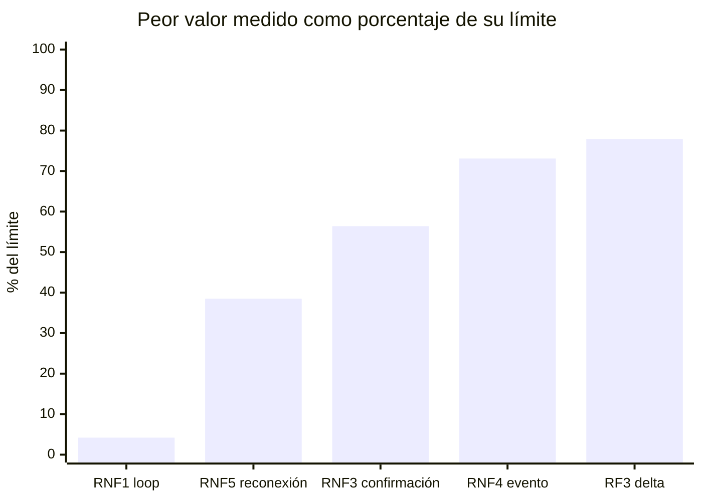

**Figura 12.** Margen de cada requisito de tiempo. Barras: el peor valor medido dividido por su límite. RNF1: 21 de 500 ms; RNF5: 3848 de 10 000 ms; RNF3: 1691 de 3000 ms; RNF4: 804 de 1100 ms; RF3: 1169 de 1500 ms. El intervalo entre reportes de RF2 (59 999 de 61 500 ms) no se incluye, porque está fijado por el heartbeat de 60 s y no es un retraso.

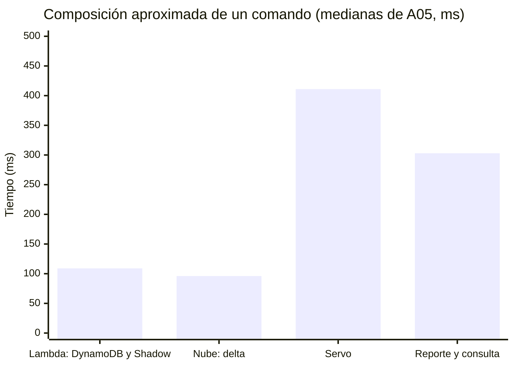

**Figura 13.** De dónde sale la mediana de 919 ms entre la llegada del intent y la respuesta "Listo". Datos de [A05_analisis.txt](docs/evidencias/A05/A05_analisis.txt): la nube aporta una mediana de 96 ms (`UpdateThingShadow` → `DELTA_RX`); el servo, 11 ms hasta arrancar más 400 ms de movimiento; la Lambda, desde que recibe el intent hasta escribir `desired`, el resto de la mediana de 616 ms hasta el servo detenido (unos 109 ms); y el reporte junto con la espera entre consultas de la Lambda, los 303 ms que separan los 616 ms de los 919 ms. Los segmentos se calcularon con medianas, así que su suma es aproximada.

### 5.2 Análisis crítico

Lo que los datos permiten afirmar:

- **Todos los requerimientos medidos cumplen, con margen.** El peor caso de cada requisito de tiempo queda entre el 4 % y el 78 % de su límite (Figura 12). RNF3, el requisito central de la consigna, usó como máximo el 56 % de los 3 s, y en mediana el 31 %.
- **El tiempo de respuesta lo domina el servo, no la nube.** De los 919 ms de mediana, 411 ms son el servo y solo 96 ms la entrega del `delta` (Figura 13). La confirmación en `reported` (RF10) agrega unos 300 ms de reporte y de espera entre consultas a cambio de una respuesta verdadera: el usuario escucha "Listo" solo cuando la puerta se movió.
- **Los máximos de los reportes son una decisión de diseño.** Los 804 ms de RNF4 y los 1169 ms de RF3 no son ruido: son el intervalo mínimo de 1 s entre reportes, que agrupa los cambios muy seguidos para no generar ráfagas de mensajes. En el caso normal, el reporte sale 5 ms después del cambio.
- **El Shadow desacopla de verdad a Alexa del objeto.** Una orden dada con el objeto sin red o sin energía se guardó en `desired` y se aplicó sola entre 3.3 y 3.9 s después de recuperarse (A07, A08), sin movimientos duplicados.
- **La skill no está atada a un único Thing.** Dos usuarios, cada uno con su Thing, solo actuaron sobre el suyo (A02), y la vinculación se valida antes de guardarse (A01).
- **El firmware es estable en el tiempo probado.** 27.3 min de corrida medida y 83 min sin reiniciar, con 0 caídas y sin pérdida de memoria (A10).
- **Las pruebas encontraron defectos reales.** D1 y D2 (§4.4) no se veían usando el sistema: el servo parecía funcionar y el bloqueo solo aparecía con WiFi pero sin Internet. Sin B02 y sin el corte de red de A07, el sistema habría confirmado posiciones antes de tiempo y se habría congelado con una red degradada.

Lo que los datos no permiten afirmar:

- **La exactitud del servo**, que quedó pendiente de medición, ni la posición física real de la puerta, porque `servo_angle` es el ángulo ordenado y no uno medido.
- **Una tasa de detección del PIR del 95 % o más.** Con 15 cruces, la cota inferior de confianza es 81.9 %, y solo se probaron cruces laterales a tres distancias.
- **El tiempo percibido por el usuario de punta a punta.** RNF3 empieza cuando la Lambda recibe el intent; el reconocimiento de voz del simulador no está incluido.
- **Estabilidad por días.** Se midieron 27.3 min de corrida analizada y 83 min sin reiniciar; no se probaron horas ni días seguidos, ni el comportamiento al renovar la conexión TLS a largo plazo.
- **La generalidad de los tiempos.** Todo se midió en una noche, con una red (el hotspot de un celular) y una placa.

---

## 6. Conclusiones

1. **Integración completa a través del Shadow.** El sistema cumple los requerimientos funcionales RF1 a RF12: el objeto reporta presencia y estado de la puerta en `reported`, aplica el `delta` en el servo y lo confirma, y la skill responde consultas y ejecuta comandos en español sobre el Thing de cada usuario, sin comunicarse nunca directamente con el objeto (§5.1).
2. **El Device Shadow es lo que da robustez al sistema.** Como la Lambda solo escribe `desired` y el objeto solo `reported`, una orden no se pierde si el objeto está desconectado: en A07 y A08 se aplicó sola entre 3.3 y 3.9 s después de volver la red o la energía, muy por debajo del límite de 10 s de RNF5.
3. **Confirmar con `reported` vale el costo.** Esperar la confirmación del objeto (RF10) agrega unos 300 ms a la respuesta, pero la mediana sigue en 919 ms, el 31 % del límite de 3 s. A cambio, la skill nunca afirma que la puerta se movió cuando no ocurrió: con la placa sin energía respondió que no recibió confirmación (A08), y con el objeto desconectado avisó que la orden queda en espera (A07).
4. **La política de reporte cumple la consigna y la capa gratuita.** El reporte por evento con 1 s mínimo y heartbeat de 60 s reporta los cambios con una mediana de 5 ms y un máximo de 804 ms, y en reposo usa 1440 mensajes por día, el 19 % de las operaciones de Shadow gratuitas; un heartbeat de 10 s las habría superado (§2.8.3).
5. **La vinculación por código permite varios usuarios con validación.** El código de 6 dígitos sin cero inicial, validado contra el registro de AWS IoT antes de guardarse, separa a cada usuario en su Thing (A01, A02) y es compatible con cómo Alexa entrega los números.
6. **Un diseño modular se pudo probar sin AWS.** Las interfaces `DeviceComponent` y `ShadowTransport` permitieron probar el firmware por el puerto serie (B02), y la inyección del reloj en la Lambda, probar el límite de 3 s sin esperar (B01). Esas pruebas encontraron un defecto (D1) que el uso normal no mostraba.
7. **Los logs con hora UTC hicieron medibles los requerimientos.** Un log de eventos en el objeto y una línea `SKILL_REQUEST` por solicitud, unidos por la versión del Shadow, permitieron medir cada requerimiento con números y no por observación, y descomponer el tiempo de un comando en sus partes (Figura 13).

---

## 7. Recomendaciones

Mejoras técnicas, cada una ligada a la prueba que la motiva:

- **Conexión MQTT no bloqueante (A07, D2).** La conexión exitosa todavía detiene `loop()` unos 2 s (`max_loop_ms=2111`). Moverla a una tarea propia de FreeRTOS, o usar un cliente MQTT asíncrono, dejaría el PIR y el LED funcionando durante la reconexión.
- **Borrar las órdenes inválidas (A09).** Al rechazar un valor, el objeto podría publicar `{"state":{"desired":{"door":null}}}` para borrarlo y evitar que AWS reenvíe el `delta` con cada reporte (13 `INVALID_VALUE` para 3 publicaciones).
- **Aplicar los permisos mínimos (§3.4.4, B03).** Reemplazar `Allow * *` por [iot-policy.json](aws/iot-policy.json) y las políticas administradas de la Lambda por [lambda-role-policy.json](aws/lambda-role-policy.json). Con varios dispositivos, una política con variables de AWS IoT (por ejemplo, el nombre del Thing conectado) evita escribir una política por cada uno.
- **Medir la exactitud del servo y la posición real de la puerta (A06-C, §4.5).** Completar la medición con transportador y agregar un sensor de puerta, como un *reed switch* o un final de carrera, como un componente más (`DeviceComponent`): así `reported.door` diría dónde está la puerta y no solo qué se le ordenó al servo.
- **Fuente aparte para el actuador (§2.2.2).** No hubo reinicios por *brownout*, pero un servo más grande o una cerradura compartirían la corriente del USB con el ESP32. Una fuente de 5 V propia, con la tierra común, elimina ese riesgo.
- **Más evidencia estadística (A05, A06, A10).** Repetir A05 y A10 en otra red y otro día, con corridas de varias horas, y aumentar los cruces del PIR (con 59 de 59 cruces detectados, la cota inferior de confianza llegaría al 95 %), incluyendo personas que se acercan de frente.
- **Primer comando más rápido (A05).** El peor caso (1304 ms de confirmación) fue el primer comando después de 5 min; si el arranque en frío de la Lambda se volviera notorio, se podría reducir el tamaño del paquete o mantener la función activa.
- **Cuenta de AWS.** Configurar una alerta de facturación, como recomienda la consigna, y usar usuarios IAM para cada integrante en lugar de compartir las credenciales de la cuenta.

Extensiones hacia un uso real:

- **Cerradura real.** Reemplazar el servo de la maqueta por una cerradura solenoide de 12 V controlada con un MOSFET, siempre en baja tensión, como otro `DeviceComponent`, con el sensor de puerta para confirmar el cierre.
- **Aviso cuando alguien llega.** Hoy el usuario tiene que preguntar; con eventos proactivos de Alexa, la skill podría avisar cuando `presence` pasa a `true`.
- **Historial de presencia.** Una regla de AWS IoT podría guardar cada cambio de `presence` en otra tabla de DynamoDB, para preguntar "¿cuándo vino alguien?".
- **Varias puertas por usuario.** Agregar una clave de ordenamiento a `user_thing` (por ejemplo, el nombre de la puerta) y un slot en los intents.
- **Prueba de propiedad al vincular (§2.6.4).** Que el objeto muestre un código de un solo uso que cambie en cada vinculación, o implementar Account Linking con OAuth, para que conocer el código fijo no alcance para vincular un objeto ajeno.

Limitaciones conocidas del diseño y cómo resolverlas:

- **Dependencia de Internet:** sin conexión, el objeto no recibe órdenes nuevas. Una puerta real necesitaría además una forma local de abrirla, como un botón o una llave.
- **Conexión sincrónica:** ver la primera recomendación.
- **Posición deducida del comando:** ver la recomendación del sensor de puerta.

---

## 8. Anexos

Evidencias de las pruebas, una carpeta por prueba en [docs/evidencias/](docs/evidencias/README.md); cada carpeta tiene un `README.md` que describe sus archivos y su tabla de medidas.

| Carpeta | Prueba | Archivos principales | Qué demuestra |
|---|---|---|---|
| [A01](docs/evidencias/A01/README.md) | Vinculación, cambio y desvinculación | 19 capturas del simulador y de DynamoDB, `A01_cloudwatch.csv`, `A01_analisis.txt` | 13 de 13 respuestas; un ítem por usuario; persistencia (RF7 a RF9) |
| [A02](docs/evidencias/A02/README.md) | Dos usuarios | 11 capturas de los Shadows, de DynamoDB y de los logs, `A02_ESP32.log` | Cada usuario solo modifica su Thing (RF8) |
| [A03](docs/evidencias/A03/README.md) | Consulta del sensor | 2 capturas, 1 video, `A03_ESP32.log`, `A03_cloudwatch.csv`, `A03_analisis.txt` | 8 de 8 respuestas; reporte en mediana 5 ms (RF4, RNF4) |
| [A04](docs/evidencias/A04/README.md) | Comandos y estado | 7 capturas, 3 videos del servo, `A04_ESP32.log`, `A04_analisis.txt` | 6 de 6 respuestas; `delta` → `reported` en 415 ms (RF3, RF5, RF6, RF10) |
| [A05](docs/evidencias/A05/README.md) | Tiempo de respuesta | 3 capturas, `A05_cloudwatch.csv`, `A05_analisis.txt` | 28 de 28; confirmación en mediana 919 ms y máx. 1691 ms (RNF3) |
| [A06](docs/evidencias/A06/README.md) | Exactitud | `A06_PIR_ESP32.log` | 15 de 15 cruces y 0 falsos positivos (RNF2) |
| [A07](docs/evidencias/A07/README.md) | Caída de WiFi | 5 capturas, 1 video, 2 logs y 2 análisis (antes y después de la corrección D2) | Orden pendiente aplicada a 3297–3848 ms (RNF5, RF11) |
| [A08](docs/evidencias/A08/README.md) | Corte de energía | 4 capturas, 1 video, `A08_ESP32.log` | Orden pendiente aplicada 3.9 s después de enchufar (RNF5, RF10) |
| [A09](docs/evidencias/A09/README.md) | Comandos inválidos | 4 capturas, `A09_ESP32.log` | 3 de 3 inválidos sin movimiento (RF12) |
| [A10](docs/evidencias/A10/README.md) | Estabilidad | `A10_ESP32.log`, `A10_analisis.txt` | 27.3 min, 0 reinicios, `loop()` máx. 21 ms (RNF1, RF2, RNF4) |
| [B01](docs/evidencias/B01/README.md) | Pruebas unitarias de la Lambda | `B01_salida.txt` | 23 de 23 `ok` |
| [B02](docs/evidencias/B02/README.md) | Firmware con transporte serie | 2 salidas y 2 logs (antes y después de la corrección D1) | 16 de 16 casos |
| [B03](docs/evidencias/B03/README.md) | Secretos | `B03_salida.txt` | 0 secretos en archivos e historial (RNF6) |

| Anexo | Archivo | Contenido |
|---|---|---|
| Plan de pruebas | [docs/PLAN_DE_PRUEBAS.md](docs/PLAN_DE_PRUEBAS.md) | Requerimientos y procedimiento detallado de cada prueba |
| Esquema eléctrico | [docs/img/circuito_objeto_inteligente.svg](docs/img/circuito_objeto_inteligente.svg) | Circuito del objeto inteligente (Figura 4) |
| Modelo de interacción | [alexa/interaction-model.es-US.json](alexa/interaction-model.es-US.json) | Invocación, intents, slot y frases de la skill |
| Política de AWS IoT usada | [aws/iot-policy-usada.json](aws/iot-policy-usada.json) | `Allow * *`, tal como está en AWS |
| Política de AWS IoT mínima | [aws/iot-policy.json](aws/iot-policy.json) | Permisos mínimos del certificado para producción |
| Política del rol de la Lambda | [aws/lambda-role-policy.json](aws/lambda-role-policy.json) | Permisos mínimos del rol para producción |
| Tabla de vinculaciones | [aws/dynamodb-table.md](aws/dynamodb-table.md) | Definición de `user_thing` y operaciones |
| Configuración de AWS | [aws/README.md](aws/README.md) | Permisos asignados, por qué y riesgos; datos de la configuración |
| Plantilla de configuración del objeto | [include/secrets.example.h](include/secrets.example.h) | Credenciales y certificados del objeto, sin valores reales |
| Constantes del firmware | [include/config.h](include/config.h) | Pines, tiempos, temas y contrato del Shadow |
| Pruebas unitarias | [lambda/tests/](lambda/tests/test_lambda_function.py) | 23 casos de B01 |
| Herramientas de prueba | [tools/](tools/) | `analyze_log.py`, `serial_check.py`, `serial_logger.py` y `check_secrets.py` |
| Diagramas | Bloques `mermaid` de este informe | Fuentes editables de los diagramas de estados, arquitectura, clases y secuencia, y de las Figuras 12 y 13 |
