# Práctica 4 - Procesamiento, Almacenamiento y Lógica de Negocio de Objetos Inteligentes con AWS y Alexa

**SmartLoft: monoambiente inteligente con dos objetos (ventilación por gas y luces por zona) sincronizados con AWS IoT Core, con lógica de control en el Edge y en la Nube, histórico en DynamoDB y control por voz con Alexa**


|  |  |
| --- | --- |
| **Universidad** | Universidad Católica Boliviana “San Pablo” |
| **Carrera** | Ingeniería de Sistemas |
| **Asignatura** | SIS-234 Internet de las Cosas / 2-2026 |
| **Fecha de entrega** | 24 de noviembre de 2026 |
| **Repositorio** | [https://github.com/Andres004/FourthProject-AWS-IoT](https://github.com/Andres004/FourthProject-AWS-IoT) |
| **Grupo** | 1 |
| **Integrantes** | Ricardo Andres Andrade Vargas · Dabner Eliezer Orozco Veizaga |

> El informe de la Práctica 3 se conserva sin cambios en [Informe.md](Informe.md); el código que describe está en el tag `p3-final` (commit `73fed14`).


---
## Resumen ejecutivo

**Qué es.** SmartLoft es la maqueta de un monoambiente con dos objetos inteligentes. La **placa 1 (ventilación)** mide gas y humo con un MQ-2 y abre la ventana con un servo SG90 cuando el índice supera un umbral; la **placa 2 (luces y entrada)** controla cinco luces por zona y detecta presencia en la entrada con un PIR. El usuario lo maneja con la skill de Alexa **"monoambiente inteligente"**: enciende luces, abre o cierra la ventana, cambia el modo y los umbrales de la ventilación y pregunta si hay gas o alguien en la puerta.

**Qué agrega a la P3.** Lógica de control automática en el **Edge** (gas → ventana, con histéresis, aun sin Internet) y en la **Nube** (si las alarmas se repiten en modo manual, la Nube vuelve a automático), y un **histórico** de lecturas y eventos en DynamoDB, con el origen de cada cambio (`voice`, `edge`, `cloud`, `boot`), del que salen los reportes para la toma de decisiones.

**Cumplimiento** (§5.1).

| Requisito | Declarado | Medido | Veredicto |
|---|---|---|---|
| RF1–RF9 (P3, todos los sensores y actuadores) | §1.4 | Vinculación 10/10 (A01); luces 11/11 (A02); gas y ventana 6/6 (A03); PIR 16/16 y 0 falsos positivos (A12); firmwares 29/29 y 19/19 (B02); Lambdas 86/86 (B01) | Cumple |
| RF10–RF12 almacenamiento con validación y origen | §1.4 | 176 reportes de 66 min guardados con su `origin` (A08); 5/5 inválidos descartados | Cumple |
| RF13 lógica Edge (E1–E3) y Nube (C1) | §2.6 | Edge: 15/15 ciclos con gas real (A05); Nube: C1 actuó en la tercera alarma en `manual` y no en las dos primeras (A06); convivencia 7/7 (A07) | Cumple |
| RF14 modo y umbrales por voz | §1.4 | 7/7 frases, incluidos 2 umbrales inválidos rechazados (A04) | Cumple |
| RF15 mockups de reportes | §2.13 | 4 mockups, cada elemento con su consulta de DynamoDB | Cumple |
| Integridad del almacenamiento | ≥ 99 % | 100 % en las dos placas (96/96 y 80/80) (A08) | Cumple |
| Latencia de almacenamiento | ≤ 5 s | Mediana 325 ms, máx. 655 ms (A08) | Cumple |
| Respuesta automática Edge | ≤ 1000 ms | 400–411 ms en 27 ciclos: 15 sin conexión y 12 con AWS (A05) | Cumple |
| Respuesta automática Nube | ≤ 5000 ms | 591 y 3959 ms del reporte de la alarma al cambio de modo (A06, **n = 2**) | Cumple, con dos mediciones |
| Operación sin conexión | E1 sigue; lo no enviado se cuenta | E1 sin Internet: 15/15 (A05) y 3/3 (A09); órdenes de voz encoladas aplicadas 1.2–3.1 s después de reconectar (A09) | Cumple |
| Costo mensual | Dentro de la capa gratuita | ≈ 0.10 USD/mes con la capa gratuita, ≈ 0.46 USD sin ella (B04) | Cumple |

**Hallazgos** (§4.4). Se encontraron ocho defectos y se corrigieron siete: uno de diseño en la política de reporte (se perdía el evento `mode_changed` de la Nube cuando E1 actuaba en el mismo segundo), uno de montaje (un jumper sin contacto en el GND del MQ-2), un cambio de hardware (el LED de D32 pasó a indicar el gas) tres en las herramientas de prueba y uno de conectividad (la placa 1 perdía la conexión a AWS con −75 dBm de señal; se resolvió con un hotspot junto a las placas). La respuesta automática en el Edge la domina el servo (400 ms); la de la Nube (591 ms) suma la regla, la Lambda, la consulta al índice y la entrega del `delta`; el tiempo total desde que llega el gas lo domina el sensor (1–3 s).

**Cómo probarlo.** El [README](README.md) explica cómo compilar los dos firmwares y correr las pruebas; la evidencia de cada prueba está en [docs/evidencias_p4/](docs/evidencias_p4/).

---
## Contenido

1. [Caso de uso y requerimientos](#1-caso-de-uso-y-requerimientos)
   - [1.1 Caso de uso](#11-caso-de-uso-smartloft) · [1.2 Ampliación respecto a la P3](#12-ampliación-respecto-a-la-práctica-3) · [1.3 Sensores y actuadores](#13-justificación-de-sensores-y-actuadores) · [1.4 Requerimientos funcionales](#14-requerimientos-funcionales) · [1.5 Requerimientos no funcionales](#15-requerimientos-no-funcionales) · [1.6 Matriz de trazabilidad](#16-matriz-de-trazabilidad)
2. [Análisis y diseño](#2-análisis-y-diseño)
   - [2.1 Bloques del objeto](#21-diagrama-de-bloques-del-objeto-inteligente) · [2.2 Arquitectura](#22-diagrama-de-arquitectura-del-sistema) · [2.3 Circuito](#23-diagrama-de-circuito) · [2.4 Clases](#24-diagramas-de-clases) · [2.5 Secuencia](#25-diagramas-de-secuencia) · [2.6 Lógica de control](#26-lógica-de-control-modos-reglas-y-ubicación) · [2.7 Shadow](#27-especificación-de-los-documentos-shadow) · [2.8 Frecuencia de reporte](#28-frecuencia-de-reporte-y-consumo-de-mensajes) · [2.9 DynamoDB](#29-modelo-de-datos-de-dynamodb) · [2.10 Reglas y Lambdas](#210-reglas-de-aws-iot-y-funciones-lambda) · [2.11 Vinculación](#211-vinculación-usuario--things) · [2.12 Skill](#212-diseño-de-la-skill-de-alexa) · [2.13 Mockups](#213-diseño-de-reportes-mockups)
3. [Desarrollo e implementación](#3-desarrollo-e-implementación)
   - [3.1 Entorno](#31-entorno-de-desarrollo) · [3.2 Repositorio](#32-estructura-del-repositorio) · [3.3 Módulos](#33-módulos-y-clases) · [3.4 AWS](#34-configuración-en-aws) · [3.5 Alexa](#35-configuración-en-alexa) · [3.6 Credenciales](#36-credenciales-y-secretos) · [3.7 Ejecución](#37-compilación-carga-y-despliegue) · [3.8 Fragmentos clave](#38-fragmentos-clave) · [3.9 Temporización](#39-temporización-sin-bloqueos) · [3.10 Logs](#310-registro-de-eventos-logs) · [3.11 Buenas prácticas](#311-buenas-prácticas-aplicadas)
4. [Pruebas y validaciones](#4-pruebas-y-validaciones)
   - [4.1 Plan de pruebas](#41-plan-de-pruebas) · [4.2 Físicas y de entorno](#42-a-pruebas-físicas-y-de-entorno) · [4.3 Automáticas](#43-b-pruebas-automáticas) · [4.4 Defectos corregidos](#44-defectos-encontrados-y-corregidos) · [4.5 Análisis de errores](#45-análisis-de-errores)
5. [Resultados](#5-resultados)
6. [Conclusiones](#6-conclusiones)
7. [Recomendaciones](#7-recomendaciones)
8. [Anexos](#8-anexos)

---
## 1. Caso de uso y requerimientos

### 1.1 Caso de uso: SmartLoft

SmartLoft es la maqueta a escala de un monoambiente inteligente con dos objetos inteligentes, uno por función. Será también la base del proyecto final.

| Función | Qué hace | Placa |
|---|---|---|
| Luces por zona | 5 zonas (cocina, sala de estar, comedor, baño y habitación) que se encienden y apagan por voz | 2 (luces y entrada) |
| Ventilación | El MQ-2 detecta gas o humo sobre un umbral → el servo abre la ventana; al volver a la normalidad la cierra | 1 (ventilación) |
| Presencia en la entrada | El PIR solo se consulta por voz ("¿hay alguien en la puerta?"); no acciona nada | 2 |
| Registro | Cada alarma de gas, movimiento de la ventana, cambio de luz y detección en la entrada queda guardado con su hora en DynamoDB | Nube |

**Fuera del alcance:** puerta automática, temperatura y humedad, cortina, ventilador y timbre.

**Aclaración de seguridad:** es un prototipo educativo; no reemplaza un detector de gas certificado ni una válvula de corte.

### 1.2 Ampliación respecto a la Práctica 3

La P3 era una puerta con servo y PIR. En la P4 el caso de uso **cambia** a un monoambiente:

| P3 | P4 | Por qué |
|---|---|---|
| Puerta automática con servo | Se elimina; el servo pasa a mover una **ventana** | La puerta no tenía ninguna variable que justificara lógica automática ni histórico |
| PIR que se consultaba por voz | Se conserva en la entrada, solo para consulta y registro | El grupo no quiere luces que se enciendan por presencia (§2.6) |
| — | **MQ-2** (gas y humo) | Da la variable que justifica la lógica automática: umbral con histéresis en el Edge y alarmas que se cuentan en el día en la Nube |
| — | **5 LEDs** (luces por zona) | Amplía los comandos por voz a varios actuadores del mismo tipo sin cambiar la arquitectura |
| 1 placa, 1 *Thing* | **2 placas**, un *Thing* cada una | La regla "gas → ventana" vive entera en la placa 1 y funciona sin Internet; las placas no se comunican entre sí |

La arquitectura del firmware de la P3 se conserva y se generaliza: el código común pasó a una librería compartida por las dos placas (§3.2) y agregar un sensor sigue siendo agregar una clase `DeviceComponent` (§2.4).

### 1.3 Justificación de sensores y actuadores

| Componente | Cant. | Por qué este y no otro |
|---|---|---|
| MQ-2 | 1 | Único sensor ambiental; responde a gas combustible (GLP, metano) y humo, los riesgos típicos de una cocina. Se usa la salida **analógica** (AO) para que el umbral se cambie por voz (RF14); la salida DO tiene el umbral fijo en un potenciómetro |
| PIR AM312 | 1 | Presencia en la entrada; salida digital de 3.3 V directa al GPIO, sin adaptación |
| Servo SG90 | 1 | Actuador que **no es un LED** (restricción del enunciado), a 5 V (≤ 12 V) |
| LED blanco + 220 Ω | 5 | Representan las luces; se permiten porque no son los únicos actuadores |
| ESP32 | 2 | Una por función: la lógica de seguridad (gas) no depende de la placa de luces ni de Internet |
| Ultrasónico | 0 | El caso no mide niveles ni distancias |

**Precalentamiento.** El MQ-2 estuvo alimentado ≈ 24 h continuas antes de la calibración (22/11 19:27 → 23/11 ≈ 19:25), primero desde el VIN de una ESP32 y, desde el 23/11 ≈ 20:42, desde la fuente externa definitiva. No se grabó la curva de esas 24 h; el calentamiento tras un encendido en frío se mide aparte (A10, `WARMUP_MS`).

**Qué mide el MQ-2.** El firmware no reporta ppm: reporta un **índice relativo** `gas_pct` = tensión de AO / tensión de alimentación × 100. La calibración en ppm exige gases patrón y 24–48 h de precalentamiento por punto; para decidir "abrir la ventana" basta un índice **repetible** y un umbral elegido con datos (§4.2, A10).

### 1.4 Requerimientos funcionales

RF1–RF9 son los de la P3, aplicados a todos los sensores y actuadores; RF10–RF15 son los nuevos del enunciado.

| ID | Requisito | Criterio observable |
|---|---|---|
| RF1 | Capturar los sensores (MQ-2 y PIR) | `GAS_SAMPLE` cada 1 s con `n=20` muestras; `PRESENCE_DETECTED` después del calentamiento de 30 s del PIR (`PIR_READY`) |
| RF2 | Reportar el estado completo en `reported` | Cada reporte trae **todos** los atributos de su placa (§2.7) más `event`, `origin`, `seq` y `device_ts`; nunca pasan más de 61.5 s entre reportes con la conexión activa |
| RF3 | Aplicar el `delta` en los actuadores y confirmarlo | Un `delta` válido cambia el LED o mueve el servo y el nuevo estado aparece en `reported` en ≤ 1.5 s desde `DELTA_RX` |
| RF4 | Consultar por voz gas, presencia, luces y ventana | La skill lee `reported` del *Thing* del usuario y responde con el valor; avisa si el sensor se calienta o si la placa no reporta hace más de 150 s (§2.12) |
| RF5 | Comandos por voz sobre luces y ventana | La skill escribe `desired` con `cmd_origin = voice` en el *Thing* del usuario y espera la confirmación en `reported` hasta 3 s (§2.12) |
| RF6 | Estado de los actuadores por voz | "La luz de la cocina está encendida", "la ventana está abierta", según `reported`; menciona si hay una orden pendiente |
| RF7–RF9 | Vinculación usuario ↔ *Things* (un código vincula los dos *Things* de la casa) | El código se valida (6 dígitos, sin 0 inicial), se comprueba que existan los dos *Things* y se guardan dos ítems en `smartloft-user-thing`; persiste entre sesiones y se puede cambiar o borrar (§2.11) |
| RF10 | Reglas de AWS IoT que invocan las Lambdas | `smartloft_data_rule` se dispara con cada reporte y `smartloft_control_rule` solo con `event = gas_alarm_on` (§2.10) |
| RF11 | Validar, enriquecer y guardar las lecturas | La Lambda de datos valida tipos y rangos de todos los atributos (descarta el reporte incompleto o inválido con `DATA_DISCARDED`), agrega `thingName`, `timestamp`, `storedTs` y TTL, y hace `PutItem` (§2.10) |
| RF12 | Guardar los eventos de los actuadores con su origen | La placa reporta `event` y `origin` (`voice`, `cloud`, `edge`, `boot`) en cada cambio; la Lambda de datos los guarda |
| RF13 | Lógica automática en el Edge y en la Nube | E1–E3 en la placa 1; C1 en la Lambda de control, que actúa solo con `desired.mode = auto` (§2.6, §2.10) |
| RF14 | Modo y umbrales en `reported`, consultables y modificables por voz | `mode`, `gas_high_pct` y `gas_low_pct` en `reported`; la placa los aplica desde `desired`, los valida y los guarda en la NVS |
| RF15 | Mockups de reportes para la toma de decisiones | 4 mockups, cada elemento con la consulta de DynamoDB que lo alimenta (§2.13) |

### 1.5 Requerimientos no funcionales

| ID | Atributo | Valor declarado | Cómo se mide | Prueba |
|---|---|---|---|---|
| RNF1 | Estabilidad | ≥ 60 min por placa con 0 reinicios, 0 caídas, `loop()` ≤ 500 ms y pérdida de heap ≤ 4096 bytes | Líneas `HEALTH` y `BOOT` | A11 |
| RNF2 | Exactitud | PIR: 100 % de las pasadas (≥ 15) y 0 falsos positivos en 5 min. Servo: el movimiento termina y se confirma en 400 ± 60 ms. MQ-2: repetibilidad declarada (no exactitud en ppm) | Conteo con video; `ACTUATOR_START` → `ACTUATOR_DONE` en el log; `mq2_probe` | A12, A05, B02, A10 |
| RNF3 | Respuesta por voz | ≤ 3 s Lambda → objeto confirmado, para luces y ventana (valor de la P3) | `DELTA_RX` → `LIGHT_APPLIED` / `ACTUATOR_DONE` y CloudWatch | A02, A03 |
| RNF4 | Frecuencia de reporte | ≥ 1 s entre reportes; heartbeat de 60 s; `gas_changed` si `gas_pct` varía ≥ 3 puntos | `REPORT_TX` del log | B02, A08 |
| RNF5 | Reconexión | Orden pendiente aplicada en ≤ 10 s desde `WIFI_CONNECTED` | `WIFI_CONNECTED` → `GET_RX` → orden aplicada | A09 |
| RNF6 | Seguridad | 0 secretos en los archivos y en el historial | [check_secrets.py](tools/check_secrets.py) | B03 |
| RNF7 | Integridad del almacenamiento | ≥ 99 % de los `seq` publicados guardados en una ventana de ≥ 60 min; 100 % de inválidos descartados | `seq` distintos guardados / (`seq` máx − mín + 1) por placa | A08 |
| RNF8 | Latencia de almacenamiento | ≤ 5 s desde que la placa publica hasta que el ítem queda en DynamoDB | `storedTs − deviceTs` (dos relojes, NTP vs AWS) y `storedTs − timestamp` (solo AWS) | A08 |
| RNF9 | Respuesta de la lógica automática **Edge** | ≤ 1000 ms desde `GAS_ALARM_ON` hasta `ACTUATOR_DONE` | Un solo reloj: `millis()` de la placa 1 | A05 |
| RNF10 | Respuesta de la lógica automática **Nube** | ≤ 5000 ms desde `REPORT_TX event=gas_alarm_on` hasta `MODE_APPLIED origin=cloud` | Un solo reloj: placa 1 | A06 |
| RNF11 | Operación sin conexión | Sin Internet, E1 abre y cierra la ventana igual; los reportes que no salen se pierden (sin buffer) y quedan como huecos de `seq`; al volver se publica el estado completo | Log de la placa 1 contra DynamoDB | A09 |
| RNF12 | Costo | Consumo mensual de mensajes, invocaciones y escrituras dentro de la capa gratuita | Conteo real de A08 extrapolado a 30 días | B04 |

**Ángulo del servo.** A diferencia de la P3 (±5° medido con transportador, A06-C), aquí no se declara exactitud angular: la ventana de la maqueta no se montó a tiempo, así que los ángulos quedan en los valores por defecto (0° y 90°) y `servo_angle` informa el ángulo **ordenado**, no el medido. Lo que se declara y se mide es que el movimiento termina y se confirma en 400 ± 60 ms. Medir el ángulo con la ventana montada queda como recomendación (§7).

**Dinámica del caso de uso.** El humo llega al sensor en segundos y se dispersa en decenas de segundos; abrir la ventana en ≤ 1 s es suficiente. La regla de la Nube (C1) depende de alarmas que ocurren pocas veces al día, por eso tolera unos segundos.

### 1.6 Matriz de trazabilidad

| Requisito | Diseño | Implementación | Prueba |
|---|---|---|---|
| RF1 gas | §2.3 divisor; §2.7 | [GasSensor.cpp](src/vent/GasSensor.cpp): `update()`, `closeWindow()` | A10, B02 |
| RF1 presencia | §2.7 | [PresenceSensor.cpp](src/lights/PresenceSensor.cpp): `update()` | A12 |
| RF2 reporte completo | §2.7, §2.8 | [ShadowReporter.cpp](lib/SmartObjectCore/ShadowReporter.cpp): `publish()` | B02, A08 |
| RF3 luces | §2.7 | [ZoneLight.cpp](src/lights/ZoneLight.cpp): `applyDesired()` | A02, B02 |
| RF3 ventana | §2.6, §2.7 | [VentilationController.cpp](src/vent/VentilationController.cpp): `applyWindow()`; [WindowActuator.cpp](src/vent/WindowActuator.cpp): `moveTo()` | A03, B02 |
| RF12 origen | §2.7, §2.8 | [DeviceComponent.cpp](lib/SmartObjectCore/DeviceComponent.cpp): `commandOrigin()`; `ShadowReporter::nextEvent()` | B02, A08 |
| RF13 E1–E3 | §2.6 | `VentilationController::updateAlarm()`, `enforceEdgeRule()`; [SettingsStore.cpp](src/vent/SettingsStore.cpp) | A05, A09, B02 |
| RF14 modo y umbrales | §2.6, §2.7 | `VentilationController::applyMode()`, `applyThresholds()` | A04, B02 |
| RNF1 | §3.9 | [SmartObjectApp.cpp](lib/SmartObjectCore/SmartObjectApp.cpp): `update()`; `HealthMonitor` | A11 |
| RNF4 | §2.8 | `ShadowReporter::update()`; [ReportQueue.cpp](lib/SmartObjectCore/ReportQueue.cpp) | B02, A08 |
| RNF9 | §2.5.5, §2.6 | `VentilationController::enforceEdgeRule()`; `WindowActuator` (`SETTLE_TIME_MS`) | A05 |
| RNF11 | §2.5.6 | `ShadowReporter::update()` (sin buffer, `seq` sube igual); `ShadowClient` (`/get` al reconectar) | A09 |
| RF4–RF6 voz | §2.12 | [lambda/skill](lambda/skill/lambda_function.py): `GetGasLevelHandler`, `LightCommandHandler`, `WindowCommandHandler`, `send_command()` | A02, A03, B01 |
| RF7–RF9 vinculación | §2.11 | `LinkThingHandler`, `UnlinkThingHandler`, `LinkRepository`, `ThingGateway.exists()` | A01, B01 |
| RF10 reglas | §2.10 | [aws/iot-rules.md](aws/iot-rules.md) | A08 |
| RF11 validación y almacenamiento | §2.9, §2.10 | [lambda/data](lambda/data/lambda_function.py): `ReportValidator`, `ItemBuilder`, `DataRecorder` | A08, B01 |
| RF13 C1 | §2.6, §2.10 | [lambda/control](lambda/control/lambda_function.py): `GasControl`, `AlarmCounter`, `ShadowWriter` | A06, B01 |
| RF14 modo y umbrales (voz) | §2.12 | `SetModeHandler`, `SetThresholdHandler`, `GetThresholdsHandler` | A04, B01 |
| RF15 mockups | §2.13 | [docs/mockups/](docs/mockups/README.md) | — |
| RNF7, RNF8 | §2.9 | `seq`, `deviceTs`, `storedTs` en cada ítem | A08 |
| RNF10 | §2.10 | `smartloft_control_rule` → `GasControl.handle()` | A06 |
| RNF12 | §2.8 | — | B04 |

---
## 2. Análisis y diseño

### 2.1 Diagrama de bloques del objeto inteligente

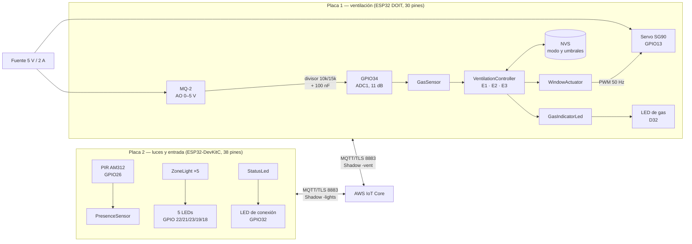

Las placas **no se comunican entre sí ni comparten GND**: todo pasa por sus Shadows. Las dos ESP32 se alimentan por USB. El servo y el MQ-2 se alimentan de una fuente externa de 5 V / 2 A, con GND común con la placa 1; ningún pin de la ESP32 (VIN, 3V3 ni GPIO) va a la línea de 5 V. Se eligió la fuente externa en lugar de VIN porque en la P4 se suma el calefactor del MQ-2 (unos 150 mA permanentes) y así el sensor se calibra con la misma alimentación que usa al final.

**Indicadores.** En la placa 1, el LED de D32 indica el **gas**: apagado = aire normal, encendido = alarma, parpadeo lento = sensor calentando. Hace visible la decisión del Edge en la demo aunque la ventana no se mueva (modo `manual`) y funciona sin conexión; no es un actuador. En la placa 2, el LED de GPIO32 indica la **conexión**, como en la P3.

### 2.2 Diagrama de arquitectura del sistema

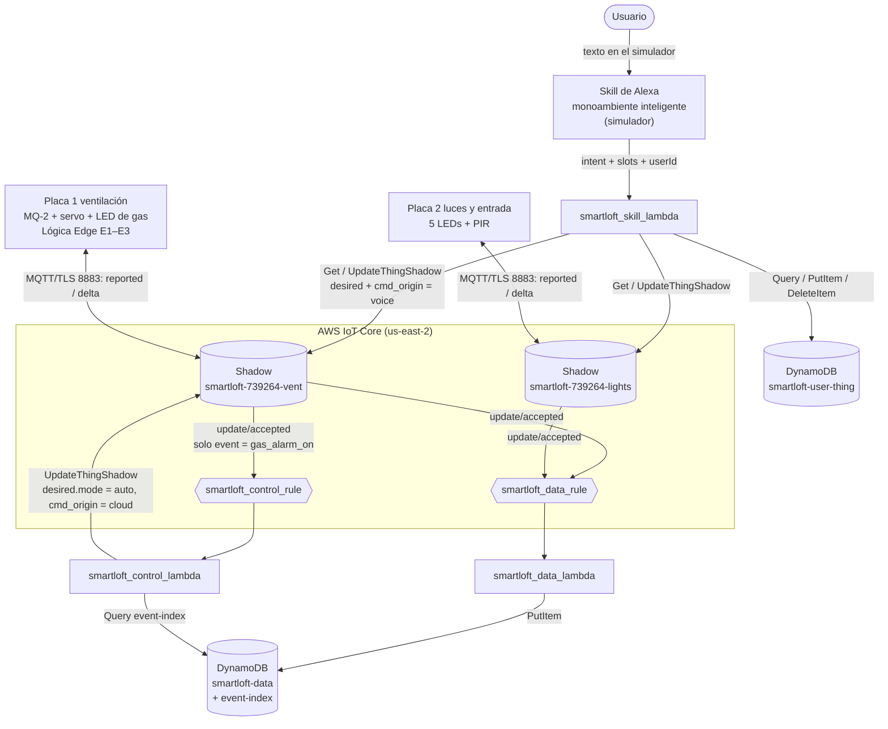

Tres flujos, como en el ejemplo del docente:

| Flujo | Recorrido |
|---|---|
| **Voz** | Usuario → skill → `smartloft_skill_lambda` resuelve los *Things* del `userId` en `smartloft-user-thing` → lee `reported` o escribe `desired` en el Shadow → `delta` a la placa → la placa aplica y reporta → la Lambda ve la confirmación y responde |
| **Almacenamiento** | Cada reporte aceptado por el Shadow → `smartloft_data_rule` → `smartloft_data_lambda` valida, enriquece y guarda en `smartloft-data` |
| **Control en la Nube (C1)** | El reporte del inicio de una alarma → `smartloft_control_rule` → `smartloft_control_lambda` cuenta las alarmas de 24 h en `event-index` → si son ≥ 3 y el modo es `manual`, escribe `desired.mode = auto` → la placa lo aplica y E1 abre la ventana si el gas sigue alto |

**Alexa y la Nube nunca hablan con las placas:** todo pasa por los Shadows. Las placas no se comunican entre sí.

**Por qué esta arquitectura:**
- **Lo urgente en el Edge, lo que necesita historia en la Nube.** Gas → ventana se decide en la placa en ≈ 0.4 s y funciona sin Internet (A05). Contar alarmas del día necesita el histórico de DynamoDB, que la placa no tiene.
- **Dos reglas y dos Lambdas, no una.** La de datos se dispara con cada reporte (~1 por minuto por placa) y solo necesita `dynamodb:PutItem`; la de control se dispara pocas veces al día y necesita `dynamodb:Query` e `iot:UpdateThingShadow`. Juntas, la función que guarda cada heartbeat tendría permiso para mover la ventana y la lógica de C1 correría con cada mensaje (más costo y más riesgo).
- **Un *Thing* por placa.** Cada placa tiene su certificado y su Shadow; un usuario tiene dos *Things*, uno por `place`.

### 2.3 Diagrama de circuito

**Figura 2.3a.** Placa 1 (ventilación): MQ-2 con divisor y filtro hacia D34, servo en D13 con su capacitor, LED indicador de gas en D32 y fuente externa de 5 V.

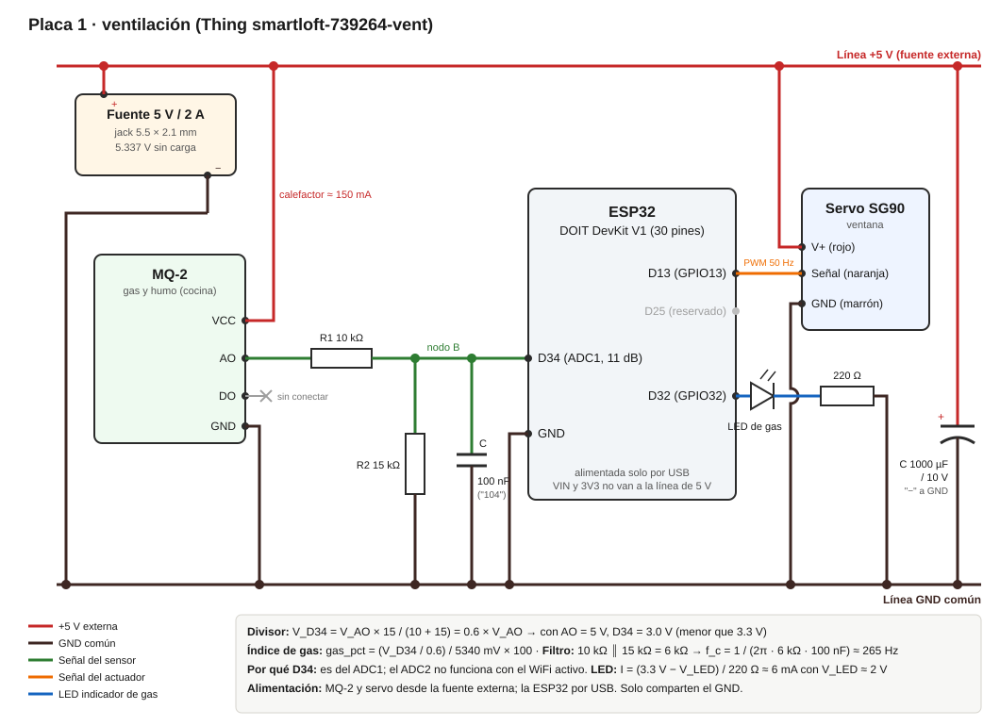

**Figura 2.3b.** Placa 2 (luces y entrada): cinco luces con 220 Ω, PIR a 3V3 con salida en GPIO26 y LED de estado de la conexión en GPIO32.

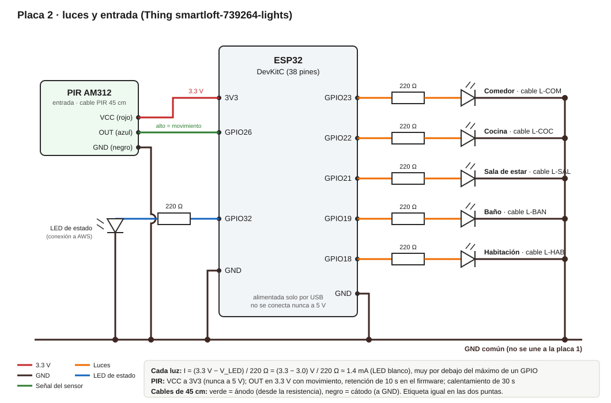

**Divisor del MQ-2.** La AO del módulo llega a 5 V y el ADC del ESP32, con 11 dB, mide hasta ~3.1 V:

- `V_D34 = V_AO × R2 / (R1 + R2) = V_AO × 15 kΩ / 25 kΩ = 0.6 × V_AO`
- Con `V_AO = 5.0 V` → `V_D34 = 3.0 V` (< 3.3 V). No se midió con la punta AO en +5 V porque no hubo multímetro; la prueba de seguridad del divisor queda indirecta: el gas más alto registrado (86 %, A05) dio `gas_mv` = 4590 mV, es decir ≈ 2.75 V en D34, por debajo de 3.3 V.
- El firmware reconstruye `gas_mv = V_D34 / 0.6` y calcula `gas_pct = gas_mv / SUPPLY_MV × 100`, con `SUPPLY_MV` = 5340 mV (fuente sin carga; ver abajo).
- Con AO en unos 4 V (máximo real del módulo) → `V_D34 ≈ 2.4 V`.
- Corriente del divisor: `5 V / 25 kΩ = 0.2 mA`, despreciable para la salida del módulo.
- Filtro: el capacitor de 100 nF ve `10 kΩ ∥ 15 kΩ = 6 kΩ`, así que `f_c = 1 / (2π · 6 kΩ · 100 nF) ≈ 265 Hz`: deja pasar los cambios del gas (segundos) y atenúa el ruido.
- El MQ-2 va al ADC1 (D34) porque el ADC2 no funciona con el WiFi activo; en la fila libre de la protoboard de la placa 1 no hay otro pin analógico del ADC1.
- **Fuente:** 5.337 V sin carga en el jack (multímetro UNI-T UT890D) y ≈ 5.35 V en el SPL-62. El firmware y `mq2_probe` usan `SUPPLY_MV = 5340`, así los umbrales de la calibración significan lo mismo en los dos; el bus con el MQ-2 y el servo funcionando no se midió (no hubo multímetro el día de las pruebas); queda como recomendación (§7).

**LED de cada zona.** `I = (3.3 V − V_LED) / 220 Ω`; con `V_LED ≈ 3.0 V` (blanco) → `I ≈ 1.4 mA`, muy por debajo del máximo de un GPIO. Se probó 220 Ω frente a 110 Ω sin diferencia visible de brillo, así que se eligió 220 Ω.

**Servo.** Rojo a la línea de 5 V, marrón a GND y naranja a D13, con un **capacitor de 1000 µF / 10 V** entre 5 V y GND cerca del servo (franja "−" a GND), para absorber el pico de corriente al arrancar el motor.

**Pines** (ninguno es de arranque ni de la flash):

| Placa | GPIO | Componente | Cable |
|---|---|---|---|
| 1 | 13 | Señal del servo | `SERVO` |
| 1 | 34 | MQ-2 AO (divisor + 100 nF) | `MQ2` |
| 1 | 32 | LED indicador de gas (D32 → LED → 220 Ω → GND) | — |
| 1 | 25 | Reservado (buzzer), sin conectar | — |
| 2 | 32 | LED de estado de la conexión | — |
| 2 | 22 | Luz de la cocina | `L-COC` |
| 2 | 21 | Luz de la sala de estar | `L-SAL` |
| 2 | 23 | Luz del comedor | `L-COM` |
| 2 | 19 | Luz del baño | `L-BAN` |
| 2 | 18 | Luz de la habitación | `L-HAB` |
| 2 | 26 | PIR OUT (VCC a 3V3, nunca a 5 V) | `PIR` |

### 2.4 Diagramas de clases

#### 2.4.1 Firmware de los objetos inteligentes (ESP32)

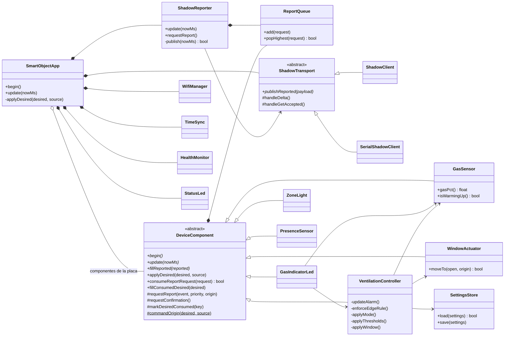

- **[lib/SmartObjectCore/](lib/SmartObjectCore/)** contiene el código común a las dos placas, sin duplicar: conexión, Shadow, reporte, log y salud. `SmartObjectApp` escribe una sola vez la secuencia de `setup()` y `loop()`; cada `main.cpp` solo declara sus componentes y sus credenciales. La librería no lee archivos de secretos: las credenciales se le pasan desde `main.cpp`.
- **[src/vent/](src/vent/)** y **[src/lights/](src/lights/)** tienen los componentes de cada placa. Agregar un sensor o actuador es escribir una clase `DeviceComponent` y sumarla al arreglo `components[]` de su `main.cpp`.
- `VentilationController` es el único que decide quién mueve la ventana (voz en `manual`, E1 en `auto`); `WindowActuator` solo obedece y confirma.
- En los entornos `*_local_test`, `SerialShadowClient` reemplaza a AWS: el mismo código se prueba por el puerto serie (B02).

#### 2.4.2 Funciones Lambda

Cada Lambda separa la lógica (clases y funciones puras) de los clientes de AWS, que se crean una vez por contenedor y se inyectan; así las pruebas unitarias (B01) reemplazan DynamoDB, AWS IoT y el reloj por dobles.

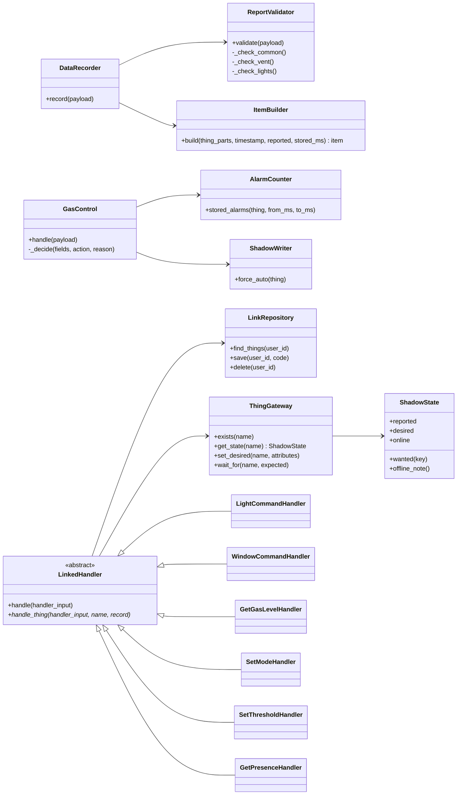

| Lambda | Clase | Responsabilidad |
|---|---|---|
| [data](lambda/data/lambda_function.py) | `ReportValidator` | Tipos y rangos de cada atributo según la placa; lanza `InvalidReport` con el motivo |
| | `ItemBuilder` | Clasifica (`reading` / `event`), arma `eventKey` solo en eventos, calcula `expiresAt` (TTL) |
| | `DataRecorder` | Coordina: valida, arma, `PutItem` y una línea `DATA_STORED` o `DATA_DISCARDED` |
| [control](lambda/control/lambda_function.py) | `AlarmCounter` | `Query` en `event-index` de las `gas_alarm_on` de la ventana de tiempo |
| | `ShadowWriter` | `UpdateThingShadow` con `{"desired": {"mode": "auto", "cmd_origin": "cloud"}}` |
| | `GasControl` | Decide C1 y escribe una línea `CONTROL_DECISION` |
| [skill](lambda/skill/lambda_function.py) | `LinkRepository` | Los dos ítems del usuario en `smartloft-user-thing` |
| | `ThingGateway`, `ShadowState` | `DescribeThing`, `GetThingShadow`, `UpdateThingShadow`; lectura del documento, antigüedad del último reporte y orden pendiente |
| | `LinkedHandler` y un handler por intent | Resuelve los *Things* del usuario antes de cada consulta o comando; un handler por intent |
| | `RequestTimer`, `RequestLogger` | Una línea `SKILL_REQUEST` por solicitud, con el `userId` reducido a un hash |

### 2.5 Diagramas de secuencia

#### 2.5.1 Consulta del sensor: "¿hay gas en la cocina?"

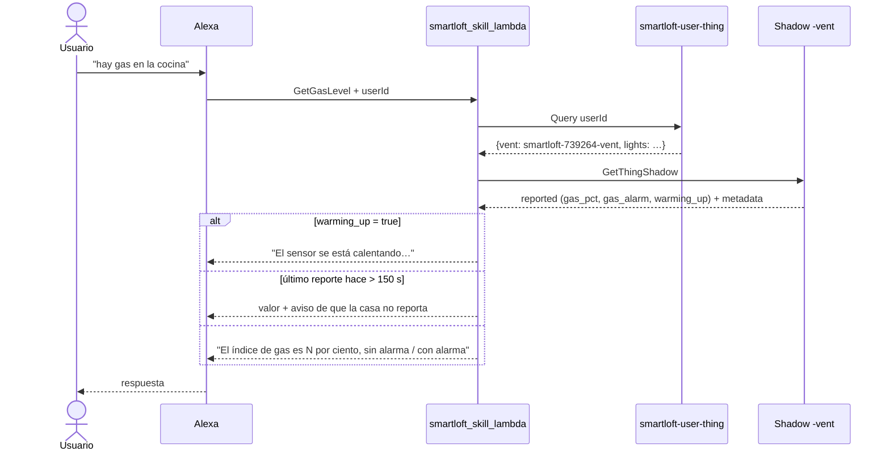

#### 2.5.2 Comando sobre un actuador: "enciende la luz de la cocina"

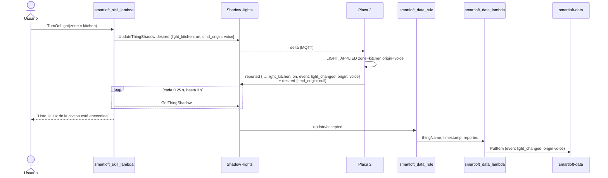

#### 2.5.3 Almacenamiento de un dato

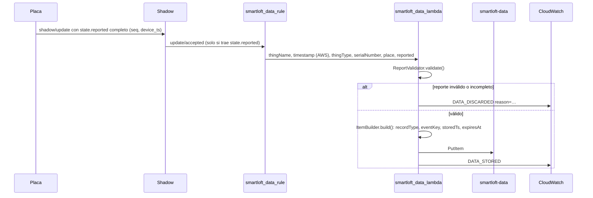

#### 2.5.4 Regla C1: alarmas repetidas en modo manual

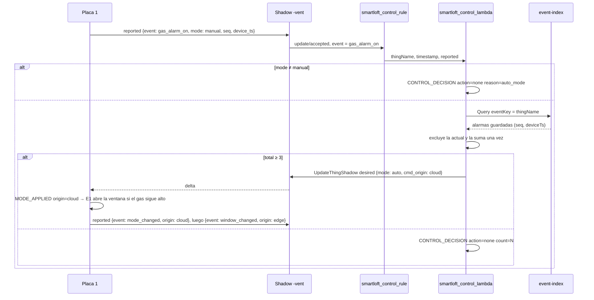

El reporte que produce la orden de la Nube trae `event = mode_changed`, que no pasa el filtro de la regla de control: no hay bucle.

Las dos secuencias siguientes ocurren dentro del objeto.

#### 2.5.5 Regla E1: gas en modo automático (Edge)

```mermaid
sequenceDiagram
    participant MQ as MQ-2
    participant GS as GasSensor
    participant VC as VentilationController
    participant WA as WindowActuator
    participant SR as ShadowReporter
    participant SH as Shadow -vent

    MQ->>GS: AO sube (humo)
    GS->>GS: promedio de 1 s → gas_pct ≥ gas_high_pct
    VC->>VC: GAS_ALARM_ON (t0, millis)
    VC->>WA: moveTo(open, edge) → EDGE_ACTION
    WA-->>WA: ACTUATOR_DONE tras 400 ms (t1)
    Note over VC,WA: Respuesta Edge = t1 − t0 (A05), sin pasar por Internet
    SR->>SH: reported {event: gas_alarm_on, origin: edge, gas_alarm: true, …}
    SR->>SH: 1 s después: reported {event: window_changed, window: open, …}
    Note over SH: Las reglas de datos y de control reciben ambos reportes; en modo auto C1 no actúa
```

#### 2.5.6 Operación sin conexión y reconexión

```mermaid
sequenceDiagram
    participant U as Usuario (Alexa)
    participant SH as Shadow -vent
    participant P1 as Placa 1

    Note over P1: Hotspot apagado
    P1->>P1: humo → GAS_ALARM_ON → abre la ventana (E1 sigue funcionando)
    P1--xSH: REPORT_TX_FAILED seq=n (se pierde; no hay buffer)
    U->>SH: "cambia el umbral alto a 40" → desired.gas_high_pct = 40
    Note over P1: Vuelve el hotspot
    P1->>SH: MQTT_CONNECTED → /get
    SH-->>P1: GET_RX con desired pendiente (cmd_origin = voice)
    P1->>P1: THRESHOLDS_APPLIED origin=voice y guarda en la NVS (E3)
    P1->>SH: reported completo, seq = n+k (los huecos de seq miden lo perdido)
```

### 2.6 Lógica de control: modos, reglas y ubicación

**Modos de la ventilación:**
- **`auto`** (por defecto): la placa abre y cierra la ventana según el gas. La voz no mueve la ventana; la skill lo rechaza con una explicación.
- **`manual`**: la ventana se mueve solo por voz. Sirve cuando el usuario conoce la causa (por ejemplo, está cocinando) y no quiere que la ventana se mueva. El gas se sigue midiendo y la alarma se sigue reportando y guardando, y no se permite cerrar la ventana mientras haya alarma.

| ID | Regla | Ubicación | Justificación |
|---|---|---|---|
| E1 | En `auto`: `gas_alarm` se enciende con `gas_pct ≥ gas_high_pct` y se apaga con `gas_pct ≤ gas_low_pct` (histéresis); la ventana sigue a la alarma, con origen `edge` | Edge (placa 1) | Respuesta inmediata (≈ 400 ms del servo); sigue funcionando sin Internet; depende solo del dato local |
| E2 | Durante el calentamiento del MQ-2 (`WARMUP_MS` = 60 000 ms) no hay alarma ni acción automática | Edge | Solo la placa sabe cuándo arrancó el sensor. En A10 un arranque en frío tras 15 min apagado no mostró transitorio; los 60 s quedan como margen |
| E3 | El modo y los umbrales se guardan en la NVS al aplicarlos | Edge | Si la placa se reinicia sin Internet, E1 sigue con los últimos valores y no con los de compilación |
| C1 | Al empezar una alarma en `manual`: si hubo ≥ 3 en 24 h, volver a `auto` | Nube (Lambda de control) | Necesita el histórico de DynamoDB, que la placa no tiene; el límite se cambia sin reprogramar. Detalle: **Ricardo** |

**Descartado:** encender luces por presencia (el PIR es solo informativo); "gas → encender luces" (accionar interruptores durante una fuga es justo lo que se recomienda no hacer); detectar placas que dejaron de reportar con una Lambda programada (queda como recomendación, §7).

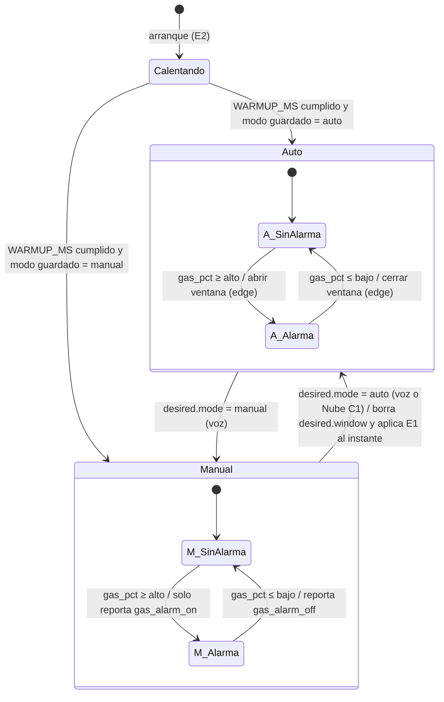

**Convivencia de la voz con la lógica automática.** La skill aplica estas reglas con una respuesta explicativa (§2.12); la placa las vuelve a aplicar como **defensa en profundidad**, de modo que tampoco un `desired` publicado a mano desde el MQTT test client puede saltárselas:

| Situación | Qué hace la placa | Log |
|---|---|---|
| `window` en `auto` | Rechaza y borra `desired.window` | `COMMAND_REJECTED reason=auto_mode` |
| `window = closed` con alarma (en `manual`) | Rechaza y borra `desired.window` | `COMMAND_REJECTED reason=gas_alarm` |
| Umbrales fuera de 1–99, bajo ≥ alto o no enteros | Rechaza | `COMMAND_REJECTED reason=invalid_thresholds` |
| `mode` o `window` con un valor desconocido | Rechaza | `INVALID_VALUE` |
| `window` en `manual` sin alarma | Mueve, confirma y borra `desired.window` y `cmd_origin` | `ACTUATOR_START origin=voice` → `ACTUATOR_DONE` |
| `mode = auto` | Aplica, borra `desired.window` y E1 decide la ventana en el mismo ciclo | `MODE_APPLIED`, luego `EDGE_ACTION` si corresponde |

**C1 se vuelve a disparar a propósito.** Si después de que la Nube pone `auto` el usuario vuelve a `manual`, la siguiente alarma dentro de las mismas 24 h encuentra otra vez ≥ 3 alarmas y la Nube devuelve la ventilación a `auto`. Mientras el gas se siga repitiendo, el modo `manual` no se sostiene; es el comportamiento buscado.

### 2.7 Especificación de los documentos Shadow

**Placa 1 — `smartloft-739264-vent`:**

| Atributo | Sección | Tipo | Valores válidos | Escribe |
|---|---|---|---|---|
| `gas_pct` | reported | number (1 decimal) | 0.0–100.0, índice relativo (no ppm) | Placa |
| `gas_mv` | reported | int | 0–5000 mV en AO | Placa |
| `gas_alarm` | reported | bool | Histéresis E1, en los dos modos | Placa |
| `warming_up` | reported | bool | `true` durante E2 | Placa |
| `window` | desired / reported | string | `open`, `closed`; en `desired` solo en `manual` y hasta que la placa lo aplica | Skill / placa |
| `servo_angle` | reported | int | `CLOSED_ANGLE_DEG` = 0, `OPEN_ANGLE_DEG` = 90 (por defecto; se calibran al montar la ventana en la maqueta) | Placa |
| `mode` | desired / reported | string | `auto`, `manual` | Skill o Lambda de control / placa |
| `gas_high_pct`, `gas_low_pct` | desired / reported | int | 1–99, bajo < alto; por defecto 15 / 8 (calibración A10) | Skill / placa |
| `cmd_origin` | desired | string | `voice` (skill) o `cloud` (Lambda de control); la placa lo borra al aplicar la orden | Skill / Lambda de control |
| `event` | reported | string | `boot`, `heartbeat`, `gas_changed`, `gas_alarm_on`, `gas_alarm_off`, `window_changed`, `mode_changed`, `thresholds_changed` | Placa |
| `origin` | reported | string | Quién causó el último cambio: `boot`, `voice`, `cloud`, `edge` | Placa |
| `seq` | reported | int | Contador de reportes desde el arranque; sube en cada intento de publicar, aunque falle | Placa |
| `device_ts` | reported | int | Epoch UTC en ms (NTP); 0 mientras no hay hora | Placa |

```json
{
  "state": {
    "desired": { "mode": "auto", "gas_high_pct": 30, "gas_low_pct": 20 },
    "reported": {
      "gas_pct": 8.4, "gas_mv": 420, "gas_alarm": false, "warming_up": false,
      "window": "closed", "servo_angle": 0,
      "mode": "auto", "gas_high_pct": 30, "gas_low_pct": 20,
      "event": "heartbeat", "origin": "boot", "seq": 1532, "device_ts": 1795862400123
    }
  }
}
```

**Placa 2 — `smartloft-739264-lights`:**

| Atributo | Sección | Tipo | Valores válidos | Escribe |
|---|---|---|---|---|
| `light_kitchen`, `light_living`, `light_dining`, `light_bathroom`, `light_bedroom` | desired / reported | string | `on`, `off` | Skill / placa |
| `presence` | reported | bool | `true` desde un movimiento hasta 10 s después del último | Placa |
| `event` | reported | string | `boot`, `heartbeat`, `light_changed`, `presence_detected`, `presence_cleared` | Placa |
| `origin`, `seq`, `device_ts`, `cmd_origin` | | | Como en la placa 1 | |

**Uso de `desired`, `reported` y `delta`:**
- La placa solo publica `reported`, con **todos** sus atributos en cada mensaje: la Lambda de datos descarta un reporte incompleto.
- **Excepción documentada:** al aplicar una orden, la placa publica en el mismo mensaje `"desired": {"window": null, "cmd_origin": null}`, solo con las claves que consumió. Así no queda un `delta` viejo que deshaga lo que hizo E1. `mode`, los umbrales y `light_*` **se quedan** en `desired`: son la configuración del usuario y la placa los recupera con `/get` después de reiniciarse.
- Cada `delta` trae `version`; uno repetido o anterior se descarta (`STALE_IGNORED`), como en la P3.
- **Cómo se evitan los bucles:** la placa nunca reporta un cambio que no ocurrió; el reporte que produce una orden de la Nube trae `event = mode_changed`, que no pasa el filtro de la regla de control (`event = gas_alarm_on`).

### 2.8 Frecuencia de reporte y consumo de mensajes

| Placa | Por evento | Heartbeat | Mínimo entre mensajes |
|---|---|---|---|
| 1 | Cambio de alarma, ventana, modo o umbrales; `gas_pct` varía ≥ 3 puntos (`gas_changed`) | 60 s | 1 s |
| 2 | Cambio de una luz; `presence_detected`; `presence_cleared` | 60 s | 1 s |

- **Eventos simultáneos.** Los eventos distintos que ocurren dentro del mismo segundo se encolan y salen uno por segundo, primero el de mayor prioridad (alarma > ventana > modo > umbrales > `gas_changed`). Cuando la Nube pone `auto` y E1 abre la ventana, salen `mode_changed` (origen `cloud`) y, un segundo después, `window_changed` (origen `edge`): la Lambda de datos guarda los dos (§4.4, D-01).
- **El mismo evento repetido se agrupa:** "apaga todas las luces" produce un solo `light_changed`.
- **Muestreo del MQ-2:** cada 50 ms, promedio de 1 s (20 muestras); la histéresis usa el promedio.
- **Justificación:** el gas cambia en segundos y un umbral de 3 puntos filtra el ruido del sensor (en aire limpio, 720 muestras planas en 4.4 %, A10) sin perder una subida real; las luces y el PIR solo cambian por acciones de personas.
- **Volumen en reposo:** 1 mensaje por minuto por placa ≈ 2 × 1440 = 2880 mensajes por día. El volumen real, con eventos, sale de A08 y alimenta el cálculo de costo (B04).

### 2.9 Modelo de datos de DynamoDB

Región `us-east-2`, capacidad **on-demand**. Definición completa en [aws/dynamodb-tables.md](aws/dynamodb-tables.md).

**`smartloft-user-thing`** — qué *Things* tiene cada usuario de Alexa:

| Atributo | Tipo | Clave | Ejemplo |
|---|---|---|---|
| `userId` | S | Partición | `amzn1.ask.account.…` |
| `place` | S | Ordenamiento | `vent` / `lights` |
| `thingName` | S | | `smartloft-739264-vent` |
| `homeCode` | S | | `739264` |
| `linkedAt` | S | | `2026-11-24T05:57:12+00:00` |

**`smartloft-data`** — lecturas y eventos de las placas:

| Atributo | Tipo | Clave / nota |
|---|---|---|
| `thingName` | S | **Partición**: distingue los datos por *Thing* |
| `timestamp` | N | **Ordenamiento**: `timestamp()` de la regla, ms, reloj de AWS |
| `thingType`, `serialNumber`, `place` | S | Del tema MQTT |
| `recordType` | S | `reading` (`heartbeat`, `gas_changed`) o `event` |
| `event`, `origin` | S | Qué pasó y quién lo causó (RF12) |
| `eventKey` | S | `<thingName>#<event>`, **solo en eventos** → índice disperso |
| `gasPct`, `gasMv`, `gasAlarm`, `warmingUp`, `window`, `servoAngle`, `mode`, `gasHighPct`, `gasLowPct` | N / BOOL / S | Ítems de `vent` |
| `lightKitchen`, `lightLiving`, `lightDining`, `lightBathroom`, `lightBedroom`, `presence` | S / BOOL | Ítems de `lights` |
| `seq`, `deviceTs`, `storedTs` | N | Integridad y latencia (A08) |
| `expiresAt` | N | **TTL** (epoch en s): lecturas 30 días, eventos 365 días |

**Índice secundario global `event-index`:** partición `eventKey`, ordenamiento `timestamp`, proyección ALL. Como solo los eventos tienen `eventKey`, el índice no carga los heartbeats.

| # | Patrón de acceso | Consulta | Lo usa |
|---|---|---|---|
| P1 | Registros de un *Thing* en un rango | `thingName = :t AND #ts BETWEEN :a AND :b` | Mockups (curva de gas, uso de luces), A08 |
| P2 | Eventos de un tipo en un rango | `event-index`: `eventKey = :k AND #ts BETWEEN :a AND :b` | **C1** (alarmas de 24 h), mockups de alarmas y presencia |
| P3 | Últimos N registros de un *Thing* | `thingName = :t`, `ScanIndexForward = false`, `Limit = N` | Demo, depuración |
| P4 | *Things* de un usuario | `smartloft-user-thing`: `userId = :u` | Skill |

**Decisiones:**
- **Por qué `thingName` + `timestamp`:** todas las consultas son "un *Thing* en un rango de tiempo"; las placas reportan como mucho uno por segundo, así que la clave no se repite.
- **Por qué un índice disperso:** C1 y los mockups preguntan por **eventos** de un tipo (alarmas, cambios de luz); con `eventKey` solo en eventos, esa consulta no recorre las ~1440 lecturas diarias de cada placa.
- **Por qué TTL distinto:** las lecturas sirven para la curva reciente (30 días); los eventos alimentan los reportes de tendencia (365 días). Limita el volumen almacenado.
- `timestamp` es palabra reservada de DynamoDB: en expresiones escritas a mano se usa `#ts`. Ninguna Lambda hace `Scan`.

### 2.10 Reglas de AWS IoT y funciones Lambda

SQL versión 2016-03-23. Las dos reglas escuchan `update/accepted`: solo los reportes que el servicio del Shadow ya aceptó. Exportadas en [aws/iot-rules.md](aws/iot-rules.md).

**`smartloft_data_rule` → `smartloft_data_lambda`**

```sql
SELECT topic(3) AS thingName,
       timestamp() AS timestamp,
       substring(topic(3), 0, 9) AS thingType,
       substring(topic(3), 10, 16) AS serialNumber,
       substring(topic(3), 17) AS place,
       state.reported AS reported
FROM '$aws/things/+/shadow/update/accepted'
WHERE substring(topic(3), 0, 9) = 'smartloft'
  AND NOT isUndefined(state.reported)
```

**`smartloft_control_rule` → `smartloft_control_lambda`**

```sql
SELECT topic(3) AS thingName,
       timestamp() AS timestamp,
       state.reported AS reported
FROM '$aws/things/+/shadow/update/accepted'
WHERE substring(topic(3), 0, 9) = 'smartloft'
  AND NOT isUndefined(state.reported)
  AND state.reported.event = 'gas_alarm_on'
```

| Función | Disparador | Responsabilidad | Recursos | Permisos mínimos |
|---|---|---|---|---|
| `smartloft_data_lambda` | `smartloft_data_rule` (cada reporte) | Validar, descartar, clasificar, enriquecer y guardar (RF11, RF12) | `smartloft-data` | `dynamodb:PutItem` |
| `smartloft_control_lambda` | `smartloft_control_rule` (solo `gas_alarm_on`) | C1 (RF13) | `event-index`; Shadow `-vent` | `dynamodb:Query` en el índice; `iot:UpdateThingShadow` en `thing/smartloft-*-vent` |
| `smartloft_skill_lambda` | Alexa Skills Kit (Skill ID verificado) | Vinculación, consultas, comandos, modo, umbrales, convivencia | `smartloft-user-thing`; Shadows `smartloft-*` | `dynamodb:Query/PutItem/DeleteItem`; `iot:DescribeThing/GetThingShadow/UpdateThingShadow` |

**Validación de la Lambda de datos.** Todos los atributos de la placa tienen que estar presentes (contrato V1) con su tipo y rango: `seq` y `device_ts` enteros ≥ 0; `event` y `origin` de su lista; `gas_pct` 0–100; `gas_mv` 0–5000; `window`, `mode`, luces de sus valores; umbrales 1–99 con bajo < alto; `presence` y `gas_alarm` booleanos. Si algo falla, el reporte no se guarda y se registra `DATA_DISCARDED` con el motivo.

**Cómo se evitan los bucles:**

| Trampa | Cómo se evita |
|---|---|
| La Lambda de control escribe `desired` → AWS publica otro `update/accepted` | Las dos reglas exigen `NOT isUndefined(state.reported)`: un mensaje solo con `desired` no pasa |
| Los heartbeats repiten `gas_alarm = true` mientras dura la alarma | La regla de control filtra por **evento** (`gas_alarm_on`), que aparece una sola vez por alarma, y no por estado |
| La placa reporta el cambio que pidió la Nube | Ese reporte trae `event = mode_changed`, que no pasa el filtro |
| Un `desired.window` viejo deshace lo que hizo E1 | La placa borra `desired.window` al aplicarlo y al pasar a `auto` (§2.7) |

**Carrera entre reglas.** Las dos reglas se disparan en paralelo con el mismo mensaje, así que cuando corre la Lambda de control la alarma actual puede estar guardada o no. Cuenta las alarmas guardadas por su par (`seq`, `deviceTs`), excluye la actual y la suma una vez.

**Configuración** (`GAS_EVENTS_LIMIT = 3`, `GAS_EVENTS_WINDOW_H = 24`, nombres de tablas e índice, endpoint) en variables de entorno: el límite de C1 se cambia sin reprogramar nada.

### 2.11 Vinculación usuario ↔ Things

Las dos placas imprimen `LINK_CODE 739264` al arrancar y su *Thing* se llama `smartloft-<código>-vent` o `smartloft-<código>-lights` ([config_common.h](include/config_common.h), [config_vent.h](include/config_vent.h), [config_lights.h](include/config_lights.h)).

| Operación | Qué hace la skill |
|---|---|
| Vincular ("vincula mi casa con el código 739264") | Valida 6 dígitos sin 0 inicial; comprueba con `DescribeThing` que existan **los dos** *Things* del código; guarda dos ítems (`place = vent` y `place = lights`) |
| Cambiar ("cambia mi casa al código 518306") | Reemplaza los dos ítems |
| Desvincular | Borra los ítems del usuario |
| Cualquier consulta o comando | `LinkedHandler` busca los *Things* del `userId`; sin vinculación, responde cómo vincular |

Un mismo usuario solo actúa sobre sus *Things*; dos usuarios con códigos distintos no se mezclan (A01, con los *Things* de prueba `smartloft-518306-*`). El `userId` completo no se escribe en los logs: se registra un hash de 10 caracteres.

### 2.12 Diseño de la skill de Alexa

- **Nombre de invocación:** `monoambiente inteligente` (Spanish US). Modelo exportado en [alexa/interaction-model.es-US.json](alexa/interaction-model.es-US.json).
- **Endpoint:** ARN de `smartloft_skill_lambda`, en la cuenta de AWS del grupo (no Alexa-hosted).

| Intent | Slots | Frases de ejemplo |
|---|---|---|
| `LinkThing` | `code` (AMAZON.NUMBER) | "vincula mi casa con el código {code}", "cambia mi casa al código {code}" |
| `UnlinkThing` | — | "desvincula mi casa" |
| `TurnOnLight` / `TurnOffLight` | `zone` (`ZoneType`) | "enciende la luz de la {zone}", "apaga la luz del {zone}", "apaga todas las luces" |
| `GetLightState` | `zone` (`ZoneType`) | "está encendida la luz de la {zone}", "cómo está la luz de la {zone}" |
| `OpenWindow` / `CloseWindow` | — | "abre la ventana", "cierra la ventana" |
| `GetWindowState` | — | "cómo está la ventana", "está abierta la ventana" |
| `GetGasLevel` | — | "hay gas en la cocina", "hay humo en la cocina" |
| `SetMode` | `mode` (`ModeType`) | "activa el modo {mode}", "pon la ventilación en {mode}" |
| `GetMode` | — | "en qué modo está la ventilación" |
| `SetThreshold` | `level` (`LevelType`), `value` (AMAZON.NUMBER) | "cambia el umbral {level} a {value} por ciento" |
| `GetThresholds` | — | "cuáles son los umbrales de gas" |
| `GetPresence` | — | "hay alguien en la puerta", "hay alguien en la entrada" |
| Ayuda, Cancelar, Detener, Fallback, NavigateHome | — | — |

| Tipo de slot | Valores (id → frases) |
|---|---|
| `ZoneType` | `kitchen` → cocina; `living` → sala, sala de estar, living; `dining` → comedor; `bathroom` → baño; `bedroom` → habitación, dormitorio, cuarto; `all` → todas, toda la casa |
| `ModeType` | `auto` → automático; `manual` → manual |
| `LevelType` | `high` → alto, de alarma; `low` → bajo, de cierre |

**Convivencia y respuestas** (la placa repite las mismas reglas, §2.6):

| Situación | Respuesta | ¿Escribe `desired`? |
|---|---|---|
| "abre/cierra la ventana" en `auto` | "La ventilación está en modo automático. Si quieres manejar la ventana, di: activa el modo manual." | No |
| "cierra la ventana" con alarma | "No puedo cerrarla: el índice de gas es N por ciento, por encima del umbral de M." | No |
| Ventana en `manual`, sin alarma | Escribe y espera la confirmación en `reported` (hasta 3 s): "Listo, la ventana está abierta." | Sí |
| Umbral fuera de 1–99, o bajo ≥ alto | "El umbral tiene que ser un número entero entre 1 y 99 por ciento." / "El umbral bajo tiene que ser menor que el alto…" | No |
| "¿hay gas?" durante el calentamiento | "El sensor se está calentando; todavía no hay lecturas confiables." | — |
| Placa sin reportar > 150 s | Avisa que la casa no se reporta y que la orden se aplicará al reconectar | Sí |
| Sin confirmación en 3 s | "Envié la orden, pero todavía no recibo la confirmación. Pregúntame en unos segundos." | Sí |

### 2.13 Diseño de reportes (mockups)

Cuatro reportes para la toma de decisiones, construidos solo con los datos de `smartloft-data`. Cada elemento del mockup indica, en un recuadro punteado, la consulta que lo alimenta. **Los números son ilustrativos**: los reportes no se implementan en esta práctica. Fuentes en [docs/mockups/](docs/mockups/README.md).

| Mockup | Decisión que apoya | Datos (patrones de §2.9) |
|---|---|---|
| **Seguridad de gas** (7 días): alarmas por día, duración de cada apertura, pico de `gasPct`, origen de cada apertura | ¿Hay una fuga recurrente? ¿Revisar la instalación? ¿Los umbrales están bien? | P2 `gas_alarm_on/off`, `window_changed`, `mode_changed`; P1 pico de `gasPct` |
| **Uso de luces por zona** (horas encendidas por día) | Qué zona queda encendida sin uso (ahorro) | P2 `light_changed`, sumando intervalos on → off |
| **Actividad en la entrada** (detecciones por día × franja horaria) | Horarios de ocupación; movimiento cuando la casa debería estar vacía | P2 `presence_detected`; P3 última detección |
| **Modo de la ventilación** (tiempo en `manual` vs `auto`; veces que la Nube volvió a `auto`) | ¿La ventilación queda en manual demasiado tiempo? ¿Cuántas veces intervino C1? | P2 `mode_changed` con su `origin` |

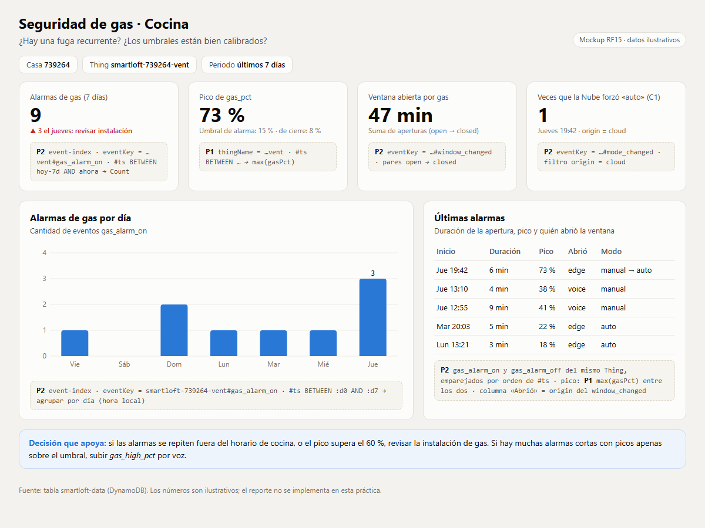

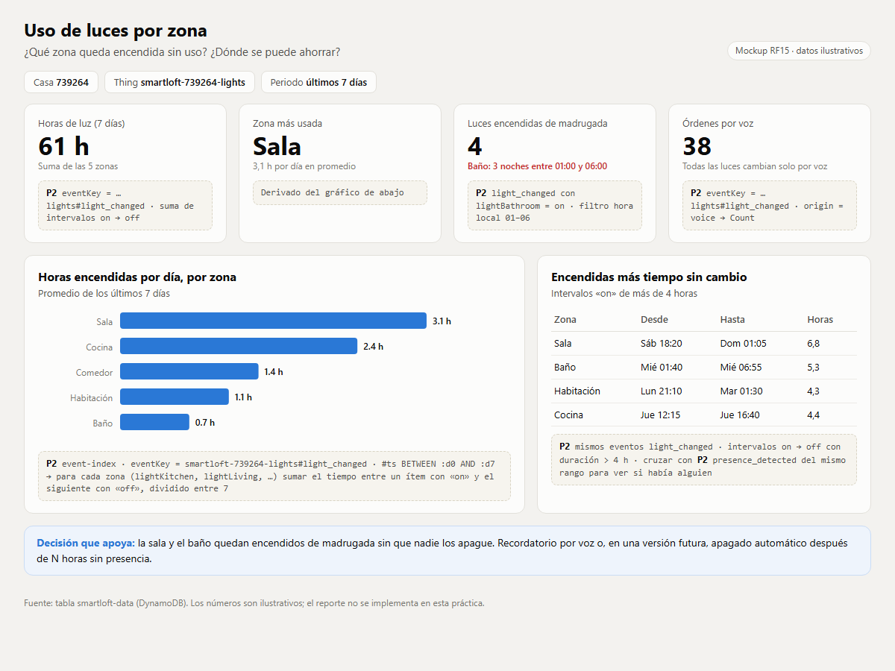

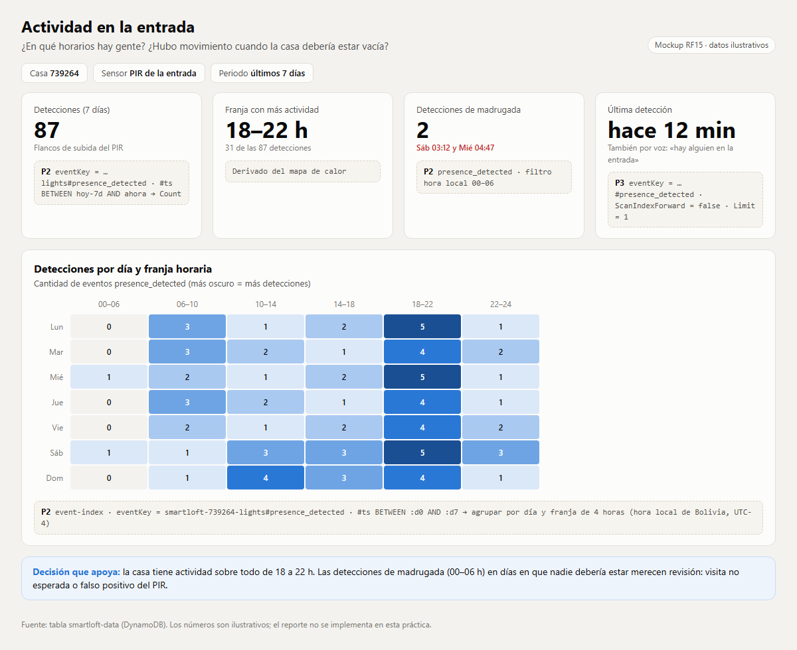

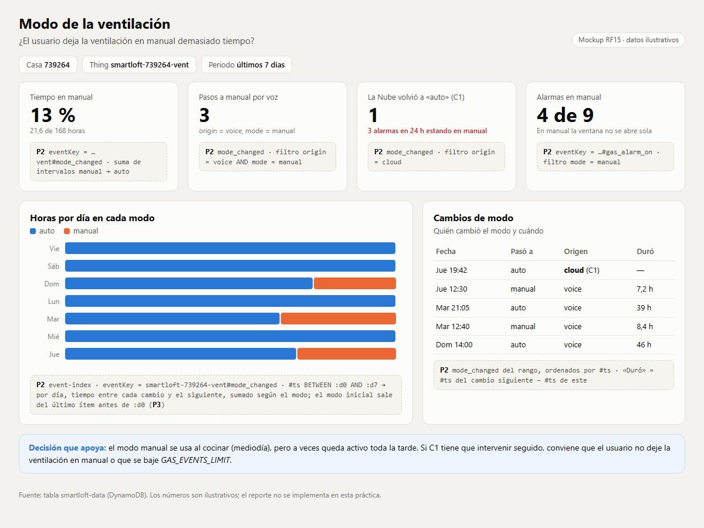

---
## 3. Desarrollo e implementación

### 3.1 Entorno de desarrollo

| Elemento | Firmware de los objetos inteligentes | Herramientas de prueba |
|---|---|---|
| Herramienta | VS Code con PlatformIO IDE (PlatformIO Core 6.2.0) | Python 3.13.7 |
| Plataforma y framework | `espressif32` 7.1.3 con Arduino-ESP32 | Biblioteca estándar de Python, más `pyserial` (incluido en el Python de PlatformIO) para hablar con la placa |
| Librerías | PubSubClient (MQTT), ArduinoJson 7 (JSON), ESP32Servo (servo, solo placa 1), Preferences (NVS, del framework) | — |
| Placas | Placa 1: ESP32 DOIT DevKit V1 (`esp32doit-devkit-v1`). Placa 2: ESP32-DevKitC de 38 pines (`esp32dev`) | — |
| Entornos | `vent` y `lights`, los firmwares reales; `vent_local_test` y `lights_local_test`, los mismos con el Shadow reemplazado por el puerto serie (`-D LOCAL_TEST_MODE`) | — |
| Monitor y logs | Serie a 115200 baud con el filtro `log2file`; `monitor_dtr = 0` y `monitor_rts = 0`, para que abrir el monitor no reinicie la placa | Los scripts de [tools/](tools/) |

| Elemento | Funciones Lambda |
|---|---|
| Runtime | Python 3.13, x86_64, región `us-east-2`; handler `lambda_function.lambda_handler` en las tres |
| Librerías | `boto3` (incluida en el runtime); la skill empaqueta `ask-sdk-core` ([requirements.txt](lambda/skill/requirements.txt)) |
| Pruebas | `unittest` con dobles de DynamoDB, AWS IoT y el reloj (B01) |

### 3.2 Estructura del repositorio

```text
FourthProject-AWS-IoT/
├── README.md                    Hardware, entornos, compilación y pruebas
├── Informe.md                   Informe de la Práctica 3 (sin cambios)
├── Informe_P4.md                Este informe
├── platformio.ini               4 entornos: vent, lights, vent_local_test, lights_local_test
├── .gitignore                   Excluye secretos, certificados, compilados, paquetes y logs crudos
├── include/
│   ├── config_common.h          Constantes compartidas: red, Shadow, reporte, log, salud
│   ├── config_vent.h            Placa 1: pines, divisor, gas, ventana, eventos, NVS
│   ├── config_lights.h          Placa 2: pines, zonas, PIR, eventos
│   ├── secrets_vent.example.h   Plantillas sin valores reales; los secrets_*.h reales
│   └── secrets_lights.example.h no se versionan
├── lib/SmartObjectCore/         Código común a las dos placas (una clase por .h/.cpp)
│   ├── SmartObjectApp.*         Secuencia de setup() y loop()
│   ├── DeviceComponent.*        Interfaz de sensores y actuadores; pedidos de reporte
│   ├── ReportQueue.*            Cola de eventos pendientes por prioridad
│   ├── ReportTypes.h            Tipos compartidos (origen del desired, pedido de reporte)
│   ├── ShadowReporter.*         Política de reporte: event, origin, seq, device_ts
│   ├── ShadowTransport.*        Interpretación del delta y del /get; filtro de versiones
│   ├── ShadowClient.*           MQTT sobre TLS con AWS IoT Core
│   ├── ShadowClientSettings.h   Endpoint, certificados y sufijo del Thing
│   ├── SerialShadowClient.*     Enlace por el puerto serie, para *_local_test
│   ├── WifiManager.*            Conexión y reintentos de WiFi
│   ├── TimeSync.*               Hora UTC por NTP (device_ts)
│   ├── HealthMonitor.*          Motivo del reinicio, línea HEALTH y watchdog
│   ├── StatusLed.*              LED de estado de la conexión (solo placa 2)
│   ├── EventLog.*               Log con t_ms y hora UTC
│   └── library.json             Advertencias -Wall -Wextra también en la librería
├── src/vent/                    Firmware de la placa 1
│   ├── main.cpp                 Componentes y credenciales de la placa
│   ├── GasSensor.*              MQ-2: muestreo, promedio, calentamiento
│   ├── WindowActuator.*         Servo de la ventana
│   ├── VentilationController.*  Modos, umbrales, E1–E2 y convivencia con la voz
│   ├── SettingsStore.*          E3: modo y umbrales en la NVS
│   ├── GasIndicatorLed.*        LED de gas en D32
│   └── VentSettings.h           Modo, umbrales y su validación
├── src/lights/                  Firmware de la placa 2
│   ├── main.cpp                 Componentes y credenciales de la placa
│   ├── ZoneLight.*              Luz de una zona
│   └── PresenceSensor.*         PIR AM312
├── lambda/
│   ├── data/lambda_function.py      smartloft_data_lambda (validar y guardar)
│   ├── control/lambda_function.py   smartloft_control_lambda (C1)
│   ├── skill/lambda_function.py     smartloft_skill_lambda (+ requirements.txt)
│   └── tests/                       86 pruebas unitarias de las tres (B01)
├── alexa/interaction-model.es-US.json   Modelo de interacción de la skill
├── aws/                         Reglas, tablas, políticas usadas y mínimas, permisos de invocación
├── docs/mockups/                Los 4 mockups (HTML fuente y PNG)
├── tools/                       Herramientas (Python)
│   ├── serial_check.py          Prueba automática de los dos firmwares por el puerto serie (B02)
│   ├── analyze_log.py           Mide los requerimientos desde los logs de las placas y DynamoDB
│   ├── serial_logger.py         Guarda el log de la placa sin reiniciarla
│   ├── check_secrets.py         Busca secretos en los archivos y en el historial (B03)
│   └── mq2_probe/               Programa aparte para calibrar el MQ-2 (A10)
├── docs/
│   ├── evidencias_p4/           Evidencia de cada prueba de la P4
│   ├── evidencias/              Evidencia de la P3 (sin cambios)
│   └── img/                     Esquemáticos y fotos
└── test/                        Carpeta estándar de PlatformIO, sin uso
```

### 3.3 Módulos y clases

| Programa | Archivo | Clase | Responsabilidad |
|---|---|---|---|
| Común | [config_common.h](include/config_common.h) | `config` (namespace) | Constantes compartidas, cada una con nombre, unidad y comentario |
| Común | [SmartObjectApp.h](lib/SmartObjectCore/SmartObjectApp.h), [.cpp](lib/SmartObjectCore/SmartObjectApp.cpp) | `SmartObjectApp` | Arranque y bucle de la placa: log, salud, WiFi, NTP, Shadow, componentes, reporte y LED |
| Común | [DeviceComponent.h](lib/SmartObjectCore/DeviceComponent.h), [.cpp](lib/SmartObjectCore/DeviceComponent.cpp) | `DeviceComponent` | Interfaz de un sensor o actuador; pedidos de reporte, claves consumidas de `desired` y origen de la orden |
| Común | [ReportQueue.h](lib/SmartObjectCore/ReportQueue.h), [.cpp](lib/SmartObjectCore/ReportQueue.cpp) | `ReportQueue` | Eventos pendientes sin memoria dinámica, servidos por prioridad |
| Común | [ShadowReporter.h](lib/SmartObjectCore/ShadowReporter.h), [.cpp](lib/SmartObjectCore/ShadowReporter.cpp) | `ShadowReporter` | Arma el reporte completo y decide cuándo publicarlo; `seq` y `device_ts` |
| Común | [ShadowTransport.h](lib/SmartObjectCore/ShadowTransport.h), [.cpp](lib/SmartObjectCore/ShadowTransport.cpp) | `ShadowTransport` | Interpreta el `delta` y el `/get`; filtra versiones; distingue orden nueva de sincronización |
| Común | [ShadowClient.h](lib/SmartObjectCore/ShadowClient.h), [.cpp](lib/SmartObjectCore/ShadowClient.cpp) | `ShadowClient` | MQTT sobre TLS, suscripciones, `/get` al conectar y reconexión |
| Común | [SerialShadowClient.h](lib/SmartObjectCore/SerialShadowClient.h), [.cpp](lib/SmartObjectCore/SerialShadowClient.cpp) | `SerialShadowClient` | El mismo contrato por el puerto serie, para probar sin AWS |
| Común | `WifiManager`, `TimeSync`, `HealthMonitor`, `StatusLed`, `EventLog` | | Como en la P3, sin cambios de lógica; ahora reciben sus datos por parámetro (el pin del LED de conexión es opcional: la placa 1 no lo tiene) |
| Placa 1 | [config_vent.h](include/config_vent.h) | `config` (namespace) | Pines, divisor, gas, ventana, valores por defecto, eventos y claves de la NVS |
| Placa 1 | [GasSensor.h](src/vent/GasSensor.h), [.cpp](src/vent/GasSensor.cpp) | `GasSensor` | Muestreo cada 50 ms, promedio de 1 s, `gas_mv`, `gas_pct`, calentamiento y `gas_changed` |
| Placa 1 | [WindowActuator.h](src/vent/WindowActuator.h), [.cpp](src/vent/WindowActuator.cpp) | `WindowActuator` | Mueve el servo sin bloquear y confirma la posición después de `SETTLE_TIME_MS` |
| Placa 1 | [VentilationController.h](src/vent/VentilationController.h), [.cpp](src/vent/VentilationController.cpp) | `VentilationController` | Modo, umbrales y alarma; E1–E2; valida y aplica las órdenes de voz y de la Nube |
| Placa 1 | [SettingsStore.h](src/vent/SettingsStore.h), [.cpp](src/vent/SettingsStore.cpp) | `SettingsStore` | E3: carga y guarda modo y umbrales en la NVS, solo si cambiaron |
| Placa 1 | [VentSettings.h](src/vent/VentSettings.h) | `VentSettings`, `VentMode` | Valores de la lógica automática y su validación |
| Placa 1 | [GasIndicatorLed.h](src/vent/GasIndicatorLed.h), [.cpp](src/vent/GasIndicatorLed.cpp) | `GasIndicatorLed` | LED de D32: apagado, encendido con alarma, parpadeo lento durante el calentamiento |
| Placa 2 | [config_lights.h](include/config_lights.h) | `config` (namespace) | Pines, zonas, PIR y eventos |
| Placa 2 | [ZoneLight.h](src/lights/ZoneLight.h), [.cpp](src/lights/ZoneLight.cpp) | `ZoneLight` | Valida y aplica `light_<zona>`, reporta `light_changed` con su origen |
| Placa 2 | [PresenceSensor.h](src/lights/PresenceSensor.h), [.cpp](src/lights/PresenceSensor.cpp) | `PresenceSensor` | PIR con calentamiento de 30 s y retención de 10 s; `presence_detected` / `presence_cleared` |
| Herramienta | [serial_check.py](tools/serial_check.py) | Script | B02: envía órdenes válidas, inválidas, repetidas y gas simulado a los firmwares `*_local_test` y comprueba la respuesta |
| Herramienta | [analyze_log.py](tools/analyze_log.py) | Script | Calcula los RNF de A05, A06, A08, A09, A11 y A12 desde los logs y la exportación de DynamoDB |
| Herramienta | [serial_logger.py](tools/serial_logger.py) | Script | Guarda el log de la placa sin reiniciarla |
| Herramienta | [check_secrets.py](tools/check_secrets.py) | Script | B03: busca secretos en los archivos y en el historial; comprueba los dos `secrets_*.h` |
| Herramienta | [mq2_probe/](tools/mq2_probe/) | Programa PlatformIO aparte | Registra el MQ-2 cada segundo para la calibración (A10) |

### 3.4 Configuración en AWS

Todo en `us-east-2`. Exportado en [aws/](aws/README.md), con `<account-id>` y `<skill-id>` en lugar de los identificadores reales.

| Recurso | Configuración |
|---|---|
| *Things* (Shadow clásico) | `smartloft-739264-vent` y `smartloft-739264-lights` (placas reales, un certificado X.509 cada uno); `smartloft-518306-vent` y `-lights` (sin hardware, para probar un segundo usuario) |
| Política de IoT | `smartloft-policy`, asociada a los dos certificados; el *client ID* de MQTT es el nombre del *Thing* |
| Reglas | `smartloft_data_rule` y `smartloft_control_rule` (§2.10), acción Lambda `$LATEST` |
| Tablas | `smartloft-user-thing` y `smartloft-data` con `event-index` y TTL en `expiresAt`, on-demand (§2.9) |

| Lambda | Disparador | Timeout | Memoria | Variables de entorno |
|---|---|---|---|---|
| `smartloft_data_lambda` | `smartloft_data_rule` | 15 s | 256 MB | Valores por defecto del código (`TABLE_NAME`, `READING_TTL_DAYS = 30`, `EVENT_TTL_DAYS = 365`) |
| `smartloft_control_lambda` | `smartloft_control_rule` | 15 s | 256 MB | `IOT_ENDPOINT`; por defecto `GAS_EVENTS_LIMIT = 3`, `GAS_EVENTS_WINDOW_H = 24` |
| `smartloft_skill_lambda` | Alexa Skills Kit, con verificación del Skill ID | 10 s | 256 MB | `IOT_ENDPOINT`, `IOT_REGION`, `USER_TABLE` |

**Timeout de 15 s en las Lambdas de las reglas.** Con el valor por defecto (3 s), la primera invocación de la Lambda de datos se cortó dos veces: el arranque en frío tardó 3147 ms. Con 15 s guardó a la primera; las siguientes tardan 8–19 ms. Como las reglas las invocan de forma asíncrona, un timeout mayor no demora a nadie.

#### Permisos asignados y permisos mínimos

| Recurso | Asignado | Motivo | Mínimo ([aws/](aws/README.md)) |
|---|---|---|---|
| Política de IoT de los certificados | `Allow` `*` sobre `*` ([iot-policy-usada.json](aws/iot-policy-usada.json)) | Configuración inicial y pruebas con el MQTT test client; la consigna lo acepta si se documenta | Cada certificado solo se conecta con el *client ID* de su *Thing* y usa su propio Shadow, con `${iot:Connection.Thing.ThingName}` ([iot-policy.json](aws/iot-policy.json)) |
| Rol de las tres Lambdas | PowerUserAccess (lo asigna la consola al crear el rol) más los permisos de logs | Lo creó la consola; se aceptan permisos amplios en desarrollo | Datos: `PutItem` ([lambda-data-policy.json](aws/lambda-data-policy.json)); control: `Query` en el índice y `UpdateThingShadow` en `-vent` ([lambda-control-policy.json](aws/lambda-control-policy.json)); skill: su tabla y los Shadows `smartloft-*` ([lambda-skill-policy.json](aws/lambda-skill-policy.json)) |
| Invocación de cada Lambda | Solo `iot.amazonaws.com` desde su regla, y Alexa con el Skill ID | Lo agrega la consola al elegir el disparador | Igual ([lambda-invoke-permissions.json](aws/lambda-invoke-permissions.json)) |

**Riesgo de los permisos amplios.** Con `Allow * *`, quien robe el certificado de una placa puede publicar en el Shadow de cualquier *Thing* de la cuenta; con PowerUserAccess, un error en una Lambda podría borrar tablas o funciones. Con los mínimos, el certificado de la placa 1 solo toca `smartloft-739264-vent` y la Lambda de datos solo puede **agregar** ítems: no puede leer, borrar ni mover un actuador. Por eso C1 vive en una Lambda aparte: si tuviera un error, solo podría cambiar el modo de la ventilación.

### 3.5 Configuración en Alexa

| Paso | Configuración |
|---|---|
| Skill | `monoambiente inteligente`, Spanish (US), modelo personalizado (la de la P3, con los intents de la puerta reemplazados) |
| Modelo | **Build → JSON Editor** con [alexa/interaction-model.es-US.json](alexa/interaction-model.es-US.json) → **Build skill** |
| Endpoint | **Build → Endpoint → AWS Lambda ARN** = ARN de `smartloft_skill_lambda` |
| Disparador en la Lambda | Alexa Skills Kit con la verificación del Skill ID activada: solo esta skill puede invocarla |
| Paquete de la Lambda | `pip install -r lambda/skill/requirements.txt -t lambda/skill/package`, se comprime con `lambda_function.py` en la raíz del zip y se sube con **Upload from → .zip file** (`package/` y `*.zip` están en `.gitignore`) |
| Pruebas | Pestaña **Test** → **Development**; las frases se escriben en el simulador (Skill I/O muestra el JSON) |

### 3.6 Credenciales y secretos

| Secreto | Dónde está | Cómo se protege |
|---|---|---|
| SSID y contraseña WiFi | `include/secrets_vent.h` e `include/secrets_lights.h` | En [.gitignore](.gitignore) (`include/secrets_*.h`); en el repositorio solo están las plantillas [secrets_vent.example.h](include/secrets_vent.example.h) y [secrets_lights.example.h](include/secrets_lights.example.h) |
| Certificado y clave privada de cada placa | Los mismos archivos; un certificado distinto por placa | `.gitignore` excluye además `certificados*/`, `certs/`, `*.pem`, `*.crt` y `*.key`; los certificados se pasaron entre los integrantes por un canal privado |
| Endpoint de AWS IoT | Los mismos archivos | No aparece en el código ni en los logs publicados |
| Access keys de AWS | — | No existen en el firmware: la placa se autentica solo con su certificado X.509 |

La librería común no incluye ningún archivo de secretos: cada `main.cpp` le pasa sus credenciales ([src/vent/main.cpp, líneas 30 a 35](src/vent/main.cpp#L30-L35)). [check_secrets.py](tools/check_secrets.py) lo comprueba en los archivos publicados y en todo el historial (B03).

### 3.7 Compilación, carga y despliegue

**Firmware**, desde la raíz del proyecto:

1. Copiar `include/secrets_vent.example.h` como `include/secrets_vent.h` (y lo mismo con `lights`) y completar el WiFi, el endpoint, la CA raíz y el certificado y la clave de **esa** placa.
2. Comprobar que `LINK_CODE` en [config_common.h](include/config_common.h) coincida con el nombre de los *Things*.
3. Compilar, cargar y abrir el monitor de cada placa:

```bash
pio run -e vent -t upload -t monitor
```

```bash
pio run -e lights -t upload -t monitor
```

Para probar el hardware sin AWS, con el Shadow reemplazado por el monitor serie (se escribe un `delta` como `{"state":{"light_kitchen":"on"}}`):

```bash
pio run -e lights_local_test -t upload -t monitor
```

**Herramientas**, desde la raíz del proyecto (los scripts que hablan con la placa usan el Python de PlatformIO, que trae `pyserial`):

```bash
python tools/serial_check.py --board vent --port COM3 --log docs/evidencias_p4/B02/B02_vent_ESP32.log   # B02
python tools/serial_logger.py --port COM3 --out logs/A08_vent.log                                       # log sin reiniciar
python tools/analyze_log.py logs/A08_vent.log logs/A08_lights.log --dynamo A08.csv -o salida.txt        # mide los RNF
python tools/check_secrets.py -o docs/evidencias_p4/B03/B03_salida.txt                                  # B03
```

### 3.8 Fragmentos clave

Los fragmentos son extractos cortos; el código completo está en los archivos enlazados.

#### 3.8.1 Una placa = una lista de componentes

Cada firmware solo declara sus componentes y sus credenciales; el bucle, el reporte y la entrega de `desired` son los de la librería común ([src/vent/main.cpp, líneas 19 a 35](src/vent/main.cpp#L19-L35)):

```cpp
GasSensor gasSensor;
WindowActuator window;
SettingsStore settingsStore;
VentilationController ventilation(gasSensor, window, settingsStore);

// The controller goes after the gas sensor, so each loop decides with the
// newest reading.
DeviceComponent* const components[] = {&gasSensor, &window, &ventilation};

SmartObjectApp app(settings, components, COMPONENT_COUNT);
```

#### 3.8.2 Bucle principal sin bloqueos

`loop()` llama a `app.update(millis())`, que toma el tiempo una sola vez y se lo pasa a cada módulo ([SmartObjectApp.cpp, líneas 46 a 56](lib/SmartObjectCore/SmartObjectApp.cpp#L46-L56)):

```cpp
void SmartObjectApp::update(uint32_t nowMs) {
  health_.update(nowMs, wifi_.disconnections(), shadow_.disconnections());
  wifi_.update(nowMs);
  timeSync_.update(wifi_.isConnected());
  shadow_.update(nowMs);
  for (size_t i = 0; i < componentCount_; ++i) {
    components_[i]->update(nowMs);
  }
  reporter_.update(nowMs);
  statusLed_.update(nowMs, wifi_.isConnected(), shadow_.isConnected());
}
```

#### 3.8.3 Regla E1 con histéresis

La alarma usa dos umbrales distintos para no oscilar cerca del límite; en `auto`, la ventana sigue a la alarma en cada vuelta del bucle, por eso E1 también actúa justo después de que la Nube pone `auto` ([VentilationController.cpp, líneas 166 a 193](src/vent/VentilationController.cpp#L166-L193)):

```cpp
if (!gasAlarm_ && gasPct >= settings_.gasHighPct) {
  gasAlarm_ = true;
  EventLog::recordf("GAS_ALARM_ON", "gas_pct=%.1f gas_high_pct=%u mode=%s", ...);
  requestReport(ev::GAS_ALARM_ON, ev::PRIORITY_GAS_ALARM, origin);
} else if (gasAlarm_ && gasPct <= settings_.gasLowPct) {
  gasAlarm_ = false;
  ...
}

void VentilationController::enforceEdgeRule() {
  if (window_.moveTo(gasAlarm_, report_doc::ORIGIN_EDGE)) {
    EventLog::recordf("EDGE_ACTION", "window=%s gas_pct=%.1f", ...);
  }
}
```

#### 3.8.4 La orden de voz pasa por las reglas de convivencia

([VentilationController.cpp, líneas 123 a 164](src/vent/VentilationController.cpp#L123-L164))

```cpp
// Accepted or not, the command is consumed: it must not stay in desired.
markDesiredConsumed(doc::KEY_WINDOW);
...
if (settings_.mode == VentMode::kAuto) {
  EventLog::recordf("COMMAND_REJECTED", "reason=auto_mode window=%s", requested);
  requestConfirmation();
  return true;
}
if (!open && gasAlarm_) {
  EventLog::recordf("COMMAND_REJECTED", "reason=gas_alarm window=closed ...");
  requestConfirmation();
  return true;
}
```

#### 3.8.5 Origen de cada cambio

`cmd_origin` lo escribe quien da la orden; si falta, una orden que llega con el `/get` al reconectar se marca `boot` y un `delta` normal, `voice` ([DeviceComponent.cpp, líneas 45 a 55](lib/SmartObjectCore/DeviceComponent.cpp#L45-L55)).

#### 3.8.6 Reporte: `seq` aunque falle, y borrado de `desired`

([ShadowReporter.cpp, líneas 21 a 41 y 70 a 119](lib/SmartObjectCore/ShadowReporter.cpp#L21-L41))

```cpp
// Attempted even while offline: seq must advance (contract V2) and the
// log shows which reports were lost.
if (!publish(nowMs)) {
  events_.clear();
}
...
++seq_;
reported[doc::KEY_SEQ] = seq_;
reported[doc::KEY_DEVICE_TS] = deviceTs;
JsonObject desired = state["desired"].to<JsonObject>();
for (size_t i = 0; i < componentCount_; ++i) {
  components_[i]->fillConsumedDesired(desired);   // {"window": null, ...}
}
```

#### 3.8.7 Cola de eventos por prioridad

Dos eventos distintos en el mismo segundo no se pisan; el mismo evento repetido solo actualiza su origen ([ReportQueue.cpp, líneas 11 a 39](lib/SmartObjectCore/ReportQueue.cpp#L11-L39)).

#### 3.8.8 E3: la NVS solo se escribe si el valor cambió

([SettingsStore.cpp, líneas 46 a 68](src/vent/SettingsStore.cpp#L46-L68)) La flash del ESP32 admite un número limitado de escrituras; un comando repetido por voz no escribe nada.

#### 3.8.9 Índice de gas

`GasSensor` promedia 20 lecturas de `analogReadMilliVolts()` (calibración de fábrica del ADC), deshace el divisor y redondea a un decimal ([GasSensor.cpp, líneas 50 a 87](src/vent/GasSensor.cpp#L50-L87)).

### 3.9 Temporización sin bloqueos

| Tarea | Periodo | Constante | Dónde |
|---|---|---|---|
| Muestreo del MQ-2 | 50 ms | `gas::SAMPLE_PERIOD_MS` | [config_vent.h](include/config_vent.h) |
| Ventana de promedio del gas | 1 s | `gas::AVERAGE_WINDOW_MS` | config_vent.h |
| Calentamiento del MQ-2 (E2) | 60 s | `gas::WARMUP_MS` | config_vent.h |
| Movimiento del servo | 400 ms | `window::SETTLE_TIME_MS` | config_vent.h |
| Lectura del PIR | 50 ms | `pir::POLL_PERIOD_MS` | [config_lights.h](include/config_lights.h) |
| Calentamiento y retención del PIR | 30 s / 10 s | `pir::WARMUP_MS`, `pir::PRESENCE_HOLD_MS` | config_lights.h |
| Mínimo entre reportes / heartbeat | 1 s / 60 s | `report::MIN_REPORT_INTERVAL_MS`, `HEARTBEAT_PERIOD_MS` | [config_common.h](include/config_common.h) |
| Reintento de WiFi / MQTT | 10 s / 5 s | `network::WIFI_RETRY_INTERVAL_MS`, `MQTT_RETRY_INTERVAL_MS` | config_common.h |
| Línea `HEALTH` / watchdog | 60 s / 30 s | `health::LOG_PERIOD_MS`, `WATCHDOG_TIMEOUT_S` | config_common.h |
| Parpadeo del LED de gas durante el calentamiento | 1 s / 1 s | `gas_led::WARMUP_BLINK_HALF_PERIOD_MS` | config_vent.h |

Ningún archivo usa `delay()`: cada módulo compara `nowMs` con su último instante y vuelve de inmediato. La única espera bloqueante es la conexión MQTT/TLS de PubSubClient (hasta 21 s en el peor caso, cubierta por el watchdog de 30 s), igual que en la P3.

### 3.10 Registro de eventos (logs)

Formato de cada línea: `[t_ms|UTC] EVENTO detalles`. Eventos nuevos de la P4 (los de la P3 se mantienen):

| Evento | Placa | Significado | Lo usa |
|---|---|---|---|
| `GAS_SAMPLE pin_mv ao_mv gas_pct min_mv max_mv n warming_up simulated` | 1 | Una ventana de 1 s del MQ-2 | A10 |
| `GAS_READY` | 1 | Fin del calentamiento (E2) | A05 |
| `GAS_ALARM_ON` / `GAS_ALARM_OFF` | 1 | Cambio de la alarma, con el umbral y el modo | A05, A06 |
| `EDGE_ACTION window` | 1 | E1 movió la ventana | A05, A09 |
| `ACTUATOR_START window origin` / `ACTUATOR_DONE window angle` | 1 | Inicio y fin del movimiento | A03, A05 |
| `MODE_APPLIED mode origin` / `THRESHOLDS_APPLIED` | 1 | Orden aplicada (y guardada en la NVS) | A04, A06 |
| `COMMAND_REJECTED reason` | 1 | Orden rechazada por la convivencia | A07 |
| `SETTINGS_LOADED` / `SETTINGS_SAVED` | 1 | E3 | A09 |
| `LIGHT_APPLIED zone state origin` | 2 | Luz cambiada | A02 |
| `PRESENCE_DETECTED` / `PRESENCE_CLEARED` | 2 | Flancos del PIR | A12 |
| `REPORT_TX seq event origin {json}` | 1 y 2 | Reporte publicado | A06, A08 |
| `REPORT_TX_FAILED seq event` | 1 y 2 | Reporte que no salió (se pierde) | A09 |
| `REPORT_EVENT_DROPPED` | 1 y 2 | La cola de eventos se llenó (no debería ocurrir) | — |

### 3.11 Buenas prácticas aplicadas

- **Sin código duplicado entre firmwares:** todo lo común está en `lib/SmartObjectCore/`; las placas solo tienen sus componentes.
- **Sin números mágicos:** cada constante está en `config_*.h`, dentro de un namespace, con su unidad y comentario.
- **Sin estado global suelto:** los objetos de cada `main.cpp` están en un namespace anónimo y `SmartObjectApp` los coordina.
- **Una clase por archivo**, estilo Google C++ (PascalCase, camelCase, miembros con `_`), Doxygen en los `.h` y comentarios en inglés en todos los archivos.
- **Inyección de dependencias:** credenciales, sensor, actuador y almacenamiento se pasan por constructor, así el mismo código corre con AWS o con el puerto serie.
- **Advertencias:** `-Wall -Wextra` en el código de las placas y en la librería; los 4 entornos compilan sin advertencias.
- **Defensa en profundidad:** la placa vuelve a validar todo lo que llega de la Nube, aunque la skill ya lo haya validado.

---
## 4. Pruebas y validaciones

Cada prueba guarda su evidencia en `docs/evidencias_p4/<ID>/` (log, captura, CSV y un `README.md` con fecha, hora de Bolivia y UTC, responsable, commit, tabla de medidas, criterio y veredicto). Cada punto se mide al menos 10 veces y los resultados negativos se informan con su causa.

### 4.1 Plan de pruebas

| ID | Qué se prueba | Cómo y con qué reloj | Requisitos | Responsable |
|---|---|---|---|---|
| A01 | Vinculación (un código → 2 *Things*) y dos usuarios | Eventos de prueba en la consola de la Lambda | RF7–RF9 | Ricardo |
| A02 | Las 5 luces por voz (≥ 10 comandos) y consulta | Log de la placa 2 (`DELTA_RX` → `LIGHT_APPLIED`) + CloudWatch | RF3–RF6, RNF3 | Ricardo + Dabner |
| A03 | Gas y ventana por voz (consulta; abrir/cerrar en `manual`) | Log de la placa 1 + Skill I/O | RF3–RF6, RNF3 | Ricardo + Dabner |
| A04 | Modo y umbrales por voz, incluidos inválidos | `reported` antes y después | RF14 | Ricardo |
| A05 | E1 con gas real en `auto`, ≥ 10 ciclos, y respuesta Edge | `millis()` de la placa 1: `GAS_ALARM_ON` → `ACTUATOR_DONE`; video para el tiempo físico | RF13, RNF9 | Dabner |
| A06 | C1 (3 alarmas en `manual` → `auto`) y respuesta Nube | Placa 1: `REPORT_TX event=gas_alarm_on` → `DELTA_RX` → `MODE_APPLIED` | RF13, RNF10 | Ricardo + Dabner |
| A07 | Convivencia voz / automático, una frase por situación | Respuesta exacta (Skill I/O) | §2.6 | Ricardo |
| A08 | Integridad y latencia del almacenamiento; descarte de inválidos | ≥ 60 min con las dos placas, sin reinicios; ítems exportados a CSV | RF10–RF12, RNF7, RNF8 | Ricardo |
| A09 | Sin conexión: E1 sin Internet; orden pendiente al volver; `seq` perdidos | Log de la placa 1 contra DynamoDB | RNF5, RNF11 | Dabner |
| A10 | Hardware (voltajes, divisor, PIR, servo) y calibración del MQ-2 | Multímetro, `mq2_probe`, fotos | RNF2 | Ricardo (MQ-2) + Dabner |
| A11 | Estabilidad de las dos placas (puede ser la corrida de A08) | Sin `BOOT` nuevo; líneas `HEALTH` | RNF1 | Dabner |
| A12 | Exactitud del PIR: ≥ 15 pasadas y 5 min sin nadie | Log + video | RNF2 | Dabner |
| B01 | Pruebas unitarias de las Lambdas | `unittest` | RF4–RF14 | Ricardo (código), Dabner (ejecución) |
| B02 | Firmwares en `*_local_test` | [serial_check.py](tools/serial_check.py) | RF1–RF3, RF12–RF14, RNF4 | Dabner |
| B03 | Secretos en el repositorio y el historial | [check_secrets.py](tools/check_secrets.py) | RNF6 | Dabner |
| B04 | Costo mensual extrapolado de A08 | Tabla de cálculo | RNF12 | Ricardo |

### 4.2 A. Pruebas físicas y de entorno

#### A01–A04, A06–A08. Pruebas de la Nube y de la skill

Las placas, con el firmware real, conectadas a AWS IoT por un hotspot a 30–50 cm (señal de −35 y −48 dBm, ver D-07). Las frases se escribieron en el simulador de la Alexa Developer Console (Spanish US) **mientras corría A08**: las órdenes no reinician las placas, así que sus reportes también cuentan para la prueba de almacenamiento. Cada prueba tiene su `README.md` con las frases, las respuestas, las capturas y el extracto del log de la placa.

| Prueba | Qué se hizo | Resultado | Evidencia |
|---|---|---|---|
| **A01** vinculación | Abrir; código corto; código inexistente; vincular 739264; cerrar y reabrir; cambiar a 518306; desvincular; consulta sin casa; volver a vincular. DynamoDB después de cada cambio | **10 / 10** respuestas correctas; 2 ítems (`vent`, `lights`) por vinculación; 0 códigos inválidos guardados; la vinculación persiste entre sesiones | [A01](docs/evidencias_p4/A01/README.md) |
| **A02** luces | Apagar y encender las 5 zonas, consultas, orden repetida, "apaga todas las luces", "¿hay alguien en la puerta?" | **11 / 11**; 8 / 8 comandos confirmados ("Listo…"); en la placa, `DELTA_RX` → `LIGHT_APPLIED` mediana **11 ms** y reporte publicado mediana **29 ms**; "todas" = 1 `delta` y 1 reporte | [A02](docs/evidencias_p4/A02/README.md) |
| **A03** gas y ventana | Consulta de gas y de la ventana; abrir en `auto` (rechazo); modo manual; abrir y cerrar | **6 / 6**; `DELTA_RX` → `ACTUATOR_DONE` 410–411 ms; confirmación publicada a los 416–417 ms | [A03](docs/evidencias_p4/A03/README.md) |
| **A04** modo y umbrales | Consultar modo y umbrales; cambiar el alto a 20; bajo 25 (≥ alto); alto 100 (fuera de rango); alto 15 | **7 / 7**; las 2 órdenes inválidas no llegaron a la placa; `THRESHOLDS_APPLIED` 17–18 ms después del `delta` | [A04](docs/evidencias_p4/A04/README.md) |
| **A06** regla C1 | 3 alarmas con gas de encendedor en `manual` | Alarmas 1 y 2: la Nube no actuó y la ventana no se movió. Alarma 3: `desired.mode = auto` con `cmd_origin = cloud`; **591 ms** (y 3959 ms en una segunda medición; n = 2) desde el reporte `gas_alarm_on` hasta `MODE_APPLIED`; la ventana abierta por E1 a los 1033 ms; `mode_changed` (cloud) y `window_changed` (edge) en reportes separados; sin bucle | [A06](docs/evidencias_p4/A06/README.md) |
| **A07** convivencia | Una frase por situación: ventana en `auto`, cerrar con alarma, consulta con alarma, umbrales inválidos, ventana en `manual`, modo tras C1 | **7 / 7** situaciones con la respuesta explicativa esperada; ninguna orden rechazada escribió `desired` | [A07](docs/evidencias_p4/A07/README.md) |

**Tiempo de respuesta por voz (RNF3).** La skill solo responde "Listo…" si lee la confirmación en `reported` dentro de 3 s; los 10 comandos de A02 y A03 la recibieron. Del lado de la placa, cada orden se aplica en 10–41 ms y se confirma en 28–741 ms (741 ms cuando el reporte anterior había salido hace menos de 1 s y el firmware espera el mínimo entre reportes).

#### A05. Regla E1 con gas real y tiempo de respuesta Edge

- **Procedimiento:** placa 1 en `auto` y ya caliente, umbrales calibrados 15 / 8. Gas de un encendedor **sin llama**, a 2–3 cm del MQ-2, hasta que se encendía el LED de gas (3–5 s); 20 s de espera entre ciclos. Sin conexión a Internet: la regla se decide en la placa.
- **Medición:** `millis()` de la placa 1, un solo reloj. [analyze_log.py](tools/analyze_log.py), sección "E1 / E2 / RNF7". Evidencia: [docs/evidencias_p4/A05/](docs/evidencias_p4/A05/README.md) (log, análisis y dos videos).

| Medida | Valor | Criterio | Veredicto |
|---|---|---|---|
| Ciclos completos (abre y cierra) | 15 de 15 | ≥ 10 | PASS |
| `GAS_ALARM_ON` → `ACTUATOR_DONE` (abrir) | mín. 410 / mediana 411 / máx. 411 ms | ≤ 1000 ms | PASS |
| `GAS_ALARM_OFF` → `ACTUATOR_DONE` (cerrar) | mín. 411 / mediana 411 / máx. 411 ms | ≤ 1000 ms | PASS |
| Cambios de alarma fuera de los umbrales | 0 de 30 | 0 | PASS |
| Índice al encender / al apagar la alarma | 16.8–78.2 % / 5.8–8.0 % | ≥ 15 % / ≤ 8 % | PASS |
| Soplos débiles (picos de 6.1 % y 8.1 %) | Sin alarma | Sin alarma | PASS |
| Respuesta del sensor (línea base → alarma) | 1.0–3.0 s (promedio 1.5 s) | — | INFO |
| Recuperación (fin de la alarma → línea base) | 1.0–2.0 s (promedio 1.3 s) | — | INFO |

Los ≈ 411 ms son el movimiento del servo (`SETTLE_TIME_MS = 400`) más ≈ 11 ms del bucle y del log. Lo que más tarda, desde que llega el gas hasta que la ventana está abierta, es la química del sensor (1–3 s), no la decisión.

#### A08. Integridad y latencia del almacenamiento

- **Procedimiento:** las dos placas reiniciadas (`seq` desde 1) y conectadas 66 min sin tocar (08:19–09:25, Bolivia), mientras se hacían A01–A04, A06 y A07. Al final se exportó `smartloft-data` a CSV y se filtró a la ventana de la corrida. Para el descarte se publicó, desde el MQTT test client, un reporte inválido en el *Thing* de prueba `smartloft-518306-vent`.
- **Medición:** `analyze_log.py --dynamo`. Integridad = `seq` distintos guardados / (`seq` máx − mín + 1); latencia = `storedTs − deviceTs` (dos relojes) y `storedTs − timestamp` (solo AWS). Evidencia: [docs/evidencias_p4/A08/](docs/evidencias_p4/A08/README.md).

| Medida | Placa 1 | Placa 2 | Criterio | Veredicto |
|---|---|---|---|---|
| Reportes publicados / guardados | 96 / 96 | 80 / 80 | — | — |
| **Integridad** | **100 %** | **100 %** | ≥ 99 % | PASS |
| `REPORT_TX` del log ausentes en DynamoDB | 0 | 0 | 0 | PASS |
| **Latencia** `storedTs − deviceTs` | mediana 325, p95 490, **máx. 655 ms** | mediana 320, p95 525, **máx. 642 ms** | ≤ 5000 ms | PASS |
| Valores negativos (relojes desfasados) | 0 | 0 | 0 | PASS |
| Regla → escritura (solo reloj de AWS) | mediana 80, máx. 214 ms | mediana 79, máx. 151 ms | — | INFO |
| Lecturas / eventos | 81 / 15 | 67 / 13 | — | INFO |
| `origin` guardados | `boot`, `voice`, `cloud`, `edge` | `boot`, `voice` | RF12 | PASS |
| Inválidos descartados | 5 / 5, con 4 motivos distintos: `missing_origin`, `bad_gas_pct`, `bad_window`, `low_not_below_high` | | 100 % | PASS |

#### A09. Operación sin conexión y reconexión

- **Procedimiento:** con las placas en el hotspot y la PC en otra red, (1) se apagó el hotspot y se aplicó gas a la placa 1 tres veces; (2) se volvió a apagar y, pasados 3 min, se consultó el gas y se dieron dos órdenes por voz (umbral alto 18, luz de la cocina); luego se encendió el hotspot. Evidencia: [docs/evidencias_p4/A09/](docs/evidencias_p4/A09/README.md) (logs, capturas y dos videos).

| Medida | Valor | Criterio | Veredicto |
|---|---|---|---|
| E1 sin Internet | 3 ciclos: 6 movimientos para 6 cambios de alarma, 410–411 ms cada uno | La ventana se mueve igual | PASS |
| Reportes perdidos sin conexión | Placa 1: 19 (`seq` 11–29) en 154 s; placa 2: 2 en 149 s; todos como `REPORT_TX_FAILED` | Se declaran (sin buffer) | INFO |
| Al reconectar | `WIFI_CONNECTED` → `MQTT_CONNECTED` 2.0–3.9 s → `GET_RX` y reporte completo | — | INFO |
| Aviso de la skill con la casa desconectada | "Ojo: tu casa no se reporta desde hace 3 minutos…" | Aviso tras > 150 s | PASS |
| Órdenes por voz sin conexión | 2 / 2 encoladas ("Se aplicará apenas vuelva a conectarse") y aplicadas solas al reconectar, con `origin=voice` | Se aplican | PASS |
| Reconexión → orden pendiente aplicada | Luz: **3.06 s** desde `WIFI_CONNECTED`; umbral: 1.19 s desde `MQTT_CONNECTED` (≈ 5.1 s estimado desde el WiFi) | ≤ 10 s | PASS |

**Hallazgo (D-08).** Mientras el WiFi seguía asociado pero sin Internet, cada intento de conexión MQTT bloqueó el bucle ≈ 7 s (PubSubClient conecta de forma sincrónica) y la placa no muestreó el gas: huecos de hasta 10.8 s entre lecturas. E1 actuó en los tres ciclos, pero sin Internet la detección puede demorarse hasta ≈ 11 s en el peor caso.

Lo que se pierde sin conexión es el **registro**: las alarmas de ese intervalo no llegaron a DynamoDB, así que C1 tampoco las cuenta. Las órdenes por voz no se pierden porque quedan en `desired` del Shadow.

#### A10. Hardware y calibración del MQ-2

**Calibración del MQ-2** (Ricardo, con [mq2_probe](tools/mq2_probe/); capturas en [docs/evidencias_p4/A10/](docs/evidencias_p4/A10/)):

| Medida | Valor |
|---|---|
| Precalentamiento previo | ≈ 24 h continuas (22/11 19:27 → 23/11 ≈ 19:25) |
| Alimentación del MQ-2 | 5.337 V sin carga (multímetro UNI-T UT890D) → `SUPPLY_MV = 5340` |
| Aire limpio | < 4.4 %, en el piso del ADC: 720 muestras planas |
| Gas de encendedor | 11 ciclos, picos de 9 % a 73 %; respuesta 2–3.5 s; recuperación 3–5 s |
| Arranque en frío (15 min apagado) | Sin transitorio; `WARMUP_MS = 60 000` queda como margen |
| Umbrales elegidos | `gas_high_pct = 15`, `gas_low_pct = 8`: la banda de 7 puntos es mayor que el ruido (nulo en aire limpio) y el umbral alto queda por debajo de casi todos los picos de gas |

**Comprobaciones con la placa (Dabner):**

| Medida | Valor | Fuente |
|---|---|---|
| Lectura en D34 con aire limpio | `pin_mv = 142`, `ao_mv = 237`, `gas_pct = 4.4` | `GAS_SAMPLE` de B02 y A05 |
| Muestras por ventana de 1 s | 20 | `GAS_SAMPLE n=20` |
| Movimiento del servo | 400 ms en todos los casos | B02 (V10, V11) y A05 |
| PIR: salida activa sin movimiento / con movimiento | `PRESENCE_DETECTED` solo con movimiento; 0 en 5 min sin nadie | A12 |
| Ángulos de la ventana | 0° y 90° (valores por defecto: el prototipo se armó en protoboard y la ventana de la maqueta no se montó a tiempo; no se calibraron) | — |
| Bus de 5 V con carga | No medido (no hubo multímetro el día de las pruebas); se usa el valor sin carga, 5.34 V | — |

**Limitación del ADC.** El aire limpio da 142 mV en D34, por debajo de ~150 mV, donde el ADC del ESP32 con 11 dB es poco lineal; por eso la línea base queda plana en 4.4 % y no se puede medir una deriva menor que eso. No afecta la detección, porque el gas da tensiones mucho mayores (16–86 %).

#### A11. Estabilidad

Misma corrida que A08 (66 min, las dos placas conectadas por el hotspot, con carga real de pruebas). `analyze_log.py` sección "RNF1". Evidencia: [docs/evidencias_p4/A11/](docs/evidencias_p4/A11/README.md).

| Placa | Tiempo sin reinicio | Caídas WiFi / MQTT | `loop()` máx. en operación | `loop()` al conectarse | Heap perdido | Veredicto |
|---|---|---|---|---|---|---|
| 1 | 66.0 min | 0 / 0 | 71 ms | 2913 ms | 168 bytes | PASS |
| 2 | 65.6 min | 0 / 0 | 82 ms | 2213 ms | 168 bytes | PASS |

El bucle largo ocurre una sola vez, al establecer la conexión MQTT sobre TLS (PubSubClient conecta de forma sincrónica), como en la P3; lo cubre el watchdog de 30 s.

#### A12. Exactitud del PIR

- **Procedimiento:** pasadas de la mano frente al PIR a unos 20 cm (en la maqueta el sensor mira una entrada pequeña), una cada 25 s, contadas en video; y 5 min sin nadie frente al sensor.
- **Medición:** `millis()` de la placa 2; `analyze_log.py` sección "RNF2" con `--from-ms/--to-ms` para cada tramo. Evidencia: [docs/evidencias_p4/A12/](docs/evidencias_p4/A12/README.md).

| Medida | Valor | Criterio | Veredicto |
|---|---|---|---|
| Detecciones / pasadas | 16 / 16 | 100 % | PASS |
| Falsos positivos en 5 min sin nadie | 0 | 0 | PASS |
| `PIR_READY` | 30 028 ms | ≥ 30 000 ms | PASS |
| Duración de cada detección | 13 250–14 050 ms (mediana 13 700) | ≥ 10 000 ms (retención) | PASS |

Cada detección dura ≈ 13.7 s: unos 3.7 s de la salida del AM312 más los 10 s de retención del firmware. Es decir, el PIR distingue una persona cada ~14 s, suficiente para "¿hay alguien en la puerta?", que es su único uso.

### 4.3 B. Pruebas automáticas

#### B01. Pruebas unitarias de las Lambdas

`python -m unittest discover -s lambda/tests -v`, con DynamoDB, AWS IoT y el reloj reemplazados por dobles (no usa AWS). Evidencia: [docs/evidencias_p4/B01/](docs/evidencias_p4/B01/README.md).

| Lambda | Casos | Resultado |
|---|---|---|
| `smartloft_data_lambda` | 34 | 34 OK |
| `smartloft_control_lambda` | 13 | 13 OK |
| `smartloft_skill_lambda` (vinculación, luces, ventana, gas, modo y umbrales, generales) | 39 | 39 OK |
| **Total** | **86** | **86 OK** |

#### B02. Firmwares con transporte serie

[serial_check.py](tools/serial_check.py) reinicia la placa en `*_local_test`, le envía órdenes por el puerto serie y comprueba la respuesta en el log. En la placa 1 el gas se simula con `sim_gas_pct` (solo existe en `vent_local_test`), así se prueban las dos fronteras de la histéresis sin humo. Evidencia: [docs/evidencias_p4/B02/](docs/evidencias_p4/B02/README.md) (logs, salidas y video de la placa 1).

| Casos | Qué comprueban | Resultado |
|---|---|---|
| V01–V03, L01–L02 | Reporte de arranque completo (`event=boot`, `seq=1`, todos los atributos); calentamiento | PASS |
| V04–V07 | E1: justo por debajo del umbral alto (sin alarma), en el umbral (abre, `origin=edge`, 411 ms), dentro de la banda (sigue abierta) y en el umbral bajo (cierra) | PASS |
| V08–V13 | Convivencia: ventana en `auto` rechazada y borrada de `desired`; modo manual; abrir y cerrar por voz (400 ms); con alarma en manual la ventana no se mueve sola y no se puede cerrar | PASS |
| V14 | `auto` puesto por la Nube con gas alto: `mode_changed` (origen `cloud`) y `window_changed` (origen `edge`) en dos reportes | PASS |
| V15–V21 | Umbrales válidos e inválidos (orden, rango, tipo); modo y ventana con valores desconocidos | PASS |
| V22 | E3: manual y 40/25 sobreviven a un reinicio | PASS |
| L03–L12 | Las 5 zonas, orden repetida, "todas" en un solo reporte, valores inválidos | PASS |
| V/L 90–96 | Versiones repetidas, JSON roto, línea demasiado larga, `seq` sin huecos, tamaño de los reportes (máx. 275 bytes), ≥ 1 s entre reportes y heartbeat de 60 s | PASS |

| Placa | Casos | Heartbeat | Reporte más grande | Veredicto |
|---|---|---|---|---|
| 1 (`vent_local_test`) | 29 / 29 | 60 000 ms | 275 bytes | PASS |
| 2 (`lights_local_test`) | 19 / 19 | 59 952 ms | 243 bytes | PASS |

#### B03. Secretos en el repositorio

[check_secrets.py](tools/check_secrets.py) busca claves, certificados, access keys, números de cuenta, endpoints y contraseñas en los archivos publicados y en el diff de cada commit. Evidencia: [docs/evidencias_p4/B03/](docs/evidencias_p4/B03/README.md).

| Comprobación | Resultado | Veredicto |
|---|---|---|
| Secretos en los archivos publicados | 0 en 240 archivos | PASS |
| Secretos en el historial | 0 en 68 commits | PASS |
| Rutas de secretos ignoradas por git | 9 / 9 | PASS |
| Plantillas `secrets_*.example.h` publicadas | 2 / 2 | PASS |
| Control positivo sobre los `secrets_*.h` reales (no publicados) | Detecta la clave, el certificado, el endpoint y la contraseña WiFi de cada placa | PASS |

#### B04. Costo mensual

Conteo real de A08 extrapolado a 30 días, con precios de lista de AWS para US East consultados el 24/11/2026 (estimación). Detalle: [docs/evidencias_p4/B04/](docs/evidencias_p4/B04/README.md).

| Concepto mensual | Uso de la demo (160 reportes/h) | Reposo (120/h) | Capa gratuita |
|---|---|---|---|
| Mensajes / operaciones de Shadow | 115 200 / 120 000 | 86 400 / 91 200 | 500 000 / 225 000 (12 meses) |
| Reglas disparadas | 230 400 (**92 %** del límite) | 172 800 | 250 000 (12 meses) |
| Invocaciones de Lambda | 115 800 | 87 000 | 1 000 000 (permanente) |
| Escrituras en DynamoDB (on-demand) | 133 527 WRU | 100 145 WRU | — |
| **Costo sin capa gratuita** | **≈ 0.46 USD** | **≈ 0.35 USD** | |
| **Costo con capa gratuita** | **≈ 0.10 USD** (solo DynamoDB on-demand) | **≈ 0.08 USD** | |

El límite que primero se alcanzaría no es el costo sino la cuota gratuita de **reglas disparadas**: las dos reglas escuchan el mismo tema y AWS cuenta las dos por cada reporte. Con una tercera placa se superaría.

### 4.4 Defectos encontrados y corregidos

| ID | Síntoma | Causa | Corrección | Commit |
|---|---|---|---|---|
| D-01 | En el diseño de la política de reporte: cuando la Nube pone `auto` y E1 abre la ventana medio segundo después, solo se reportaba `window_changed` y se perdía el evento `mode_changed` con origen `cloud`, que es justamente el que cuenta el reporte de "veces que la Nube volvió a automático" | El reporte guardaba un solo evento pendiente y el de mayor prioridad reemplazaba al otro dentro del mínimo de 1 s | Cola de eventos por prioridad ([ReportQueue](lib/SmartObjectCore/ReportQueue.h)): los eventos distintos salen uno por segundo; el caso V14 de B02 lo comprueba | `2b012b7` |
| D-02 | Herramienta: en los logs de `*_local_test`, `analyze_log.py` contaba cada reporte dos veces y daba 0 ms entre reportes | En prueba local cada reporte aparece como `LOCAL_REPORT` y como `REPORT_TX` | Se usa `REPORT_TX` cuando está presente | `7a525d8` |
| D-03 | Montaje: el módulo MQ-2 no encendía en la fuente externa | Un jumper macho-hembra usado como extensión del GND del módulo no hacía contacto | Se diagnosticó moviendo un LED de prueba a las filas de VCC y GND del módulo; se cambió el jumper y se descartó el defectuoso | — (hardware) |
| D-04 | Diseño: el LED de D32 de la placa 1 se usaba como LED de conexión, pero en el hardware final indica el gas | Cambio de hardware del 23/11 (el LED de gas muestra la decisión del Edge en la demo) | `GasIndicatorLed` en la placa 1; el LED de conexión queda solo en la placa 2 | `435c9fb` |
| D-05 | Herramienta: con un log que empieza con la placa ya caliente (A05), `analyze_log.py` contaba todas las alarmas como "durante el calentamiento" | Buscaba la línea `GAS_READY`, que estaba antes del inicio del log | Si el primer `GAS_SAMPLE` tiene `warming_up=0`, el calentamiento terminó antes del log | `e7f4672` |
| D-06 | Herramienta: después de B02, la placa 1 quedaba con los umbrales de prueba (30 / 20) guardados en la NVS | `serial_check.py` dejaba la placa con los valores de la prueba | La prueba termina restaurando los calibrados (15 / 8) | `435c9fb` |
| D-07 | Conectividad: la placa 1 se conectaba a AWS y perdía la conexión a los pocos segundos; cada reintento terminaba en `MQTT_CONNECT_FAILED state=-4`. La placa 2, en la misma red y con el mismo código, funcionaba | Señal WiFi de −72 a −78 dBm en la placa 1 frente a −58 dBm en la placa 2 (la antena de la DevKit de 30 pines). La consola de AWS mostró `CONNECTION_LOST` y ningún error de autorización; se descartaron el certificado, la política, un *client ID* duplicado (otra IP) y el ruido de la fuente de 5 V (siguió fallando desenchufada). Subir el tiempo de espera de MQTT de 5 a 10 s no lo resolvió | Hotspot de celular a 30–50 cm de las placas: −35 dBm en la placa 1, sin caídas desde entonces. El tiempo de espera de 10 s se dejó como margen | `config_common.h` |
| D-08 | Sin Internet (WiFi asociado, sin salida), huecos de hasta 10.8 s entre lecturas del gas y `max_loop_ms` de 10 012 ms en A09 | Cada intento de conexión MQTT bloquea el bucle ≈ 7 s hasta fallar (`state=-2`); PubSubClient es sincrónico | **No corregido**: documentado y medido. E1 siguió actuando (3/3), pero la alarma puede demorarse hasta ≈ 11 s sin Internet. Corrección propuesta en §7 (cliente no bloqueante o backoff de reintentos) | — |

### 4.5 Análisis de errores

| Medida | Fuente de error | Efecto |
|---|---|---|
| Índice de gas | Promedio de 1 s (20 muestras): un soplo de menos de 1 s se diluye | En A05, dos soplos breves no superaron el umbral (picos de 6.1 % y 8.1 %); es el comportamiento buscado, pero el tiempo del sensor se mide con una resolución de 1 s |
| Índice de gas en aire limpio | No linealidad del ADC del ESP32 por debajo de ~150 mV (142 mV en D34) | La línea base queda plana en 4.4 % y no se puede medir una deriva menor; no afecta la detección (16–86 %) |
| `gas_pct` absoluto | `SUPPLY_MV` medido sin carga (5.337 V); con el servo moviéndose la tensión real puede ser algo menor | Un error de unos 0.1 V cambia el índice en ≈ 2 % relativo; los umbrales se eligieron con el mismo valor, así que la decisión no cambia |
| Respuesta Edge | Mide la orden al servo más `SETTLE_TIME_MS` (400 ms fijo), no la posición real del eje | `servo_angle` es el ángulo ordenado; el tiempo físico se ve en los videos de A05 |
| Detecciones del PIR | Cada detección dura ≈ 13.7 s; un movimiento dentro de ese tiempo se une a la detección anterior | Las pasadas se separaron 25 s para contar 1 detección por pasada |

**Resultados negativos y su causa:**
- **A05, primer intento** ([log](docs/evidencias_p4/A05/A05_intento1_ESP32.log)): con el gas soltado a distinta distancia y durante tiempos distintos, 3 de 4 intentos abrieron la ventana; el cuarto llegó solo a 9 % (bajo el umbral de 15 %). El firmware actuó bien en los 4; se estandarizó el estímulo y se repitió (15 de 15).
- **A12, primera tanda:** con pasadas cada ~15 s, 15 pasadas dieron 12 detecciones porque algunas cayeron dentro de la detección anterior. Se repitió con 25 s entre pasadas (16 de 16).
- **A12, primera fase sin nadie:** 1 detección causada por un movimiento que se ve en el video; se repitió alejándose del escritorio (0 en 5 min).

---
## 5. Resultados

### 5.1 Requisitos no funcionales: declarado frente a medido

| ID | Atributo | Declarado | Medido | Prueba | Veredicto |
|---|---|---|---|---|---|
| RNF1 | Estabilidad | ≥ 60 min, 0 reinicios, `loop()` ≤ 500 ms | 66.0 y 65.6 min, 0 reinicios, 0 caídas; `loop()` máx. 71 y 82 ms en operación (2.2–2.9 s una vez al conectarse) | A11 | Cumple |
| RNF2 | Exactitud del PIR | 100 % de las pasadas; 0 falsos positivos en 5 min | 16/16 pasadas; 0 en 5 min | A12 | Cumple |
| RNF2 | Exactitud del MQ-2 | Índice repetible; umbral elegido con datos | Aire limpio plano en 4.4 % (720 muestras); 11 + 15 ciclos de gas con picos de 9–86 % | A10, A05 | Cumple |
| RNF2 | Servo | Movimiento confirmado en 400 ± 60 ms | 400–411 ms en todos los movimientos (B02, A03, A05, A06, A09) | B02, A05 | Cumple |
| RNF3 | Respuesta por voz | ≤ 3 s Lambda → objeto confirmado | 10 / 10 comandos confirmados dentro de los 3 s de la skill; en la placa, orden aplicada en 10–41 ms (luces) y 410 ms (ventana) | A02, A03 | Cumple |
| RNF4 | Frecuencia de reporte | ≥ 1 s entre reportes; heartbeat 60 s | Mínimo 999 ms (1 ms de registro); heartbeat 60 000 y 59 952 ms | B02 | Cumple |
| RNF5 | Reconexión | Orden pendiente ≤ 10 s desde `WIFI_CONNECTED` | 3.06 s (luz) y ≈ 5.1 s (umbral) | A09 | Cumple |
| RNF6 | Seguridad | 0 secretos publicados | 0 en 240 archivos y 68 commits | B03 | Cumple |
| RNF7 | Integridad del almacenamiento | ≥ 99 % | 100 % (96/96 y 80/80); 5/5 inválidos descartados (4 motivos) | A08 | Cumple |
| RNF8 | Latencia del almacenamiento | ≤ 5 s | Mediana 320–325 ms, máx. 655 ms, sin valores negativos | A08 | Cumple |
| RNF9 | Respuesta automática Edge | ≤ 1000 ms | 400–411 ms en 27 ciclos con gas real (15 sin conexión, 12 con AWS); 411 ms con gas simulado | A05, B02 | Cumple |
| RNF10 | Respuesta automática Nube | ≤ 5000 ms | 591 ms (`gas_alarm_on` → `MODE_APPLIED origin=cloud`); 1033 ms hasta la ventana abierta; segunda medición 3959 ms (probable arranque en frío de la Lambda). **n = 2** | A06 | Cumple, con dos mediciones |
| RNF11 | Operación sin conexión | E1 sigue sin Internet; lo no enviado se declara | E1 sin Internet: 15/15 (A05) y 3/3 (A09); 19 + 2 reportes perdidos, todos registrados como `REPORT_TX_FAILED`. Mientras intenta reconectarse, la lectura del gas se pausa hasta 10.8 s (D-08) | A05, A09 | Cumple, con la limitación D-08 |
| RNF12 | Costo | Dentro de la capa gratuita | ≈ 0.10 USD/mes con capa gratuita; ≈ 0.46 USD sin ella; reglas al 92 % de su cuota gratuita | B04 | Cumple |

### 5.2 Requisitos funcionales

| Requisito | Evidencia | Resultado |
|---|---|---|
| RF1 captura de sensores | `GAS_SAMPLE` cada 1 s con `n=20` (A05, B02); `PRESENCE_DETECTED` tras 30 s (A12) | Cumple |
| RF2 reporte completo | V01 y L01 de B02: todos los atributos en cada reporte; reportes de 243–275 bytes | Cumple |
| RF3 aplicar el `delta` | 5 zonas y ventana, en `local_test` (B02) y por voz con AWS (A02, A03): cada orden confirmada en `reported` | Cumple |
| RF4–RF9 voz y vinculación | 39 pruebas unitarias de la skill (B01); con la skill real: vinculación 10/10 (A01), luces 11/11 (A02), gas y ventana 6/6 (A03) | Cumple |
| RF10–RF11 reglas y validación | 34 pruebas unitarias (B01); con datos reales: 176/176 reportes guardados y 5/5 inválidos descartados con 4 motivos distintos (A08) | Cumple |
| RF12 eventos con origen | `origin` = `boot`, `voice`, `cloud` y `edge` guardados en DynamoDB (A08) | Cumple |
| RF13 lógica Edge y Nube | E1: 15/15 con gas real (A05); E2, E3: B02 (V02, V22); C1: 13 pruebas unitarias (B01) y de punta a punta con AWS: actuó en la tercera alarma (A06) | Cumple |
| RF14 modo y umbrales | Aplicar, rechazar inválidos y recordar tras un reinicio (B02); por voz 7/7 (A04) | Cumple |
| RF15 mockups | 4 mockups, cada elemento con su consulta (§2.13) | Cumple |

### 5.3 Datos sacados de las placas y de DynamoDB

| Dato | Valor | Fuente |
|---|---|---|
| Índice de gas en aire limpio | 4.4 % (`pin_mv = 142`, `ao_mv = 237`), sin variación | A05, A10 |
| Picos del índice con gas de encendedor | 16.8–85.9 % (15 ciclos estandarizados) | A05 |
| Tiempo desde que llega el gas hasta la alarma | 1.0–3.0 s (promedio 1.5 s), dominado por el sensor | A05 |
| Tiempo de la decisión del Edge hasta la ventana abierta | 410–411 ms | A05 |
| Duración de una detección del PIR | 13.2–14.0 s | A12 |
| Mensajes por hora (ambas placas) | 160 con actividad de pruebas; 120 en reposo | A08 |
| Ítems guardados por tipo y origen | Placa 1: 81 lecturas y 15 eventos (`edge` 43, `boot` 28, `voice` 24, `cloud` 1); placa 2: 67 lecturas y 13 eventos (`voice` 54, `boot` 26) | A08 |

### 5.4 Análisis crítico

- **La decisión Edge / Nube se comportó como se diseñó.** La regla que protege (gas → ventana) respondió en 411 ms sin Internet, 15 de 15 veces. Si esa regla viviera en la Nube, el tiempo de respuesta dependería del WiFi, del broker MQTT y de dos invocaciones de Lambda, y no funcionaría con la red caída. La regla que necesita historia (C1) no se puede hacer en la placa, que no guarda las alarmas pasadas: la Nube tarda más, pero su decisión no es urgente.
- **El cuello de botella es el sensor, no el software.** De los ≈ 2–3.5 s totales entre que llega el gas y la ventana está abierta, 1–3 s son la respuesta química del MQ-2 y 1 s es el promedio; el firmware y el servo aportan ≈ 0.4 s.
- **El umbral filtra lo que debe filtrar.** Con 15 / 8, los soplos breves (6–9 %) no dispararon alarmas y ninguna alarma osciló. El precio es que una fuga muy pequeña tarda en detectarse; el umbral se puede bajar por voz sin reprogramar (RF14).
- **Limitación de la medición.** El aire limpio queda en el piso no lineal del ADC (142 mV en D34): el sistema no puede medir una deriva menor de 4.4 %, y el índice no es una concentración en ppm.
- **La Nube agrega ≈ 0.2 s sobre el Edge, no órdenes de magnitud.** C1 respondió en 591 ms (A06; 3959 ms en una segunda medición con la Lambda fría) frente a los 411 ms de E1 (A05). La diferencia no está en la velocidad sino en la **disponibilidad**: E1 funcionó sin Internet y C1 no puede.
- **La regla del Edge no depende de Internet, pero sí del bucle.** E1 funcionó sin conexión (A05, A09), pero mientras la placa intenta reconectarse con WiFi sin salida, la conexión MQTT sincrónica bloquea el bucle ≈ 7 s por intento y la lectura del gas se pausa hasta 10.8 s (D-08). La lógica de seguridad debería correr aislada de la red (otra tarea o un cliente no bloqueante).
- **La conectividad fue el punto débil del prototipo, no el código.** La placa 1 no se mantenía conectada con −75 dBm (D-07); la misma placa con −35 dBm no se desconectó en toda la corrida. Un producto real necesitaría una antena externa o un aviso de señal débil.

---
## 6. Conclusiones

1. **La lógica de seguridad pertenece al Edge.** E1 abrió la ventana en 410–411 ms en 15 de 15 ciclos con gas real y sin conexión a Internet (A05). La misma regla en la Nube habría dependido de la red justo en la situación en la que más importa.
2. **La lógica que necesita memoria pertenece a la Nube.** C1 cuenta las alarmas de 24 h con una consulta al índice disperso `event-index`; la placa no tiene ese histórico. Separarla en su propia regla y su propia Lambda permitió darle solo los permisos que usa y que se ejecute solo con `gas_alarm_on`, no con cada heartbeat.
3. **Filtrar por evento y no por estado evita bucles y costo.** Gracias a los campos `event` y `origin` del firmware, la regla de control se dispara una vez por alarma y el reporte que produce la orden de la Nube (`mode_changed`) no la vuelve a disparar.
4. **Las pruebas encontraron defectos que el uso normal no mostraba.** La pérdida del evento `mode_changed` cuando E1 actuaba en el mismo segundo (D-01) apareció al diseñar la prueba V14; se corrigió con una cola de eventos y la prueba la confirma. Tres defectos de las herramientas de medición (D-02, D-05, D-06) se encontraron al usarlas con datos reales.
5. **La arquitectura del firmware de la P3 escaló sin rediseño.** Pasar de una placa a dos y de 2 a 9 componentes solo agregó clases `DeviceComponent`; el código común está una sola vez en `lib/SmartObjectCore/`.
6. **Un índice relativo y bien calibrado basta para decidir.** No se necesitan ppm para abrir una ventana: un índice repetible (aire limpio plano en 4.4 %) y umbrales elegidos con 11 ciclos de calibración separaron sin errores los 15 ciclos de A05 de los soplos débiles.
7. **La regla de la Nube funcionó de punta a punta sin bucles.** C1 no actuó con 1 ni 2 alarmas y sí con la tercera; el reporte que produce su orden (`mode_changed`) no volvió a disparar la regla, y la placa aplicó la orden y E1 abrió la ventana en ≈ 1 s (A06).
8. **La skill y la placa aplican las mismas reglas de convivencia.** Todas las órdenes inválidas o en conflicto se rechazaron en la skill con una explicación (A04, A07) y, si llegaran por otra vía, la placa también las rechaza (B02).
9. **El almacenamiento con validación no perdió datos mientras hubo conexión.** Los 176 reportes de 66 minutos se guardaron (100 %), en ≈ 0.3 s, y los inválidos se descartaron (A08). Las únicas pérdidas fueron las de los cortes de red provocados en A09, y quedaron contadas en el log: el sistema sabe qué no guardó.

---
## 7. Recomendaciones

| Recomendación | Motiva | Por qué |
|---|---|---|
| **Buffer de eventos sin conexión** en la placa (guardar los eventos importantes en la NVS o en RAM y enviarlos al reconectar) | A09, RNF11 | Hoy un reporte que no sale se pierde; E1 actúa igual, pero la alarma no queda en el histórico ni la cuenta C1 |
| **Lambda programada (EventBridge) que detecte placas que dejaron de reportar** | §2.6 (descartado por tiempo) | El objeto no puede reportar su propia desconexión; hoy solo la skill lo advierte cuando se le pregunta |
| **Notificar al usuario cuando la Nube vuelve a `auto`** (Alexa Proactive Events o un mensaje) | C1, V14 | El usuario eligió `manual` y la Nube lo cambia sin avisar; en un producto real debería saberlo |
| **Promediar menos o usar el máximo de la ventana para la alarma** | A05 (soplos de 6–9 % sin alarma) | El promedio de 1 s diluye una fuga breve; el máximo (ya se calcula como `max_mv`) reaccionaría antes, a costa de más falsas alarmas |
| **Montar la ventana en la maqueta, calibrar `OPEN_ANGLE_DEG` / `CLOSED_ANGLE_DEG` y medirlos con transportador** | RNF2 | Hoy `servo_angle` es el ángulo ordenado, no el medido |
| **Medir el bus de 5 V con el servo en movimiento** y usar ese valor en `SUPPLY_MV` | A10 | El índice se calcula con la tensión sin carga (5.34 V) |
| **Separar los rangos de lectura del ADC** (atenuación de 6 dB para el aire limpio) o un ADC externo | A10 (142 mV en el piso no lineal) | Permitiría medir la deriva de la línea base y bajar el umbral con seguridad |
| **Aplicar los permisos mínimos documentados** en `aws/` en lugar de `Allow * *` y PowerUserAccess | §3.4 | Un certificado robado o un error en una Lambda hoy alcanzan toda la cuenta |
| **Conexión MQTT no bloqueante** (cliente asíncrono o tarea de FreeRTOS aparte); como mitigación inmediata, reintentos espaciados (backoff) | A09 (D-08): sin Internet, cada intento bloqueó el bucle ≈ 7 s y el gas quedó sin muestrear hasta 10.8 s | PubSubClient puede bloquear el bucle hasta 21 s al conectar; E1 no responde durante ese tiempo |
| **Para un uso real:** detector de gas certificado y válvula de corte; la ventana como medida adicional | §1.1 | SmartLoft es un prototipo educativo |

---
## 8. Anexos

| Anexo | Contenido |
|---|---|
| [docs/evidencias_p4/](docs/evidencias_p4/README.md) | Evidencia de cada prueba: logs, salidas de los scripts, capturas y videos, con un `README.md` por prueba |
| [docs/evidencias_p4/A05/](docs/evidencias_p4/A05/README.md) | E1 con gas real: log, análisis, dos videos y el primer intento |
| [docs/evidencias_p4/A12/](docs/evidencias_p4/A12/README.md) | PIR: log de todas las fases y video |
| [docs/evidencias_p4/B01/](docs/evidencias_p4/B01/README.md), [B02/](docs/evidencias_p4/B02/README.md), [B03/](docs/evidencias_p4/B03/README.md) | Salidas de las pruebas automáticas y el video de B02 |
| [docs/mockups/](docs/mockups/README.md) | Los 4 mockups (HTML fuente y PNG) |
| [aws/](aws/README.md), [alexa/](alexa/interaction-model.es-US.json) | Configuración exportada: reglas, tablas, políticas usadas y mínimas, permisos de invocación y modelo de la skill |
| [tools/](tools/) | Scripts de prueba y medición: `serial_check.py`, `analyze_log.py`, `serial_logger.py`, `check_secrets.py`, `mq2_probe/` |
| [docs/img/](docs/img/) | Esquemáticos de las dos placas ([placa 1](docs/img/esquematico_vent.svg), [placa 2](docs/img/esquematico_lights.svg)) |
| [Informe.md](Informe.md) | Informe de la Práctica 3, base de esta práctica |
