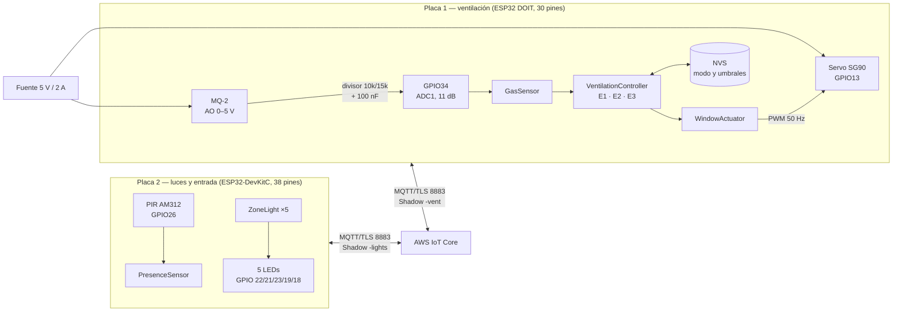
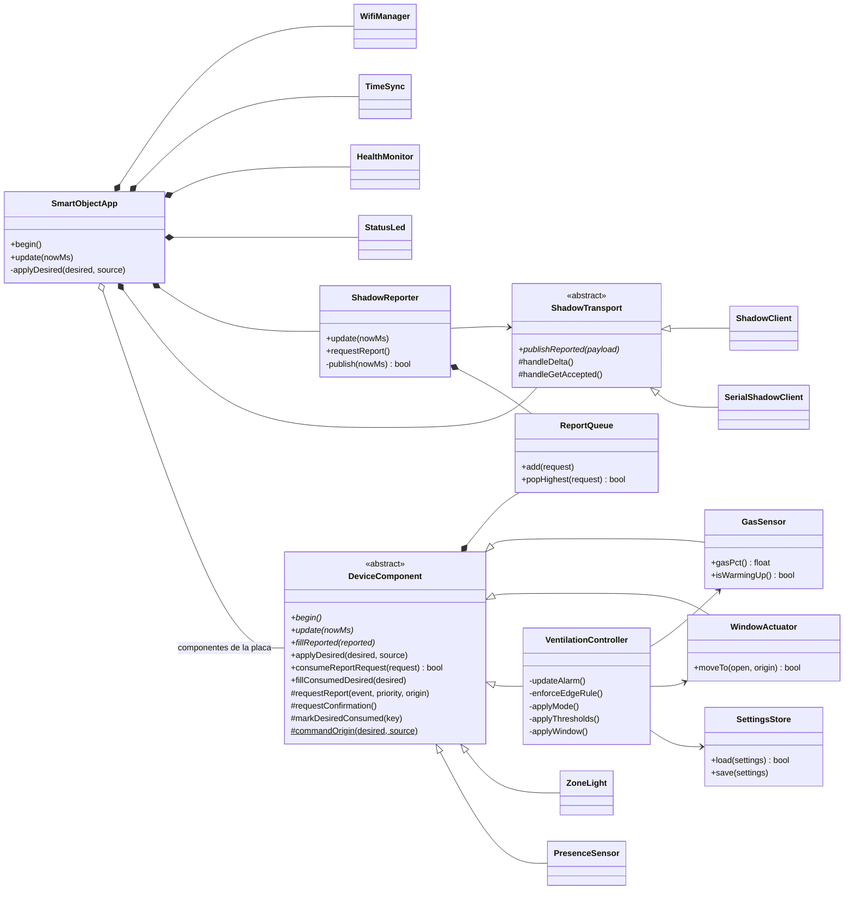
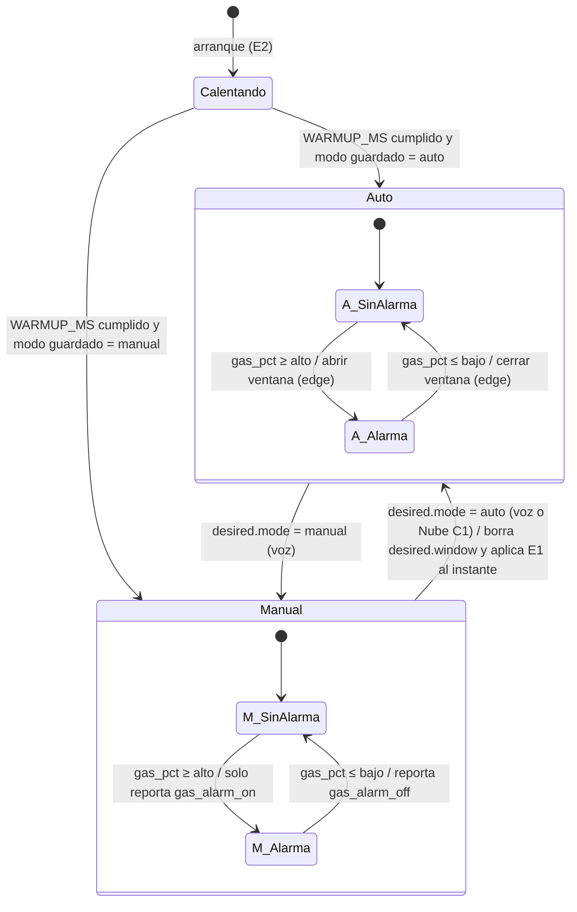

# Práctica 4 - Procesamiento, Almacenamiento y Lógica de Negocio de Objetos Inteligentes con AWS y Alexa

**SmartLoft: monoambiente inteligente con dos objetos (ventilación por gas y luces por zona) sincronizados con AWS IoT Core, con lógica de control en el Edge y en la Nube, histórico en DynamoDB y control por voz con Alexa**


|  |  |
| --- | --- |
| **Universidad** | Universidad Católica Boliviana “San Pablo” |
| **Carrera** | Ingeniería de Sistemas |
| **Asignatura** | SIS-234 Internet de las Cosas / 2-2026 |
| **Fecha de entrega** | 24 de noviembre de 2026 |
| **Repositorio** | [https://github.com/Andres004/FourthProject-AWS-IoT](https://github.com/Andres004/FourthProject-AWS-IoT) |
| **Grupo** | 1 |
| **Integrantes** | Ricardo Andres Andrade Vargas · Dabner Eliezer Orozco Veizaga |

> El informe de la Práctica 3 se conserva sin cambios en [Informe.md](Informe.md).

> **Convención de este borrador** (se elimina antes de la entrega): `⟨…⟩` marca un valor que sale de una evidencia todavía no tomada; "**A cargo de Ricardo**" marca una sección de la Nube (AWS IoT Rules, Lambdas, DynamoDB, skill, costo y mockups).

---
## Resumen ejecutivo

**Qué es.** SmartLoft es la maqueta de un monoambiente con dos objetos inteligentes. La **placa 1 (ventilación)** mide gas y humo con un MQ-2 y abre la ventana con un servo SG90 cuando el índice supera un umbral; la **placa 2 (luces y entrada)** controla cinco luces por zona y detecta presencia en la entrada con un PIR. El usuario lo maneja con la skill de Alexa **"monoambiente inteligente"**: enciende luces, abre o cierra la ventana, cambia el modo y los umbrales de la ventilación y pregunta si hay gas o alguien en la puerta.

**Qué agrega a la P3.** Lógica de control automática en el **Edge** (gas → ventana, con histéresis, aun sin Internet) y en la **Nube** (si las alarmas se repiten en modo manual, la Nube vuelve a automático), y un **histórico** de lecturas y eventos en DynamoDB, con el origen de cada cambio (`voice`, `edge`, `cloud`, `boot`), del que salen los reportes para la toma de decisiones.

**Cumplimiento** (§5.1).

| Requisito | Declarado | Medido | Veredicto |
|---|---|---|---|
| RF1–RF9 (P3, todos los sensores y actuadores) | §1.4 | ⟨A02, A03, A12, B02⟩ | ⟨⟩ |
| RF10–RF12 almacenamiento con validación y origen | §1.4 | ⟨A08⟩ | ⟨⟩ |
| RF13 lógica Edge (E1–E3) y Nube (C1) | §2.6 | ⟨A05, A06, A09⟩ | ⟨⟩ |
| RF14 modo y umbrales por voz | §1.4 | ⟨A04⟩ | ⟨⟩ |
| RF15 mockups de reportes | §2.13 | ⟨⟩ | ⟨⟩ |
| Integridad del almacenamiento | ≥ 99 % | ⟨A08⟩ | ⟨⟩ |
| Latencia de almacenamiento | ≤ 5 s | ⟨A08⟩ | ⟨⟩ |
| Respuesta automática Edge | ≤ 1000 ms | ⟨A05⟩ | ⟨⟩ |
| Respuesta automática Nube | ≤ 5000 ms | ⟨A06⟩ | ⟨⟩ |
| Operación sin conexión | E1 sigue; lo no enviado se cuenta | ⟨A09⟩ | ⟨⟩ |
| Costo mensual | Dentro de la capa gratuita | ⟨B04⟩ | ⟨⟩ |

**Hallazgos** (§4.4). ⟨Se completa con los defectos encontrados en B02, S1–S3 y las pruebas.⟩

**Cómo probarlo.** El [README](README.md) explica cómo compilar los dos firmwares y correr las pruebas; la evidencia de cada prueba está en [docs/evidencias_p4/](docs/evidencias_p4/).

---
## Contenido

1. [Caso de uso y requerimientos](#1-caso-de-uso-y-requerimientos)
   - [1.1 Caso de uso](#11-caso-de-uso-smartloft) · [1.2 Ampliación respecto a la P3](#12-ampliación-respecto-a-la-práctica-3) · [1.3 Sensores y actuadores](#13-justificación-de-sensores-y-actuadores) · [1.4 Requerimientos funcionales](#14-requerimientos-funcionales) · [1.5 Requerimientos no funcionales](#15-requerimientos-no-funcionales) · [1.6 Matriz de trazabilidad](#16-matriz-de-trazabilidad)
2. [Análisis y diseño](#2-análisis-y-diseño)
   - [2.1 Bloques del objeto](#21-diagrama-de-bloques-del-objeto-inteligente) · [2.2 Arquitectura](#22-diagrama-de-arquitectura-del-sistema) · [2.3 Circuito](#23-diagrama-de-circuito) · [2.4 Clases](#24-diagramas-de-clases) · [2.5 Secuencia](#25-diagramas-de-secuencia) · [2.6 Lógica de control](#26-lógica-de-control-modos-reglas-y-ubicación) · [2.7 Shadow](#27-especificación-de-los-documentos-shadow) · [2.8 Frecuencia de reporte](#28-frecuencia-de-reporte-y-consumo-de-mensajes) · [2.9 DynamoDB](#29-modelo-de-datos-de-dynamodb) · [2.10 Reglas y Lambdas](#210-reglas-de-aws-iot-y-funciones-lambda) · [2.11 Vinculación](#211-vinculación-usuario--things) · [2.12 Skill](#212-diseño-de-la-skill-de-alexa) · [2.13 Mockups](#213-diseño-de-reportes-mockups)
3. [Desarrollo e implementación](#3-desarrollo-e-implementación)
   - [3.1 Entorno](#31-entorno-de-desarrollo) · [3.2 Repositorio](#32-estructura-del-repositorio) · [3.3 Módulos](#33-módulos-y-clases) · [3.4 AWS](#34-configuración-en-aws) · [3.5 Alexa](#35-configuración-en-alexa) · [3.6 Credenciales](#36-credenciales-y-secretos) · [3.7 Ejecución](#37-compilación-carga-y-despliegue) · [3.8 Fragmentos clave](#38-fragmentos-clave) · [3.9 Temporización](#39-temporización-sin-bloqueos) · [3.10 Logs](#310-registro-de-eventos-logs) · [3.11 Buenas prácticas](#311-buenas-prácticas-aplicadas)
4. [Pruebas y validaciones](#4-pruebas-y-validaciones)
   - [4.1 Plan de pruebas](#41-plan-de-pruebas) · [4.2 Físicas y de entorno](#42-a-pruebas-físicas-y-de-entorno) · [4.3 Automáticas](#43-b-pruebas-automáticas) · [4.4 Defectos corregidos](#44-defectos-encontrados-y-corregidos) · [4.5 Análisis de errores](#45-análisis-de-errores)
5. [Resultados](#5-resultados)
6. [Conclusiones](#6-conclusiones)
7. [Recomendaciones](#7-recomendaciones)
8. [Anexos](#8-anexos)

---
## 1. Caso de uso y requerimientos

### 1.1 Caso de uso: SmartLoft

SmartLoft es la maqueta a escala de un monoambiente inteligente con dos objetos inteligentes, uno por función. Será también la base del proyecto final.

| Función | Qué hace | Placa |
|---|---|---|
| Luces por zona | 5 zonas (cocina, sala de estar, comedor, baño y habitación) que se encienden y apagan por voz | 2 (luces y entrada) |
| Ventilación | El MQ-2 detecta gas o humo sobre un umbral → el servo abre la ventana; al volver a la normalidad la cierra | 1 (ventilación) |
| Presencia en la entrada | El PIR solo se consulta por voz ("¿hay alguien en la puerta?"); no acciona nada | 2 |
| Registro | Cada alarma de gas, movimiento de la ventana, cambio de luz y detección en la entrada queda guardado con su hora en DynamoDB | Nube |

**Fuera del alcance:** puerta automática, temperatura y humedad, cortina, ventilador y timbre.

**Aclaración de seguridad:** es un prototipo educativo; no reemplaza un detector de gas certificado ni una válvula de corte.

### 1.2 Ampliación respecto a la Práctica 3

La P3 era una puerta con servo y PIR. En la P4 el caso de uso **cambia** a un monoambiente:

| P3 | P4 | Por qué |
|---|---|---|
| Puerta automática con servo | Se elimina; el servo pasa a mover una **ventana** | La puerta no tenía ninguna variable que justificara lógica automática ni histórico |
| PIR que se consultaba por voz | Se conserva en la entrada, solo para consulta y registro | El grupo no quiere luces que se enciendan por presencia (§2.6) |
| — | **MQ-2** (gas y humo) | Da la variable que justifica la lógica automática: umbral con histéresis en el Edge y alarmas que se cuentan en el día en la Nube |
| — | **5 LEDs** (luces por zona) | Amplía los comandos por voz a varios actuadores del mismo tipo sin cambiar la arquitectura |
| 1 placa, 1 *Thing* | **2 placas**, un *Thing* cada una | La regla "gas → ventana" vive entera en la placa 1 y funciona sin Internet; las placas no se comunican entre sí |

La arquitectura del firmware de la P3 se conserva y se generaliza: el código común pasó a una librería compartida por las dos placas (§3.2) y agregar un sensor sigue siendo agregar una clase `DeviceComponent` (§2.4).

### 1.3 Justificación de sensores y actuadores

| Componente | Cant. | Por qué este y no otro |
|---|---|---|
| MQ-2 | 1 | Único sensor ambiental; responde a gas combustible (GLP, metano) y humo, los riesgos típicos de una cocina. Se usa la salida **analógica** (AO) para que el umbral se cambie por voz (RF14); la salida DO tiene el umbral fijo en un potenciómetro |
| PIR AM312 | 1 | Presencia en la entrada; salida digital de 3.3 V directa al GPIO, sin adaptación |
| Servo SG90 | 1 | Actuador que **no es un LED** (restricción del enunciado), a 5 V (≤ 12 V) |
| LED blanco + 220 Ω | 5 | Representan las luces; se permiten porque no son los únicos actuadores |
| ESP32 | 2 | Una por función: la lógica de seguridad (gas) no depende de la placa de luces ni de Internet |
| Ultrasónico | 0 | El caso no mide niveles ni distancias |

**Qué mide el MQ-2.** El firmware no reporta ppm: reporta un **índice relativo** `gas_pct` = tensión de AO / tensión de alimentación × 100. La calibración en ppm exige gases patrón y 24–48 h de precalentamiento por punto; para decidir "abrir la ventana" basta un índice **repetible** y un umbral elegido con datos (§4.2, A10).

### 1.4 Requerimientos funcionales

RF1–RF9 son los de la P3, aplicados a todos los sensores y actuadores; RF10–RF15 son los nuevos del enunciado.

| ID | Requisito | Criterio observable |
|---|---|---|
| RF1 | Capturar los sensores (MQ-2 y PIR) | `GAS_SAMPLE` cada 1 s con `n=20` muestras; `PRESENCE_DETECTED` después del calentamiento de 30 s del PIR (`PIR_READY`) |
| RF2 | Reportar el estado completo en `reported` | Cada reporte trae **todos** los atributos de su placa (§2.7) más `event`, `origin`, `seq` y `device_ts`; nunca pasan más de 61.5 s entre reportes con la conexión activa |
| RF3 | Aplicar el `delta` en los actuadores y confirmarlo | Un `delta` válido cambia el LED o mueve el servo y el nuevo estado aparece en `reported` en ≤ 1.5 s desde `DELTA_RX` |
| RF4 | Consultar por voz gas, presencia, luces y ventana | **A cargo de Ricardo** (skill) |
| RF5 | Comandos por voz sobre luces y ventana | **A cargo de Ricardo** (skill) |
| RF6 | Estado de los actuadores por voz | **A cargo de Ricardo** (skill) |
| RF7–RF9 | Vinculación usuario ↔ *Things* (un código vincula los dos *Things* de la casa) | **A cargo de Ricardo** (skill) |
| RF10 | Reglas de AWS IoT que invocan las Lambdas | **A cargo de Ricardo** |
| RF11 | Validar, enriquecer y guardar las lecturas | **A cargo de Ricardo**; la placa entrega el reporte completo que la Lambda valida (contrato V1) |
| RF12 | Guardar los eventos de los actuadores con su origen | La placa reporta `event` y `origin` (`voice`, `cloud`, `edge`, `boot`) en cada cambio; la Lambda de datos los guarda |
| RF13 | Lógica automática en el Edge y en la Nube | E1–E3 en la placa 1 (§2.6); C1 en la Lambda de control (**Ricardo**) |
| RF14 | Modo y umbrales en `reported`, consultables y modificables por voz | `mode`, `gas_high_pct` y `gas_low_pct` en `reported`; la placa los aplica desde `desired`, los valida y los guarda en la NVS |
| RF15 | Mockups de reportes para la toma de decisiones | **A cargo de Ricardo** (§2.13) |

### 1.5 Requerimientos no funcionales

| ID | Atributo | Valor declarado | Cómo se mide | Prueba |
|---|---|---|---|---|
| RNF1 | Estabilidad | ≥ 60 min por placa con 0 reinicios, 0 caídas, `loop()` ≤ 500 ms y pérdida de heap ≤ 4096 bytes | Líneas `HEALTH` y `BOOT` | A11 |
| RNF2 | Exactitud | PIR: 15/15 pasadas y 0 falsos positivos en 5 min. Servo: ±5° en abierta y cerrada. MQ-2: repetibilidad declarada (no exactitud en ppm) | Conteo con video, transportador, `mq2_probe` | A12, A10 |
| RNF3 | Respuesta por voz | ≤ 3 s Lambda → objeto confirmado, para luces y ventana (valor de la P3) | `DELTA_RX` → `LIGHT_APPLIED` / `ACTUATOR_DONE` y CloudWatch | A02, A03 |
| RNF4 | Frecuencia de reporte | ≥ 1 s entre reportes; heartbeat de 60 s; `gas_changed` si `gas_pct` varía ≥ 3 puntos | `REPORT_TX` del log | B02, A08 |
| RNF5 | Reconexión | Orden pendiente aplicada en ≤ 10 s desde `WIFI_CONNECTED` | `WIFI_CONNECTED` → `GET_RX` → orden aplicada | A09 |
| RNF6 | Seguridad | 0 secretos en los archivos y en el historial | [check_secrets.py](tools/check_secrets.py) | B03 |
| RNF7 | Integridad del almacenamiento | ≥ 99 % de los `seq` publicados guardados en una ventana de ≥ 60 min; 100 % de inválidos descartados | `seq` distintos guardados / (`seq` máx − mín + 1) por placa | A08 |
| RNF8 | Latencia de almacenamiento | ≤ 5 s desde que la placa publica hasta que el ítem queda en DynamoDB | `storedTs − deviceTs` (dos relojes, NTP vs AWS) y `storedTs − timestamp` (solo AWS) | A08 |
| RNF9 | Respuesta de la lógica automática **Edge** | ≤ 1000 ms desde `GAS_ALARM_ON` hasta `ACTUATOR_DONE` | Un solo reloj: `millis()` de la placa 1 | A05 |
| RNF10 | Respuesta de la lógica automática **Nube** | ≤ 5000 ms desde `REPORT_TX event=gas_alarm_on` hasta `MODE_APPLIED origin=cloud` | Un solo reloj: placa 1 | A06 |
| RNF11 | Operación sin conexión | Sin Internet, E1 abre y cierra la ventana igual; los reportes que no salen se pierden (sin buffer) y quedan como huecos de `seq`; al volver se publica el estado completo | Log de la placa 1 contra DynamoDB | A09 |
| RNF12 | Costo | Consumo mensual de mensajes, invocaciones y escrituras dentro de la capa gratuita | **A cargo de Ricardo** | B04 |

**Dinámica del caso de uso.** El humo llega al sensor en segundos y se dispersa en decenas de segundos; abrir la ventana en ≤ 1 s es suficiente. La regla de la Nube (C1) depende de alarmas que ocurren pocas veces al día, por eso tolera unos segundos.

### 1.6 Matriz de trazabilidad

| Requisito | Diseño | Implementación | Prueba |
|---|---|---|---|
| RF1 gas | §2.3 divisor; §2.7 | [GasSensor.cpp](src/vent/GasSensor.cpp): `update()`, `closeWindow()` | A10, B02 |
| RF1 presencia | §2.7 | [PresenceSensor.cpp](src/lights/PresenceSensor.cpp): `update()` | A12 |
| RF2 reporte completo | §2.7, §2.8 | [ShadowReporter.cpp](lib/SmartObjectCore/ShadowReporter.cpp): `publish()` | B02, A08 |
| RF3 luces | §2.7 | [ZoneLight.cpp](src/lights/ZoneLight.cpp): `applyDesired()` | A02, B02 |
| RF3 ventana | §2.6, §2.7 | [VentilationController.cpp](src/vent/VentilationController.cpp): `applyWindow()`; [WindowActuator.cpp](src/vent/WindowActuator.cpp): `moveTo()` | A03, B02 |
| RF12 origen | §2.7, §2.8 | [DeviceComponent.cpp](lib/SmartObjectCore/DeviceComponent.cpp): `commandOrigin()`; `ShadowReporter::nextEvent()` | B02, A08 |
| RF13 E1–E3 | §2.6 | `VentilationController::updateAlarm()`, `enforceEdgeRule()`; [SettingsStore.cpp](src/vent/SettingsStore.cpp) | A05, A09, B02 |
| RF14 modo y umbrales | §2.6, §2.7 | `VentilationController::applyMode()`, `applyThresholds()` | A04, B02 |
| RNF1 | §3.9 | [SmartObjectApp.cpp](lib/SmartObjectCore/SmartObjectApp.cpp): `update()`; `HealthMonitor` | A11 |
| RNF4 | §2.8 | `ShadowReporter::update()`; [ReportQueue.cpp](lib/SmartObjectCore/ReportQueue.cpp) | B02, A08 |
| RNF9 | §2.5.1, §2.6 | `VentilationController::enforceEdgeRule()`; `WindowActuator` (`SETTLE_TIME_MS`) | A05 |
| RNF11 | §2.5.2 | `ShadowReporter::update()` (sin buffer, `seq` sube igual); `ShadowClient` (`/get` al reconectar) | A09 |
| RF4–RF11, RF13 C1, RF15, RNF7, RNF8, RNF10, RNF12 | **A cargo de Ricardo** | | |

---
## 2. Análisis y diseño

### 2.1 Diagrama de bloques del objeto inteligente



Las placas **no se comunican entre sí**: todo pasa por sus Shadows. El servo y el MQ-2 se alimentan de la fuente de 5 V / 2 A con GND común con la placa 1; el 5 V nunca toca VIN, 3V3 ni un GPIO. La placa 2 se alimenta por USB.

### 2.2 Diagrama de arquitectura del sistema

**A cargo de Ricardo:** arquitectura completa (objetos, Shadows, reglas de AWS IoT, Lambdas, tablas de DynamoDB y skill) y por qué las reglas y Lambdas están separadas.

### 2.3 Diagrama de circuito

⟨Esquemáticos en Fritzing/KiCad: `docs/img/esquematico_vent.png` y `docs/img/esquematico_lights.png`.⟩

**Divisor del MQ-2.** La AO del módulo llega a 5 V y el ADC del ESP32, con 11 dB, mide hasta ~3.1 V:

- `V_D34 = V_AO × R2 / (R1 + R2) = V_AO × 15 kΩ / 25 kΩ = 0.6 × V_AO`
- Con `V_AO = 5.0 V` → `V_D34 = 3.0 V` (< 3.3 V). Medido con la punta AO en +5 V, antes de conectar el sensor: ⟨valor⟩ V (A10).
- El firmware reconstruye `gas_mv = V_D34 / 0.6` y calcula `gas_pct = gas_mv / SUPPLY_MV × 100`, con `SUPPLY_MV` = ⟨tensión del bus de 5 V medida con el servo y el MQ-2 conectados⟩ mV.
- Corriente del divisor: `5 V / 25 kΩ = 0.2 mA`, despreciable para la salida del módulo. El capacitor de 100 nF filtra el ruido del calefactor.

**LED de cada zona.** `I = (3.3 V − V_LED) / 220 Ω`; con `V_LED ≈ 2.9 V` (blanco) → `I ≈ 1.8 mA`, muy por debajo del máximo de un GPIO.

**Pines** (ninguno es de arranque ni de la flash):

| Placa | GPIO | Componente | Cable |
|---|---|---|---|
| 1 | 13 | Señal del servo | `SERVO` |
| 1 | 34 | MQ-2 AO (divisor + 100 nF) | `MQ2` |
| 1 y 2 | 32 | LED de estado (solo indicador) | — |
| 2 | 22 | Luz de la cocina | `L-COC` |
| 2 | 21 | Luz de la sala de estar | `L-SAL` |
| 2 | 23 | Luz del comedor | `L-COM` |
| 2 | 19 | Luz del baño | `L-BAN` |
| 2 | 18 | Luz de la habitación | `L-HAB` |
| 2 | 26 | PIR OUT (VCC a 3V3) | `PIR` |

### 2.4 Diagramas de clases

#### 2.4.1 Firmware de los objetos inteligentes (ESP32)



- **[lib/SmartObjectCore/](lib/SmartObjectCore/)** contiene el código común a las dos placas, sin duplicar: conexión, Shadow, reporte, log y salud. `SmartObjectApp` escribe una sola vez la secuencia de `setup()` y `loop()`; cada `main.cpp` solo declara sus componentes y sus credenciales. La librería no lee archivos de secretos: las credenciales se le pasan desde `main.cpp`.
- **[src/vent/](src/vent/)** y **[src/lights/](src/lights/)** tienen los componentes de cada placa. Agregar un sensor o actuador es escribir una clase `DeviceComponent` y sumarla al arreglo `components[]` de su `main.cpp`.
- `VentilationController` es el único que decide quién mueve la ventana (voz en `manual`, E1 en `auto`); `WindowActuator` solo obedece y confirma.
- En los entornos `*_local_test`, `SerialShadowClient` reemplaza a AWS: el mismo código se prueba por el puerto serie (B02).

#### 2.4.2 Funciones Lambda

**A cargo de Ricardo.**

### 2.5 Diagramas de secuencia

Consulta del sensor, comando sobre un actuador desde el usuario, almacenamiento (objeto → regla → Lambda → DynamoDB) y regla C1: **a cargo de Ricardo**. Las dos secuencias siguientes ocurren dentro del objeto.

#### 2.5.1 Regla E1: gas en modo automático (Edge)

```mermaid
sequenceDiagram
    participant MQ as MQ-2
    participant GS as GasSensor
    participant VC as VentilationController
    participant WA as WindowActuator
    participant SR as ShadowReporter
    participant SH as Shadow -vent

    MQ->>GS: AO sube (humo)
    GS->>GS: promedio de 1 s → gas_pct ≥ gas_high_pct
    VC->>VC: GAS_ALARM_ON (t0, millis)
    VC->>WA: moveTo(open, edge) → EDGE_ACTION
    WA-->>WA: ACTUATOR_DONE tras 400 ms (t1)
    Note over VC,WA: Respuesta Edge = t1 − t0 (A05), sin pasar por Internet
    SR->>SH: reported {event: gas_alarm_on, origin: edge, gas_alarm: true, …}
    SR->>SH: 1 s después: reported {event: window_changed, window: open, …}
    Note over SH: Las reglas de datos y de control reciben ambos reportes; en modo auto C1 no actúa
```

#### 2.5.2 Operación sin conexión y reconexión

```mermaid
sequenceDiagram
    participant U as Usuario (Alexa)
    participant SH as Shadow -vent
    participant P1 as Placa 1

    Note over P1: Hotspot apagado
    P1->>P1: humo → GAS_ALARM_ON → abre la ventana (E1 sigue funcionando)
    P1--xSH: REPORT_TX_FAILED seq=n (se pierde; no hay buffer)
    U->>SH: "cambia el umbral alto a 40" → desired.gas_high_pct = 40
    Note over P1: Vuelve el hotspot
    P1->>SH: MQTT_CONNECTED → /get
    SH-->>P1: GET_RX con desired pendiente (cmd_origin = voice)
    P1->>P1: THRESHOLDS_APPLIED origin=voice y guarda en la NVS (E3)
    P1->>SH: reported completo, seq = n+k (los huecos de seq miden lo perdido)
```

### 2.6 Lógica de control: modos, reglas y ubicación

**Modos de la ventilación:**
- **`auto`** (por defecto): la placa abre y cierra la ventana según el gas. La voz no mueve la ventana; la skill lo rechaza con una explicación.
- **`manual`**: la ventana se mueve solo por voz. Sirve cuando el usuario conoce la causa (por ejemplo, está cocinando) y no quiere que la ventana se mueva. El gas se sigue midiendo y la alarma se sigue reportando y guardando, y no se permite cerrar la ventana mientras haya alarma.

| ID | Regla | Ubicación | Justificación |
|---|---|---|---|
| E1 | En `auto`: `gas_alarm` se enciende con `gas_pct ≥ gas_high_pct` y se apaga con `gas_pct ≤ gas_low_pct` (histéresis); la ventana sigue a la alarma, con origen `edge` | Edge (placa 1) | Respuesta inmediata (≈ 400 ms del servo); sigue funcionando sin Internet; depende solo del dato local |
| E2 | Durante el calentamiento del MQ-2 (`WARMUP_MS` = ⟨A10⟩ ms) no hay alarma ni acción automática | Edge | Solo la placa sabe cuándo arrancó el sensor |
| E3 | El modo y los umbrales se guardan en la NVS al aplicarlos | Edge | Si la placa se reinicia sin Internet, E1 sigue con los últimos valores y no con los de compilación |
| C1 | Al empezar una alarma en `manual`: si hubo ≥ 3 en 24 h, volver a `auto` | Nube (Lambda de control) | Necesita el histórico de DynamoDB, que la placa no tiene; el límite se cambia sin reprogramar. Detalle: **Ricardo** |

**Descartado:** encender luces por presencia (el PIR es solo informativo); "gas → encender luces" (accionar interruptores durante una fuga es justo lo que se recomienda no hacer); detectar placas que dejaron de reportar con una Lambda programada (queda como recomendación, §7).



**Convivencia de la voz con la lógica automática.** La skill aplica estas reglas con una respuesta explicativa (**Ricardo**); la placa las vuelve a aplicar como **defensa en profundidad**, de modo que tampoco un `desired` publicado a mano desde el MQTT test client puede saltárselas:

| Situación | Qué hace la placa | Log |
|---|---|---|
| `window` en `auto` | Rechaza y borra `desired.window` | `COMMAND_REJECTED reason=auto_mode` |
| `window = closed` con alarma (en `manual`) | Rechaza y borra `desired.window` | `COMMAND_REJECTED reason=gas_alarm` |
| Umbrales fuera de 1–99, bajo ≥ alto o no enteros | Rechaza | `COMMAND_REJECTED reason=invalid_thresholds` |
| `mode` o `window` con un valor desconocido | Rechaza | `INVALID_VALUE` |
| `window` en `manual` sin alarma | Mueve, confirma y borra `desired.window` y `cmd_origin` | `ACTUATOR_START origin=voice` → `ACTUATOR_DONE` |
| `mode = auto` | Aplica, borra `desired.window` y E1 decide la ventana en el mismo ciclo | `MODE_APPLIED`, luego `EDGE_ACTION` si corresponde |

**C1 se vuelve a disparar a propósito.** Si después de que la Nube pone `auto` el usuario vuelve a `manual`, la siguiente alarma dentro de las mismas 24 h encuentra otra vez ≥ 3 alarmas y la Nube devuelve la ventilación a `auto`. Mientras el gas se siga repitiendo, el modo `manual` no se sostiene; es el comportamiento buscado.

### 2.7 Especificación de los documentos Shadow

**Placa 1 — `smartloft-739264-vent`:**

| Atributo | Sección | Tipo | Valores válidos | Escribe |
|---|---|---|---|---|
| `gas_pct` | reported | number (1 decimal) | 0.0–100.0, índice relativo (no ppm) | Placa |
| `gas_mv` | reported | int | 0–5000 mV en AO | Placa |
| `gas_alarm` | reported | bool | Histéresis E1, en los dos modos | Placa |
| `warming_up` | reported | bool | `true` durante E2 | Placa |
| `window` | desired / reported | string | `open`, `closed`; en `desired` solo en `manual` y hasta que la placa lo aplica | Skill / placa |
| `servo_angle` | reported | int | `CLOSED_ANGLE_DEG` = ⟨⟩, `OPEN_ANGLE_DEG` = ⟨⟩ (calibrados en la maqueta) | Placa |
| `mode` | desired / reported | string | `auto`, `manual` | Skill o Lambda de control / placa |
| `gas_high_pct`, `gas_low_pct` | desired / reported | int | 1–99, bajo < alto; por defecto ⟨A10⟩ / ⟨A10⟩ | Skill / placa |
| `cmd_origin` | desired | string | `voice` (skill) o `cloud` (Lambda de control); la placa lo borra al aplicar la orden | Skill / Lambda de control |
| `event` | reported | string | `boot`, `heartbeat`, `gas_changed`, `gas_alarm_on`, `gas_alarm_off`, `window_changed`, `mode_changed`, `thresholds_changed` | Placa |
| `origin` | reported | string | Quién causó el último cambio: `boot`, `voice`, `cloud`, `edge` | Placa |
| `seq` | reported | int | Contador de reportes desde el arranque; sube en cada intento de publicar, aunque falle | Placa |
| `device_ts` | reported | int | Epoch UTC en ms (NTP); 0 mientras no hay hora | Placa |

```json
{
  "state": {
    "desired": { "mode": "auto", "gas_high_pct": 30, "gas_low_pct": 20 },
    "reported": {
      "gas_pct": 8.4, "gas_mv": 420, "gas_alarm": false, "warming_up": false,
      "window": "closed", "servo_angle": 0,
      "mode": "auto", "gas_high_pct": 30, "gas_low_pct": 20,
      "event": "heartbeat", "origin": "boot", "seq": 1532, "device_ts": 1795862400123
    }
  }
}
```

**Placa 2 — `smartloft-739264-lights`:**

| Atributo | Sección | Tipo | Valores válidos | Escribe |
|---|---|---|---|---|
| `light_kitchen`, `light_living`, `light_dining`, `light_bathroom`, `light_bedroom` | desired / reported | string | `on`, `off` | Skill / placa |
| `presence` | reported | bool | `true` desde un movimiento hasta 10 s después del último | Placa |
| `event` | reported | string | `boot`, `heartbeat`, `light_changed`, `presence_detected`, `presence_cleared` | Placa |
| `origin`, `seq`, `device_ts`, `cmd_origin` | | | Como en la placa 1 | |

**Uso de `desired`, `reported` y `delta`:**
- La placa solo publica `reported`, con **todos** sus atributos en cada mensaje: la Lambda de datos descarta un reporte incompleto.
- **Excepción documentada:** al aplicar una orden, la placa publica en el mismo mensaje `"desired": {"window": null, "cmd_origin": null}`, solo con las claves que consumió. Así no queda un `delta` viejo que deshaga lo que hizo E1. `mode`, los umbrales y `light_*` **se quedan** en `desired`: son la configuración del usuario y la placa los recupera con `/get` después de reiniciarse.
- Cada `delta` trae `version`; uno repetido o anterior se descarta (`STALE_IGNORED`), como en la P3.
- **Cómo se evitan los bucles:** la placa nunca reporta un cambio que no ocurrió; el reporte que produce una orden de la Nube trae `event = mode_changed`, que no pasa el filtro de la regla de control (`event = gas_alarm_on`).

### 2.8 Frecuencia de reporte y consumo de mensajes

| Placa | Por evento | Heartbeat | Mínimo entre mensajes |
|---|---|---|---|
| 1 | Cambio de alarma, ventana, modo o umbrales; `gas_pct` varía ≥ 3 puntos (`gas_changed`) | 60 s | 1 s |
| 2 | Cambio de una luz; `presence_detected`; `presence_cleared` | 60 s | 1 s |

- **Eventos simultáneos.** Los eventos distintos que ocurren dentro del mismo segundo se encolan y salen uno por segundo, primero el de mayor prioridad (alarma > ventana > modo > umbrales > `gas_changed`). Cuando la Nube pone `auto` y E1 abre la ventana, salen `mode_changed` (origen `cloud`) y, un segundo después, `window_changed` (origen `edge`): la Lambda de datos guarda los dos (§4.4, D-01).
- **El mismo evento repetido se agrupa:** "apaga todas las luces" produce un solo `light_changed`.
- **Muestreo del MQ-2:** cada 50 ms, promedio de 1 s (20 muestras); la histéresis usa el promedio.
- **Justificación:** el gas cambia en segundos y un umbral de 3 puntos filtra el ruido del sensor (⟨desviación medida en A10⟩) sin perder una subida real; las luces y el PIR solo cambian por acciones de personas.
- **Volumen en reposo:** 1 mensaje por minuto por placa ≈ 2 × 1440 = 2880 mensajes por día. El volumen real, con eventos, sale de A08 y alimenta el cálculo de costo (B04, **Ricardo**).

### 2.9 Modelo de datos de DynamoDB

**A cargo de Ricardo.**

### 2.10 Reglas de AWS IoT y funciones Lambda

**A cargo de Ricardo.**

### 2.11 Vinculación usuario ↔ Things

**A cargo de Ricardo.** Del lado del objeto, las dos placas imprimen `LINK_CODE 739264` al arrancar y su *Thing* se llama `smartloft-<código>-vent` o `smartloft-<código>-lights` ([config_common.h](include/config_common.h), [config_vent.h](include/config_vent.h), [config_lights.h](include/config_lights.h)).

### 2.12 Diseño de la skill de Alexa

**A cargo de Ricardo.**

### 2.13 Diseño de reportes (mockups)

**A cargo de Ricardo.**

---
## 3. Desarrollo e implementación

### 3.1 Entorno de desarrollo

| Elemento | Firmware de los objetos inteligentes | Herramientas de prueba |
|---|---|---|
| Herramienta | VS Code con PlatformIO IDE (PlatformIO Core 6.2.0) | Python 3.13.7 |
| Plataforma y framework | `espressif32` 7.1.3 con Arduino-ESP32 | Biblioteca estándar de Python, más `pyserial` (incluido en el Python de PlatformIO) para hablar con la placa |
| Librerías | PubSubClient (MQTT), ArduinoJson 7 (JSON), ESP32Servo (servo, solo placa 1), Preferences (NVS, del framework) | — |
| Placas | Placa 1: ESP32 DOIT DevKit V1 (`esp32doit-devkit-v1`). Placa 2: ESP32-DevKitC de 38 pines (`esp32dev`) | — |
| Entornos | `vent` y `lights`, los firmwares reales; `vent_local_test` y `lights_local_test`, los mismos con el Shadow reemplazado por el puerto serie (`-D LOCAL_TEST_MODE`) | — |
| Monitor y logs | Serie a 115200 baud con el filtro `log2file`; `monitor_dtr = 0` y `monitor_rts = 0`, para que abrir el monitor no reinicie la placa | Los scripts de [tools/](tools/) |

Las herramientas de la Nube (Lambdas, pruebas unitarias de Python) están en §3.4 (**Ricardo**).

### 3.2 Estructura del repositorio

```text
FourthProject-AWS-IoT/
├── README.md                    Hardware, entornos, compilación y pruebas
├── Informe.md                   Informe de la Práctica 3 (sin cambios)
├── Informe_P4.md                Este informe
├── platformio.ini               4 entornos: vent, lights, vent_local_test, lights_local_test
├── .gitignore                   Excluye secretos, certificados, compilados, paquetes y logs crudos
├── include/
│   ├── config_common.h          Constantes compartidas: red, Shadow, reporte, log, salud
│   ├── config_vent.h            Placa 1: pines, divisor, gas, ventana, eventos, NVS
│   ├── config_lights.h          Placa 2: pines, zonas, PIR, eventos
│   ├── secrets_vent.example.h   Plantillas sin valores reales; los secrets_*.h reales
│   └── secrets_lights.example.h no se versionan
├── lib/SmartObjectCore/         Código común a las dos placas (una clase por .h/.cpp)
│   ├── SmartObjectApp.*         Secuencia de setup() y loop()
│   ├── DeviceComponent.*        Interfaz de sensores y actuadores; pedidos de reporte
│   ├── ReportQueue.*            Cola de eventos pendientes por prioridad
│   ├── ReportTypes.h            Tipos compartidos (origen del desired, pedido de reporte)
│   ├── ShadowReporter.*         Política de reporte: event, origin, seq, device_ts
│   ├── ShadowTransport.*        Interpretación del delta y del /get; filtro de versiones
│   ├── ShadowClient.*           MQTT sobre TLS con AWS IoT Core
│   ├── ShadowClientSettings.h   Endpoint, certificados y sufijo del Thing
│   ├── SerialShadowClient.*     Enlace por el puerto serie, para *_local_test
│   ├── WifiManager.*            Conexión y reintentos de WiFi
│   ├── TimeSync.*               Hora UTC por NTP (device_ts)
│   ├── HealthMonitor.*          Motivo del reinicio, línea HEALTH y watchdog
│   ├── StatusLed.*              LED de estado de la conexión
│   ├── EventLog.*               Log con t_ms y hora UTC
│   └── library.json             Advertencias -Wall -Wextra también en la librería
├── src/vent/                    Firmware de la placa 1
│   ├── main.cpp                 Componentes y credenciales de la placa
│   ├── GasSensor.*              MQ-2: muestreo, promedio, calentamiento
│   ├── WindowActuator.*         Servo de la ventana
│   ├── VentilationController.*  Modos, umbrales, E1–E2 y convivencia con la voz
│   ├── SettingsStore.*          E3: modo y umbrales en la NVS
│   └── VentSettings.h           Modo, umbrales y su validación
├── src/lights/                  Firmware de la placa 2
│   ├── main.cpp                 Componentes y credenciales de la placa
│   ├── ZoneLight.*              Luz de una zona
│   └── PresenceSensor.*         PIR AM312
├── lambda/, alexa/, aws/        Nube (§3.4, §3.5): a cargo de Ricardo
├── tools/                       Herramientas (Python)
│   ├── serial_check.py          Prueba automática de los dos firmwares por el puerto serie (B02)
│   ├── analyze_log.py           Mide los requerimientos desde los logs de las placas y DynamoDB
│   ├── serial_logger.py         Guarda el log de la placa sin reiniciarla
│   ├── check_secrets.py         Busca secretos en los archivos y en el historial (B03)
│   └── mq2_probe/               Programa aparte para calibrar el MQ-2 (A10)
├── docs/
│   ├── evidencias_p4/           Evidencia de cada prueba de la P4
│   ├── evidencias/              Evidencia de la P3 (sin cambios)
│   └── img/                     Esquemáticos y fotos
└── test/                        Carpeta estándar de PlatformIO, sin uso
```

### 3.3 Módulos y clases

| Programa | Archivo | Clase | Responsabilidad |
|---|---|---|---|
| Común | [config_common.h](include/config_common.h) | `config` (namespace) | Constantes compartidas, cada una con nombre, unidad y comentario |
| Común | [SmartObjectApp.h](lib/SmartObjectCore/SmartObjectApp.h), [.cpp](lib/SmartObjectCore/SmartObjectApp.cpp) | `SmartObjectApp` | Arranque y bucle de la placa: log, salud, WiFi, NTP, Shadow, componentes, reporte y LED |
| Común | [DeviceComponent.h](lib/SmartObjectCore/DeviceComponent.h), [.cpp](lib/SmartObjectCore/DeviceComponent.cpp) | `DeviceComponent` | Interfaz de un sensor o actuador; pedidos de reporte, claves consumidas de `desired` y origen de la orden |
| Común | [ReportQueue.h](lib/SmartObjectCore/ReportQueue.h), [.cpp](lib/SmartObjectCore/ReportQueue.cpp) | `ReportQueue` | Eventos pendientes sin memoria dinámica, servidos por prioridad |
| Común | [ShadowReporter.h](lib/SmartObjectCore/ShadowReporter.h), [.cpp](lib/SmartObjectCore/ShadowReporter.cpp) | `ShadowReporter` | Arma el reporte completo y decide cuándo publicarlo; `seq` y `device_ts` |
| Común | [ShadowTransport.h](lib/SmartObjectCore/ShadowTransport.h), [.cpp](lib/SmartObjectCore/ShadowTransport.cpp) | `ShadowTransport` | Interpreta el `delta` y el `/get`; filtra versiones; distingue orden nueva de sincronización |
| Común | [ShadowClient.h](lib/SmartObjectCore/ShadowClient.h), [.cpp](lib/SmartObjectCore/ShadowClient.cpp) | `ShadowClient` | MQTT sobre TLS, suscripciones, `/get` al conectar y reconexión |
| Común | [SerialShadowClient.h](lib/SmartObjectCore/SerialShadowClient.h), [.cpp](lib/SmartObjectCore/SerialShadowClient.cpp) | `SerialShadowClient` | El mismo contrato por el puerto serie, para probar sin AWS |
| Común | `WifiManager`, `TimeSync`, `HealthMonitor`, `StatusLed`, `EventLog` | | Como en la P3, sin cambios de lógica; ahora reciben sus datos por parámetro |
| Placa 1 | [config_vent.h](include/config_vent.h) | `config` (namespace) | Pines, divisor, gas, ventana, valores por defecto, eventos y claves de la NVS |
| Placa 1 | [GasSensor.h](src/vent/GasSensor.h), [.cpp](src/vent/GasSensor.cpp) | `GasSensor` | Muestreo cada 50 ms, promedio de 1 s, `gas_mv`, `gas_pct`, calentamiento y `gas_changed` |
| Placa 1 | [WindowActuator.h](src/vent/WindowActuator.h), [.cpp](src/vent/WindowActuator.cpp) | `WindowActuator` | Mueve el servo sin bloquear y confirma la posición después de `SETTLE_TIME_MS` |
| Placa 1 | [VentilationController.h](src/vent/VentilationController.h), [.cpp](src/vent/VentilationController.cpp) | `VentilationController` | Modo, umbrales y alarma; E1–E2; valida y aplica las órdenes de voz y de la Nube |
| Placa 1 | [SettingsStore.h](src/vent/SettingsStore.h), [.cpp](src/vent/SettingsStore.cpp) | `SettingsStore` | E3: carga y guarda modo y umbrales en la NVS, solo si cambiaron |
| Placa 1 | [VentSettings.h](src/vent/VentSettings.h) | `VentSettings`, `VentMode` | Valores de la lógica automática y su validación |
| Placa 2 | [config_lights.h](include/config_lights.h) | `config` (namespace) | Pines, zonas, PIR y eventos |
| Placa 2 | [ZoneLight.h](src/lights/ZoneLight.h), [.cpp](src/lights/ZoneLight.cpp) | `ZoneLight` | Valida y aplica `light_<zona>`, reporta `light_changed` con su origen |
| Placa 2 | [PresenceSensor.h](src/lights/PresenceSensor.h), [.cpp](src/lights/PresenceSensor.cpp) | `PresenceSensor` | PIR con calentamiento de 30 s y retención de 10 s; `presence_detected` / `presence_cleared` |
| Herramienta | [serial_check.py](tools/serial_check.py) | Script | B02: envía órdenes válidas, inválidas, repetidas y gas simulado a los firmwares `*_local_test` y comprueba la respuesta |
| Herramienta | [analyze_log.py](tools/analyze_log.py) | Script | Calcula los RNF de A05, A06, A08, A09, A11 y A12 desde los logs y la exportación de DynamoDB |
| Herramienta | [serial_logger.py](tools/serial_logger.py) | Script | Guarda el log de la placa sin reiniciarla |
| Herramienta | [check_secrets.py](tools/check_secrets.py) | Script | B03: busca secretos en los archivos y en el historial; comprueba los dos `secrets_*.h` |
| Herramienta | [mq2_probe/](tools/mq2_probe/) | Programa PlatformIO aparte | Registra el MQ-2 cada segundo para la calibración (A10) |

### 3.4 Configuración en AWS

**A cargo de Ricardo:** *Things*, certificados, política de AWS IoT, reglas, Lambdas, tablas, roles IAM y permisos usados vs. mínimos.

### 3.5 Configuración en Alexa

**A cargo de Ricardo.**

### 3.6 Credenciales y secretos

| Secreto | Dónde está | Cómo se protege |
|---|---|---|
| SSID y contraseña WiFi | `include/secrets_vent.h` e `include/secrets_lights.h` | En [.gitignore](.gitignore) (`include/secrets_*.h`); en el repositorio solo están las plantillas [secrets_vent.example.h](include/secrets_vent.example.h) y [secrets_lights.example.h](include/secrets_lights.example.h) |
| Certificado y clave privada de cada placa | Los mismos archivos; un certificado distinto por placa | `.gitignore` excluye además `certificados*/`, `certs/`, `*.pem`, `*.crt` y `*.key`; los certificados se pasaron entre los integrantes por un canal privado |
| Endpoint de AWS IoT | Los mismos archivos | No aparece en el código ni en los logs publicados |
| Access keys de AWS | — | No existen en el firmware: la placa se autentica solo con su certificado X.509 |

La librería común no incluye ningún archivo de secretos: cada `main.cpp` le pasa sus credenciales ([src/vent/main.cpp, líneas 30 a 35](src/vent/main.cpp#L30-L35)). [check_secrets.py](tools/check_secrets.py) lo comprueba en los archivos publicados y en todo el historial (B03).

### 3.7 Compilación, carga y despliegue

**Firmware**, desde la raíz del proyecto:

1. Copiar `include/secrets_vent.example.h` como `include/secrets_vent.h` (y lo mismo con `lights`) y completar el WiFi, el endpoint, la CA raíz y el certificado y la clave de **esa** placa.
2. Comprobar que `LINK_CODE` en [config_common.h](include/config_common.h) coincida con el nombre de los *Things*.
3. Compilar, cargar y abrir el monitor de cada placa:

```bash
pio run -e vent -t upload -t monitor
```

```bash
pio run -e lights -t upload -t monitor
```

Para probar el hardware sin AWS, con el Shadow reemplazado por el monitor serie (se escribe un `delta` como `{"state":{"light_kitchen":"on"}}`):

```bash
pio run -e lights_local_test -t upload -t monitor
```

**Herramientas**, desde la raíz del proyecto (los scripts que hablan con la placa usan el Python de PlatformIO, que trae `pyserial`):

```bash
python tools/serial_check.py --board vent --port COM3 --log docs/evidencias_p4/B02/B02_vent_ESP32.log   # B02
python tools/serial_logger.py --port COM3 --out logs/A08_vent.log                                       # log sin reiniciar
python tools/analyze_log.py logs/A08_vent.log logs/A08_lights.log --dynamo A08.csv -o salida.txt        # mide los RNF
python tools/check_secrets.py -o docs/evidencias_p4/B03/B03_salida.txt                                  # B03
```

### 3.8 Fragmentos clave

Los fragmentos son extractos cortos; el código completo está en los archivos enlazados.

#### 3.8.1 Una placa = una lista de componentes

Cada firmware solo declara sus componentes y sus credenciales; el bucle, el reporte y la entrega de `desired` son los de la librería común ([src/vent/main.cpp, líneas 19 a 35](src/vent/main.cpp#L19-L35)):

```cpp
GasSensor gasSensor;
WindowActuator window;
SettingsStore settingsStore;
VentilationController ventilation(gasSensor, window, settingsStore);

// The controller goes after the gas sensor, so each loop decides with the
// newest reading.
DeviceComponent* const components[] = {&gasSensor, &window, &ventilation};

SmartObjectApp app(settings, components, COMPONENT_COUNT);
```

#### 3.8.2 Bucle principal sin bloqueos

`loop()` llama a `app.update(millis())`, que toma el tiempo una sola vez y se lo pasa a cada módulo ([SmartObjectApp.cpp, líneas 46 a 56](lib/SmartObjectCore/SmartObjectApp.cpp#L46-L56)):

```cpp
void SmartObjectApp::update(uint32_t nowMs) {
  health_.update(nowMs, wifi_.disconnections(), shadow_.disconnections());
  wifi_.update(nowMs);
  timeSync_.update(wifi_.isConnected());
  shadow_.update(nowMs);
  for (size_t i = 0; i < componentCount_; ++i) {
    components_[i]->update(nowMs);
  }
  reporter_.update(nowMs);
  statusLed_.update(nowMs, wifi_.isConnected(), shadow_.isConnected());
}
```

#### 3.8.3 Regla E1 con histéresis

La alarma usa dos umbrales distintos para no oscilar cerca del límite; en `auto`, la ventana sigue a la alarma en cada vuelta del bucle, por eso E1 también actúa justo después de que la Nube pone `auto` ([VentilationController.cpp, líneas 166 a 193](src/vent/VentilationController.cpp#L166-L193)):

```cpp
if (!gasAlarm_ && gasPct >= settings_.gasHighPct) {
  gasAlarm_ = true;
  EventLog::recordf("GAS_ALARM_ON", "gas_pct=%.1f gas_high_pct=%u mode=%s", ...);
  requestReport(ev::GAS_ALARM_ON, ev::PRIORITY_GAS_ALARM, origin);
} else if (gasAlarm_ && gasPct <= settings_.gasLowPct) {
  gasAlarm_ = false;
  ...
}

void VentilationController::enforceEdgeRule() {
  if (window_.moveTo(gasAlarm_, report_doc::ORIGIN_EDGE)) {
    EventLog::recordf("EDGE_ACTION", "window=%s gas_pct=%.1f", ...);
  }
}
```

#### 3.8.4 La orden de voz pasa por las reglas de convivencia

([VentilationController.cpp, líneas 123 a 164](src/vent/VentilationController.cpp#L123-L164))

```cpp
// Accepted or not, the command is consumed: it must not stay in desired.
markDesiredConsumed(doc::KEY_WINDOW);
...
if (settings_.mode == VentMode::kAuto) {
  EventLog::recordf("COMMAND_REJECTED", "reason=auto_mode window=%s", requested);
  requestConfirmation();
  return true;
}
if (!open && gasAlarm_) {
  EventLog::recordf("COMMAND_REJECTED", "reason=gas_alarm window=closed ...");
  requestConfirmation();
  return true;
}
```

#### 3.8.5 Origen de cada cambio

`cmd_origin` lo escribe quien da la orden; si falta, una orden que llega con el `/get` al reconectar se marca `boot` y un `delta` normal, `voice` ([DeviceComponent.cpp, líneas 45 a 55](lib/SmartObjectCore/DeviceComponent.cpp#L45-L55)).

#### 3.8.6 Reporte: `seq` aunque falle, y borrado de `desired`

([ShadowReporter.cpp, líneas 21 a 41 y 70 a 119](lib/SmartObjectCore/ShadowReporter.cpp#L21-L41))

```cpp
// Attempted even while offline: seq must advance (contract V2) and the
// log shows which reports were lost.
if (!publish(nowMs)) {
  events_.clear();
}
...
++seq_;
reported[doc::KEY_SEQ] = seq_;
reported[doc::KEY_DEVICE_TS] = deviceTs;
JsonObject desired = state["desired"].to<JsonObject>();
for (size_t i = 0; i < componentCount_; ++i) {
  components_[i]->fillConsumedDesired(desired);   // {"window": null, ...}
}
```

#### 3.8.7 Cola de eventos por prioridad

Dos eventos distintos en el mismo segundo no se pisan; el mismo evento repetido solo actualiza su origen ([ReportQueue.cpp, líneas 11 a 39](lib/SmartObjectCore/ReportQueue.cpp#L11-L39)).

#### 3.8.8 E3: la NVS solo se escribe si el valor cambió

([SettingsStore.cpp, líneas 46 a 68](src/vent/SettingsStore.cpp#L46-L68)) La flash del ESP32 admite un número limitado de escrituras; un comando repetido por voz no escribe nada.

#### 3.8.9 Índice de gas

`GasSensor` promedia 20 lecturas de `analogReadMilliVolts()` (calibración de fábrica del ADC), deshace el divisor y redondea a un decimal ([GasSensor.cpp, líneas 50 a 87](src/vent/GasSensor.cpp#L50-L87)).

### 3.9 Temporización sin bloqueos

| Tarea | Periodo | Constante | Dónde |
|---|---|---|---|
| Muestreo del MQ-2 | 50 ms | `gas::SAMPLE_PERIOD_MS` | [config_vent.h](include/config_vent.h) |
| Ventana de promedio del gas | 1 s | `gas::AVERAGE_WINDOW_MS` | config_vent.h |
| Calentamiento del MQ-2 (E2) | ⟨A10⟩ | `gas::WARMUP_MS` | config_vent.h |
| Movimiento del servo | 400 ms | `window::SETTLE_TIME_MS` | config_vent.h |
| Lectura del PIR | 50 ms | `pir::POLL_PERIOD_MS` | [config_lights.h](include/config_lights.h) |
| Calentamiento y retención del PIR | 30 s / 10 s | `pir::WARMUP_MS`, `pir::PRESENCE_HOLD_MS` | config_lights.h |
| Mínimo entre reportes / heartbeat | 1 s / 60 s | `report::MIN_REPORT_INTERVAL_MS`, `HEARTBEAT_PERIOD_MS` | [config_common.h](include/config_common.h) |
| Reintento de WiFi / MQTT | 10 s / 5 s | `network::WIFI_RETRY_INTERVAL_MS`, `MQTT_RETRY_INTERVAL_MS` | config_common.h |
| Línea `HEALTH` / watchdog | 60 s / 30 s | `health::LOG_PERIOD_MS`, `WATCHDOG_TIMEOUT_S` | config_common.h |

Ningún archivo usa `delay()`: cada módulo compara `nowMs` con su último instante y vuelve de inmediato. La única espera bloqueante es la conexión MQTT/TLS de PubSubClient (hasta 21 s en el peor caso, cubierta por el watchdog de 30 s), igual que en la P3.

### 3.10 Registro de eventos (logs)

Formato de cada línea: `[t_ms|UTC] EVENTO detalles`. Eventos nuevos de la P4 (los de la P3 se mantienen):

| Evento | Placa | Significado | Lo usa |
|---|---|---|---|
| `GAS_SAMPLE pin_mv ao_mv gas_pct min_mv max_mv n warming_up simulated` | 1 | Una ventana de 1 s del MQ-2 | A10 |
| `GAS_READY` | 1 | Fin del calentamiento (E2) | A05 |
| `GAS_ALARM_ON` / `GAS_ALARM_OFF` | 1 | Cambio de la alarma, con el umbral y el modo | A05, A06 |
| `EDGE_ACTION window` | 1 | E1 movió la ventana | A05, A09 |
| `ACTUATOR_START window origin` / `ACTUATOR_DONE window angle` | 1 | Inicio y fin del movimiento | A03, A05 |
| `MODE_APPLIED mode origin` / `THRESHOLDS_APPLIED` | 1 | Orden aplicada (y guardada en la NVS) | A04, A06 |
| `COMMAND_REJECTED reason` | 1 | Orden rechazada por la convivencia | A07 |
| `SETTINGS_LOADED` / `SETTINGS_SAVED` | 1 | E3 | A09 |
| `LIGHT_APPLIED zone state origin` | 2 | Luz cambiada | A02 |
| `PRESENCE_DETECTED` / `PRESENCE_CLEARED` | 2 | Flancos del PIR | A12 |
| `REPORT_TX seq event origin {json}` | 1 y 2 | Reporte publicado | A06, A08 |
| `REPORT_TX_FAILED seq event` | 1 y 2 | Reporte que no salió (se pierde) | A09 |
| `REPORT_EVENT_DROPPED` | 1 y 2 | La cola de eventos se llenó (no debería ocurrir) | — |

### 3.11 Buenas prácticas aplicadas

- **Sin código duplicado entre firmwares:** todo lo común está en `lib/SmartObjectCore/`; las placas solo tienen sus componentes.
- **Sin números mágicos:** cada constante está en `config_*.h`, dentro de un namespace, con su unidad y comentario.
- **Sin estado global suelto:** los objetos de cada `main.cpp` están en un namespace anónimo y `SmartObjectApp` los coordina.
- **Una clase por archivo**, estilo Google C++ (PascalCase, camelCase, miembros con `_`), Doxygen en los `.h` y comentarios en inglés en todos los archivos.
- **Inyección de dependencias:** credenciales, sensor, actuador y almacenamiento se pasan por constructor, así el mismo código corre con AWS o con el puerto serie.
- **Advertencias:** `-Wall -Wextra` en el código de las placas y en la librería; los 4 entornos compilan sin advertencias.
- **Defensa en profundidad:** la placa vuelve a validar todo lo que llega de la Nube, aunque la skill ya lo haya validado.

---
## 4. Pruebas y validaciones

Cada prueba guarda su evidencia en `docs/evidencias_p4/<ID>/` (log, captura, CSV y un `README.md` con fecha, hora de Bolivia y UTC, responsable, commit, tabla de medidas, criterio y veredicto). Cada punto se mide al menos 10 veces y los resultados negativos se informan con su causa.

### 4.1 Plan de pruebas

| ID | Qué se prueba | Cómo y con qué reloj | Requisitos | Responsable |
|---|---|---|---|---|
| A01 | Vinculación (un código → 2 *Things*) y dos usuarios | Eventos de prueba en la consola de la Lambda | RF7–RF9 | Ricardo |
| A02 | Las 5 luces por voz (≥ 10 comandos) y consulta | Log de la placa 2 (`DELTA_RX` → `LIGHT_APPLIED`) + CloudWatch | RF3–RF6, RNF3 | Ricardo + Dabner |
| A03 | Gas y ventana por voz (consulta; abrir/cerrar en `manual`) | Log de la placa 1 + Skill I/O | RF3–RF6, RNF3 | Ricardo + Dabner |
| A04 | Modo y umbrales por voz, incluidos inválidos | `reported` antes y después | RF14 | Ricardo |
| A05 | E1 con humo en `auto`, ≥ 10 ciclos, y respuesta Edge | `millis()` de la placa 1: `GAS_ALARM_ON` → `ACTUATOR_DONE`; video para el tiempo físico | RF13, RNF9 | Dabner |
| A06 | C1 (3 alarmas en `manual` → `auto`) y respuesta Nube | Placa 1: `REPORT_TX event=gas_alarm_on` → `DELTA_RX` → `MODE_APPLIED` | RF13, RNF10 | Ricardo + Dabner |
| A07 | Convivencia voz / automático, una frase por situación | Respuesta exacta (Skill I/O) | §2.6 | Ricardo |
| A08 | Integridad y latencia del almacenamiento; descarte de inválidos | ≥ 60 min con las dos placas, sin reinicios; ítems exportados a CSV | RF10–RF12, RNF7, RNF8 | Ricardo |
| A09 | Sin conexión: E1 sin Internet; orden pendiente al volver; `seq` perdidos | Log de la placa 1 contra DynamoDB | RNF5, RNF11 | Dabner |
| A10 | Hardware (voltajes, divisor, PIR, servo) y calibración del MQ-2 | Multímetro, `mq2_probe`, fotos | RNF2 | Ricardo (MQ-2) + Dabner |
| A11 | Estabilidad de las dos placas (puede ser la corrida de A08) | Sin `BOOT` nuevo; líneas `HEALTH` | RNF1 | Dabner |
| A12 | Exactitud del PIR: 15 pasadas y 5 min sin nadie | Log + video | RNF2 | Dabner |
| B01 | Pruebas unitarias de las Lambdas | `unittest` | RF10–RF14 | Ricardo |
| B02 | Firmwares en `*_local_test` | [serial_check.py](tools/serial_check.py) | RF1–RF3, RF12–RF14, RNF4 | Dabner |
| B03 | Secretos en el repositorio y el historial | [check_secrets.py](tools/check_secrets.py) | RNF6 | Ricardo |
| B04 | Costo mensual extrapolado de A08 | Tabla de cálculo | RNF12 | Ricardo |

### 4.2 A. Pruebas físicas y de entorno

#### A01–A04, A06–A08, A10. Pruebas de la Nube y de la skill

**A cargo de Ricardo** (A02, A03 y A06 se hacen juntos: la parte de la placa se mide con [analyze_log.py](tools/analyze_log.py)).

#### A05. Regla E1 y tiempo de respuesta Edge

- **Procedimiento:** placa 1 en `auto`, ya calentada; humo (incienso o fósforo recién apagado, sin llama) a ⟨distancia⟩ cm, ≥ 10 ciclos humo → aire limpio. Log con `serial_logger.py` y video.
- **Medición:** `python tools/analyze_log.py A05_vent_ESP32.log -o A05_analisis.txt` (sección "E1 / E2 / RNF7").

| Medida | Valor | Criterio | Veredicto |
|---|---|---|---|
| Ciclos | ⟨⟩ | ≥ 10 | ⟨⟩ |
| `GAS_ALARM_ON` → `ACTUATOR_DONE` (abrir) | mín. ⟨⟩ / mediana ⟨⟩ / máx. ⟨⟩ ms | ≤ 1000 ms | ⟨⟩ |
| `GAS_ALARM_OFF` → `ACTUATOR_DONE` (cerrar) | ⟨⟩ | ≤ 1000 ms | ⟨⟩ |
| Cambios de alarma fuera de los umbrales | ⟨⟩ | 0 | ⟨⟩ |
| Alarmas durante el calentamiento | ⟨⟩ | 0 | ⟨⟩ |

#### A09. Operación sin conexión y reconexión

- **Procedimiento:** con la placa 1 en `auto` y conectada, apagar el hotspot; aplicar humo y retirarlo; mientras tanto, cambiar un umbral por voz; encender el hotspot.
- **Medición:** `analyze_log.py` (sección "RNF9 / RNF5") y comparación de los `seq` del log con los guardados en DynamoDB (`--dynamo`).

| Medida | Valor | Criterio | Veredicto |
|---|---|---|---|
| Movimientos de E1 sin conexión | ⟨⟩ | ≥ 1 por cambio de alarma | ⟨⟩ |
| `seq` perdidos (`REPORT_TX_FAILED`) | ⟨⟩ | Se declaran; no hay buffer | INFO |
| `WIFI_CONNECTED` → orden pendiente aplicada | ⟨⟩ ms | ≤ 10 000 ms | ⟨⟩ |

#### A11. Estabilidad

Misma corrida que A08 (≥ 60 min, las dos placas conectadas, sin tocar). `analyze_log.py` sección "RNF1".

| Placa | Tiempo sin reinicio | Caídas | `loop()` máx. | Heap perdido | Veredicto |
|---|---|---|---|---|---|
| 1 | ⟨⟩ min | ⟨⟩ | ⟨⟩ ms | ⟨⟩ bytes | ⟨⟩ |
| 2 | ⟨⟩ min | ⟨⟩ | ⟨⟩ ms | ⟨⟩ bytes | ⟨⟩ |

#### A12. Exactitud del PIR

15 pasadas frente al sensor (contadas en video) y 5 min sin nadie. `analyze_log.py` sección "RNF2", con `--from-ms/--to-ms` para el tramo sin personas.

| Medida | Valor | Criterio | Veredicto |
|---|---|---|---|
| Detecciones / pasadas | ⟨⟩ / 15 | 15 / 15 | ⟨⟩ |
| Falsos positivos en 5 min | ⟨⟩ | 0 | ⟨⟩ |
| `PIR_READY` | ⟨⟩ ms | ≥ 30 000 ms | ⟨⟩ |

### 4.3 B. Pruebas automáticas

#### B01. Pruebas unitarias de las Lambdas

**A cargo de Ricardo.**

#### B02. Firmwares con transporte serie

[serial_check.py](tools/serial_check.py) reinicia la placa en `*_local_test`, le envía órdenes por el puerto serie y comprueba la respuesta en el log. En la placa 1 el gas se simula con `sim_gas_pct` (solo existe en `vent_local_test`), así se prueban las fronteras de la histéresis sin humo.

| Casos | Qué comprueban |
|---|---|
| V01–V03, L01–L02 | Reporte de arranque completo (`event=boot`, `seq=1`, todos los atributos); calentamiento |
| V04–V07 | E1: justo por debajo del umbral alto (sin alarma), en el umbral (abre, `origin=edge`), dentro de la banda (sigue abierta) y en el umbral bajo (cierra) |
| V08–V13 | Convivencia: ventana en `auto` rechazada y borrada de `desired`; modo manual; abrir y cerrar por voz (400 ± 60 ms); con alarma en manual la ventana no se mueve sola y no se puede cerrar |
| V14 | `auto` puesto por la Nube con gas alto: `mode_changed` (origen `cloud`) y `window_changed` (origen `edge`) en dos reportes |
| V15–V21 | Umbrales válidos e inválidos (orden, rango, tipo); modo y ventana con valores desconocidos |
| V22 | E3: manual y 40/25 sobreviven a un reinicio |
| L03–L12 | Las 5 zonas, orden repetida, "todas" en un solo reporte, valores inválidos |
| V/L 90–96 | Versiones repetidas, JSON roto, línea demasiado larga, `seq` sin huecos, tamaño de los reportes, ≥ 1 s entre reportes y heartbeat de 60 s |

Resultado: ⟨vent: n/n; lights: n/n⟩. Salida y log en `docs/evidencias_p4/B02/`.

#### B03. Secretos en el repositorio

**A cargo de Ricardo.** [check_secrets.py](tools/check_secrets.py) ya revisa los dos `secrets_*.h` y las carpetas `certificados-*`.

### 4.4 Defectos encontrados y corregidos

| ID | Síntoma | Causa | Corrección | Commit |
|---|---|---|---|---|
| D-01 | En el diseño de la política de reporte: cuando la Nube pone `auto` y E1 abre la ventana medio segundo después, solo se reportaba `window_changed` y se perdía el evento `mode_changed` con origen `cloud`, que es justamente el que cuenta el reporte de "veces que la Nube volvió a automático" | El reporte guardaba un solo evento pendiente y el de mayor prioridad reemplazaba al otro dentro del mínimo de 1 s | Cola de eventos por prioridad ([ReportQueue](lib/SmartObjectCore/ReportQueue.h)): los eventos distintos salen uno por segundo; el caso V14 de B02 lo comprueba | `2b012b7` |
| D-02 | Herramienta: en los logs de `*_local_test`, `analyze_log.py` contaba cada reporte dos veces y daba 0 ms entre reportes | En prueba local cada reporte aparece como `LOCAL_REPORT` y como `REPORT_TX` | Se usa `REPORT_TX` cuando está presente | `7a525d8` |
| ⟨D-03…⟩ | ⟨defectos de B02, S1–S3 y las pruebas⟩ | | | |

### 4.5 Análisis de errores

⟨Se completa con las pruebas: fuentes de error de cada medición (granularidad de 1 s del promedio del gas, reloj NTP de la placa contra el de AWS, deriva de la línea base del MQ-2, no linealidad del ADC por debajo de ~150 mV), y resultados negativos con su causa.⟩

---
## 5. Resultados

⟨RNF declarado contra medido, con los datos sacados de DynamoDB (Ricardo y Dabner).⟩

---
## 6. Conclusiones

⟨Basadas en la evidencia, con un análisis crítico de la decisión Edge / Nube (los dos).⟩

---
## 7. Recomendaciones

⟨Cada una ligada a la prueba que la motiva. Candidatas: buffer de eventos sin conexión (A09), detección de placas que dejaron de reportar con una Lambda programada, notificación al usuario cuando la Nube vuelve a automático, detector de gas certificado y válvula de corte para un uso real, conexión MQTT no bloqueante.⟩

---
## 8. Anexos

⟨Evidencias, exportaciones, fotos del montaje y esquemáticos.⟩
