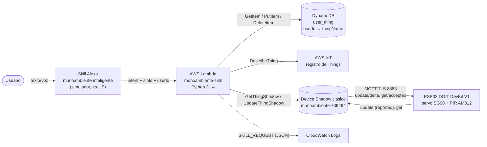
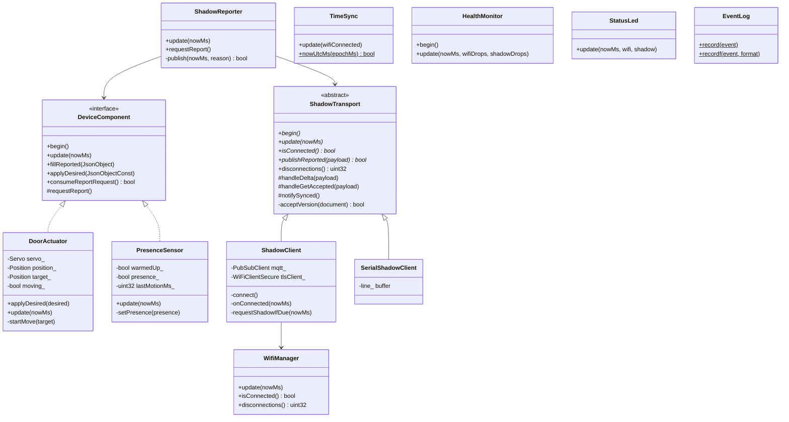
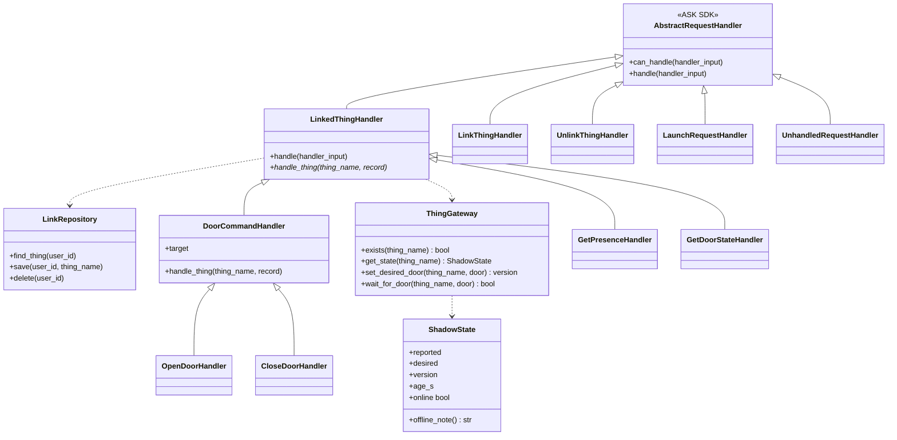
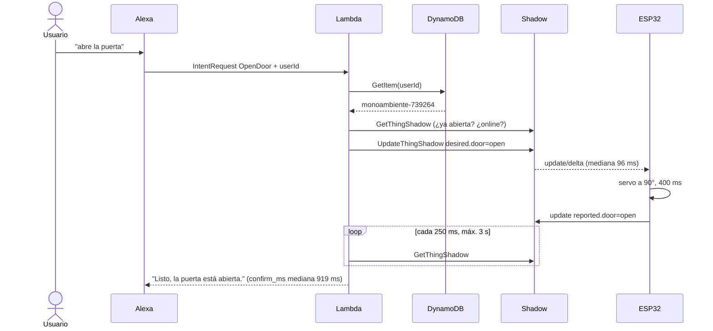

# Guía para escribir el informe — Práctica 3

**Para:** Dabner. **Entrega:** martes 10/11/2026, 17:45, por el LMS (enlace del repositorio).

Este documento reúne todo lo que el informe tiene que contar, con los valores medidos y dónde está cada cosa en el repositorio. El informe va en **`Informe.md`, en la raíz del repositorio**, en Markdown, con la estructura de §4.2 de la consigna ([Práctica_3.md] del docente). Usa como modelo de nivel de detalle el `Informe.md` de la Práctica 2, que sacó 16/16.

> Regla de oro: **no copies código completo**. Explica los fragmentos clave y enlaza al archivo (`[ShadowClient.cpp](src/ShadowClient.cpp)`). Todos los números de esta guía salen de la evidencia; si cambias uno, cámbialo también en su `README.md` de evidencia.

---

## 0. Lo que el docente valoró en la P2 y debemos repetir

De la revisión de la P2 (16/16):
- Requerimientos **medibles**, cada uno con criterio de aceptación verificable, y **matriz de trazabilidad** requisito → diseño → código → prueba → resultado.
- **Todos** los diagramas exigidos, y que coincidan con el código.
- Plan de pruebas con ID, requisito, procedimiento, criterio, resultado observado, estado y enlace a la evidencia.
- **Análisis de errores** honesto (qué permiten y qué no permiten afirmar los datos) y **defectos encontrados y corregidos**.
- Recomendaciones técnicas, cada una ligada a la prueba que la motiva.

Lo que pidió mejorar y debemos hacer ahora:
1. **Resumen ejecutivo de una página al inicio** (arquitectura, cómo funciona, tabla de cumplimiento).
2. Numeración de títulos consistente (`##` sección, `###` subsección, `####` sub-subsección).
3. Identidad de Git bien configurada: `git config user.name "Dabner …"` y `git config user.email …` antes de commitear. **Cada uno commitea con su propia cuenta**: el historial se usa en la defensa individual.
4. No dejar todo para el último día (ya vamos tarde: escribe por secciones y haz un commit por sección).

---

## 1. Estructura obligatoria del informe (consigna §4.2)

```text
# Práctica 3 - Integración de un objeto inteligente con Alexa mediante MQTT y AWS IoT Core
(integrantes, materia, fecha, enlace al repo)
## Resumen ejecutivo
## Contenido
## 1. Caso de uso y requerimientos
   1.1 Caso de uso y justificación del sensor y el actuador
   1.2 Requerimientos funcionales
   1.3 Requerimientos no funcionales (con justificación de los valores)
   1.4 Matriz de trazabilidad
## 2. Análisis y diseño
   2.1 Arquitectura del sistema
   2.2 Diagrama de circuito
   2.3 Diagramas de clases (ESP32 y Lambda)
   2.4 Diagramas de secuencia (vinculación, consulta del sensor, comando; + reconexión)
   2.5 Especificación del documento Shadow
   2.6 Diseño del mecanismo de vinculación
   2.7 Diseño de la skill de Alexa
   2.8 Frecuencia de reporte (justificación y consumo de mensajes)
## 3. Desarrollo e implementación
   3.1 Entorno y estructura del repositorio
   3.2 Módulos y clases
   3.3 Fragmentos clave (con enlaces)
   3.4 Configuración en AWS (Thing, certificados, política, Lambda, tabla, rol IAM) y permisos
   3.5 Configuración en Alexa (modelo de interacción, enlace con la Lambda)
   3.6 Registro de eventos (logs) y herramientas de prueba
## 4. Pruebas y validaciones
   4.1 Plan de pruebas
   4.2 A. Pruebas físicas y de entorno (A01–A10)
   4.3 B. Pruebas automáticas (B01–B03)
   4.4 Defectos encontrados y corregidos
   4.5 Análisis de errores
## 5. Resultados
   5.1 Tabla consolidada (valor declarado vs. medido)
   5.2 Análisis crítico
## 6. Conclusiones
## 7. Recomendaciones (incluye extensiones hacia un uso real)
## 8. Anexos
```

---

## 2. Caso de uso (§1.1)

**Puerta de un monoambiente inteligente.** Un servo SG90 abre y cierra la puerta (maqueta) y un sensor PIR AM312 detecta si hay alguien en la entrada. El usuario, desde Alexa, pregunta si hay alguien en la puerta, abre o cierra la puerta y consulta su estado, sin estar en casa (por ejemplo, para dejar entrar a alguien o comprobar que quedó cerrada).

**Justificación del sensor y actuador:**
- **PIR AM312**: detecta personas por movimiento infrarrojo, bajo consumo, salida digital de 3.3 V (directo al ESP32, sin divisor), alcance de unos 3 m. Es lo natural para "¿hay alguien en la puerta?". Como detecta movimiento y no presencia quieta, el firmware mantiene `presence = true` durante **10 s** después del último movimiento, y descarta las lecturas de los primeros **30 s** (calentamiento del sensor).
- **Servo SG90**: posición controlada (0° cerrada, 90° abierta), bajo voltaje (5 V, cumple ≤ 12 V DC), sin cargas de 220 V. **No se usa un LED como actuador** (el LED de GPIO32 solo indica el estado de conexión).
- **No se usa el ultrasónico** (HC-SR04): se descartó porque el caso no mide distancias. Puede ir como extensión en recomendaciones.
- El diseño es extensible: cada sensor o actuador es una clase que implementa `DeviceComponent`; agregar uno no cambia el código del Shadow.

**Lógica de control:** solo por voz, a través del Shadow (la consigna no exige control automático local).

---

## 3. Requerimientos (§1.2 y §1.3)

Copia estas tablas (están también en [docs/PLAN_DE_PRUEBAS.md](PLAN_DE_PRUEBAS.md) §1). **RF10, RF11 y RF12 son nuestros**: explica en el informe que se agregaron porque cierran casos que la consigna deja abiertos.

### Funcionales

| ID | Requerimiento | Criterio de aceptación |
|---|---|---|
| RF1 | Detectar presencia en la entrada con el PIR AM312. | `PRESENCE_ON` al detectar movimiento, después de 30 s de calentamiento (`PIR_READY`). `presence` se mantiene `true` 10 s después del último movimiento. |
| RF2 | Reportar periódicamente `presence`, `door` y `servo_angle` en `reported`. | Cada reporte trae los tres atributos. Con la conexión activa, nunca pasan más de 61.5 s entre dos reportes (heartbeat de 60 s). |
| RF3 | Aplicar el `delta` en el servo y confirmarlo en `reported`. | Un `delta` válido mueve el servo y su posición aparece en `reported` en ≤ 1.5 s desde `DELTA_RX`. |
| RF4 | Responder por voz el valor del sensor, leyendo `reported`. | "Sí, se detecta a alguien…" / "No, no se detecta…" según `reported.presence`, nunca según `desired`. |
| RF5 | Ejecutar por voz abrir y cerrar, escribiendo `desired`. | `desired.door` cambia a `open`/`closed` en el Shadow del Thing del usuario. |
| RF6 | Responder por voz el estado de la puerta. | "La puerta está abierta/cerrada" según `reported.door`; si `desired` difiere, menciona la orden pendiente. |
| RF7 | Vincular con un código y que persista entre sesiones. | Ítem `userId → thingName, fechaVinculacion` en DynamoDB, usado al reabrir la skill. |
| RF8 | Resolver el Thing de cada usuario por su `userId`. | Usuario sin vincular recibe la guía; dos usuarios con Things distintos solo actúan sobre el suyo. |
| RF9 | Validar el Thing antes de vincular y permitir cambiar o eliminar. | Código inválido o Thing inexistente no se guarda; volver a vincular reemplaza; desvincular borra. |
| **RF10** | Confirmar al usuario que la puerta se movió. | La Lambda espera `reported.door` hasta 3 s y dice "Listo, la puerta está abierta/cerrada"; si no llega, dice que no recibió confirmación. |
| **RF11** | Avisar cuando el objeto está desconectado. | Si el último reporte tiene > 150 s, las consultas lo advierten y los comandos avisan que se aplicarán al reconectarse. |
| **RF12** | Rechazar comandos inválidos y repetidos sin mover el servo. | Valor fuera de `open`/`closed`, JSON mal formado o `delta` con versión repetida/anterior → `INVALID_VALUE`, `JSON_ERROR` o `STALE_IGNORED`, sin movimiento. |

### No funcionales

| ID | Atributo | Valor declarado | Prueba |
|---|---|---|---|
| RNF1 | Estabilidad | ≥ 15 min continuos, 0 reinicios, 0 caídas WiFi/MQTT, `loop()` ≤ 500 ms, pérdida de heap ≤ 4096 bytes | A10 |
| RNF2 | Exactitud | PIR: 100 % de detección de cruces a 0.5, 1.0 y 2.0 m (5 por distancia) y 0 falsos positivos en 5 min; servo ±5° en 0° y 90° | A06 |
| RNF3 | Tiempo de respuesta | ≤ 3 s desde que la Lambda recibe el comando hasta que la puerta está confirmada, en ≥ 20 comandos | A05 |
| RNF4 | Frecuencia de reporte | Evento ≤ 1.1 s desde el cambio; heartbeat 60 s (máx. 61.5 s entre reportes); ~1440 mensajes/día en reposo | A10, B02 |
| RNF5 | Reconexión y sincronización | WiFi reintenta cada 10 s ± 0.5 s; orden pendiente aplicada ≤ 10 s desde `WIFI_CONNECTED` | A07, A08 |
| RNF6 | Seguridad | 0 secretos en archivos y en todo el historial; secretos ignorados por git; plantilla publicada | B03 |

**Justificaciones** (están en el plan, §1.2): por qué 0.5–2.0 m (zona frente a la puerta; el PIR es binario, su exactitud es tasa de detección), por qué 3 s (referencia de la consigna; el servo usa 400 ms), por qué evento + heartbeat 60 s (puerta y presencia son eventos discretos → inmediato, orden de 1 s como pide la consigna; heartbeat de 10 s daría 8640 mensajes/día sin ganar nada), por qué 150 s (2.5 heartbeats: tolera un mensaje perdido más una reconexión).

---

## 4. Diagramas (§2) — todos obligatorios

Usa **Mermaid** (GitHub lo dibuja solo). Abajo hay borradores correctos respecto del código; complétalos y revísalos.

### 4.1 Arquitectura (§2.1)



Explica: Alexa **nunca** habla con la ESP32; todo pasa por el Shadow. Región única `us-east-2` (Ohio).

### 4.2 Circuito (§2.2)

Puedes dibujarlo en Wokwi/Fritzing o en Mermaid. Datos reales:

| Componente | Pin del componente | Conexión ESP32 |
|---|---|---|
| Servo SG90 | Señal (naranja) | GPIO13 |
| Servo SG90 | V+ (rojo) / GND (marrón) | 5 V (VIN, desde USB) / GND común |
| PIR AM312 | OUT | GPIO26 (D26), entrada con pull-down interno |
| PIR AM312 | VCC / GND | 5 V (VIN) / GND común |
| LED de estado | Ánodo con resistencia 220–330 Ω | GPIO32 (solo indicador: rápido = sin WiFi, lento = sin Shadow, fijo = en línea) |

Justificación de GPIO: 13, 26 y 32 no son pines de arranque (*strapping*) ni de la flash. El servo se alimenta del 5 V de la placa; en las pruebas no hubo ningún reinicio inesperado (83 min seguidos sin reiniciar, ver A10), pero se recomienda fuente de 5 V externa con GND común para un uso real. Incluye una **foto del montaje** (falta tomarla).

### 4.3 Clases de la ESP32 (§2.3)



Explica el patrón: `main.cpp` registra los componentes en un arreglo; `ShadowReporter` arma `reported` pidiéndole a cada uno `fillReported()`; `ShadowTransport` entrega el `desired` a todos con `applyDesired()`. **Para agregar un sensor nuevo solo se escribe su clase y se agrega al arreglo.** El modo `local_test` reemplaza AWS por el puerto serie usando la misma interfaz (polimorfismo), y eso permite la prueba automática B02.

### 4.4 Clases de la Lambda (§2.3)



Además: `HelpIntentHandler`, `CancelOrStopIntentHandler`, `SessionEndedRequestHandler`, `CatchAllExceptionHandler`, y los interceptores `RequestTimer` / `RequestLogger` que escriben la línea `SKILL_REQUEST`.

### 4.5 Secuencias (§2.4) — mínimo 3, recomendado 4

**Vinculación:** Usuario → Alexa ("vincula mi casa con el código 739264") → Lambda `LinkThing` → `parse_link_code` (6 dígitos, sin 0 inicial) → `iot.describe_thing("monoambiente-739264")` → si existe, `GetItem` (¿ya vinculado?) → `PutItem(userId, thingName, fechaVinculacion)` → "Listo, tu casa con el código 7 3 9 2 6 4 quedó vinculada".

**Consulta del sensor:** Usuario → "hay alguien en la puerta" → Lambda `GetPresence` → `GetItem(userId)` → `GetThingShadow` → lee `reported.presence` y la antigüedad (`metadata.reported.*.timestamp`) → si > 150 s agrega "Ojo: tu casa no se reporta desde hace…" → respuesta.

**Comando (el más importante, con tiempos medidos):**


**Reconexión (recomendado, la consigna la evalúa en la demo):** ESP32 sin WiFi → Lambda responde "tu casa está desconectada, se aplicará al reconectarse" (`desired` queda con `delta`) → vuelve el WiFi → `MQTT_CONNECTED` → suscripciones → `/get` → `GET_RX` (o el `delta` llega antes) → servo → `reported` → el `delta` desaparece. Medido: 3.3–3.8 s desde `WIFI_CONNECTED`.

---

## 5. Shadow, vinculación y skill (§2.5–2.7)

### Documento Shadow

```json
{
  "state": {
    "desired":  { "door": "closed" },
    "reported": { "door": "closed", "servo_angle": 0, "presence": false }
  }
}
```

| Atributo | Sección | Tipo | Valores | Quién escribe |
|---|---|---|---|---|
| `door` | `desired` | string | `"open"` / `"closed"` (minúsculas) | Lambda (comandos) |
| `door` | `reported` | string | `"open"` / `"closed"` | ESP32, **después** de los 400 ms del servo |
| `servo_angle` | `reported` | entero | 0 / 90 (`CLOSED_ANGLE_DEG` / `OPEN_ANGLE_DEG`) | ESP32 |
| `presence` | `reported` | booleano | `true` / `false` | ESP32 |

- **`delta`**: lo genera AWS cuando `desired ≠ reported`; la ESP32 se suscribe a `$aws/things/<thing>/shadow/update/delta`.
- La **Lambda nunca escribe `reported`** y **nunca lee `desired` para responder** (solo para avisar una orden pendiente).
- La ESP32 usa el campo `version` del documento para descartar `delta` repetidos o atrasados (MQTT QoS 1 puede reentregar).
- Al conectarse, la ESP32 pide el documento completo (`/get`) para aplicar lo que quedó pendiente.
- Al arrancar, la puerta va a `closed` (estado seguro ante corte de luz) y luego se sincroniza con el Shadow.
- Temas usados: `update`, `update/delta`, `update/rejected`, `get`, `get/accepted`, `get/rejected`.

### Vinculación

- **Identificador:** código de 6 dígitos que no empieza en 0; Thing name = `monoambiente-<código>` (`monoambiente-739264`). La ESP32 lo imprime al arrancar (`LINK_CODE 739264`). No es trivial de adivinar (900 000 combinaciones) y no se publica en el Shadow.
- **Slot** `code` tipo `AMAZON.NUMBER` (el usuario dice los dígitos).
- **Validaciones:** formato (6 dígitos, sin cero inicial) → `iot:DescribeThing` (RF9) → recién entonces `PutItem`.
- **Cambiar** = vincular otro código (reemplaza el ítem); **eliminar** = `UnlinkThing` (`DeleteItem`).
- **Tabla:** ver [aws/dynamodb-table.md](../aws/dynamodb-table.md).
- Account Linking (OAuth) está fuera de alcance (consigna).

### Skill

Invocación **"monoambiente inteligente"**, Spanish (US). Modelo completo: [alexa/interaction-model.es-US.json](../alexa/interaction-model.es-US.json).

| Intent | RF | Frases | Slot |
|---|---|---|---|
| `LinkThing` | RF7, RF9 | "vincula mi casa con el código {code}", "cambia mi casa al código {code}", "mi código es {code}" | `code`: AMAZON.NUMBER |
| `UnlinkThing` | RF9 | "desvincula mi casa", "elimina la vinculación" | — |
| `GetPresence` | RF4 | "hay alguien en la puerta", "detectas a alguien en la entrada", "hay presencia en la puerta" | — |
| `OpenDoor` / `CloseDoor` | RF5, RF10 | "abre la puerta", "cierra la puerta", "abrir/cerrar la puerta" | — |
| `GetDoorState` | RF6 | "cómo está la puerta", "cuál es el estado de la puerta", "la puerta está abierta" | — |
| Integrados | — | Help, Cancel, Stop, Fallback, NavigateHome | — |

Respuestas importantes: todas mantienen la sesión abierta (`.ask`), el código se lee dígito por dígito (SSML `say-as digits`).

---

## 6. Implementación (§3)

### Estructura del repositorio

```text
include/config.h            todas las constantes (pines, tiempos, temas, contrato del Shadow)
include/secrets.example.h   plantilla SIN valores reales (secrets.h está en .gitignore)
src/                        firmware ESP32 (una clase por archivo .h/.cpp)
lambda/lambda_function.py   backend de la skill
lambda/tests/               23 pruebas unitarias de la Lambda (B01)
alexa/, aws/                configuraciones exportadas
tools/                      analyze_log.py, serial_check.py, serial_logger.py, check_secrets.py
docs/PLAN_DE_PRUEBAS.md     plan de pruebas;  docs/evidencias/  evidencia por prueba
platformio.ini              envs esp32doit-devkit-v1 (real) y local_test (sin AWS)
```

### Fragmentos clave para explicar (con enlace, sin copiar todo)

1. **Sin bloqueos:** `loop()` toma `millis()` una vez y llama `update(nowMs)` de cada módulo; no hay `delay()`. [main.cpp](../src/main.cpp)
2. **Conexión MQTT/TLS y suscripciones; `/get` tras conectar con reintento**: [ShadowClient.cpp](../src/ShadowClient.cpp) (`connect`, `onConnected`, `requestShadowIfDue`).
3. **Interpretación del `delta` y filtro por versión:** [ShadowTransport.cpp](../src/ShadowTransport.cpp) (`handleDelta`, `acceptVersion`).
4. **Actuador que confirma después de moverse:** [DoorActuator.cpp](../src/DoorActuator.cpp) (`applyDesired`, `update`).
5. **PIR con calentamiento y retención:** [PresenceSensor.cpp](../src/PresenceSensor.cpp).
6. **Política de reporte (evento + 1 s mínimo + heartbeat):** [ShadowReporter.cpp](../src/ShadowReporter.cpp).
7. **Evidencia de estabilidad y watchdog:** [HealthMonitor.cpp](../src/HealthMonitor.cpp) (motivo del reinicio, `HEALTH` cada 60 s, watchdog de 30 s).
8. **Hora UTC por NTP para comparar logs con CloudWatch:** [TimeSync.cpp](../src/TimeSync.cpp), [EventLog.cpp](../src/EventLog.cpp).
9. **Lambda — resolución del Thing (RF8):** `LinkedThingHandler.handle()`; **validación y vinculación (RF7/RF9):** `LinkThingHandler`; **comando con confirmación (RF5/RF10):** `DoorCommandHandler.handle_thing()` + `ThingGateway.wait_for_door()`; **aviso de desconexión (RF11):** `ShadowState.online/offline_note()`; **log por solicitud:** `log_request()`. [lambda_function.py](../lambda/lambda_function.py)

Buenas prácticas para mencionar: POO con interfaz y clases derivadas, sin números mágicos (54 constantes con nombre y unidad en `config.h`; constantes con nombre en la Lambda), comentarios Doxygen en inglés, código en inglés, `-Wall -Wextra` sin warnings, clientes de AWS creados una vez por contenedor, sin access keys en el código (la Lambda usa su rol IAM).

### Logs

ESP32: cada línea `[t_ms|UTC] EVENTO detalle` (tabla de eventos en el [README](../README.md)). Lambda: una línea JSON `SKILL_REQUEST` por solicitud con intent, hash del usuario, Thing, resultado, versión del Shadow, `lambda_ms` y `confirm_ms`. Explica que con eso se calculan los requisitos con [tools/analyze_log.py](../tools/analyze_log.py).

### Configuración AWS y Alexa (§3.4–3.5)

Todo está en [aws/README.md](../aws/README.md): Things, certificado, política usada (`Allow * *`) **y la mínima**, rol de la Lambda (`AWSIoTFullAccess` + `AmazonDynamoDBFullAccess`) **y el mínimo**, riesgos de los permisos amplios, variables de entorno, timeout 7 s, disparador con verificación del Skill ID, endpoint de la skill = ARN de la Lambda. **La consigna exige explicar qué se asignó, por qué y cuál sería el mínimo**: copia esa tabla.

**Dónde vive cada cosa (aclararlo en el informe y en la defensa):** la skill se creó con la plantilla *Alexa-hosted (Python)*, pero en **Build → Endpoint** se reemplazó por el **ARN de nuestra Lambda** `monoambiente-skill`. Por eso el backend, la tabla DynamoDB `user_thing` y los logs de CloudWatch están en **nuestra cuenta de AWS** (`us-east-2`), y el código y la base de datos que trae una skill Alexa-hosted **no se usan**. Alexa solo convierte la frase en un intent y lo envía a la Lambda. La evidencia está en A01 (ítems de DynamoDB en la consola de AWS) y en los CSV de CloudWatch.

Para las capturas de configuración usa las de [docs/GUIA_AWS_ANDRES.md](GUIA_AWS_ANDRES.md) como guía de qué mostrar (sin mostrar claves ni el número de cuenta).

---

## 7. Pruebas (§4)

Copia la estructura de [docs/PLAN_DE_PRUEBAS.md](PLAN_DE_PRUEBAS.md) y, por cada prueba, una tabla `ID | Requisitos | Procedimiento | Criterio | Resultado observado | Estado | Evidencia` (como B06 de la P2). Los resultados están en cada `docs/evidencias/AXX/README.md` y resumidos en [docs/evidencias/README.md](evidencias/README.md).

| Prueba | Resultado medido |
|---|---|
| A01 Vinculación por voz | 13/13 respuestas correctas, 0 errores; DynamoDB con 1 ítem por usuario; persistió tras cerrar la sesión |
| A02 Dos usuarios | `test-user-2` → `monoambiente-518306`; su `OpenDoor` solo modificó ese Shadow; 0 `DELTA_RX` en la ESP32 real |
| A03 Consulta del sensor | 8/8 respuestas coinciden con el PIR; reporte del cambio: mediana 5 ms, máx. 254 ms |
| A04 Comandos | 6/6; `DELTA_RX` → `reported` 415–416 ms; "ya está abierta" no reescribe el Shadow |
| A05 Tiempo de respuesta | **28/28**; Lambda → servo detenido: mediana **616 ms**, máx. **984 ms**; Lambda → confirmado en `reported`: mediana **919 ms**, máx. **1691 ms**; nube (`UpdateThingShadow` → `DELTA_RX`): mediana 96 ms |
| A06 Exactitud | PIR **15/15** cruces (0.5, 1.0, 2.0 m), **0** falsos positivos en 5.0 min; servo: 4/4 fotos con diferencia estimada < 3° en 0° y 90° |
| A07 Caída de WiFi | Aviso "no se reporta desde hace 2/3 minutos"; orden pendiente aplicada **3848 ms** y **3297 ms** después de `WIFI_CONNECTED`; reintentos WiFi cada 10 000 ms |
| A08 Corte de energía | Orden pendiente `open` aplicada **3.9 s** después de enchufar |
| A09 Comandos inválidos | 3/3 rechazados (`medio`, `5`, `OPEN`) sin mover; 2/2 válidos después |
| A10 Estabilidad | **27.3 min**, 0 reinicios, 0 caídas, `loop()` máx. **21 ms**, heap sin pérdida, máx. 59 999 ms entre reportes, 115/115 reportes completos |
| B01 Lambda | **23/23** pruebas unitarias |
| B02 Firmware | **16/16** casos (válidos, inválidos, repetidos, JSON roto, inversión a mitad de movimiento, 1 s mínimo, heartbeat 60 000 ms) |
| B03 Secretos | 0 en 149 archivos y 27 commits; control positivo OK |

### Defectos encontrados y corregidos (§4.4) — muy valorado

1. **B02 — confirmación prematura del servo.** `ACTUATOR_DONE` salía 0–10 ms después de `ACTUATOR_START` en vez de 400 ms: el Shadow decía "abierta" mientras el servo aún se movía. Causa: resta sin signo `nowMs - moveStartMs_` con `moveStartMs_` tomado después de `nowMs` → número enorme. Corrección: diferencia con signo. Evidencia: corrida 13/16 → 16/16. Detalle en [B02/README.md](evidencias/B02/README.md).
2. **A07 — bloqueo del `loop()` sin internet.** Con WiFi pero sin internet, cada intento MQTT esperaba ~7 s al DNS y el siguiente arrancaba de inmediato porque el intervalo de 5 s se contaba desde el inicio: `max_loop_ms=7032`. Corrección: contar el intervalo desde el fin del intento. Verificación: reintentos cada 5 s con `max_loop_ms` 23/17 ms. Detalle en [A07/README.md](evidencias/A07/README.md).

### Análisis de errores (§4.5) — qué permiten y qué NO permiten afirmar los datos

- El tiempo de **reconocimiento de voz/texto del simulador** no se puede medir desde la Lambda: RNF3 se mide desde que la Lambda recibe el intent. `confirm_ms` es cota superior (incluye la espera del sondeo de 250 ms).
- La medición con dos relojes depende del NTP de la ESP32 (error del orden de decenas de ms).
- A06 usa 15 cruces: un 100 % observado no prueba estadísticamente ≥ 95 %; se declara como limitación.
- A08 intento 1 no fue concluyente porque la orden pendiente coincidía con el estado de arranque (`closed`); se repitió con `open`.
- Con un `desired` inválido en el Shadow, AWS reenvía el `delta` con cada `reported`: 13 `INVALID_VALUE` para 3 publicaciones (A09). No mueve el servo, pero gasta mensajes.
- Las conexiones TLS exitosas bloquean ~2–4 s (`max_loop_ms=2111` en A07): PubSubClient conecta de forma sincrónica.
- Peor caso de A05 (984 ms) fue el primer comando tras 5 min sin uso.
- Todas las pruebas fueron en una noche, una red (hotspot iPhone) y un solo dispositivo físico.

---

## 8. Resultados, conclusiones y recomendaciones (§5–7)

### Tabla consolidada (§5.1)

| Requisito | Declarado | Medido | Prueba | Veredicto |
|---|---|---|---|---|
| RNF1 | ≥ 15 min, 0 reinicios, `loop()` ≤ 500 ms | 27.3 min, 0, 21 ms (83 min sin reinicio en total) | A10 | Cumple |
| RNF2 | 100 % detección 0.5–2.0 m, 0 falsos positivos; servo ±5° | 15/15, 0 en 5 min; servo < 3° | A06 | Cumple |
| RNF3 | ≤ 3 s | máx. 1691 ms (confirmado), 984 ms (servo) | A05 | Cumple |
| RNF4 | evento ≤ 1.1 s, heartbeat ≤ 61.5 s | máx. 804 ms, 59 999 ms | A10, A03, B02 | Cumple |
| RNF5 | orden pendiente ≤ 10 s | 3.3–3.9 s | A07, A08 | Cumple |
| RNF6 | 0 secretos | 0 | B03 | Cumple |

Agrega una fila por cada RF (RF1–RF12) con su prueba (ver matriz en el plan).

### Ideas para conclusiones (fundadas en números)

- El Shadow desacopla a Alexa de la ESP32: un comando con la casa apagada se guarda y se aplica 3–4 s después de volver (A07, A08).
- El tiempo de extremo a extremo (≈0.6 s al servo) está dominado por los 400 ms del servo; la nube aporta ~0.1 s.
- La confirmación por `reported` (RF10) da al usuario una respuesta verdadera, no solo "enviando".
- La política evento + heartbeat da 1440 mensajes/día en reposo y reacción en < 1 s.
- Las pruebas encontraron 2 defectos que no se veían usando el sistema normalmente.

### Recomendaciones (cada una con la prueba que la motiva)

1. Conexión MQTT no bloqueante o en otra tarea de FreeRTOS (A07: 2–4 s de bloqueo al reconectar).
2. Al rechazar un valor inválido, que la ESP32 publique `"desired":{"door":null}` para borrar el `delta` (A09).
3. Aplicar las políticas mínimas de `aws/` en producción (B03, §3.4).
4. Fuente de 5 V externa para el servo con GND común (riesgo de *brownout*, aunque no ocurrió).
5. Sensor de final de carrera o *reed switch* para confirmar la posición física real de la puerta, no solo el comando al servo.
6. Cerradura solenoide (12 V con MOSFET) para un uso real; el servo es de maqueta.
7. Alerta de facturación en AWS (la consigna la recomienda) y usuarios IAM en vez de compartir la cuenta (consejo del docente).
8. Extensiones: varias puertas por usuario (clave de ordenamiento en DynamoDB), historial de presencia (tabla aparte), notificaciones proactivas de Alexa cuando hay alguien en la puerta, Account Linking (OAuth).
9. Repetir A05/A10 en otra red y otro día para margen estadístico (lección de la P2).

### Anexos (§8)

Enlaces a: `docs/evidencias/` (índice), `docs/PLAN_DE_PRUEBAS.md`, `alexa/`, `aws/`, `include/secrets.example.h`, `lambda/tests/`, `tools/`, videos de A03, A04, A07 y A08, foto del montaje.

---

## 9. Lo que todavía falta (antes de entregar)

- [x] A06: fotos del servo con transportador (falta solo la foto de las marcas del piso, opcional).
- [ ] Foto del montaje completo y diagrama de circuito.
- [ ] Capturas de configuración de AWS/Alexa para §3.4–3.5 (sin número de cuenta).
- [ ] `Informe.md` completo, con commits de los dos.
- [ ] Revisión final: todos los enlaces funcionan en GitHub y no hay secretos (`python tools/check_secrets.py`).
- [ ] Subir el enlace del repositorio al LMS antes de las 17:45.
