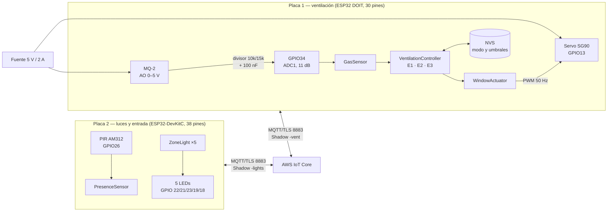
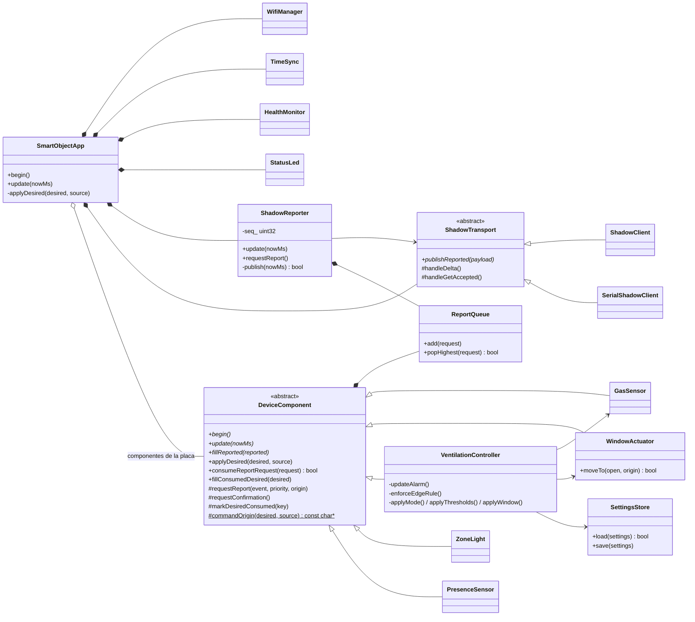
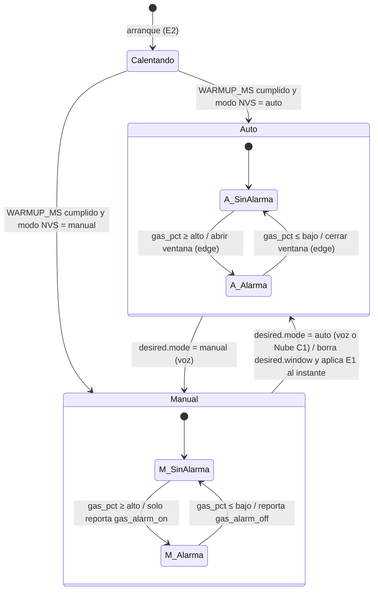

# Borrador — secciones de Dabner del Informe P4

> **Borrador de trabajo.** Se pega en `Informe_P4.md` (raíz del repo) cuando Andrés lo cree y **después se borra este archivo**. Los enlaces están escritos relativos a la raíz, como quedarán en `Informe_P4.md`. Todo lo marcado `⟨…⟩` es un valor medido que falta: se completa con el número de la evidencia indicada, nunca con "cumple".

---

## 1. Caso de uso y requerimientos

### 1.1 Caso de uso: SmartLoft

SmartLoft es la maqueta a escala de un monoambiente inteligente con dos objetos inteligentes, uno por función:

| Función | Qué hace | Placa |
|---|---|---|
| Luces por zona | 5 zonas (cocina, sala de estar, comedor, baño y habitación) que se encienden y apagan por voz | 2 (luces y entrada) |
| Ventilación | El MQ-2 detecta gas o humo sobre un umbral → el servo abre la ventana; al volver a la normalidad la cierra | 1 (ventilación) |
| Presencia en la entrada | El PIR solo se consulta por voz ("¿hay alguien en la puerta?"); no acciona nada | 2 |
| Registro | Cada alarma de gas, movimiento de la ventana, cambio de luz y detección en la entrada se guarda con su hora en DynamoDB | Nube |

**Fuera del alcance:** puerta automática, temperatura y humedad, cortina, ventilador y timbre. **Aclaración de seguridad:** es un prototipo educativo; no reemplaza un detector de gas certificado ni una válvula de corte.

### 1.2 Ampliación respecto a la Práctica 3

La P3 era una puerta con servo y PIR. En la P4 el caso de uso **cambia** a un monoambiente:

| P3 | P4 | Por qué |
|---|---|---|
| Puerta automática con servo | Se elimina; el servo pasa a mover una **ventana** | La puerta no tenía ninguna variable que justificara lógica automática ni histórico |
| PIR que se consultaba por voz | Se conserva en la entrada, solo para consulta y registro | El grupo no quiere luces que se enciendan por presencia (§2.4) |
| — | **MQ-2** (gas y humo) | Da la variable que justifica la lógica automática: umbral con histéresis en el Edge y alarmas que se cuentan en el día en la Nube |
| — | **5 LEDs** (luces por zona) | Amplía los comandos por voz a varios actuadores del mismo tipo sin cambiar la arquitectura |
| 1 placa | **2 placas**, un *Thing* cada una | La regla "gas → ventana" vive entera en la placa 1 y funciona sin Internet; las placas no se comunican entre sí |

### 1.3 Justificación de sensores y actuadores

| Componente | Cant. | Por qué este y no otro |
|---|---|---|
| MQ-2 | 1 | Único sensor ambiental; responde a gas combustible (GLP, metano) y humo, los riesgos típicos de una cocina. Se usa la salida **analógica** (AO) para que el umbral se cambie por voz (RF14); la salida DO tiene el umbral fijo en un potenciómetro |
| PIR AM312 | 1 | Presencia en la entrada; salida digital de 3.3 V directa al GPIO, sin adaptación |
| Servo SG90 | 1 | Actuador que **no es un LED** (restricción del enunciado), a 5 V (≤ 12 V) |
| LED blanco + 220 Ω | 5 | Representan las luces; se permiten porque no son los únicos actuadores |
| ESP32 | 2 | Una por función: la lógica de seguridad (gas) no depende de la placa de luces ni de Internet |
| Ultrasónico | 0 | El caso no mide niveles ni distancias |

### 1.4 Requerimientos funcionales

RF1–RF9 son los de la P3 aplicados a todos los sensores y actuadores; RF10–RF15 son los nuevos del enunciado.

| ID | Requisito | Criterio observable |
|---|---|---|
| RF1 | Capturar los sensores (MQ-2 y PIR) | `GAS_SAMPLE` cada 1 s con `n=20`; `PRESENCE_DETECTED` tras el calentamiento de 30 s del PIR |
| RF2 | Reportar el estado completo en `reported` | Cada reporte trae **todos** los atributos de su placa (§2.6) y `event`, `origin`, `seq`, `device_ts` |
| RF3 | Aplicar el `delta` en los actuadores y confirmarlo | Un `delta` válido mueve el servo o cambia el LED y el nuevo estado aparece en `reported` en ≤ 1.5 s desde `DELTA_RX` |
| RF4–RF6 | Consultas y comandos por voz | Ver diseño de la skill (sección de Andrés) |
| RF7–RF9 | Vinculación usuario ↔ *Things* | Un código vincula los dos *Things* de la casa (ver sección de Andrés) |
| RF10 | Reglas de IoT que invocan las Lambdas | Ver sección de Andrés |
| RF11 | Validar, enriquecer y guardar lecturas | Ver sección de Andrés; la placa entrega el reporte completo que la Lambda valida |
| RF12 | Guardar eventos de actuadores con su origen | La placa reporta `event` y `origin` (`voice`, `cloud`, `edge`, `boot`) en cada cambio |
| RF13 | Lógica automática Edge y Nube | E1–E3 en la placa 1 (§2.5); C1 en la Lambda de control |
| RF14 | Modo y umbrales en `reported`, consultables y modificables por voz | `mode`, `gas_high_pct`, `gas_low_pct` en `reported`; se cambian por `desired` |
| RF15 | Mockups de reportes | Ver sección de Andrés |

### 1.5 Requerimientos no funcionales (parte del objeto)

| ID | Atributo | Valor declarado | Cómo se mide | Prueba |
|---|---|---|---|---|
| RNF1 | Estabilidad | ≥ 60 min con 0 reinicios por placa, `loop()` ≤ 500 ms en operación normal | Líneas `HEALTH` y `BOOT` | A11 |
| RNF2 | Exactitud | PIR: 15/15 pasadas y 0 falsos positivos en 5 min. Servo: ±5° en abierta y cerrada. MQ-2: repetibilidad declarada (no exactitud en ppm) | Conteo, transportador, `mq2_probe` | A12, A10 |
| RNF3 | Respuesta por voz | ≤ 3 s Lambda → objeto confirmado (como la P3), para luces y ventana | `DELTA_RX` → `LIGHT_APPLIED` / `ACTUATOR_DONE` | A02, A03 |
| RNF4 | Frecuencia de reporte | Por evento ≥ 1 s entre reportes; heartbeat 60 s; `gas_changed` cuando `gas_pct` varía ≥ 3 puntos | `REPORT_TX` del log y B02 | B02, A08 |
| RNF5 | Reconexión | Orden pendiente aplicada en ≤ 10 s desde `WIFI_CONNECTED` | `WIFI_CONNECTED` → `GET_RX` → `ACTUATOR_DONE` | A09 |
| RNF7 | Respuesta de la lógica automática **Edge** | `GAS_ALARM_ON` → `ACTUATOR_DONE` ≤ ⟨A05⟩ ms (esperado ≈ 400 ms del servo) | Un solo reloj: `millis()` de la placa 1 | A05 |
| RNF8 | Respuesta de la lógica automática **Nube** | `REPORT_TX event=gas_alarm_on` → `MODE_APPLIED origin=cloud` ≤ ⟨A06⟩ ms | Un solo reloj: placa 1 | A06 |
| RNF9 | Operación sin conexión | Sin Internet, E1 abre y cierra la ventana igual; los reportes no enviados se pierden y se ven como huecos de `seq`; al volver se publica el estado completo | Log de la placa 1 vs DynamoDB | A09 |

### 1.6 Matriz requisito → diseño → código → prueba (objeto)

| Requisito | Diseño | Código | Prueba |
|---|---|---|---|
| RF1 gas | §2.2 divisor; §2.6 | [GasSensor.cpp](src/vent/GasSensor.cpp): `update()`, `closeWindow()` | A10, B02 |
| RF1 presencia | §2.6 | [PresenceSensor.cpp](src/lights/PresenceSensor.cpp) | A12 |
| RF2 reporte completo | §2.6, §2.7 | [ShadowReporter.cpp](lib/SmartObjectCore/ShadowReporter.cpp): `publish()` | B02 (V01, L01, V94) |
| RF3 luces | §2.6 | [ZoneLight.cpp](src/lights/ZoneLight.cpp): `applyDesired()` | A02, B02 (L03–L09) |
| RF3 ventana | §2.5, §2.6 | [VentilationController.cpp](src/vent/VentilationController.cpp): `applyWindow()`; [WindowActuator.cpp](src/vent/WindowActuator.cpp) | A03, B02 (V10, V11) |
| RF12 origen | §2.6 | `DeviceComponent::commandOrigin()`; `ShadowReporter::nextEvent()` | B02, A08 |
| RF13 E1–E3 | §2.5 | `VentilationController::updateAlarm()`, `enforceEdgeRule()`; [SettingsStore.cpp](src/vent/SettingsStore.cpp) | A05, A09, B02 (V04–V07, V22) |
| RF14 modo y umbrales | §2.5, §2.6 | `VentilationController::applyMode()`, `applyThresholds()` | A04, B02 (V09, V15–V19) |
| RNF4 | §2.7 | `ShadowReporter::update()`; [ReportQueue.cpp](lib/SmartObjectCore/ReportQueue.cpp) | B02 (V95, V96) |

---

## 2. Análisis y diseño (objeto inteligente)

### 2.1 Diagrama de bloques



Las placas **no se comunican entre sí**: todo pasa por sus Shadows. El servo y el MQ-2 se alimentan de la fuente de 5 V / 2 A con GND común con la placa 1; el 5 V nunca toca VIN, 3V3 ni un GPIO.

### 2.2 Circuito y cálculos

> Esquemáticos en Fritzing/KiCad: ⟨`docs/img/esquematico_vent.png`, `docs/img/esquematico_lights.png`⟩ (los circuitos no van en Mermaid).

**Divisor del MQ-2.** La AO del módulo llega a 5 V y el ADC del ESP32 admite ~3.1 V con 11 dB:

- `V_D34 = V_AO × R2 / (R1 + R2) = V_AO × 15 kΩ / 25 kΩ = 0.6 × V_AO`
- Con `V_AO = 5.0 V` → `V_D34 = 3.0 V` (< 3.3 V). Medido en el paso 0.6b con la punta AO en +5 V: ⟨valor⟩ V (evidencia A10).
- El firmware reconstruye `gas_mv = V_D34 / 0.6` y calcula `gas_pct = gas_mv / SUPPLY_MV × 100`, con `SUPPLY_MV` = ⟨tensión del bus medida con carga, paso 0.6⟩ mV.
- Corriente del divisor: `5 V / 25 kΩ = 0.2 mA`: no carga la salida del módulo. El capacitor de 100 nF filtra el ruido del calefactor.

**LED de cada zona.** `I = (3.3 V − V_LED) / 220 Ω`; con `V_LED ≈ 2.9 V` (blanco) → `I ≈ 1.8 mA`, muy por debajo de los 40 mA máximos por GPIO.

**Pines** (ninguno es de arranque ni de la flash):

| Placa | GPIO | Componente | Cable |
|---|---|---|---|
| 1 | 13 | Servo | `SERVO` |
| 1 | 34 | MQ-2 AO (divisor + 100 nF) | `MQ2` |
| 1, 2 | 32 | LED de estado (solo indicador) | — |
| 2 | 22 / 21 / 23 / 19 / 18 | Cocina / sala / comedor / baño / habitación | `L-COC` / `L-SAL` / `L-COM` / `L-BAN` / `L-HAB` |
| 2 | 26 | PIR OUT | `PIR` |

### 2.3 Diagrama de clases (firmware)



- **`lib/SmartObjectCore/`** (código común, sin duplicar): `SmartObjectApp` arma la secuencia de `setup()`/`loop()` una sola vez; cada `main.cpp` solo declara sus componentes y credenciales. Las credenciales se inyectan (`WifiManager`, `ShadowClientSettings`): la librería no lee archivos de secretos.
- **`src/vent/`** y **`src/lights/`**: componentes de cada placa. Agregar un sensor = una clase `DeviceComponent` y una línea en `main.cpp`.
- En `*_local_test`, `SerialShadowClient` reemplaza a AWS: el mismo código se prueba por el puerto serie (B02).

### 2.4 Lógica de control: ubicación de cada regla

| ID | Regla | Ubicación | Justificación |
|---|---|---|---|
| E1 | En `auto`: `gas_alarm` se enciende con `gas_pct ≥ gas_high_pct` y se apaga con `gas_pct ≤ gas_low_pct` (histéresis); la ventana sigue a la alarma, origen `edge` | Edge (placa 1) | Respuesta inmediata (≈ 400 ms del servo); sigue funcionando sin Internet; depende solo del dato local |
| E2 | Durante el calentamiento del MQ-2 (`WARMUP_MS` = ⟨A10/M4⟩ ms) no hay alarma ni acción | Edge | Solo la placa sabe cuándo arrancó el sensor |
| E3 | Modo y umbrales se guardan en la NVS al aplicarlos | Edge | Si la placa se reinicia sin Internet, E1 sigue con los últimos valores |
| C1 | Al empezar una alarma en `manual`: si hubo ≥ 3 en 24 h, volver a `auto` | Nube (Lambda de control) | Necesita el histórico de DynamoDB; el límite se cambia sin reprogramar |

**Descartado:** luces por presencia (el PIR es solo informativo); "gas → encender luces" (accionar interruptores durante una fuga es lo que se recomienda no hacer).

### 2.5 Diagrama de estados de la ventilación



| Situación | Qué hace la placa | Log |
|---|---|---|
| `window` por voz en `auto` | Rechaza y borra `desired.window` | `COMMAND_REJECTED reason=auto_mode` |
| "cierra la ventana" con alarma (en `manual`) | Rechaza | `COMMAND_REJECTED reason=gas_alarm` |
| Umbrales fuera de 1–99 o bajo ≥ alto | Rechaza | `COMMAND_REJECTED reason=invalid_thresholds` |
| `window` en `manual` sin alarma | Mueve, confirma y borra `desired.window` y `cmd_origin` | `ACTUATOR_START origin=voice` → `ACTUATOR_DONE` |

La skill aplica las mismas reglas con una respuesta explicativa; la placa las repite como **defensa en profundidad** (un `desired` publicado a mano desde el MQTT test client tampoco puede saltárselas).

### 2.6 Especificación de los Shadows

**Placa 1 — `smartloft-739264-vent`:**

| Atributo | Sección | Tipo | Valores válidos | Escribe |
|---|---|---|---|---|
| `gas_pct` | reported | number (1 decimal) | 0.0–100.0, índice relativo (no ppm) | Placa |
| `gas_mv` | reported | int | 0–5000 mV en AO | Placa |
| `gas_alarm` | reported | bool | Histéresis E1, en los dos modos | Placa |
| `warming_up` | reported | bool | `true` durante E2 | Placa |
| `window` | desired / reported | string | `open`, `closed`; en desired solo en `manual` y hasta que la placa lo aplica | Skill / placa |
| `servo_angle` | reported | int | `CLOSED_ANGLE_DEG`–`OPEN_ANGLE_DEG` = ⟨calibrados⟩ | Placa |
| `mode` | desired / reported | string | `auto`, `manual` | Skill o Lambda de control / placa |
| `gas_high_pct`, `gas_low_pct` | desired / reported | int | 1–99, bajo < alto | Skill / placa |
| `cmd_origin` | desired | string | `voice`, `cloud`; la placa lo borra al aplicar | Skill / Lambda de control |
| `event` | reported | string | `boot`, `heartbeat`, `gas_changed`, `gas_alarm_on`, `gas_alarm_off`, `window_changed`, `mode_changed`, `thresholds_changed` | Placa |
| `origin` | reported | string | `boot`, `voice`, `cloud`, `edge` | Placa |
| `seq` | reported | int | Sube en cada intento de publicar, aunque falle | Placa |
| `device_ts` | reported | int | Epoch UTC en ms (NTP); 0 sin hora | Placa |

**Placa 2 — `smartloft-739264-lights`:** `light_kitchen`, `light_living`, `light_dining`, `light_bathroom`, `light_bedroom` (desired/reported, `on`/`off`); `presence` (reported, bool); `event` ∈ {`boot`, `heartbeat`, `light_changed`, `presence_detected`, `presence_cleared`}; `origin`, `seq`, `device_ts` y `cmd_origin` como en la placa 1.

**Uso de `desired`, `reported` y `delta`:**
- La placa solo publica `reported`, con **todos** sus atributos en cada mensaje (contrato V1).
- Excepción documentada: al aplicar una orden publica en el mismo mensaje `"desired": {"window": null, "cmd_origin": null}` (solo las claves que consumió). Así no queda un `delta` viejo que deshaga lo que hizo E1. `mode`, umbrales y `light_*` **se quedan** en `desired`: son la configuración del usuario y se recuperan con `/get` tras un reinicio.
- Cada `delta` trae `version`; uno repetido o anterior se descarta (`STALE_IGNORED`).

### 2.7 Política y frecuencia de reporte

| Placa | Por evento | Heartbeat | Mínimo entre mensajes |
|---|---|---|---|
| 1 | Cambio de alarma, ventana, modo o umbrales; `gas_pct` varía ≥ 3 puntos (`gas_changed`) | 60 s | 1 s |
| 2 | Cambio de una luz; `presence_detected`; `presence_cleared` | 60 s | 1 s |

- Eventos distintos dentro del mismo segundo **no se pisan**: se encolan y salen uno por segundo, primero el de mayor prioridad (alarma > ventana > modo > umbrales > `gas_changed`). Ejemplo: cuando la Nube pone `auto` y E1 abre la ventana, salen `mode_changed` (origen `cloud`) y, un segundo después, `window_changed` (origen `edge`). Así la Lambda de datos guarda los dos eventos.
- El mismo evento repetido se agrupa: "apaga todas las luces" produce un solo `light_changed`.
- Volumen en reposo: 1 mensaje/min por placa ≈ 2 × 1440 = 2880 mensajes/día (base para el costo, B04).
- Muestreo del MQ-2: cada 50 ms, promedio de 1 s (20 muestras); la histéresis usa el promedio.

### 2.8 Secuencia: regla E1 (gas en modo automático)

```mermaid
sequenceDiagram
    participant MQ as MQ-2
    participant GS as GasSensor
    participant VC as VentilationController
    participant WA as WindowActuator
    participant SR as ShadowReporter
    participant SH as Shadow -vent
    participant R as Reglas de IoT

    MQ->>GS: AO sube (humo)
    GS->>GS: promedio de 1 s → gas_pct ≥ gas_high_pct
    VC->>VC: GAS_ALARM_ON (t0, millis)
    VC->>WA: moveTo(open, edge) → EDGE_ACTION
    WA-->>WA: ACTUATOR_DONE tras 400 ms (t1)
    Note over VC,WA: Tiempo de respuesta Edge = t1 − t0 (A05), sin Internet
    SR->>SH: reported {event: gas_alarm_on, origin: edge, gas_alarm: true, …}
    SR->>SH: 1 s después: reported {event: window_changed, window: open, …}
    SH->>R: update/accepted → regla de datos guarda; regla de control: modo auto → no hace nada
```

### 2.9 Secuencia: operación sin conexión y reconexión

```mermaid
sequenceDiagram
    participant U as Usuario (Alexa)
    participant SH as Shadow -vent
    participant P1 as Placa 1

    Note over P1: Hotspot apagado
    P1->>P1: humo → GAS_ALARM_ON → abre la ventana (E1 sigue funcionando)
    P1--xSH: REPORT_TX_FAILED seq=n (se pierde; sin buffer)
    U->>SH: "cambia el umbral alto a 40" → desired.gas_high_pct = 40
    Note over P1: Vuelve el hotspot
    P1->>SH: MQTT_CONNECTED → /get
    SH-->>P1: GET_RX con desired pendiente (cmd_origin = voice)
    P1->>P1: THRESHOLDS_APPLIED origin=voice y guarda en la NVS (E3)
    P1->>SH: reported completo, seq = n+k (los huecos de seq miden lo perdido)
```

**Datos no enviados:** no hay buffer. Los reportes que no salen se pierden y quedan en el log de la placa como `REPORT_TX_FAILED seq=…`; al reconectar se publica el estado completo. La pérdida se mide en A09 comparando los `seq` del log con los guardados en DynamoDB. Un buffer de eventos queda como recomendación.
